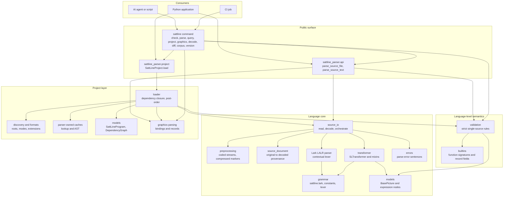

# sattline-parser documentation

This directory is the durable context for anyone, human or AI agent, working on
`sattline-parser`. It documents the language infrastructure that the package
owns. It does not describe how a consumer should analyse a SattLine program.

## What this package is

`sattline-parser` is **language infrastructure** for the SattLine PLC language.
It answers "what is in this source, and how is it structured?". It does not
answer "is this program good?", "what does this program do?", or "which
variables are never used?".

A SattLine program or library is one unit made of three files: the code body,
the dependency sidecar, and the graphics companion. Draft is `.s`, `.l`, `.g`;
official is `.x`, `.z`, `.y`. See
[project.md](project.md#artifact-formats) for how each role is resolved.

| Responsibility | Owned by | Entry point |
| --- | --- | --- |
| Grammar and tokenization | `grammar/` | `create_parser`, `SLTransformer` |
| Compressed-source preprocessing and source provenance | `preprocessing/`, `source_document.py` | `preprocess_source`, `SourceDocument` |
| AST models and transformation | `models/`, `transformer/` | `BasePicture`, `SLTransformer` |
| Syntax diagnostics | `errors.py` | `describe_parse_error` |
| Graphics file parsing and data models | `project/graphics_*.py`, `project/models.py` | `parse_graphics_file`, `GraphicsModel` |
| SattLine project discovery | `project/discovery.py`, `project/formats.py` | `ProjectLookup` |
| Draft/official resolution | `project/formats.py` | `LoadMode` |
| Dependency resolution and project loading | `project/loader.py`, `project/project.py` | `SattLineProject.load` |
| Language-level structural validation | `validation/` | `validate_basepicture` |
| Scalar type facts and literal inference | `validation/typing.py`, `types.py` | `sattline_parser.types` |
| Generic parser and project introspection | `cli/` | the `sattline` command |

### What it deliberately does not own

- Semantic analysis, lint policy, metrics, refactoring, or code generation.
- Cross-project business rules beyond the language-level contract and the
  dependency graph.
- Graphics correlation, asset verification, or rendering. The graphics model
  is parsed data, not a validated UI description.
- A compiler, interpreter, or runtime. The AST preserves what the source says,
  including constructs whose effect is not modelled.

The boundary is enforced by imports: `sattline-parser` never imports a consumer
tool, and its layers only point downward. See [architecture.md](architecture.md).

```mermaid
flowchart LR
    subgraph OWNED["Owned by sattline-parser"]
        G["grammar and tokenization"]
        S["source decoding and provenance"]
        A["AST and transformation"]
        D["syntax diagnostics"]
        GR["graphics parsing"]
        P["project discovery and loading"]
        V["language-level validation"]
        I["parser and project introspection"]
    end

    subgraph CONSUMER["Owned by the consumer"]
        L["lint policy and metrics"]
        R["refactoring and code generation"]
        C["graphics correlation and rendering"]
        B["business and machine rules"]
    end

    OWNED -->|"facts, spans, diagnostics, graphs"| CONSUMER
    CONSUMER -.->|"must not import back"| OWNED
```

## Reading paths

| If you need to | Read |
| --- | --- |
| Understand the whole package in ten minutes | this file, then [architecture.md](architecture.md) |
| Change or debug parsing | [parse-pipeline.md](parse-pipeline.md), [grammar.md](grammar.md) |
| Work on source positions or compressed files | [source-provenance.md](source-provenance.md) |
| Change the AST or transformer | [ast.md](ast.md), [transformer.md](transformer.md) |
| Add or change validation rules | [validation.md](validation.md) |
| Work on project loading or dependencies | [project.md](project.md) |
| Work on graphics companions | [graphics.md](graphics.md) |
| Change the CLI or JSON output | [cli.md](cli.md) |
| Change builtin signatures or record fields | [builtins.md](builtins.md) |
| Run tests, fuzzing, or CI | [testing.md](testing.md) |
| Set up the repository and follow its workflow | [development.md](development.md) |
| See the stable import surface | [api.md](api.md) |
| Look up a term | [glossary.md](glossary.md) |

## Workspace tooling

The repository ships an OpenCode workspace in `.opencode/`:

- the `sattline-parser` skill, with the map, recipes, and verification ladder;
- `/verify`, `/release`, and `/review` commands;
- the read-only `parser-reviewer` subagent.

The pull request template is at `.github/pull_request_template.md`.
`scripts/check_docs.py` and the Docs workflow gate links, prose punctuation, and
Mermaid rendering. See [development.md](development.md) for the local setup.

## The package in one diagram

## Core invariants

1. **Strict, no silent fallback.** An unknown compressed marker raises
   `PreprocessError`. A source that does not parse raises. A project load
   failure raises under `strict=True`, and a skipped program under
   `strict=False` is recorded as a `LOAD_SKIPPED` diagnostic. Nothing is
   silently dropped.
2. **Positions always refer to the original source.** Even when a file is
   decoded from a coded stream or expanded from compressed markers, every
   `SourceSpan`, diagnostic, and parse error points into the bytes the user
   supplied.
3. **One grammar is canonical.** `src/sattline_parser/grammar/sattline.lark` is
   the single grammar. `constants.py` supplies its placeholders, and
   `keywords.py` applies case-insensitive keyword matching. The parser cache
   key includes the resolved grammar fingerprint, so a grammar change cannot
   be served a stale cache.
4. **The AST is data, not policy.** The transformer preserves structure,
   spelling, comments, and source order. Validation lives in `validation/` and
   is opt-in through `parse_and_validate` or the project loader.
5. **The CLI adds no semantics.** Every command maps onto a documented library
   call and emits one finding shape. Exit codes are the contract.
6. **Layers point downward.** `source_io` imports neither `api` nor `project`,
   so the project layer can build on it without a cycle. The project layer may
   import the parser core. The public `api` façade re-exports both.

## Documentation maintenance

This repository is maintained by AI agents. Treat these documents as part of
the product:

- When a public behaviour changes, update the matching document in the same
  change.
- When a new module or subpackage is added, add it to
  [architecture.md](architecture.md) and to the repo map in `AGENTS.md`.
- When a rule, diagnostic code, or JSON schema changes, update
  [validation.md](validation.md) or [cli.md](cli.md).
- Keep Mermaid diagrams in sync with the import graph. A diagram that lies is
  worse than no diagram. `python scripts/check_docs.py` checks links and prose,
  and the Docs workflow renders every diagram.
- Follow `AGENTS.md` for writing style: no dashes used as punctuation, describe
  behaviour rather than origin, and keep the public tree free of third-party
  identifiers.
