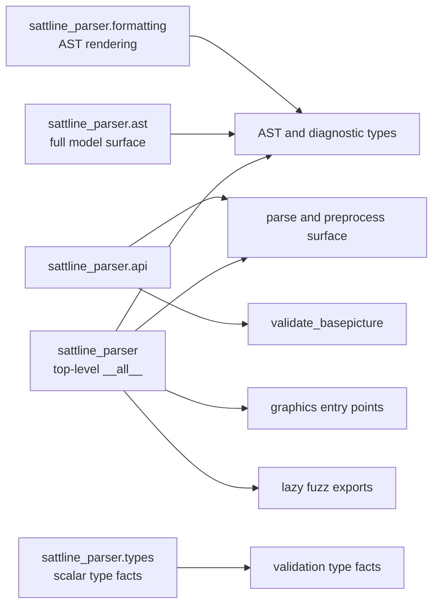

# Public API

The supported public surface is the names listed in
`sattline_parser.__all__`, `sattline_parser.api.__all__`,
`sattline_parser.ast.__all__`, `sattline_parser.models.__all__`,
`sattline_parser.types.__all__`, `sattline_parser.formatting.__all__`,
`sattline_parser.validation.__all__`, `sattline_parser.project.__all__`, and
`sattline_parser.builtins.__all__`, plus the documented `sattline` command and
its JSON schemas. Submodule paths not listed there are internal and may change
between releases.

## Import doors



Use the top-level package for ordinary parsing. Use `sattline_parser.api` when
you want the parser pipeline in one import. Use `sattline_parser.ast` when you
need the model itself. Use `sattline_parser.types` for scalar type facts and
literal inference, and `sattline_parser.formatting` to render expressions and
statements.

## Parse and preprocess

| Name | Exported from | Signature summary | Returns |
| --- | --- | --- | --- |
| `parse_source_text` | both | `(src, *, parser=None, transformer=None, debug=None, source_path=None, log_failures=True)` | `BasePicture` |
| `parse_source_file` | both | `(path, *, parser=None, transformer=None, debug=None, log_failures=True)` | `BasePicture` |
| `parse_and_validate` | both | same options as `parse_source_text` | `(BasePicture, tuple[Diagnostic, ...])` |
| `create_parser` | both | `()` | `Lark` |
| `build_lark_parser` | `api` | `(*, start="start", propagate_positions=True)` | `Lark` |
| `describe_parse_error` | both | `(exc, source_text, *, source_document=None)` | `ParseErrorDetails` |
| `SourceTooDeepError` | both | `(limit, *, line=None, column=None, pos_in_stream=None)` | `UnexpectedInput` subclass for an over-deep structure |
| `MAX_SOURCE_DEPTH` | both | `256` | Maximum structural depth accepted by `parse_source_text` |
| `is_compressed` | top-level | `(text)` | `bool` |
| `preprocess_source` | top-level | `(text)` | `SourceDocument` |
| `preprocess_sl_text` | top-level | `(text)` | `(decoded_text, marker_mapping)` |
| `render_ide_text` | both | `(text)` | `str` with CRLF and IDE-safe lines |
| `decode_source_bytes` | `api` | `(raw_bytes, *, debug=None, source_path=None, log_failures=True)` | decoded `str` |
| `load_source_text` | `api` | `(path, *, debug=None)` | decoded `str` |
| `read_text_cp1252` | `api` | `(path)` | strict cp1252 `str` |
| `source_text_for_parse` | `api` | `(path, *, debug=None, log_failures=True)` | text for `parse_source_text` |

`parse_source_text` and `parse_source_file` are the ordinary entry points.
`parse_and_validate` is the opt-in single-source validation. The rest are
power-user helpers for tooling that needs an intermediate stage.

## Validation

| Name | Signature summary | Returns |
| --- | --- | --- |
| `validate_basepicture` | `(bp, *, external_datatypes=(), external_moduletype_defs=(), allow_unresolved_external_datatypes=False)` | `tuple[Diagnostic, ...]` |
| `Diagnostic` | dataclass `(code, message, span=None, tentative=False)` | value |
| `DiagnosticCode` | `StrEnum` of stable `SL-V###` ids | value |

`validate_basepicture` is re-exported by both `sattline_parser` and
`sattline_parser.api`. The `Diagnostic` type and codes are re-exported by
`sattline_parser`.

### Rule registry

`validation/rules.py` gives every `DiagnosticCode` one `Rule` with an id, enum
name, scope, status, summary, and optional details. The
registry is exported from `sattline_parser.validation`:

| Name | Signature summary | Returns |
| --- | --- | --- |
| `RULES` | tuple of every rule, in enum order | `tuple[Rule, ...]` |
| `RULES_BY_ID`, `RULES_BY_NAME` | case-folded id and name lookups | `dict[str, Rule]` |
| `find_rule` | `(value)` accepts `SL-V019` or `UNDEFINED_VARIABLE` | `Rule | None` |
| `Rule` | metadata dataclass with derived `id`, `name`, `status`, `enabled` | value |
| `RuleScope` | `DECLARATIONS`, `CODE`, `SFC`, `MAPPINGS`, `PROJECT` | `StrEnum` |
| `RuleStatus` | `ACTIVE`, `RETIRED`, `UNIMPLEMENTED` | `StrEnum` |

The registry is metadata, not an execution switch. `validate_basepicture` still
runs the full strict pass; `sattline rules` and the documentation table read the
registry. `RETIRED_CODES` is derived from it.

## Type facts

`sattline_parser.types` is the public door for the scalar type facts the parser
and its validation share. It re-exports the pure inference, normalization, and
compatibility helpers from the validation layer. Expression typing that needs a
validation scope stays internal behind `validate_basepicture`.

| Group | Names |
| --- | --- |
| Core type | `Simple_DataType` |
| Families | `TypeFamily`, `datatype_family`, `family_of`, `is_numeric`, `is_numeric_datatype`, `is_boolean`, `is_boolean_datatype`, `is_string_simple_type`, `is_anytype_datatype` |
| Datatype names | `normalize_builtin_datatype`, `format_datatype`, `suggest_datatype_name` |
| Dotted names and records | `split_dotted_name`, `resolve_variable_field_datatype`, `FieldGraph`, `FieldSpec` |
| Literals | `infer_literal_datatype`, `literal_matches_expected_datatype`, `is_valid_duration_literal`, `is_valid_time_literal`, `has_time_literal_marker`, `extract_time_literal`, `expression_is_zero_literal` |
| Compatibility | `assignment_type_matches`, `builtin_type_matches`, `merge_numeric_types`, `merge_compatible_types` |

`infer_literal_datatype` returns `Simple_DataType | str | None`. A time literal
returns the grammar marker string `"Time_Value"`, not `Simple_DataType.TIME`,
because the marker is compared against the declared datatype before the value
is parsed. Use `has_time_literal_marker`, or compare through
`literal_matches_expected_datatype`, when the distinction matters.

`FieldGraph` is the structural protocol for a record graph. A consumer's own
graph passes to `resolve_variable_field_datatype` when it exposes
`field(record_type, field_name)`. `FieldSpec` is the field result, which exposes
`datatype`. The base value is an `ast.Variable`.

## Formatting

`sattline_parser.formatting` renders AST values in a readable SattLine-like
notation. `formatting/formatter.py` adds no dependency of its own beyond the AST
expression nodes, so a consumer can use it for message text without adopting a
validation API. The supported contract covers the function names and their
documented signatures; the exact rendered string is display output, not a
serialization format.

| Name | Signature summary | Returns |
| --- | --- | --- |
| `format_expr` | `(expr, indent="    ")` | expression or statement text |
| `format_list` | `(items, indent="    ", align_variables=True, inline_if_singleline=False)` | list text |
| `format_optional` | `(obj)` | `str(obj)` or `"None"` |
| `format_seq_nodes` | `(nodes, indent="    ")` | sequence text |

## AST types

`sattline_parser.ast` is the supported model surface. It re-exports every node,
clause payload, and tail type together with the traversal helpers:

| Name | Meaning |
| --- | --- |
| `BasePicture` | Root node |
| `SourceSpan` | Original-source range |
| `ModuleHeader`, `ModuleDef`, `ModuleCode`, `SingleModule`, `FrameModule`, `ModuleTypeInstance`, `ModuleTypeDef` | Module and layout nodes |
| `Sequence`, `Equation`, `SFCStep`, `SFCTransition`, and the other `SFC*` nodes | Code and SFC nodes |
| `Variable`, `DataType`, `ParameterMapping`, `MappingSource` | Declarations |
| `GraphObject`, `InteractObject` | Graphics and interact AST nodes, visited by `walk` |
| `GraphicsBinding` | Project graphics value carried by `GraphicsModel.bindings`; not an AST node and never visited by `walk` |
| `GraphProperties`, `InteractProperties` | Typed property maps carried by graphics and interact nodes |
| `AssignClause`, `EnableClause`, `TailedClause`, `ColourSpec`, `PickButton`, `Alignment`, `InteractBodyEntry`, and the other clause payloads | Typed clause payloads and the interactor body union |
| `VarTail`, `LitStringTail`, `Tail` | Bound and computed tails |
| `walk` | `(node, *, prune=None, emit_leave=False)` yields every AST node in pre-order |
| `NodeVisitor` | `visit_<ClassName>` and `leave_<ClassName>` dispatch with `generic_visit` |
| `WalkEvent` | `(node, relation, parents, field, indices, phase)` for one visit; `parents` is a sequence view expanded on access and costs O(depth) per read |
| `iter_child_nodes` | `(node)` yields `(relation, child)` pairs |
| `iter_literal_leaves` | `(node)` yields `LiteralLeaf(relation, field, indices, value)` for the literal values a node holds |

The top-level package keeps the root, span, expression, statement, and walker
names for short scripts, and exports `SLTransformer`. The full model, including
module, SFC, graphics, declaration, clause, and tail types, is published by
`sattline_parser.ast`. The class names are still importable from
`sattline_parser.models.ast_model` and `sattline_parser.models.expressions` for
historical reasons, but the supported import path is `sattline_parser.ast`. See
[ast.md](ast.md).

## Graphics

| Name | Signature summary | Returns |
| --- | --- | --- |
| `parse_graphics_text` | `(text)` | `GraphicsModel` |
| `parse_graphics_file` | `(path)` | `GraphicsModel` |
| `resolve_graphics_companion_path` | `(code_path, *, mode)` | `Path | None` |

These live in `sattline_parser.project` and are re-exported by
`sattline_parser`, not by `sattline_parser.api`.

## Fuzz exports

The fuzz names are lazy attributes on `sattline_parser`:

- `fuzz_harness`
- `FuzzResult`
- `assert_no_crashes`
- `assert_no_timeouts`
- `collect_corpus_inputs`
- `fuzz_parse_text`
- `generate_random_text`
- `run_random_fuzz`
- `run_corpus_regression`

They are imported on first access so the fuzz subprocess machinery is not part
of the ordinary import cost. See [testing.md](testing.md).

## Project surface

`sattline_parser.project.__all__` is the public project layer:

| Group | Names |
| --- | --- |
| Loading | `SattLineProject`, `ProjectLoader`, `LoadMode`, `LoadValidation` |
| Models | `SattLineProgram`, `DependencyGraph`, `ProgramFormat`, `SidecarState` |
| Diagnostics | `LoadDiagnostic`, `LoadDiagnosticKind` |
| Errors | `ProjectLoadError`, `ArtifactLoadError`, `DependencyNotFoundError`, `DependencyParseError` |
| Discovery | `ProjectLookup`, `SourceIndex`, `ordered_lookup_bases`, `shared_lookup_root_for` |
| Formats | `ArtifactKind`, `candidate_extensions`, `code_ext`, `code_ext_candidates`, `deps_ext`, `deps_ext_candidates`, `graphics_ext`, `graphics_ext_candidates`, `preferred_extension` |
| Graphics | `GraphicsModel`, `GraphicsBinding`, `GraphicsMessage`, `GraphicsCompositeRecord`, `GraphicsPictureDisplayRecord`, `GraphicsPathRow`, `parse_graphics_file`, `parse_graphics_text`, `resolve_graphics_companion_path` |
| Caches | `FileLookupCache`, `FileASTCache`, `LOOKUP_CACHE_VERSION`, `FILE_AST_CACHE_VERSION`, `DEFAULT_LOOKUP_CACHE_FLUSH_INTERVAL` |

See [project.md](project.md) for behaviour.

## Builtins surface

`sattline_parser.builtins.__all__` is the public language-facts surface:

| Group | Names |
| --- | --- |
| Functions | `BUILTIN_FUNCTIONS`, `BUILTIN_ALIASES`, `CATALOGUE_META`, `BuiltinFunction`, `BuiltinParameter`, `get_function_signature`, `is_builtin_function` |
| Records | `BUILTIN_RECORD_SPECS`, `BUILTIN_DECLARED_DATATYPE_NAMES`, `FIELDLESS_BUILTIN_RECORD_NAMES`, `OPAQUE_BUILTIN_RECORD_NAMES`, `BuiltinFieldSpec` |

See [builtins.md](builtins.md) for the catalogue and its provenance rules.

## Versioning

Releases use calendar versioning (`YYYY.M.N`). The version orders releases; it
does not encode semantic-version compatibility.

Within the supported surface:

- Patch releases preserve existing names and behaviour.
- A breaking change is called out in the changelog and removed in that release.
  There is no deprecation window and no compatibility shim.
- Adding a dataclass field is not breaking.
- Removing or renaming a field is breaking.

## Examples

```python
from pathlib import Path

from sattline_parser import parse_and_validate, parse_source_file

base_picture = parse_source_file(Path("program.s"))
print(base_picture.program_name)

base_picture, diagnostics = parse_and_validate(source_text)
for diagnostic in diagnostics:
    print(diagnostic.code, diagnostic.message, diagnostic.span)
```

```python
from pathlib import Path

from sattline_parser.project import LoadMode, SattLineProject

project = SattLineProject.load(
    roots=[Path("programs"), Path("libs")],
    mode=LoadMode.DRAFT,
    targets=["MyProgram"],
    cache_dir=None,
)
program = project.get("MyProgram")
print(program.name, len(program.dependencies))
```

```python
from pathlib import Path

from sattline_parser.project import parse_graphics_file

model = parse_graphics_file(Path("drawing.y"))
print(len(model.bindings), len(model.errors))
```

## Stability boundary

If a name is not in one of the `__all__` lists above, treat it as internal even
when it is importable. The project layer, the CLI helpers, and the transformer
mixins are deliberately reachable for testing, but their paths and signatures
are not a compatibility promise.
