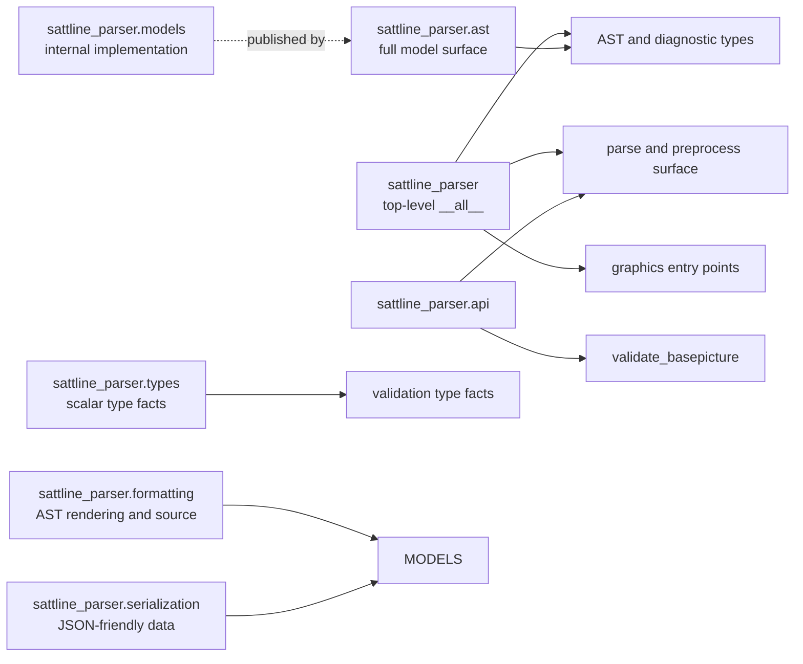

# Public API

The supported public surface is the names listed in
`sattline_parser.__all__`, `sattline_parser.api.__all__`,
`sattline_parser.ast.__all__`, `sattline_parser.types.__all__`,
`sattline_parser.formatting.__all__`, `sattline_parser.serialization.__all__`,
`sattline_parser.preprocessing.__all__`, `sattline_parser.validation.__all__`,
`sattline_parser.project.__all__`, and `sattline_parser.builtins.__all__`, plus
the documented `sattline` command and its JSON schemas. Submodule paths not
listed there are internal and may change between releases. The modules under
`sattline_parser.models` are internal implementation modules: import the model
through `sattline_parser.ast`, which publishes it.

## Import doors



Use the top-level package for ordinary parsing. Use `sattline_parser.api` when
you want the parser pipeline in one import; the graphics and distribution entry
points on the top-level package are lazy, so this import does not load
`sattline_parser.project`. Use `sattline_parser.ast` when you
need the model itself. Use `sattline_parser.types` for scalar type facts and
literal inference, `sattline_parser.formatting` to render expressions, statements,
and whole files, and `sattline_parser.serialization` to turn the model into
JSON-friendly data.

## Parse and preprocess

| Name | Exported from | Signature summary | Returns |
| --- | --- | --- | --- |
| `parse_source_text` | both | `(src, *, parser=None, transformer=None, debug=None, source_path=None, log_failures=True)` | `BasePicture` |
| `parse_source_file` | both | `(path, *, parser=None, transformer=None, debug=None, log_failures=True)` | `BasePicture` |
| `parse_source_bytes` | both | `(raw_bytes, *, parser=None, transformer=None, debug=None, source_path=None, log_failures=True)` | `BasePicture` |
| `parse_and_validate` | both | same options as `parse_source_text`, plus `external_datatypes=()`, `external_moduletype_defs=()`, `allow_unresolved_external_datatypes=False` | `(BasePicture, tuple[Diagnostic, ...])` |
| `create_parser` | both | `()` | `Lark` |
| `build_lark_parser` | `api` | `(*, start="start", propagate_positions=True)` | `Lark` |
| `describe_parse_error` | both | `(exc, source_text=None, *, source_document=None)` | `ParseErrorDetails`; with `source_text=None` the position is kept and no excerpt is produced |
| `PARSE_FAILURES` | `api` | tuple of exception types | the invalid-input contract: `UnexpectedInput`, `ValueError`, `UnicodeError`, `OSError` |
| `source_line_at` | `api` | `(source_text, line)` | the original source line, split at CRLF, LF, or a lone CR |
| `SourceTooDeepError` | both | `(limit, *, line=None, column=None, pos_in_stream=None)` | `UnexpectedInput` subclass for an over-deep structure |
| `MAX_SOURCE_DEPTH` | both | `256` | Maximum structural depth accepted by `parse_source_text` |
| `is_compressed` | top-level | `(text)` | `bool` |
| `preprocess_source` | top-level | `(text)` | `SourceDocument` |
| `SourceDocument` | `preprocessing` | `(original_text, normalized_text, char_map=None)` | provenance object with the read-only `char_map` property (`None` for an identity document), `map_position`, `map_range`, `line_col`, and `is_decoded_range` |
| `preprocess_sl_text` | top-level | `(text)` | `(decoded_text, marker_mapping)` |
| `render_ide_text` | both | `(text)` | `str` with CRLF and IDE-safe lines |
| `decode_source_bytes` | `api` | `(raw_bytes, *, debug=None, source_path=None, log_failures=True)` | decoded `str` |
| `load_source_text` | `api` | `(path, *, debug=None)` | decoded `str` |
| `read_text_cp1252` | `api` | `(path)` | strict cp1252 `str` |
| `source_text_for_parse` | `api` | `(path, *, debug=None, log_failures=True)` | text for `parse_source_text` |

`parse_source_text` and `parse_source_file` are the ordinary entry points.
`parse_source_bytes` is for a caller that already read the source and needs to
keep the exact bytes it parsed, such as the project cache, which identifies an
entry by their digest. `parse_and_validate` is the opt-in single-source
validation. `preprocess_source`
returns a `SourceDocument`, and the class itself is importable from
`sattline_parser.preprocessing`. The rest are power-user helpers for tooling
that needs an intermediate stage.

### Exception contract

`PARSE_FAILURES` separates invalid source from a defect. Catch it when a failure
should become a finding or a diagnostic:

| Group | Covers |
| --- | --- |
| `UnexpectedInput` | grammar, matcher, transform rejection, and `SourceTooDeepError` |
| `ValueError` | preprocessing, coded-stream, and transformer value errors (`PreprocessError` is one) |
| `UnicodeError` | an undecodable byte outside a comment body |
| `OSError` | an unreadable file |

Anything else is a defect in the parser or the caller's transformer, and
propagates instead of being reported as a broken source. In particular,
`RuntimeError` (a transformer returning the wrong type) is not part of the
contract. Catch `PARSE_FAILURES` rather than testing exception types by name.

`source_line_at` is the excerpt lookup every diagnostic uses. It splits at
CRLF, LF, or a lone CR, the same line-break definition the grammar and
`SourceDocument.line_col` use, so a CR-only document reports the quoted line it
reports the number for. A form feed or a vertical tab is content, not a line
break.

## Grammar vocabulary

| Name | Exported from | Description |
| --- | --- | --- |
| `constants` | top-level | Module of `Final` grammar constants: terminal names, tree tags, property-map keys, and grammar values used by the lexer and transformer |

## Validation

| Name | Signature summary | Returns |
| --- | --- | --- |
| `validate_basepicture` | `(bp, *, external_datatypes=(), external_moduletype_defs=(), allow_unresolved_external_datatypes=False)` | `tuple[Diagnostic, ...]` |
| `Diagnostic` | dataclass `(code, message, span=None)` | value |
| `DiagnosticCode` | `StrEnum` of stable `SL-V###` ids | value |

`validate_basepicture` is re-exported by both `sattline_parser` and
`sattline_parser.api`. The `Diagnostic` type and codes are re-exported by
`sattline_parser`.

### Rule registry

`validation/rules.py` gives every `DiagnosticCode` one `Rule` with an id, enum
name, scope, status, summary, and optional details. The
registry is exported from `sattline_parser.validation`:

| Name | Signature summary | Returns |
| --- | --- | --- |
| `RULES` | tuple of every rule, in enum order | `tuple[Rule, ...]` |
| `RULES_BY_ID`, `RULES_BY_NAME` | case-folded id and name lookups | `dict[str, Rule]` |
| `RULES_BY_CODE` | lookup by `DiagnosticCode` member | `dict[DiagnosticCode, Rule]` |
| `find_rule` | `(value)` accepts `SL-V019` or `UNDEFINED_VARIABLE` | `Rule`, or `None` |
| `require_rule` | `(value)` like `find_rule`, but raises `UnknownRuleError` | `Rule` |
| `UnknownRuleError` | raised for an unknown id or name; carries close matches | `ValueError` subclass |
| `render_markdown_table` | `(*, include_retired=True)` renders the registry as Markdown | `str` |
| `Rule` | metadata dataclass with status, and derived `id`, `name`, `enabled` | value |
| `RuleScope` | `DECLARATIONS`, `CODE`, `SFC`, `MAPPINGS`, `PROJECT` | `StrEnum` |
| `RuleStatus` | `ACTIVE`, `RETIRED`, `UNIMPLEMENTED` | `StrEnum` |

The registry is metadata, not an execution switch. `validate_basepicture` still
runs the full strict pass; `sattline rules` and the documentation table read the
registry, and `render_markdown_table` produces the table in
[validation.md](validation.md). `RETIRED_CODES` is derived from it.

## Type facts

`sattline_parser.types` is the public door for the scalar type facts the parser
and its validation share. It re-exports the pure inference, normalization, and
compatibility helpers from the validation layer. Expression typing that needs a
validation scope stays internal behind `validate_basepicture`.

| Group | Names |
| --- | --- |
| Core type | `ScalarDatatype` |
| Families | `TypeFamily`, `datatype_family`, `family_of`, `is_numeric`, `is_numeric_datatype`, `is_boolean`, `is_boolean_datatype`, `is_string_simple_type`, `is_anytype_datatype` |
| Datatype names | `normalize_builtin_datatype`, `format_datatype`, `suggest_datatype_name` |
| Dotted names and records | `split_dotted_name`, `resolve_variable_field_datatype`, `FieldGraph`, `FieldSpec` |
| Literals | `infer_literal_datatype`, `literal_matches_expected_datatype`, `is_valid_duration_literal`, `is_valid_time_literal`, `has_time_literal_marker`, `extract_time_literal`, `expression_is_zero_literal` |
| Compatibility | `assignment_type_matches`, `builtin_type_matches`, `merge_numeric_types`, `merge_compatible_types` |

`infer_literal_datatype` returns `ScalarDatatype | str | None`. A time literal
returns the grammar marker string `"Time_Value"`, not `ScalarDatatype.TIME`,
because the marker is compared against the declared datatype before the value
is parsed. Use `has_time_literal_marker`, or compare through
`literal_matches_expected_datatype`, when the distinction matters.

`FieldGraph` is the structural protocol for a record graph. A consumer's own
graph passes to `resolve_variable_field_datatype` when it exposes
`field(record_type, field_name)`. `FieldSpec` is the field result, which exposes
`datatype`. The base value is an `ast.Variable`.

## Formatting

`sattline_parser.formatting` renders AST values in a readable SattLine-like
notation. `formatting/formatter.py` adds no dependency of its own beyond the AST
expression nodes, so a consumer can use it for message text without adopting a
validation API. The supported contract covers the function names and their
documented signatures; the exact rendered string is display output, not a
serialization format.

| Name | Signature summary | Returns |
| --- | --- | --- |
| `format_expr` | `(expr, indent="    ")` | expression or statement text |
| `format_list` | `(items, indent="    ", align_variables=True, inline_if_singleline=False)` | list text |
| `format_optional` | `(obj)` | `str(obj)` or `"None"` |
| `format_seq_nodes` | `(nodes, indent="    ")` | sequence text |
| `format_source` | `(picture, *, indent="    ")` | canonical source text for a whole `BasePicture` |
| `format_module` | `(module, *, indent="    ")` | source text for one `ModuleDef` block |
| `UnsupportedFormattingError` | `(message)` | raised when a hand-built model carries a tail without its position |

`format_source` renders a parsed file back to canonical SattLine source that
parses to an equal tree. It is a formatter, not a lossless printer: whitespace
and numeric spelling are normalised, and the model keeps structure rather than
layout. Every parsed fixture in the corpus round-trips, including graphics,
interactor bodies, coordinate tails, clipping tails, and falsy parameter
mappings.

A parsed model always records where a tail was written: `ModuleHeader.coordinate_tails`,
`ClippingClause.corner_tails`, `GraphObject.properties["coord_tails"]`, and
`InteractProperties["coord_tails"]` group the tails per value. The formatter
raises `UnsupportedFormattingError` for three shapes it cannot place or spell:

| Shape | Why |
| --- | --- |
| a hand-assembled model with a tail but no positional grouping | the value the tail followed is unknown |
| a parameter mapping with no source literal | the written literal is absent from the model |
| a `time_value` payload with more than one key | the written keyword is not modelled |

The output is display text, not a supported interchange format.

## Serialization

`sattline_parser.serialization` turns the model into JSON-friendly data, so a
consumer does not need its own walker. The conversion is structural: every
dataclass field is emitted under its own name, so a model field appears without
a serializer change. The output is a data view, not a supported file format;
the documented JSON schemas of the CLI are the stable contract.

| Name | Signature summary | Returns |
| --- | --- | --- |
| `to_jsonable` | `(value, *, depth=None)` | plain `dict`/`list`/scalar data |
| `to_json` | `(value, *, depth=None, compact=False)` | JSON text |

`to_jsonable` and `to_json` are re-exported by `sattline_parser`. Scalars, enums,
paths, and `SourceSpan` values are emitted in full; dataclasses and containers
recurse. `depth` counts composite levels, and at the limit a composite value
becomes a placeholder such as `"<ModuleDef>"` or `"<12 items>"` instead of
disappearing. `None`, the default, means no limit. A `WalkEvent` serialises with
its `parents` expanded, so serialise `event.node` when only the node matters.

A literal is emitted as its plain number, because `IntLiteral` and `FloatLiteral`
are `int` and `float` subclasses. `span`, `clamped`, and `written` are model
attributes for source text and provenance and are deliberately absent from the
data view; read them on the model when the spelling matters. See
[ast.md](ast.md#serialization-and-pickling).

## AST types

`sattline_parser.ast` is the supported model surface. It re-exports every node,
clause payload, and tail type together with the traversal helpers:

| Name | Meaning |
| --- | --- |
| `BasePicture` | Root node |
| `HeaderInfo` | The quoted file header lines and change description on `BasePicture.header_info` |
| `SourceSpan` | Original-source range |
| `ModuleHeader`, `ModuleDef`, `ModuleCode`, `SingleModule`, `FrameModule`, `ModuleTypeInstance`, `ModuleTypeDef` | Module and layout nodes |
| `Sequence`, `Equation`, `SFCStep`, `SFCTransition`, and the other `SFC*` nodes | Code and SFC nodes |
| `Variable`, `DataType`, `ParameterMapping`, `MappingSource` | Declarations |
| `GraphObject`, `InteractObject` | Graphics and interact AST nodes, visited by `walk` |
| `GraphicsBinding` | Project graphics value carried by `GraphicsModel.bindings`; not an AST node and never visited by `walk` |
| `GraphProperties`, `InteractProperties` | Typed property maps carried by graphics and interact nodes |
| `interactor_property_catalogue`, `find_interactor_property`, `typed_interactor_properties`, `InteractorPropertySpec`, `TypedInteractorProperty`, `InteractorPropertyKind` | The catalogue of interactor spellings the grammar accepts as generic flags and assignments |
| `PolygonPoint` | One polygon coordinate pair with the tails written after each value |
| `AssignClause`, `EnableClause`, `TailedClause`, `ColourSpec`, `PickButton`, `Alignment`, `InteractBodyEntry`, and the other clause payloads | Typed clause payloads and the interactor body union |
| `VarTail`, `LitStringTail`, `Tail` | Bound and computed tails |
| `walk` | `(node, *, prune=None, emit_leave=False)` yields one `WalkEvent` per AST node in pre-order |
| `NodeVisitor` | `visit_<ClassName>` and `leave_<ClassName>` dispatch with `generic_visit` |
| `WalkEvent` | `(node, relation, parents, field, indices, phase)` for one visit; `parents` is a sequence view expanded on access and costs O(depth) per read |
| `iter_child_nodes` | `(node)` yields `(relation, child)` pairs |
| `iter_literal_leaves` | `(node)` yields `LiteralLeaf(relation, field, indices, value)` for the literal values a node holds |

The top-level package keeps the root, span, expression, statement, and walker
names for short scripts, and exports `SLTransformer`. The full model, including
module, SFC, graphics, declaration, clause, and tail types, is published by
`sattline_parser.ast`. The modules under `sattline_parser.models` are internal
implementation modules: the package imports from them, but they are not a
supported surface and their names may change with the model. Import through
`sattline_parser.ast`. See [ast.md](ast.md).

## Graphics

| Name | Signature summary | Returns |
| --- | --- | --- |
| `parse_graphics_text` | `(text)` | `GraphicsModel` |
| `parse_graphics_file` | `(path)` | `GraphicsModel` |
| `resolve_graphics_companion_path` | `(code_path, *, mode)` | `Path | None` |

These live in `sattline_parser.project` and are re-exported by
`sattline_parser`, not by `sattline_parser.api`.

## Distribution

| Name | Signature summary | Returns |
| --- | --- | --- |
| `parse_distribution_text` | `(text)` | `DistributionData` |
| `parse_distribution_file` | `(path)` | `DistributionData` |
| `resolve_distribution_companion_path` | `(code_path, *, mode)` | `Path | None` |

These live in `sattline_parser.project` and are re-exported by
`sattline_parser`, not by `sattline_parser.api`. A companion is resolved beside
the body, never through the ordered root list.

## Fuzz tooling

The fuzz harness and Atheris targets live under the repository-local `fuzzing/`
package. They are not part of `sattline_parser` and are not shipped in the
wheel, and the top-level package does not re-export them. Import
`fuzzing.fuzz_harness` from a repository checkout. See [testing.md](testing.md).

## Project surface

`sattline_parser.project.__all__` is the public project layer:

| Group | Names |
| --- | --- |
| Loading | `SattLineProject` (including `from_programs`), `ProjectLoader`, `LoadMode`, `LoadValidation` |
| Models | `SattLineProgram`, `DependencyGraph`, `ProgramFormat`, `SidecarState` |
| Identity | `UnitIdentity`, `ArtifactIdentity` |
| Index | `ProjectIndex`, `DefinitionSite`, `UsageSite`, `SymbolKind`, `invoked_moduletypes` |
| Diagnostics | `LoadDiagnostic`, `LoadDiagnosticKind` |
| Errors | `ProjectLoadError`, `StructuralProjectError`, `DependencyCycleError`, `ModuleTypeCycleError`, `ArtifactLoadError`, `DependencyNotFoundError`, `DependencyParseError` |
| Discovery | `ProjectLookup`, `SourceIndex`, `ordered_lookup_bases`, `parse_search_path`, `read_dependency_names` |
| Formats | `ArtifactKind`, `body_mode`, `candidate_extensions`, `code_ext`, `code_ext_candidates`, `deps_ext`, `deps_ext_candidates`, `deps_extensions_for_code`, `distribution_ext`, `distribution_ext_candidates`, `distribution_extensions_for_code`, `find_companion_beside`, `graphics_ext`, `graphics_ext_candidates`, `preferred_extension` |
| Graphics | `GraphicsModel`, `GraphicsBinding`, `GraphicsMessage`, `GraphicsCompositeRecord`, `GraphicsPictureDisplayRecord`, `GraphicsPathRow`, `GraphicsParseError`, `MAX_GRAPHICS_COMPANION_BYTES`, `parse_graphics_file`, `parse_graphics_text`, `resolve_graphics_companion_path` |
| Distribution | `DistributionData`, `DistributionTarget`, `DistributionParseError`, `parse_distribution_file`, `parse_distribution_text`, `resolve_distribution_companion_path` |
| Caches | `FileLookupCache`, `FileASTCache`, `LOOKUP_CACHE_VERSION`, `FILE_AST_CACHE_VERSION`, `DEFAULT_LOOKUP_CACHE_FLUSH_INTERVAL` |

`DistributionData` has `version`, `source_code_systems`, `executing_systems`, and
the derived `has_executing_system`. `SattLineProgram.has_executing_system` adds
the missing case: `None` when no companion was found. `DistributionParseError`
is a `ValueError` raised by the parser, not a `ProjectLoadError`; the loader
wraps it in `ArtifactLoadError` or `DependencyParseError`. See
[project.md](project.md#distribution-companion).

`ProjectLoadError` and its subclasses expose `program`, `dependency`, `path`,
and `source_line`. `path` is the artifact the failure is about, and
`source_line` is the failing line's text, bounded, when the raise site could
produce it. A body parse failure keeps the parser exception as `__cause__`, so
the `PARSE_FAILURES` contract and `describe_parse_error` apply to it. See
[project.md](project.md#load-failures).

`parse_graphics_file` raises `GraphicsParseError` (a `ValueError`) when a
companion exceeds `MAX_GRAPHICS_COMPANION_BYTES` (4 MiB). Both names are exported
from `sattline_parser.project`, so a caller can catch the refusal and check the
limit without importing an internal module; a companion at or under the limit
still reports its structural problems as `GraphicsMessage` values.

`SattLineProject.index` is a `ProjectIndex` answering "who defines X" through
`definitions_of(name)` and "who uses Y" through `usages_of(name)`, case
insensitively, with a `DefinitionSite` or `UsageSite` per place. See
[project.md](project.md#symbol-index).

`invoked_moduletypes(programs, targets, *, closure_of=None)` is the reachability
walk the loader uses to scope dependency validation. Its keys are the mapping
keys the caller supplied: the loader passes its plan-key registry, while a
caller that passes `SattLineProject.programs()` gets folded unit-name keys when
`closure_of` is omitted. Its values are module-type names folded with
`fold_identifier`. `closure_of(key)` must answer in the same key space as
`programs`; mixing the two modes returns an empty result rather than raising.

`parse_distribution_file`, `parse_distribution_text`, and
`resolve_distribution_companion_path` are also re-exported by the top-level
package, like their graphics counterparts.

See [project.md](project.md) for behaviour.

## Builtins surface

`sattline_parser.builtins.__all__` is the public language-facts surface:

| Group | Names |
| --- | --- |
| Functions | `BUILTIN_FUNCTIONS`, `BUILTIN_ALIASES`, `CATALOGUE_META`, `BuiltinFunction`, `BuiltinParameter`, `get_function_signature`, `is_builtin_function` |
| Records | `BUILTIN_RECORD_SPECS`, `BUILTIN_DECLARED_DATATYPE_NAMES`, `FIELDLESS_BUILTIN_RECORD_NAMES`, `OPAQUE_BUILTIN_RECORD_NAMES`, `BuiltinFieldSpec` |

See [builtins.md](builtins.md) for the catalogue and its provenance rules.

## Versioning

Releases use calendar versioning (`YYYY.M.N`). The version orders releases; it
does not encode semantic-version compatibility.

Within the supported surface:

- A breaking change is marked in the changelog and lands in the release that
  makes it. There is no deprecation window and no compatibility shim.
- A superseded field, alias, or name is removed in the release that replaces it,
  so read the changelog before upgrading across a breaking entry.
- Adding a dataclass field is not breaking.
- Removing or renaming a field is breaking.

## Examples

```python
from pathlib import Path

from sattline_parser import parse_and_validate, parse_source_file

path = Path("program.s")
base_picture = parse_source_file(path)
print(base_picture.program_name)

source_text = path.read_text(encoding="cp1252")
base_picture, diagnostics = parse_and_validate(source_text)
for diagnostic in diagnostics:
    print(diagnostic.code, diagnostic.message, diagnostic.span)
```

```python
from pathlib import Path

from sattline_parser.project import LoadMode, SattLineProject

project = SattLineProject.load(
    roots=[Path("programs"), Path("libs")],
    mode=LoadMode.DRAFT,
    targets=["MyProgram"],
    cache_dir=None,
    workers=1,
)
program = project.get("MyProgram")
print(program.name, len(program.dependencies))
```

`roots` is the loading path in search order. It holds one library per name: a
root whose directory name repeats an earlier root is shadowed and contributes
nothing. A later root with a different name still takes part, and an earlier
root wins when both hold a unit of the same name.

```python
from pathlib import Path

from sattline_parser.project import parse_graphics_file

model = parse_graphics_file(Path("drawing.y"))
print(len(model.bindings), len(model.errors))
```

## Stability boundary

If a name is not in one of the `__all__` lists above, treat it as internal even
when it is importable. The project layer, the CLI helpers, and the transformer
mixins are deliberately reachable for testing, but their paths and signatures
are not a compatibility promise.
