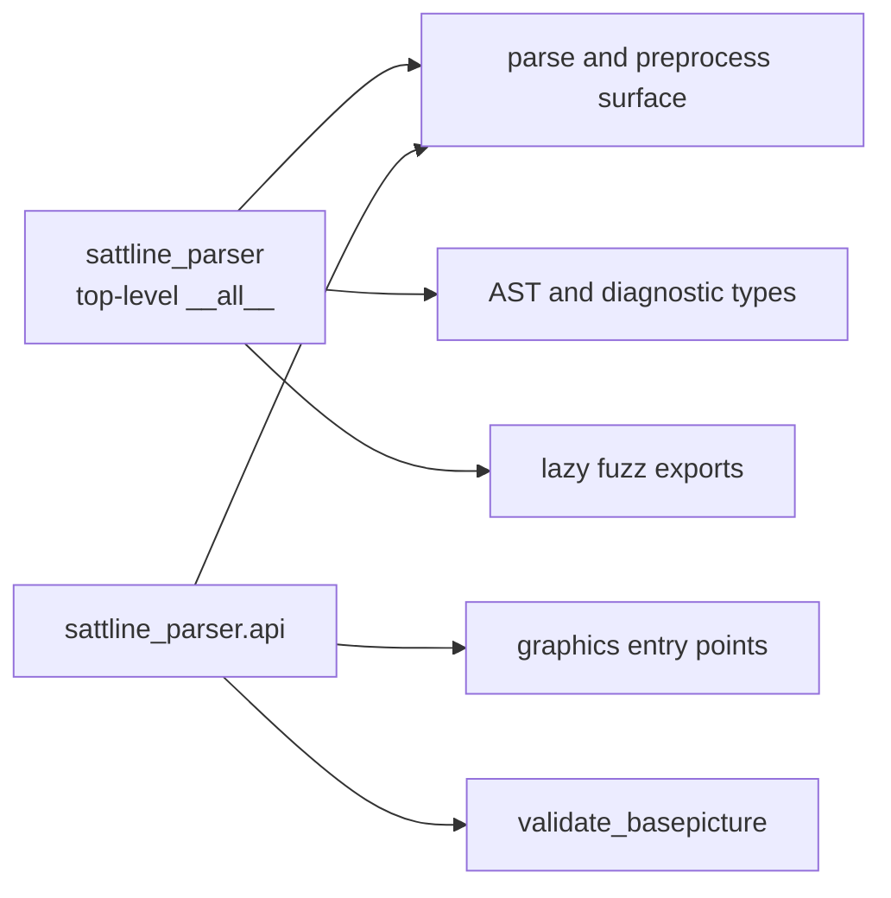

# Public API

The supported public surface is the names listed in
`sattline_parser.__all__`, `sattline_parser.api.__all__`,
`sattline_parser.models.__all__`, `sattline_parser.validation.__all__`,
`sattline_parser.project.__all__`, and `sattline_parser.builtins.__all__`, plus
the documented `sattline` command and its JSON schemas. Submodule paths not
listed there are internal and may change between releases.

## Two import doors



Use the top-level package for ordinary parsing. Use `sattline_parser.api` when
you want the parser pipeline and graphics entry points in one import.

## Parse and preprocess

| Name | Exported from | Signature summary | Returns |
| --- | --- | --- | --- |
| `parse_source_text` | both | `(src, *, parser=None, transformer=None, debug=None, source_path=None, log_failures=True, retain_parse_tree=False)` | `BasePicture` |
| `parse_source_file` | both | `(path, *, parser=None, transformer=None, debug=None, log_failures=True, retain_parse_tree=False)` | `BasePicture` |
| `parse_and_validate` | both | same options as `parse_source_text` | `(BasePicture, tuple[Diagnostic, ...])` |
| `create_parser` | both | `()` | `Lark` |
| `create_sl_parser` | both | `()` | `Lark` (compatibility alias) |
| `build_lark_parser` | `api` | `(*, start="start", propagate_positions=True)` | `Lark` |
| `describe_parse_error` | both | `(exc, source_text, *, source_document=None)` | `ParseErrorDetails` |
| `is_compressed` | top-level | `(text)` | `bool` |
| `preprocess_source` | top-level | `(text)` | `SourceDocument` |
| `preprocess_sl_text` | top-level | `(text)` | `(decoded_text, marker_mapping)` |
| `render_ide_text` | both | `(text)` | `str` with CRLF and IDE-safe lines |
| `decode_source_bytes` | `api` | `(raw_bytes, *, debug=None, source_path=None, log_failures=True)` | decoded `str` |
| `load_source_text` | `api` | `(path, *, debug=None)` | decoded `str` |
| `read_text_cp1252` | `api` | `(path)` | strict cp1252 `str` |
| `source_text_for_parse` | `api` | `(path, *, debug=None, log_failures=True)` | text for `parse_source_text` |

`parse_source_text` and `parse_source_file` are the ordinary entry points.
`parse_and_validate` is the opt-in single-source validation. The rest are
power-user helpers for tooling that needs an intermediate stage.

## Validation

| Name | Signature summary | Returns |
| --- | --- | --- |
| `validate_basepicture` | `(bp, *, external_datatypes=(), external_moduletype_defs=(), allow_unresolved_external_datatypes=False)` | `tuple[Diagnostic, ...]` |
| `Diagnostic` | dataclass `(code, message, severity=ERROR, span=None, tentative=False)` | value |
| `DiagnosticCode` | `StrEnum` of stable `SL-V###` ids | value |
| `DiagnosticSeverity` | `StrEnum` `ERROR`, `WARNING` | value |

`validate_basepicture` is re-exported by both `sattline_parser` and
`sattline_parser.api`. The `Diagnostic` type and codes are re-exported by
`sattline_parser`.

### Rule registry

`validation/rules.py` gives every `DiagnosticCode` one `Rule` with an id, enum
name, default severity, scope, status, summary, and optional details. The
registry is exported from `sattline_parser.validation`:

| Name | Signature summary | Returns |
| --- | --- | --- |
| `RULES` | tuple of every rule, in enum order | `tuple[Rule, ...]` |
| `RULES_BY_ID`, `RULES_BY_NAME` | case-folded id and name lookups | `dict[str, Rule]` |
| `find_rule` | `(value)` accepts `SL-V019` or `UNDEFINED_VARIABLE` | `Rule | None` |
| `Rule` | metadata dataclass with derived `id`, `name`, `status`, `enabled` | value |
| `RuleScope` | `DECLARATIONS`, `CODE`, `SFC`, `MAPPINGS`, `PROJECT` | `StrEnum` |
| `RuleStatus` | `ACTIVE`, `RETIRED`, `UNIMPLEMENTED` | `StrEnum` |

The registry is metadata, not an execution switch. `validate_basepicture` still
runs the full strict pass; `sattline rules` and the documentation table read the
registry. `RETIRED_CODES` is derived from it.

## AST types

The top-level package exports:

| Name | Meaning |
| --- | --- |
| `BasePicture` | Root node |
| `SourceSpan` | Original-source range |
| `SLTransformer` | The tree transformer |
| `Assignment`, `FuncCallStmt`, `IfStmt` | Statement nodes |
| `BinOp`, `BoolOp`, `Compare`, `NotOp`, `TernaryOp`, `UnaryOp` | Operator nodes |
| `FuncCall`, `VarRef` | Call and reference nodes |
| `SLExpression`, `SLStmt` | Type aliases |
| `walk` | `(node, *, prune=None)` yields every AST node in pre-order |
| `NodeVisitor` | `visit_<ClassName>` dispatch with `generic_visit` |
| `WalkEvent` | `(node, relation, parents)` for one visited node |
| `iter_child_nodes` | `(node)` yields `(relation, child)` pairs |

The full model, including module, SFC, graphics, and declaration types, lives
in `sattline_parser.models`. `models.__all__` is the stable walker surface
(`walk`, `NodeVisitor`, `WalkEvent`, `iter_child_nodes`). The node class names
are exported from `models.ast_model.__all__` and `models.expressions.__all__`,
but those lists and the node classes are outside the stable façade. See
[ast.md](ast.md).

## Graphics

| Name | Signature summary | Returns |
| --- | --- | --- |
| `parse_graphics_text` | `(text)` | `GraphicsModel` |
| `parse_graphics_file` | `(path)` | `GraphicsModel` |
| `resolve_graphics_companion_path` | `(code_path, *, mode)` | `Path | None` |

These live in `sattline_parser.project` and are re-exported by
`sattline_parser.api`.

## Fuzz exports

The fuzz names are lazy attributes on `sattline_parser`:

- `fuzz_harness`
- `FuzzResult`
- `assert_no_crashes`
- `assert_no_timeouts`
- `collect_corpus_inputs`
- `fuzz_parse_text`
- `generate_random_text`
- `run_random_fuzz`
- `run_corpus_regression`

They are imported on first access so the fuzz subprocess machinery is not part
of the ordinary import cost. See [testing.md](testing.md).

## Project surface

`sattline_parser.project.__all__` is the public project layer:

| Group | Names |
| --- | --- |
| Loading | `SattLineProject`, `ProjectLoader`, `LoadMode`, `LoadValidation` |
| Models | `SattLineProgram`, `DependencyGraph`, `ProgramFormat`, `SidecarState` |
| Diagnostics | `LoadDiagnostic`, `LoadDiagnosticKind` |
| Errors | `ProjectLoadError`, `ArtifactLoadError`, `DependencyNotFoundError`, `DependencyParseError` |
| Discovery | `ProjectLookup`, `SourceIndex`, `ordered_lookup_bases`, `shared_lookup_root_for` |
| Formats | `ArtifactKind`, `candidate_extensions`, `code_ext`, `code_ext_candidates`, `deps_ext`, `deps_ext_candidates`, `graphics_ext`, `graphics_ext_candidates`, `preferred_extension` |
| Graphics | `GraphicsModel`, `GraphicsMessage`, `GraphicsCompositeRecord`, `GraphicsPictureDisplayRecord`, `GraphicsPathRow`, `parse_graphics_file`, `parse_graphics_text`, `resolve_graphics_companion_path` |
| Caches | `FileLookupCache`, `FileASTCache`, `LOOKUP_CACHE_VERSION`, `FILE_AST_CACHE_VERSION`, `DEFAULT_LOOKUP_CACHE_FLUSH_INTERVAL` |

See [project.md](project.md) for behaviour.

## Builtins surface

`sattline_parser.builtins.__all__` is the public language-facts surface:

| Group | Names |
| --- | --- |
| Functions | `BUILTIN_FUNCTIONS`, `BUILTIN_ALIASES`, `CATALOGUE_META`, `BuiltinFunction`, `BuiltinParameter`, `get_function_signature`, `is_builtin_function` |
| Records | `BUILTIN_RECORD_SPECS`, `BUILTIN_DECLARED_DATATYPE_NAMES`, `FIELDLESS_BUILTIN_RECORD_NAMES`, `OPAQUE_BUILTIN_RECORD_NAMES`, `BuiltinFieldSpec` |

See [builtins.md](builtins.md) for the catalogue and its provenance rules.

## Versioning

Releases use calendar versioning (`YYYY.M.N`). The version orders releases; it
does not encode semantic-version compatibility.

Within the supported surface:

- Patch releases preserve existing names and behaviour.
- A breaking change is called out in the changelog and, where practical,
  deprecated for one release first.
- Adding a dataclass field is not breaking.
- Removing or renaming a field is breaking.

## Examples

```python
from pathlib import Path

from sattline_parser import parse_and_validate, parse_source_file

base_picture = parse_source_file(Path("program.s"))
print(base_picture.program_name)

base_picture, diagnostics = parse_and_validate(source_text)
for diagnostic in diagnostics:
    print(diagnostic.code, diagnostic.message, diagnostic.span)
```

```python
from pathlib import Path

from sattline_parser.project import LoadMode, SattLineProject

project = SattLineProject.load(
    roots=[Path("programs"), Path("libs")],
    mode=LoadMode.DRAFT,
    targets=["MyProgram"],
    cache_dir=None,
)
program = project.get("MyProgram")
print(program.name, len(program.dependencies))
```

```python
from pathlib import Path

from sattline_parser.project import parse_graphics_file

model = parse_graphics_file(Path("drawing.y"))
print(len(model.bindings), len(model.errors))
```

## Stability boundary

If a name is not in one of the `__all__` lists above, treat it as internal even
when it is importable. The project layer, the CLI helpers, and the transformer
mixins are deliberately reachable for testing, but their paths and signatures
are not a compatibility promise.
