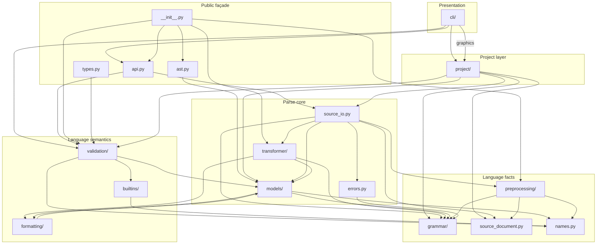
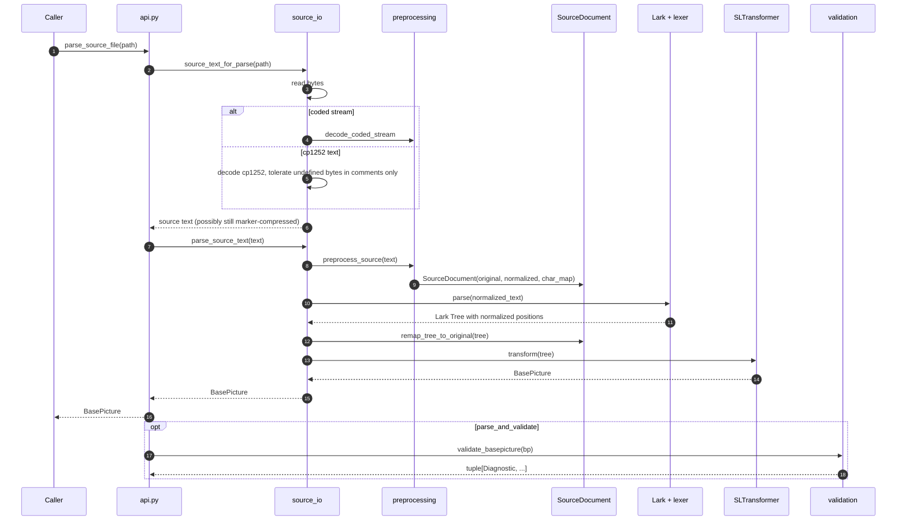
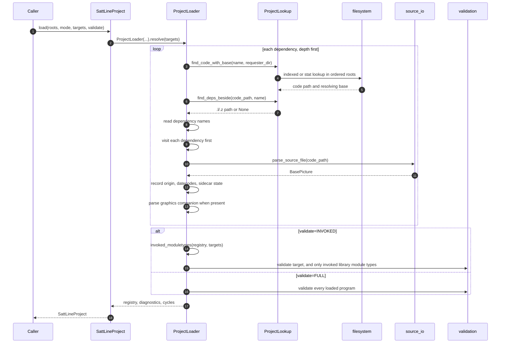
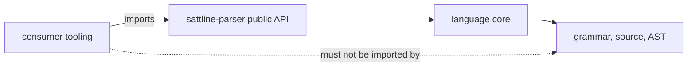

# Architecture

## Layer model

The package is a stack of layers. A layer may import the layer below it, never
the layer above. The split exists so the project layer can load files without
importing the public façade back, and so validation can run without a project.

The important import-direction rules:

- `source_io` imports neither `api` nor `project`. It is the shared floor.
- `project/loader.py` imports `source_io.parse_source_file` and
  `validation.validate_basepicture`. It never imports `api`.
- `api.py` re-exports `source_io`, `errors`, and `validation`. It is a façade,
  not an implementation. The top-level package re-exports the graphics entry
  points from the project layer.
- `ast.py` is a façade over `models/`: every node, clause, tail, and walker
  name crosses one import door, and it depends on nothing above `models/`.
- `types.py` is a façade over the pure type facts in `validation/typing.py`.
  Expression typing that needs a validation scope stays in the validation
  layer, not in the public module.
- `formatting/` renders AST values. It imports `models/`, and the model support
  layer uses it for `__str__`, so the public rendering helpers are the same code
  path as model display.
- `cli/` imports the public API and the project layer, and duplicates no parse
  or validation behaviour.

## Module map

| Path | Responsibility | Read when |
| --- | --- | --- |
| `src/sattline_parser/__init__.py` | Public names, version, lazy fuzz exports | You need the stable import surface |
| `src/sattline_parser/api.py` | Public façade over `source_io`, `errors`, and `validation` | You add a public parse or validation entry point |
| `src/sattline_parser/ast.py` | Supported AST surface: every node, clause, tail, and the walker | You import or document the model |
| `src/sattline_parser/types.py` | Public scalar type facts and literal inference | You import a type fact in a consumer |
| `src/sattline_parser/source_io.py` | Parser cache, decoding, the source-to-`BasePicture` pipeline | You change parse orchestration |
| `src/sattline_parser/source_document.py` | Original/normalized text and offset mapping | You change positions |
| `src/sattline_parser/errors.py` | Parse-error sentences, structured details, logging | You change diagnostics |
| `src/sattline_parser/names.py` | CP1252 identifier folding | You compare identifiers |
| `src/sattline_parser/grammar/` | Lark grammar, constants, keyword casing, custom lexer | You change the language |
| `src/sattline_parser/preprocessing/` | Coded stream decoding, compressed markers, IDE layout | You change source decoding |
| `src/sattline_parser/models/` | AST dataclasses and expression nodes | You change the tree |
| `src/sattline_parser/transformer/` | `SLTransformer` and responsibility mixins | You change tree construction |
| `src/sattline_parser/validation/` | Strict single-source rules, scopes, typing | You add a rule |
| `src/sattline_parser/builtins/` | Generated function catalogue and record specs | You change builtin facts |
| `src/sattline_parser/formatting/` | `__str__` and public expression rendering for AST nodes | You change rendered output |
| `src/sattline_parser/project/` | Discovery, formats, loading, graphics, caches | You change project behaviour |
| `src/sattline_parser/cli/` | The `sattline` command | You change the interface |
| `src/sattline_parser/fuzz_harness.py` | Hard-timeout fuzzing and corpus regression | You change fuzzing |
| `tests/` | Parser, project, CLI, builtins, packaging suites | You verify a change |
| `docs/` | This documentation | You need the design intent |

## Request flow

### Single file

### Whole project

## Package boundaries

The dashed edge is the rule that keeps the package shippable on PyPI: the
parser package must never import a linter, an editor integration, a report
generator, or any other consumer. If a feature needs consumer knowledge, it
belongs in the consumer and not here.

## Design decisions worth knowing

| Decision | Why |
| --- | --- |
| Lark LALR with a contextual lexer | Deterministic parsing, fast enough for batch project loads, and a grammar file that is readable on its own |
| Custom `SattLineLexer` | Nesting `(* ... *)` comments cannot be modelled safely by a merged LALR state machine |
| Per-character source map instead of re-parsing | One parse, and every span still points at the original bytes |
| AST as frozen dataclasses where possible | Hashable, comparable, picklable, and safe to share between the parser and a consumer |
| Validation separate from parsing | Consumers choose whether they want language rules; the project loader chooses the scope |
| Parser-owned caches keyed by grammar fingerprint | A warm cache can never disagree with a cold one after a grammar change |
| One finding shape in the CLI | Agents branch on exit codes and JSON, not on prose |
