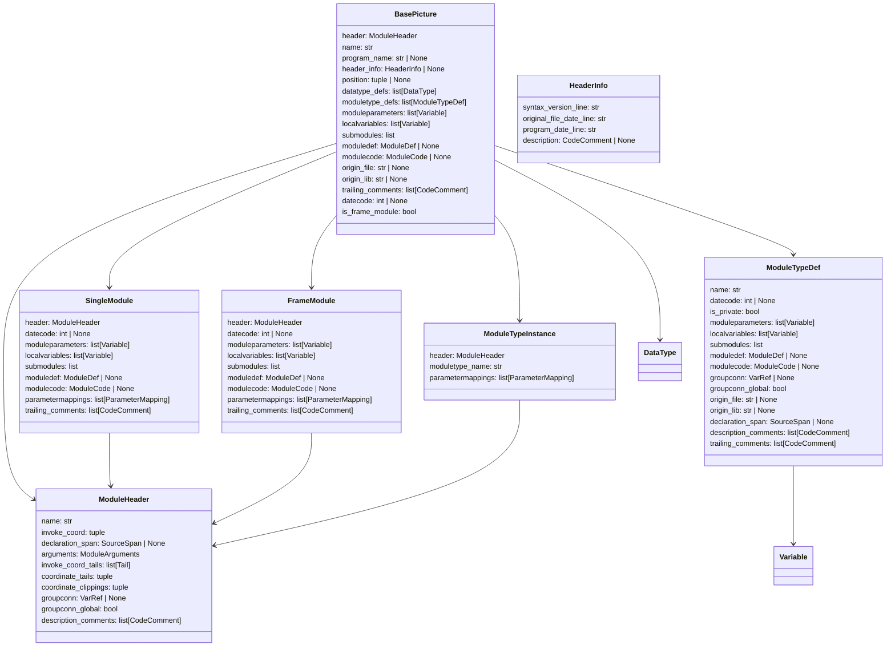
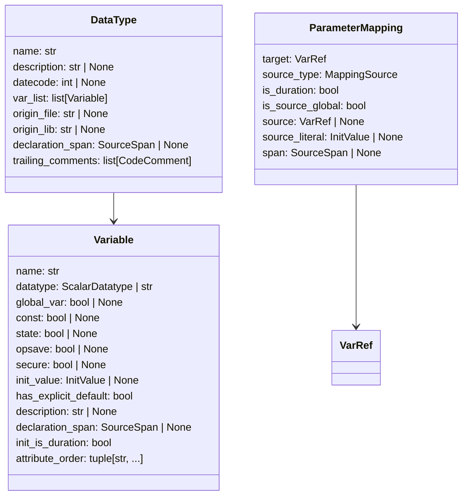
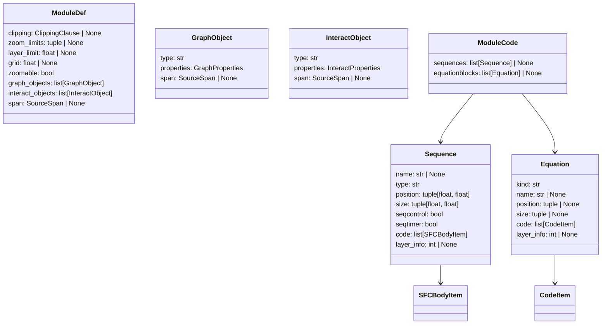
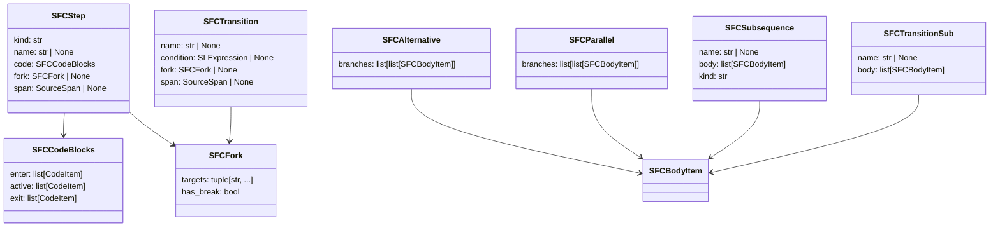
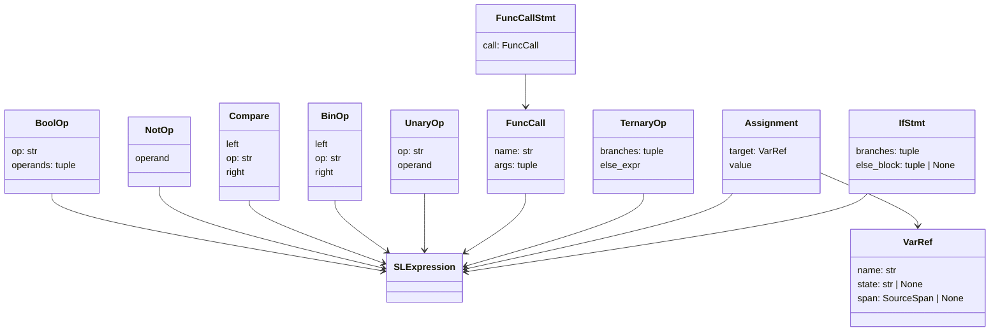
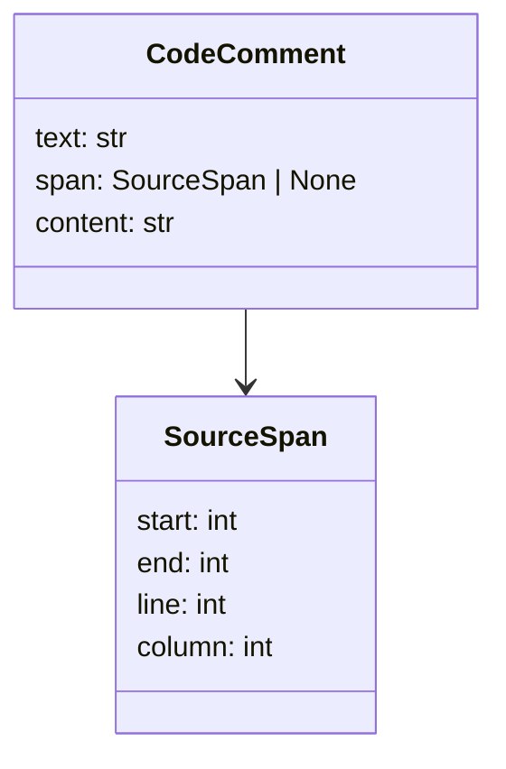

# AST models

The AST is a tree of Python dataclasses in `src/sattline_parser/models/`. It is
the package's structured answer to "what is in this source?". It preserves
structure, spelling, source order, comments, and optionality. It does not
normalize away constructs whose effect is not modelled.

## Root shape



A `submodules` list holds `SingleModule`, `FrameModule`, and
`ModuleTypeInstance` values. `moduledef` and `modulecode` are plain optional
fields: a parsed module body always carries one `ModuleDef` and may carry one
`ModuleCode`. The grammar rejects a second block before the closing `ENDDEF`, so
there is nothing to collect in a list. `None` appears only on a synthetic view
such as an empty picture or a dependency stub.

`BasePicture.is_frame_module` and the `FrameModule` type are the two homes of the
`(Frame_Module)` marker. The marker belongs to the module definition line, after
the datecode, so the root picture records it as a flag instead of an invocation
argument. A `FrameModule` invocation takes the same optional `(Name => value)`
tail as a `SingleModule`, and `FrameModule.parametermappings` keeps it.

`ModuleHeader.description_comments` holds the header comments in source order.
The grammar has exactly one position before `Invocation` and one after it, so the
list has at most two entries: the first was written before `Invocation`, the
second after it. A single comment is written back before `Invocation`, because
the model cannot say which of the two positions it came from.

`ModuleHeader.arguments` is the canonical invocation argument list: layer,
`Enable_`, `Module_In_View`, zoom limits and the `Zoomable` marker, marker
arguments, and `Name = value` assignments. The singular names `layer_info`,
`enable`, `enable_tail`, `module_in_view`, `zoom_limits`, `zoomable`, and
`invocation_arguments` are read-only views over that field. `invoke_coord_tails`
is the flat list of tails attached to the five invocation coordinates, and
`coordinate_tails` is the same tails grouped by coordinate (index-aligned with
`invoke_coord`), so a reader can place each one. A nested `ClippingBounds`
annotation on one of those values lives in `coordinate_clippings`, under the
same grouping. The tail views hold the same objects, never copies.

## Declarations



`Variable.datatype` is normalized at construction. A recognized scalar name
becomes a `ScalarDatatype` member through `fold_identifier`, so `INTEGER`,
`Integer`, and `integer` are one datatype. Every other name stays a `str`:
that is how a user-defined record type is represented, and `AnyType` stays a
string too. It is a wildcard the validator resolves, not a scalar value, so it
is not a member of the enum.

`Variable.datatype_text` is the only safe accessor for the written datatype
name. It returns the enum member's value for a builtin and the string itself for
a user-defined record, so a consumer compares through `datatype_text` rather
than against the raw union field.

`Variable.init_is_duration` records the written `Duration_Value` marker. A bare
`:= Duration_Value` has no payload text, so `init_value` is `None` while
`init_is_duration` stays `True`; a duration initializer with a payload keeps the
text in `init_value`. A `Time_Value` initializer is a one-key
`{"Time_Value": <text or None>}` mapping, and a bare `:= Time_Value` keeps
`None` as its value.

`ScalarDatatype` is a plain `Enum`, while `MappingSource` is a `StrEnum`. The
asymmetry is deliberate. `ScalarDatatype` members are language datatypes and
must not compare equal to arbitrary strings. A `MappingSource` member is part of
the parsed spelling (`"variable_name"` or `"value"`) and is stored as that
string. Neither type should be converted to the other style.

`attribute_order` keeps declaration modifiers in source order, lowercased. The
order matters: `State OpSave` is valid, while `OpSave State` and
`OpSave Const` are not. Boolean flags alone cannot express that rule.

`datecode` is `None` when the source omitted it. The parser never stamps an
import date or invents a default. Stamping is a separate consumer operation.

`BasePicture.header_info` holds the three quoted header lines as written and the
optional change description comment. `program_name` is the convenience view
over the `name:` field of the program date line, matched case-insensitively.
`HeaderInfo` reads the written syntax version, original file date, and program
date as properties. A line it does not recognise keeps its text and yields
`None` for the field it lacks; the parser never rejects a header for its shape.

`ParameterMapping.source_type` is a `MappingSource` member: `VARIABLE` for a
variable or dotted field reference, `VALUE` for a literal or a
`Duration_Value`/`Time_Value` payload.

## Code and sequences



`ModuleCode.equationblocks` holds the `Equation` nodes, in source order, and the
same name is the JSON count key. `Equation.kind` is `"equationblock"` or
`"equations"`, because the rule accepts both keywords. The two spellings are
kept distinct; their effect is not modelled, so only the spelling is preserved.
`"equations"` here is a keyword value, not a second field.

`Sequence.layer_info` and `Equation.layer_info` keep the `Layer_ = <int>` value
written after the `OBJSIZE` pair. The drawing effect is not modelled, but the
written value is preserved and absence stays `None`.

`ModuleDef.grid` is the written `Grid = <real>` spacing, and `None` means the
source wrote no `Grid` clause. There is no default value in the model: a written
`Grid = 0.2` and an absent clause are different inputs, and the formatter writes
the clause back only when the field is set.

`ModuleDef.layer_limit` is the written `Two_Layers_ LayerLimit_ = <real>` value.
Only a module has layers, and the value is the zoom level at which the module
switches from displaying layer 1 to layer 2. `None` means the module has a
single layer. An object keeps its own `Layer_ = 1` or `Layer_ = 2` in
`layer_info` or the object property map.

`ModuleDef.clipping` holds the whole `ClippingBounds` clause, so the resolved
corners and the tails attached to them live in one payload. `clipping_bounds`
and `clipping_tails` are read-only views over it. `ClippingClause.tails` is the
flat list of corner tails and `corner_tails` groups the same objects by corner,
in `bounds` order. A nested `ClippingBounds` annotation on a corner, which the
grammar allows, lives in `corner_clippings` under the same grouping. The block
has no separate property map.

## Typed property maps

`GraphObject.properties` and `InteractObject.properties` are `TypedDict` maps in
`models/properties.py`, so the fixed keys are named even though the dataclasses
expose them as a mapping.

`GraphicsBinding` is not an AST node and `walk` never yields it. It is a project
graphics value carried by `GraphicsModel.bindings`, where each entry records a
`Var`, `Expr`, or `Lit` line from a `.g`/`.y` companion. It is exported by
`sattline_parser.project` with `GraphicsModel`, and by `sattline_parser.ast`
for consumers that already hold a binding. See [graphics.md](graphics.md).

`InteractProperties.body` is `list[InteractBodyEntry] | None`, in source order.
`InteractBodyEntry` is the closed union of what a body line can produce:
`int` for `Layer_`, `Tail` for a literal or a bound/computed tail, `Alignment`
for `LeftAligned`/`CenterAligned`/`RightAligned`, and the typed clauses (`EnableClause`,
`AssignClause`, `FlagClause`, `TailedClause`, `ColourSpec`, `PickButton`,
`ScaleSelector`). Preserved comments are `CodeComment` values. No Lark tree
reaches a caller, so a consumer reads body entries directly instead of
unwrapping a grammar node.

The `Layer_` entry is a plain `int`, while a literal body value keeps the
span-carrying `IntLiteral` the token coerces to. The two are different
constructs, and `type(entry) is int` is how a reader tells them apart.

`InteractObject.type` is the interactor keyword exactly as written, for every
interactor: `ComBut_`, `OptBut_`, `CheckBox_`, `TextBox_`, `MenuInteract`,
`SimpleInteract`, `ComButProc_`, `ProcedureInteract`, or a free-form name. The
two procedure spellings are kept apart because the source wrote different
keywords and their effect is not modelled. `InteractObject.kind` is that
spelling folded through the language identifier table (`fold_identifier`, which
upper-cases ASCII), so a consumer that only needs identity compares `kind`.
`ComButProc_` and `ProcedureInteract` therefore have different kinds.

A `GraphObject` keeps the geometry its source spells, keyed by spelling rather
than by drawing effect:

| Key | Node type | Source |
| --- | --- | --- |
| `coords` | `tuple` pair or box | a box object's `(x, y) (w, h)` pairs |
| `coord_tails` | `tuple` of tail groups | the tails written after each coordinate value |
| `coord_clippings` | `tuple` of `NestedClipping` groups | a nested `ClippingBounds` annotation written after a coordinate value |
| `segment_point` | `tuple` pair | a `SegmentObject`'s third pair |
| `polygon_type` | `list[str]` | `Polyline`, `Spline`, `Connection` |
| `points` | `list[PolygonPoint]` | every polygon coordinate pair |
| `tails` | `list[Tail]` | the flat view of every tail the object carried |
| `text_vars` | `list[VarRef]` | a text object's `VarName` labels |
| `width`, `value_fraction`, `format_string` | `TailedClause` | the text object's `Width_`, `ValueFraction`, `Format_String_` clauses |
| `alignments` | `list[Alignment]` | `LeftAligned`, `CenterAligned`, `RightAligned` |
| `connection_node` | `GraphObject` | a text object's `ConnectionNode (x, y)` anchor |
| `enable`, `enable_tail` | `bool`, `Tail` | `Enable_ = ...` and its binding |
| `colours` | `list[ColourSpec]` | the outline and fill blocks |
| `layer` | `int` | `Layer_ = <int>` |

A `PolygonPoint` holds `x`, `y`, `x_tails`, and `y_tails`, so a tail written
after one value stays attached to that value. `x_clippings` and `y_clippings`
hold the nested `ClippingBounds` annotations written after each value. Every
other coordinate run uses `coord_tails`, one group per REAL, in the same order
as the values, and `coord_clippings` with the annotations for the same values;
an `InteractObject` has the same keys for its coordinate run. A polygon whose
coordinate carries a nested `ClippingBounds` annotation keeps its tails in the
same coordinate group and the annotation beside them, so neither the annotation
nor the tails are lost. The flat `tails` view lists the same tail objects, never
copies.

`NestedClipping` is an ordered tuple of `NestedClippingValue` payloads, each a
written real and the optional tail that followed it. It is a positional payload,
not an AST node: `walk` never yields one and it carries no span, and the tails
it owns appear once through the owning coordinate's flat tail view. The
`NestedClipping.tails` property reads them in written order. A nested annotation
belongs to the value it follows, so a plain tail written after it cannot be
placed back in order; the formatter refuses that shape instead of reordering the
coordinate.

A text-object clause keeps its value and its tail in one payload, so a literal
and its `InVar_` binding are read together. Compare a clause by `key` and
`value`, and read `tail` only when the binding matters.

`colours` holds the outline and fill blocks in written order, so a tailed
`OutlineColour` written before an untailed `FillColour` keeps that order when
the formatter writes the object back.

A `VarName` marker is a postfix of one `text_content`, so each `text_vars` entry
binds the text written immediately before its marker, even when that text is
empty. A marker with no text before it (the grammar allows the order) is kept as
an empty label, `VarRef("")`, rather than reaching back to an earlier caption.
A marker after a `Width_` clause, a coordinate pair, or another marker therefore
never steals a caption it was not written after.

## Interactor property catalogue

An interactor body accepts any `NAME` as a bare flag or as `NAME = value`, so an
unknown property still parses. `models/interactor_properties.py` names the
spellings the scanner enum defines and says what each one is for, without
changing how the parser stores it.

| Name | Meaning |
| --- | --- |
| `interactor_property_catalogue` | `Mapping[str, InteractorPropertySpec]` keyed by folded name |
| `find_interactor_property` | `(name)` returns the spec, or `None` for an unknown spelling |
| `typed_interactor_properties` | `(obj: InteractObject)` returns `TypedInteractorProperty` values in written order |
| `TypedInteractorProperty` | `(clause, spec)` with `name` and `value` views |
| `InteractorPropertySpec` | `(name, kind, datatype, summary)` |
| `InteractorPropertyKind` | `SELECT`, `RANGE`, `COUNTER`, `BOOLEAN`, `NUMERIC`, `TEXT`, `EVENT` |

A spec's `datatype` is advisory vocabulary: it names the value type the spelling
implies, and the grammar still accepts any value, so `Int_Value = "text"` parses
and is not a finding. The catalogue is vocabulary, not a
runtime guarantee: a property is still stored as the `FlagClause` or
`AssignClause` the source wrote, and an unknown spelling appears with
`spec is None` instead of being dropped. Both container shapes are read: an
ordered `body`, and the flat `flags` and `assigns` lists a `ComButProc_` uses.

Every payload that reaches the parsed tree (the interact body clauses,
coordinate and header tails, `ClippingClause`, `ModuleArguments`, graphics and
interact objects, and module definitions) carries a `span`
(`SourceSpan | None`) recording the source range of the rule that produced it.
Two nested payloads are exceptions: a `PolygonPoint` and a text object's
`ConnectionNode` are built without a meta span, so their `.span` is `None` for
parsed sources. `NestedClipping` and `NestedClippingValue` also carry no span,
because they are positional payloads rather than nodes. `ModuleArguments.span` is also `None` when the argument list is
empty, because an empty grammar match reports no position; the enclosing
`ModuleHeader.declaration_span` still covers the header.
A span is layout metadata: it does not participate in equality, so two
structurally identical payloads from different files compare equal. Read
`.span` when you need the provenance. A bound tail exposes the written name
through `VarTail.bound_name`. A `PickButton` keeps the written `value` and, when
the `VarName` marker is present, a `reference` `VarRef`.

The seven interim payloads described below are the exceptions: they never reach
a parsed tree, so they carry no span. They are `CommonProperties`,
`ModuleOptions`, `TwoLayers`, `Grid`, `Zoomable`, `ClipValue`, and
`CoordinateClipping`.

The same `layout` marker is on the geometry fields: `BasePicture.position`,
`Sequence.position` and `size`, `Equation.position` and `size`,
`ModuleHeader.invoke_coord`, and `ClippingClause.bounds`. They are excluded from
equality too, so a consumer diffing two revisions can drop the marked
presentation fields. Other layout-adjacent values, such as
`ModuleDef.zoom_limits`, `ModuleDef.grid`, and `ModuleDef.layer_limit`, remain
part of the model and still participate in equality.

### Interim transformer payloads

The transformer builds seven typed payloads and folds each one into an owner
before it returns a `BasePicture`: `CommonProperties`, `ModuleOptions`,
`TwoLayers`, `Grid`, `Zoomable`, `ClipValue`, and `CoordinateClipping`. They live in `sattline_parser.transformer._payloads` and
are not part of the model or the `sattline_parser.ast` surface, because a parsed
tree never contains one. An `isinstance` check against them on a parsed AST is
always false, `walk` never yields them, and `iter_child_nodes` never reports
them. A nested `ClippingBounds` annotation is folded into a `NestedClipping`
before the tree is returned, so `CoordinateClipping` is only its build-time
form.

## SFC nodes



`SFCSubsequence.kind` distinguishes `"sequence"` (`SUBSEQUENCE`, structural
position M) from `"substep"` (`SUBSEQSTEP`, step position S). They share a
model shape but occupy different positions in a sequence body.

`SFCTransition.condition` is `None` when the source omits `WAIT_FOR`. The
omission is preserved rather than synthesized, because the compiler lowers an
absent guard to true.

`SFCFork` is a suffix of a step or transition, not a sequence element. A
standalone `SEQBREAK` is not a sequence element.

## Expressions and statements

All expression nodes are frozen dataclasses. They are hashable, comparable, and
safe to share. Every node carries an optional `span`; parsed nodes have it set,
manually constructed nodes default to `None`.

A tree attached to a `SattLineProject` is frozen as a whole. `load` locks the
loader-owned tree; `from_programs` deep-copies first. Lists become tuples,
mappings become read-only, and field assignment on any mutable model node raises
`FrozenInstanceError`. A standalone parse stays mutable until it is attached.

The read-only mapping is a `FrozenMapping`, not a `types.MappingProxyType`. The
proxy supports neither pickling nor `copy.deepcopy`, so a frozen graphics-bearing
tree that carried a `Time_Value` payload could not leave the project boundary. A
`FrozenMapping` rejects item assignment and item deletion the way the proxy
does, and both copy protocols return the same immutable object.



Type aliases:

- `SLExpression = VarRef | bool | int | float | str | BoolOp | NotOp |
  Compare | BinOp | UnaryOp | FuncCall | TernaryOp`
- `SLStmt = Assignment | FuncCallStmt | IfStmt`
- `CodeItem = Assignment | FuncCallStmt | IfStmt | CodeComment`
- `SFCBodyItem = SFCStep | SFCTransition | SFCTransitionSub | SFCAlternative |
  SFCParallel | SFCSubsequence | CodeComment`
- `InteractBodyEntry = int | Tail | Alignment | AssignClause | ColourSpec |
  EnableClause | FlagClause | PickButton | ScaleSelector | TailedClause |
  CodeComment`

`IntLiteral` and `FloatLiteral` are `int` and `float` subclasses that carry a
`span`. They preserve the literal's source position without boxing the value in
a wrapper. Equality is the inherited numeric one, so `IntLiteral(1) == 1` and
`IntLiteral(1) == FloatLiteral(1.0)` are both true: the written form (`1` versus
`1.0`) is not part of equality. Read `span` or `type(value)` when the spelling
matters.

## Tails

`Tail` is `SLExpression | VarTail | LitStringTail`. A `VarTail` is the bound
`InVar_`/`OutVar_` wrapper; a `LitStringTail` is the quoted-symbol form. Two
model helpers are part of the supported surface:

- `tail_list()` is the empty-list factory used as the default for every
  tail-bearing field.
- `is_expression_tail(value)` is the single predicate for a computed tail. It
  is true for a literal or an expression node and false for the bound wrappers.
  `EXPRESSION_NODE_TYPES` in `models/tails.py` is the shared tuple behind it,
  and the walker calls the predicate instead of keeping a private copy.

## Comments and spans



`SourceSpan` uses zero-based character offsets with an exclusive `end`, and
one-based `line` and `column` for the start. All positions refer to the
original source, even after decoding. See
[source-provenance.md](source-provenance.md).

`CodeComment.text` is the full lossless comment including `(*` and `*)`.
`content` is the inner text without the delimiters. Comments are preserved on
the AST field that matches their syntactic role, not flattened into a global
list. The class is defined in `models/expressions.py` and re-exported by
`models/ast_model.py`, so `CodeItem` and every comment-bearing field use one
canonical class. A `comments` run in a `ComButProc_` body or inside a colour
assignment has no AST field and is not attached; only `interact_body` comments
become `CodeComment` values.

## Serialization and pickling

The AST is plain dataclasses, so it pickles and unpickles without retained
parser state, and a frozen tree pickles and deep-copies the same way because its
read-only mappings and tuples support both protocols. The file AST cache is
versioned. When the model shape changes, `FILE_AST_CACHE_VERSION` is bumped and
older entries are discarded rather than decoded into the current model.

`sattline_parser.serialization.to_jsonable` emits enum members as their plain
value, including `StrEnum` and `IntEnum` members, and never as a placeholder at
a `depth` limit. Scalars, source spans, paths, and byte strings are leaves and
are emitted in full at any depth; only dataclasses and containers count as a
level.

## Traversal

Import the model and its traversal through `sattline_parser.ast`. The public
walker is `sattline_parser.ast.walk`; `models/walk.py` holds the implementation,
and `sattline_parser.models` is internal, so its re-exports are not a supported
import door.
`walk(node)` yields a `WalkEvent` for every AST node in pre-order.
Each event carries the node, the display relation that holds it in its parent
(for example `localvariables[2]` or `branches[0][1]`), the model field and
subscript indices behind that relation, the phase, and the ancestor chain (root
first).

```python
from sattline_parser import parse_source_file
from sattline_parser.ast import NodeVisitor, VarRef, walk

for event in walk(basepicture):
    if isinstance(event.node, VarRef):
        print(event.relation, event.field, event.indices, event.node.name)


class DeclarationCounter(NodeVisitor):
    def __init__(self):
        self.variables = 0
        self.calls = 0

    def visit_Variable(self, variable):
        self.variables += 1

    def visit_FuncCall(self, call):
        self.calls += 1
        self.generic_visit(call)
```

`WalkEvent.phase` is `"enter"` for the pre-order event. With
`walk(..., emit_leave=True)`, each node also gets a `phase="leave"` event after
its subtree, so a consumer can maintain a scope stack without recursion. A
pruned node still gets its leave event. `NodeVisitor.visit` calls the matching
`leave_<ClassName>` hook after the enter method returns, which gives the
subclassing form the same scope-stack symmetry.

Every field of every node class is declared in `_FIELD_SPECS` as a child
(`node`), a node-or-literal (`value`), a typed property map (`properties`), or a
`leaf`. The field-coverage test compares the declaration with
`dataclasses.fields`, so a new field cannot be left unclassified. Literal
values are leaves and are not emitted as `WalkEvent`s; `iter_literal_leaves(node)`
reads the literal values a node holds directly, and `LiteralLeaf` carries the
relation, field, indices, and value. It covers all three literal homes: a
`value` field (including literals nested in its sequences), a scalar on a
`leaf` field, and a scalar entry of a property map. For example,
`iter_literal_leaves(ModuleDef(grid=0.04))` reports `grid`, and
`iter_literal_leaves(GraphObject)` reports `properties.layer`. Containers,
`None`, spans, and enum members are not literal leaves.

`NodeVisitor` dispatches to `visit_<ClassName>` and falls back to
`generic_visit`, which visits every child that `iter_child_nodes` reports. An
override decides whether to descend by calling `self.generic_visit(node)`.

The walk covers module containers, declarations, module code, SFC nodes,
statements, expressions, headers, comments, and the typed clause and tail
payloads attached to graphics, interact, and module-definition nodes. It
descends into `GraphObject.properties` and `InteractObject.properties`, and into
`ModuleHeader.arguments` and `ModuleDef.clipping` as ordinary nodes. Literal
values are leaves and are not emitted as nodes. `prune` may stop descent into a
node after it has been yielded.

Property payloads are visited in a fixed order:

| Container | Node-bearing keys, in walk order |
| --- | --- |
| `GraphObject` | `colours`, `enable_tail`, `width`, `value_fraction`, `format_string`, `alignments`, `connection_node`, `points`, `tails` |
| `InteractObject` | `procedure`, `assigns`, `enables`, `flags`, `colours`, `body`, `tails` |

`coord_tails` keeps its place in both order tuples but is a grouping view: it yields no nodes, and the flat `tails` list emits each tail once. `coord_clippings` is the same kind of view: a nested annotation is not a node, and its tails are the ones the flat list already emits. A key is in the order tuple because the table must cover every property key, not because the walker descends into it.

`ModuleHeader.arguments` is walked as a node, so a consumer reaches `enable`,
`module_in_view`, `zoom_limits`, `markers`, and `assigns` through it.
`ModuleDef.clipping` owns the clipping tails, so they are emitted through the
`ClippingClause` and never duplicated.

`GraphObject.properties["text_vars"]` holds `VarRef` values, and a
`PickButton.reference` is a `VarRef` child. A bound `InVar_`/`OutVar_` name is a
`VarTail`, not a `VarRef`, so a complete reference collector has two cases:

```python
from sattline_parser.ast import LitStringTail, VarRef, VarTail, walk

references = []
for event in walk(picture):
    node = event.node
    if isinstance(node, VarRef):
        references.append(node.name)
    elif isinstance(node, VarTail) and not isinstance(node.value, LitStringTail):
        if node.bound_name is not None:
            references.append(node.bound_name)
```

A `VarTail` whose value is a `LitStringTail` is a quoted symbol, not a variable
path, so the collector skips it.

The non-node keys (`coords`, `segment_point`, `polygon_type`, `layer`, `enable`,
`text_vars`, and `layers`) stay in the order tuple so a new property forces a
walker decision, but they produce no nodes. `text_vars` holds `VarRef` values,
which are nodes, and the walk visits them after the clauses.

The flat `properties["tails"]` list is a derived view. A tail owned by a clause,
a polygon point, or a text-object clause is emitted through that owner, and the
coordinate tails, which have no node owner, are emitted from the flat list.
Every tail node therefore appears once, and a query or validation pass does not
need to deduplicate shared payloads. `coord_tails` is not walked: it holds the
same coordinate tails, and walking it would either duplicate or suppress them.

`walk` uses an explicit stack and keeps ancestors as a persistent chain.
`WalkEvent.parents` expands its sequence view only when read, so a deep tree is
walked in linear time and does not grow the Python call stack. Reading
`parents` costs O(depth); the walk itself stays linear. The field still behaves
like a tuple for indexing, iteration, equality, and `len`. `NodeVisitor` dispatch
stays recursive by design, because an override controls its own descent.
Parsed structures are capped at `MAX_SOURCE_DEPTH` (256) levels, including
property payloads such as interactor tails, which keeps that dispatch and the
recursive formatter and cache inside the default recursion limit.

`walk` replaces the recursive helpers that consumers would otherwise copy. The
CLI query command is built on `NodeVisitor`; the validator uses `walk` to
collect variable references. Rule-specific validation walks stay in
`validation/` because they interleave scope and type checks with traversal.

## Formatting

`formatting/formatter.py` renders AST nodes for `__str__`, message text, and
debugging. `formatting/source.py` renders a whole file: `format_source` takes a
`BasePicture` and `format_module` takes one `ModuleDef` block, and their output
parses back to an equal tree for every corpus fixture. `UnsupportedFormattingError`
marks the few shapes whose written place or spelling is not in the model.
`sattline_parser.formatting` is a supported import surface for the function
names and their documented signatures; the exact layout is display output, not a
serialization contract. Use `sattline_parser.serialization` when you need
machine-readable data.

An empty equation body is written as the bare `EQUATIONBLOCK :` header: the
grammar accepts an empty statement list, so no placeholder comment is invented.
An empty datatype description is written as `""` and is not confused with an
absent one. A repeated singular clause is rejected while parsing rather than
overwritten, so the formatter never has to choose between two written values.

`format_expr` renders an expression or statement in source spelling, so the
output parses back to the same node: a `VarRef` state is written `:Old`/`:New`,
and a string literal uses double quotes with an inner quote doubled. The SFC
renderer chooses the closing keyword from the node kind, so a `SUBSEQSTEP`
renders `Substep ... EndSubstep` while a `SUBSEQUENCE` renders
`Subsequence ... EndSubsequence`. The SFC labels are display text, not source
keywords; only `format_expr` output is round-trip parseable.

Every reference that the grammar spells as a `variable_name`, including
`ModuleHeader.groupconn` and both sides of a `ParameterMapping`, is rendered
through that same spelling, so a written `:Old`/`:New` suffix survives. A
header line is written with the inner quote doubled again, and a preserved
`CodeComment` is written with its own line breaks intact, so a second pass
changes neither.

A nested `ClippingBounds` annotation is written after the value it annotated,
with every number and every value tail, so a coordinate keeps its annotation
across a format pass.

## Tests that pin the model

| Test | What it protects |
| --- | --- |
| `tests/parser/test_parser_core_ast_model.py` | Dataclass defaults, comments, spans, record descriptions, datecodes, per-variable init payloads |
| `tests/parser/test_parser_core_expressions.py` | Expression shapes and precedence |
| `tests/parser/test_parser_core_modules.py` | Module nesting and assembly |
| `tests/parser/test_parser_core_sfc.py` | SFC node shapes |
| `tests/parser/test_parser_core_module_definitions.py` | Layout and graphics fields |
| `tests/parser/test_models_walk.py` | Field coverage, node order, field and indices, ancestry, pruning, leave events, literal leaves, visitor dispatch |
| `tests/parser/test_formatter.py` | Expression rendering in source spelling, SFC footers, round-trip parsing |
| `tests/parser/test_format_source.py` | Whole-file round trip for every corpus fixture, idempotence, graphics properties |
| `tests/parser/test_format_nested_clipping.py` | Nested `ClippingBounds` values and tails written back on every coordinate position |
| `tests/parser/test_serialization.py` | JSON-friendly data for scalars, spans, containers, and a whole picture |
| `tests/parser/test_models_boundary.py` | The model layer imports no Lark module |
| `tests/parser/test_ast_namespace.py` | Every node type and model dataclass is on the `sattline_parser.ast` surface |
| `tests/parser/test_layout_metadata.py` | Every span and geometry field is classified as layout |
| `tests/parser/test_payload_spans.py` | Spans and bound names on the modelled payloads |
| `tests/parser/test_grammar_constants.py` | `Final`, `__all__`, unique values, no orphans, resolved grammar |
| `tests/parser/test_parser_core_deep_structures.py` | Deep-tree walk, clean nesting errors, iterative remapping |
