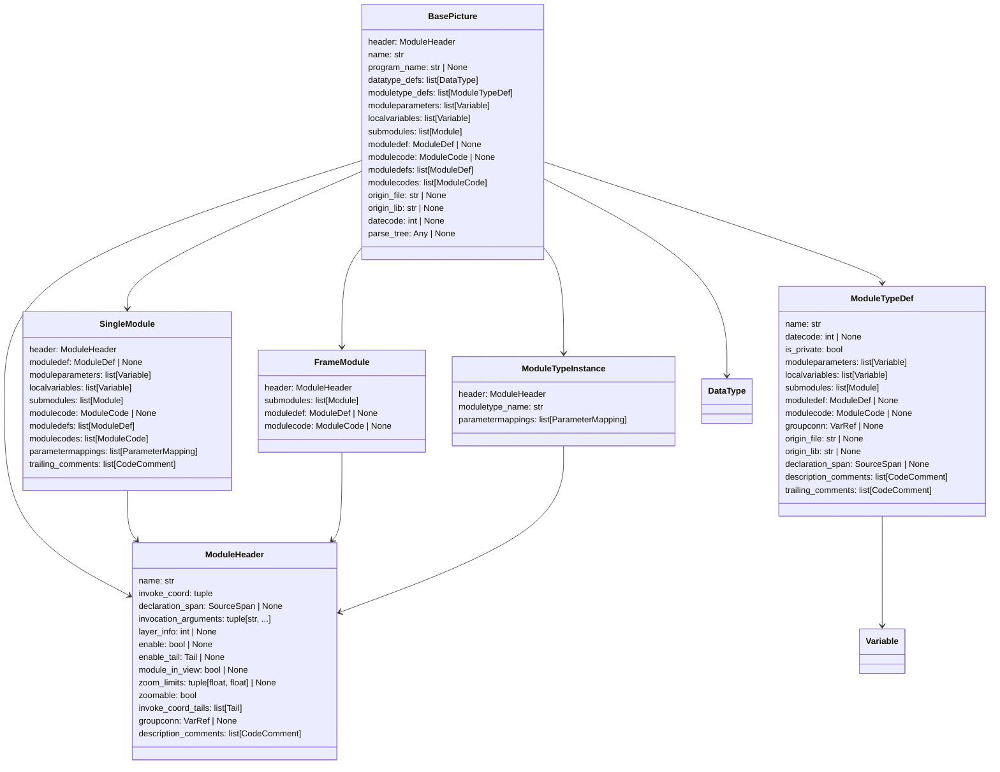
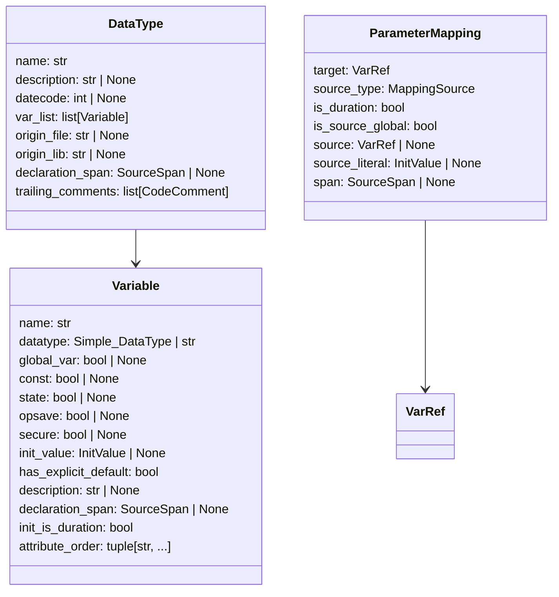
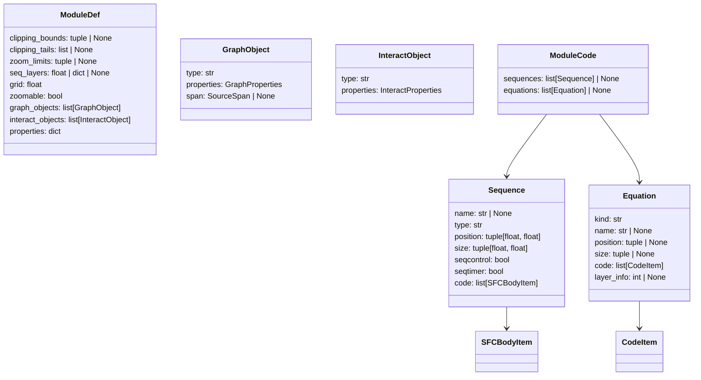
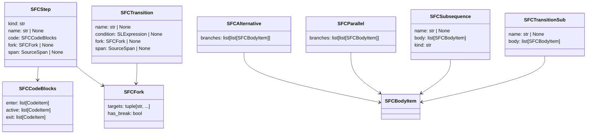
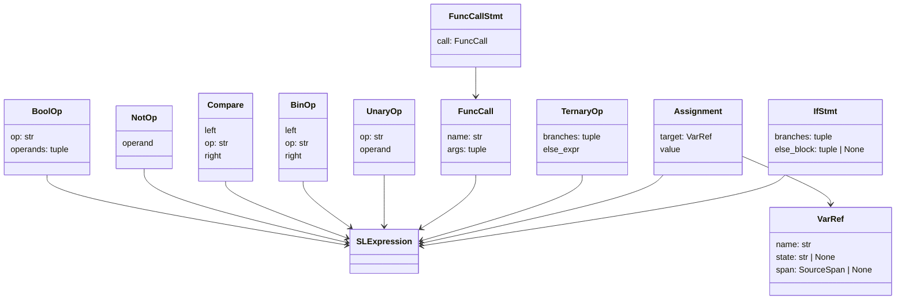
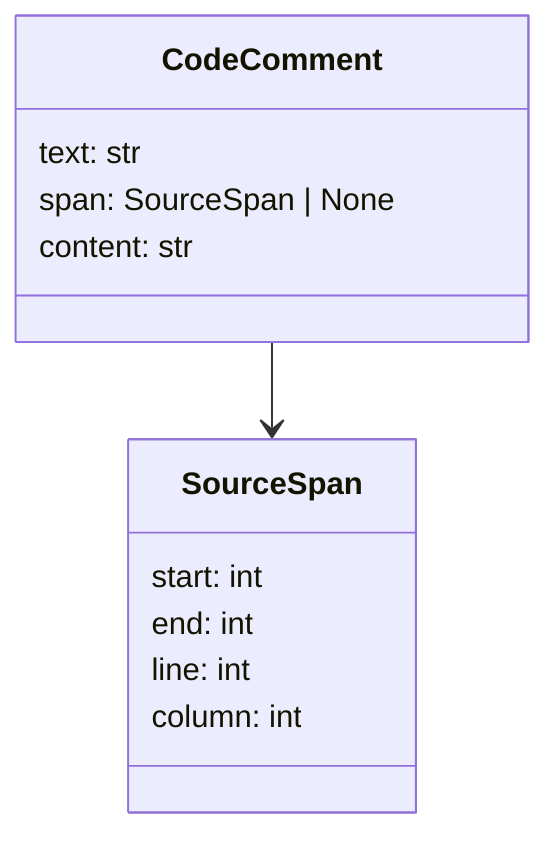

# AST models

The AST is a tree of Python dataclasses in `src/sattline_parser/models/`. It is
the package's structured answer to "what is in this source?". It preserves
structure, spelling, source order, comments, and optionality. It does not
normalize away constructs whose effect is not modelled.

## Root shape



`Module` is the alias for `SingleModule | FrameModule | ModuleTypeInstance`.

### Why `moduledefs` and `modulecodes` are lists

Legacy coded files repeat one `ModuleDef ... [ModuleCode ...] ENDDEF` block per
layer. A single `moduledef` field would silently drop all but the last block.
The AST therefore keeps every block in source order in `moduledefs` and
`modulecodes`, while `moduledef` and `modulecode` expose the last block as a
convenience view. Nothing is lost.

## Declarations



`Variable.datatype` is normalized at construction. A recognized builtin name
becomes a `Simple_DataType` member through `fold_identifier`, so `INTEGER`,
`Integer`, and `integer` are one datatype. An unrecognized name stays a `str`,
which is how a user-defined record type is represented.

`attribute_order` keeps declaration modifiers in source order, lowercased. The
order matters: `State OpSave` is valid, while `OpSave State` and
`OpSave Const` are not. Boolean flags alone cannot express that rule.

`datecode` is `None` when the source omitted it. The parser never stamps an
import date or invents a default. Stamping is a separate consumer operation.

`ParameterMapping.source_type` is a `MappingSource` member: `VARIABLE` for a
variable or dotted field reference, `VALUE` for a literal or a
`Duration_Value`/`Time_Value` payload.

## Code and sequences



`Equation.kind` is `"equationblock"` or `"equations"`. The two keywords are
kept distinct; their effect is not modelled, so only the spelling is preserved.

## Typed property maps

`GraphObject.properties`, `InteractObject.properties`, and `ModuleDef.properties`
are `TypedDict` maps in `models/properties.py`, so the fixed keys are named even
though the dataclasses expose them as a mapping.

`InteractProperties.body` is `list[InteractBodyEntry] | None`, in source order.
`InteractBodyEntry` is the closed union of what a body line can produce:
`int` for `Layer_`, `Tail` for a literal or a bound/computed tail, `Alignment`
for `LeftAligned`/`RightAligned`, and the typed clauses (`EnableClause`,
`AssignClause`, `FlagClause`, `TailedClause`, `ColourSpec`, `PickButton`,
`ScaleSelector`). Preserved comments are `CodeComment` values. No Lark tree
reaches a caller, so a consumer reads body entries directly instead of
unwrapping a grammar node.

## SFC nodes



`SFCSubsequence.kind` distinguishes `"sequence"` (`SUBSEQUENCE`, structural
position M) from `"substep"` (`SUBSEQSTEP`, step position S). They share a
model shape but occupy different positions in a sequence body.

`SFCTransition.condition` is `None` when the source omits `WAIT_FOR`. The
omission is preserved rather than synthesized, because the compiler lowers an
absent guard to true.

`SFCFork` is a suffix of a step or transition, not a sequence element. A
standalone `SEQBREAK` is not a sequence element.

## Expressions and statements

All expression nodes are frozen dataclasses. They are hashable, comparable, and
safe to share. Every node carries an optional `span`; parsed nodes have it set,
manually constructed nodes default to `None`.



Type aliases:

- `SLExpression = VarRef | bool | int | float | str | BoolOp | NotOp |
  Compare | BinOp | UnaryOp | FuncCall | TernaryOp`
- `SLStmt = Assignment | FuncCallStmt | IfStmt`
- `CodeItem = Assignment | FuncCallStmt | IfStmt | CodeComment`
- `SFCBodyItem = SFCStep | SFCTransition | SFCTransitionSub | SFCAlternative |
  SFCParallel | SFCSubsequence | CodeComment`
- `InteractBodyEntry = int | Tail | Alignment | AssignClause | ColourSpec |
  EnableClause | FlagClause | PickButton | ScaleSelector | TailedClause |
  CodeComment`

`IntLiteral` and `FloatLiteral` are `int` and `float` subclasses that carry a
`span`. They preserve the literal's source position without boxing the value in
a wrapper.

## Comments and spans



`SourceSpan` uses zero-based character offsets with an exclusive `end`, and
one-based `line` and `column` for the start. All positions refer to the
original source, even after decoding. See
[source-provenance.md](source-provenance.md).

`CodeComment.text` is the full lossless comment including `(*` and `*)`.
`content` is the inner text without the delimiters. Comments are preserved on
the AST field that matches their syntactic role, not flattened into a global
list. The class is defined in `models/expressions.py` and re-exported by
`models/ast_model.py`, so `CodeItem` and every comment-bearing field use one
canonical class.

## Serialization and pickling

`BasePicture` defines `__getstate__`: `parse_tree` is stripped when pickled. It
is tooling state, not persistent AST state, and a retained tree can be large.

`parse_tree` is attached only when `retain_parse_tree=True` is passed to a parse
entry point. Code must not rely on it surviving a pickle round trip.

The file AST cache is versioned. When the model shape changes,
`FILE_AST_CACHE_VERSION` is bumped and older entries are discarded rather than
decoded into the current model.

## Traversal

Import the model through `sattline_parser.ast`. `models/walk.py` is the public
traversal. `walk(node)` yields a `WalkEvent` for every AST node in pre-order.
Each event carries the node, the relation that holds it in its parent (for
example `localvariables[2]` or `branches[0][1]`), and the ancestor chain, root
first.

```python
from sattline_parser import parse_source_file
from sattline_parser.ast import NodeVisitor, VarRef, walk

for event in walk(basepicture):
    if isinstance(event.node, VarRef):
        print(event.relation, event.node.name)


class DeclarationCounter(NodeVisitor):
    def __init__(self):
        self.variables = 0
        self.calls = 0

    def visit_Variable(self, variable):
        self.variables += 1

    def visit_FuncCall(self, call):
        self.calls += 1
        self.generic_visit(call)
```

`NodeVisitor` dispatches to `visit_<ClassName>` and falls back to
`generic_visit`, which visits every child that `iter_child_nodes` reports. An
override decides whether to descend by calling `self.generic_visit(node)`.

The walk covers module containers, declarations, module code, SFC nodes,
statements, expressions, headers, comments, and the typed clause and tail
payloads attached to graphics, interact, and module-definition nodes. It
descends into `GraphObject.properties`, `InteractObject.properties`, and
`ModuleDef.properties`. `ModuleHeader.invocation_arguments` holds marker names
only and is not walked; header argument tails live in `invoke_coord_tails`.
`parse_tree` is not walked. Literal values are leaves and are not emitted as
nodes. `prune` may stop descent into a node after it has been yielded.

Property payloads are visited in a fixed order:

| Container | Node-bearing keys, in walk order |
| --- | --- |
| `GraphObject` | `colours`, `enable_tail`, `tails` |
| `InteractObject` | `procedure`, `assigns`, `enables`, `flags`, `colours`, `body`, `tails` |
| `ModuleDef` | `clipping_tails`, `properties["tails"]`, `graph_objects`, `interact_objects` |

The non-node keys (`coords`, `segment_point`, `polygon_type`, `layer`,
`text_vars`, `enable`, and `layers`) stay in the order tuple so a new property
forces a walker decision, but they produce no nodes.

The flat `properties["tails"]` list is a derived view. A tail owned by a clause
is emitted through that clause, and only the unowned (coordinate) tails are
emitted from the flat list. `ModuleDef.clipping_tails` owns the entries also
present in its `properties["tails"]`. Every tail node therefore appears once,
and a query or validation pass does not need to deduplicate shared payloads.

`walk` uses an explicit stack and keeps ancestors as a persistent chain.
`WalkEvent.parents` expands its sequence view only when read, so a deep tree is
walked in linear time and does not grow the Python call stack. Reading
`parents` costs O(depth); the walk itself stays linear. The field still behaves
like a tuple for indexing, iteration, equality, and `len`. `NodeVisitor` dispatch
stays recursive by design, because an override controls its own descent.
Parsed structures are capped at `MAX_SOURCE_DEPTH` (256) levels, including
property payloads such as interactor tails, which keeps that dispatch and the
recursive formatter and cache inside the default recursion limit.

`walk` replaces the recursive helpers that consumers would otherwise copy. The
CLI query command is built on `NodeVisitor`; the validator uses `walk` to
collect variable references. Rule-specific validation walks stay in
`validation/` because they interleave scope and type checks with traversal.

## Formatting

`formatting/formatter.py` renders AST nodes for `__str__` and debugging. It is
display code, not serialization. Use the CLI or a consumer serializer when you
need machine-readable output.

## Tests that pin the model

| Test | What it protects |
| --- | --- |
| `tests/parser/test_parser_core_ast_model.py` | Dataclass defaults, comments, spans |
| `tests/parser/test_parser_core_expressions.py` | Expression shapes and precedence |
| `tests/parser/test_parser_core_modules.py` | Module nesting and assembly |
| `tests/parser/test_parser_core_sfc.py` | SFC node shapes |
| `tests/parser/test_parser_core_module_definitions.py` | Layout and graphics fields |
| `tests/parser/test_models_walk.py` | Node coverage, order, ancestry, pruning, visitor dispatch |
| `tests/parser/test_models_boundary.py` | The model layer imports no Lark module |
| `tests/parser/test_ast_namespace.py` | Every node type and model dataclass is on the `sattline_parser.ast` surface |
| `tests/parser/test_parser_core_deep_structures.py` | Deep-tree walk, clean nesting errors, iterative remapping |
