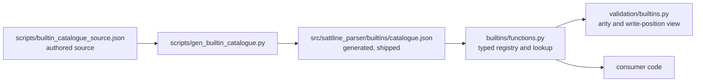
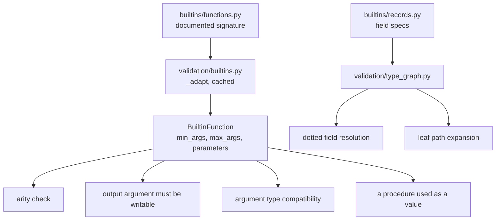

# Builtins

The `builtins/` package holds the parser's builtin **language facts**: function
signatures and record field specifications. It contains no validation policy
and no consumer-specific data. Consumers decide what to do with a signature or
a field list.

## Function catalogue



`catalogue.json` is generated. Never edit it by hand.

```bash
python scripts/gen_builtin_catalogue.py          # rewrite catalogue.json
python scripts/gen_builtin_catalogue.py --check  # verify it is current
```

A test runs the `--check` path, so a stale catalogue fails the suite.

### What the catalogue carries

| Bucket | Count at the time of writing | Meaning |
| --- | --- | --- |
| Documented functions | 171 | Full signature transcribed from the public manuals |
| Documented, untyped | 2 | `GetPrivilegeFlag`, `ResetPrivilegeFlag`; no transcribed parameter list, and their arity is recorded as unknown |
| Internal registrations | 191 | Names the system binds for compiled programs; no public manual describes them |
| Not located | 9 | Names kept only so arity checks keep working; listed under `meta.not_located` |
| Documented total | 171 | Counts only the manual-documented names |

The generated header records these numbers. `documented_total` excludes
`not_located` and `internal` so it stays comparable with the manual's own
count.

The internal and not-located buckets are kept because shipped library sources
call those names. A call to one now gets arity and argument checks instead of
passing silently. This is a deliberate trade: the package knows the arity even
when it does not know the full documentation.

### Parameter model

```python
@dataclass(frozen=True, slots=True)
class BuiltinParameter:
    name: str
    datatype: str
    direction: BuiltinDirection   # "in", "in var", "out", "inout"
    sorting: BuiltinSorting       # "RS", "WS", "RS/WS", "NoS"
    ownership: BuiltinOwnership   # "RO", "WO", "RO/WO", "NoO"
    optional: bool = False
    accepts_const_string: bool = False
```

Optional parameters are trailing-only. The generator rejects a required
parameter after an optional one. The validator uses the leading required count
as a call's minimum arity.

`accepts_const_string` marks a written string parameter that is a cursor rather
than a data write. `GetStringPos` and `SetStringPos` use it for their first
parameter, so a Const string is accepted there even though the documented
direction is `inout`. The exemption covers the Const-write finding only: the
argument is still checked for being a variable reference and for matching the
declared `String` datatype. The flag lives in the catalogue data, not in
validator code.

`BuiltinFunction` also carries `kind` (`function` or `procedure`), `return_type`,
`precision_scangroup`, and `typed`. A `typed=True` entry derives its arity from
its parameter list. A `typed=False` entry must record `arity` explicitly: a
non-negative integer, or `null` when the documented arity is not known. `null`
means no arity, direction, or datatype check runs for a call to that name,
because an untranscribed list must not be read as "takes no arguments". A
string-literal argument stays rejected there, because no documented parameter
accepts one. The generator rejects an untyped entry that omits `arity`, and
rejects an `arity` on a typed entry so the two copies cannot drift.

`kind` and `return_type` are separate facts. A procedure carries no return
type, so validation reads `kind` to reject a known procedure used where a value
is required (`SL-V060`). A `null` return type on a function is still only an
unproven type, not a rejection.

### Name lookup

Function names are case-insensitive and use the same `fold_identifier` as the
rest of the language. `BUILTIN_FUNCTIONS` is keyed by canonical name;
`get_function_signature` resolves aliases. `EqualString` is documented with
that spelling; the catalogue carries `equalstrings` as the canonical key and
`EqualString` as an alias.

`BUILTIN_FUNCTIONS`, `BUILTIN_ALIASES`, and `CATALOGUE_META` are read-only
`FrozenMapping` views built at import, not dicts. A caller cannot mutate the
table validation is reading, and an item assignment or deletion raises
`TypeError`. `FrozenMapping` is exported from `sattline_parser.ast`, and it is a
`collections.abc.Mapping`, so a consumer can read the table through the abstract
class and does not have to depend on the concrete type.

## Record field specifications

`builtins/records.py` holds:

- `BUILTIN_RECORD_SPECS`: an ordered, read-only `name -> tuple[(field, datatype), ...]`
  mapping for every builtin record datatype;
- `OPAQUE_BUILTIN_RECORD_NAMES`: native handles whose fields are not
  addressable;
- `FIELDLESS_BUILTIN_RECORD_NAMES`: names with no fields at all;
- `BUILTIN_DECLARED_DATATYPE_NAMES`: every declared builtin datatype name.

The tables cover the builtin datatype reference in the public manuals and the
datatype declarations a system configuration ships.

An empty spec means "declared, shape not modelled". Six names carry one:
`tObject`, `ArrayObject`, and `QueueObject` are native object handles with no
addressable fields, so the empty spec is the complete answer. `ByteRecord`,
`ComliMessage`, and `PidType` are declared system records that builtin
signatures name while no transcribed field table exists. The name is still a
declared datatype, so `SL-V020` stays silent and an argument of that type
matches its parameter. A field access through such a type is unknown rather than
provably absent, so no rule reports it.

## How validation uses the facts



The validator adapts the documented signature into:

- `min_args`: the count of leading required parameters;
- `max_args`: the total parameter count;
- `parameters`: the documented direction and datatype, used by the argument
  direction and argument type rules;
- `kind`: `function` or `procedure`, read by the value-position rule.

The adaptation is cached per documented signature. A written position is derived
from the parameter direction, so the validator view keeps no second copy of it.

An unknown call name has no signature, so the arity, argument-direction, and
argument-datatype rules are skipped: the callee may be a user function defined
elsewhere. A string literal in an argument position is rejected (`SL-V015`)
unless the resolved signature documents an `in` parameter of a string datatype
at that position, as `LoggedIn` does for its user name. An unknown callee
documents no such parameter, so its literal stays rejected.

`builtin_datatype_typo` suggests a builtin datatype name when a custom datatype
string is within a bounded edit distance of exactly one builtin. It never fires
for an exact match, which is already normalized to `ScalarDatatype` by
`Variable`.

## Public surface

| Name | Meaning |
| --- | --- |
| `BUILTIN_FUNCTIONS` | Read-only mapping from canonical name to signature |
| `BUILTIN_ALIASES` | Read-only mapping from alias to canonical name |
| `CATALOGUE_META` | Read-only generated header metadata |
| `BuiltinFunction` | Signature value object |
| `BuiltinParameter` | Parameter value object |
| `get_function_signature(name)` | Resolve a name or alias |
| `is_builtin_function(name)` | Membership test |
| `BUILTIN_RECORD_SPECS` | Read-only record field tables |
| `BUILTIN_DECLARED_DATATYPE_NAMES` | Declared builtin datatype names |
| `OPAQUE_BUILTIN_RECORD_NAMES` | Opaque handle names |
| `FIELDLESS_BUILTIN_RECORD_NAMES` | Fieldless names |
| `BuiltinFieldSpec` | Field spec type |

## Adding a builtin

1. Add the entry to `scripts/builtin_catalogue_source.json`, not to
   `catalogue.json`.
2. Record its source in the source file's metadata. A signature without a
   reproducible source is not accepted. See the public tree rule in
   `AGENTS.md`.
3. Run the generator.
4. Run `python scripts/gen_builtin_catalogue.py --check`.
5. Add a fixture that calls the builtin and a test for the arity and argument
   behaviour.
6. Update this document if the counts or the provenance rules change.

The generator rejects a parameter or return datatype that is not a scalar, a
declared builtin record, or `AnyType`. A signature cannot name a type the
validator would never resolve, which is how a name such as `ComliMessage` has to
be declared before a signature may use it.

For a record type, add its ordered field list to `records.py` and add a test
that resolves at least one dotted path through it. A declared system record whose
field table is not transcribed gets an empty spec instead, which keeps the name
declared while leaving field resolution unknown.

## Tests that pin builtins

| Test | What it protects |
| --- | --- |
| `tests/builtins/` | Catalogue freshness and signature shape |
| `tests/parser/test_validation_types.py` | Argument type and arity rules |
| `tests/parser/test_validation_rules.py` | Builtin call rules |
| `tests/parser/test_parser_core_ast_model.py` | Datatype normalization |
