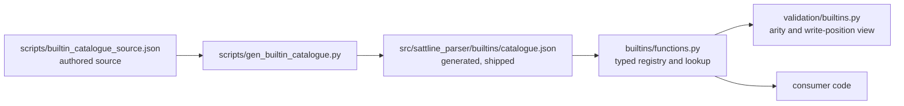
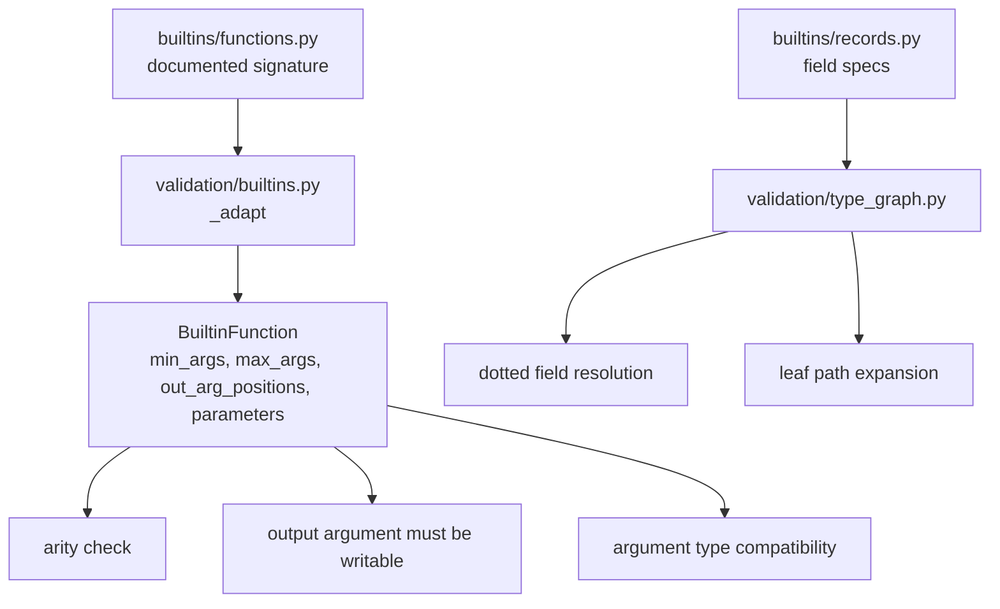

# Builtins

The `builtins/` package holds the parser's builtin **language facts**: function
signatures and record field specifications. It contains no validation policy
and no consumer-specific data. Consumers decide what to do with a signature or
a field list.

## Function catalogue



`catalogue.json` is generated. Never edit it by hand.

```bash
python scripts/gen_builtin_catalogue.py          # rewrite catalogue.json
python scripts/gen_builtin_catalogue.py --check  # verify it is current
```

A test runs the `--check` path, so a stale catalogue fails the suite.

### What the catalogue carries

| Bucket | Count at the time of writing | Meaning |
| --- | --- | --- |
| Documented functions | 171 | Full signature transcribed from the public manuals |
| Documented, untyped | 2 | `GetPrivilegeFlag`, `ResetPrivilegeFlag`; arity only |
| Internal registrations | 191 | Names the system binds for compiled programs; no public manual describes them |
| Not located | 9 | Names kept only so arity checks keep working; listed under `meta.not_located` |
| Documented total | 171 | Counts only the manual-documented names |

The generated header records these numbers. `documented_total` excludes
`not_located` and `internal` so it stays comparable with the manual's own
count.

The internal and not-located buckets are kept because shipped library sources
call those names. A call to one now gets arity and argument checks instead of
passing silently. This is a deliberate trade: the package knows the arity even
when it does not know the full documentation.

### Parameter model

```python
@dataclass(frozen=True, slots=True)
class BuiltinParameter:
    name: str
    datatype: str
    direction: BuiltinDirection   # "in", "in var", "out", "inout"
    sorting: BuiltinSorting       # "RS", "WS", "RS/WS", "NoS"
    ownership: BuiltinOwnership   # "RO", "WO", "RO/WO", "NoO"
    optional: bool = False
```

Optional parameters are trailing-only. The generator rejects a required
parameter after an optional one. The validator uses the leading required count
as a call's minimum arity.

`BuiltinFunction` also carries `kind` (`function` or `procedure`), `return_type`,
`precision_scangroup`, and `typed`. A `typed=False` entry still has an arity.

### Name lookup

Function names are case-insensitive and use the same `fold_identifier` as the
rest of the language. `BUILTIN_FUNCTIONS` is keyed by canonical name;
`get_function_signature` resolves aliases. `EqualString` is documented with
that spelling; the catalogue carries `equalstrings` as the canonical key and
`EqualString` as an alias.

## Record field specifications

`builtins/records.py` holds:

- `BUILTIN_RECORD_SPECS`: an ordered `name -> tuple[(field, datatype), ...]`
  for every builtin record datatype;
- `OPAQUE_BUILTIN_RECORD_NAMES`: native handles whose fields are not
  addressable;
- `FIELDLESS_BUILTIN_RECORD_NAMES`: names with no fields at all;
- `BUILTIN_DECLARED_DATATYPE_NAMES`: every declared builtin datatype name.

The tables cover the builtin datatype reference in the public manuals and the
datatype declarations a system configuration ships.

Only three entries carry an empty spec: `tObject`, `ArrayObject`, and
`QueueObject`. They are native object handles with no addressable fields, so an
empty spec there is the complete answer rather than a missing one. Every other
name has its declared fields.

## How validation uses the facts



The validator adapts the documented signature into:

- `min_args`: the count of leading required parameters;
- `max_args`: the total parameter count;
- `out_arg_positions`: 1-based positions that must resolve to a writable
  variable reference;
- `parameters`: the documented direction and datatype, used by the argument
  type rule.

Unknown call names are left alone. Only calls whose name appears in the
registry are checked, because an unknown name may be a user function defined
elsewhere.

`builtin_datatype_typo` suggests a builtin datatype name when a custom datatype
string is within a bounded edit distance of exactly one builtin. It never fires
for an exact match, which is already normalized to `Simple_DataType` by
`Variable`.

## Public surface

| Name | Meaning |
| --- | --- |
| `BUILTIN_FUNCTIONS` | Canonical name to signature |
| `BUILTIN_ALIASES` | Alias to canonical name |
| `CATALOGUE_META` | Generated header metadata |
| `BuiltinFunction` | Signature value object |
| `BuiltinParameter` | Parameter value object |
| `get_function_signature(name)` | Resolve a name or alias |
| `is_builtin_function(name)` | Membership test |
| `BUILTIN_RECORD_SPECS` | Record field tables |
| `BUILTIN_DECLARED_DATATYPE_NAMES` | Declared builtin datatype names |
| `OPAQUE_BUILTIN_RECORD_NAMES` | Opaque handle names |
| `FIELDLESS_BUILTIN_RECORD_NAMES` | Fieldless names |
| `BuiltinFieldSpec` | Field spec type |

## Adding a builtin

1. Add the entry to `scripts/builtin_catalogue_source.json`, not to
   `catalogue.json`.
2. Record its source in the source file's metadata. A signature without a
   reproducible source is not accepted. See the public tree rule in
   `AGENTS.md`.
3. Run the generator.
4. Run `python scripts/gen_builtin_catalogue.py --check`.
5. Add a fixture that calls the builtin and a test for the arity and argument
   behaviour.
6. Update this document if the counts or the provenance rules change.

For a record type, add its ordered field list to `records.py` and add a test
that resolves at least one dotted path through it.

## Tests that pin builtins

| Test | What it protects |
| --- | --- |
| `tests/builtins/` | Catalogue freshness and signature shape |
| `tests/parser/test_validation_types.py` | Argument type and arity rules |
| `tests/parser/test_validation_rules.py` | Builtin call rules |
| `tests/parser/test_parser_core_ast_model.py` | Datatype normalization |
