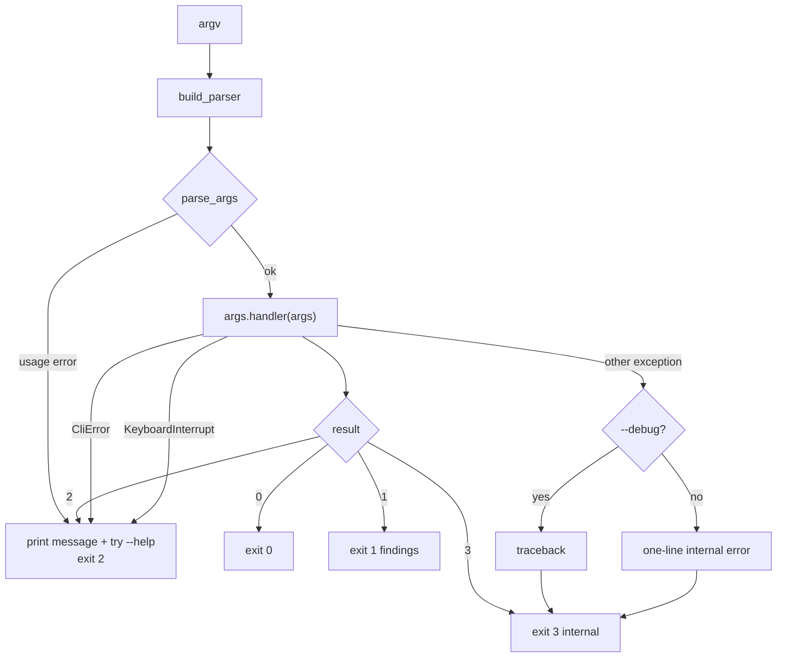

# Command line

The `sattline` command is a read-only, JSON-first wrapper over the library. It
adds no semantics: every command maps onto a documented library call and emits
one finding shape. It is designed for agents, scripts, and CI, not for
interactive editing.

```bash
sattline <command> [options]
python -m sattline_parser <command> [options]
```

There is no `--fix`, no network access, and no watch mode.

## Dispatch and exit codes



| Exit code | Meaning |
| --- | --- |
| `0` | Clean |
| `1` | Findings (or a diff that changed, or a query with no rows) |
| `2` | Usage or input problem |
| `3` | Internal error (a bug) |

Agents branch on exit codes, not on prose. A traceback is printed only under
`--debug`.

## Commands

| Command | Maps to | What it answers |
| --- | --- | --- |
| `check` | `parse_and_validate` | Does this source decode, parse, and validate? |
| `parse` | `parse_source_text` | What is the structure of this unit? |
| `query` | `parse_source_text` + AST walk | One structural question: symbols, references, writers, callers, graph objects, interact objects, sequences |
| `rules` | validation rule registry | Which rules exist, what they mean, and whether they are active? |
| `project` | `SattLineProject.load` | What does this tree contain, and how does it depend? |
| `graphics` | `parse_graphics_text` | What bindings and scan messages does this companion have? |
| `decode` | `preprocess_source` | What is this compact/coded source as plain text? |
| `diff` | `analyse` on two units | Which findings and counts moved? |
| `corpus` | `analyse` over a tree | What is the rule histogram for a whole source tree? |
| `version` | package metadata | What tool and schema versions am I talking to? |

### `check`

```bash
sattline check SR/*.s --jsonl
sattline check program.s --rule CONSECUTIVE_SEQUENCE_STEPS --fail-on error
sattline check - --stdin-name editor-buffer.s
```

Reads each source exactly like `parse_source_file` and reports parse-or-decode
failures and validator diagnostics in one shape.

`--rule` accepts a rule id (`SL-V016`), enum name
(`CONSECUTIVE_SEQUENCE_STEPS`), or a synthetic finding id such as
`PARSE_ERROR`, and is repeatable, so output can be narrowed to one rule. An
unknown or inactive rule is a usage error (exit `2`), never a silently empty
report. See [`rules`](#rules) for the registry.

### `parse`

```bash
sattline parse M.s
sattline parse M.s --tree --depth 3
sattline parse M.s --json
```

The default output is a structural summary: program name, encoding, and counts
of module types, submodules, local variables, sequences, equations, graph
objects, and interact objects. `--tree` emits the AST as JSON, bounded by
`--depth` (default 5). At the limit a composite value is replaced by a
placeholder such as `<ModuleDef>` or `<12 items>`, so nothing silently
disappears.

### `query`

```bash
sattline query M.s --what writers --name Counter
sattline query M.s --what symbols --module StartMaster/Changelog
sattline query M.s --what sequences --json
```

`--what` accepts `definitions` (an alias for all symbol kinds), `symbols`,
`references`, `writers`, `callers`, `graph-objects`, `interact-objects`, and
`sequences`. Filters are case-insensitive: `--name` matches a row name,
`--module` matches a slash-separated module path. A query with no rows exits
`1`, because "nothing found" is a finding for a caller that expected a hit.

`references` includes variable uses in header, graphics, interact, and
module-layout annotation tails. A bare bound `InVar_`/`OutVar_` name is reported
with detail `unresolved` because the parser does not evidence how the name
resolves; it carries no source span. A `LitString` tail is a quoted symbol, not
a variable path, and is not reported. Text-object `VarName` references and
`IntObjPickButton` references are reported with their own details; these rows
are AST introspection, not a graphics-companion binding, and the validator does
not diagnose them. The `GroupConn=` name is not a variable use and is not
listed.

### `rules`

```bash
sattline rules
sattline rules SL-V016
sattline rules CONSECUTIVE_SEQUENCE_STEPS --json
```

Lists every rule with its id, enum name, status, and summary. Retired rules are
hidden from the listing unless `--include-retired` is given; a single lookup by
id or name always finds one. `--json` emits one document and `--jsonl` emits one
object per line followed by a summary. An unknown rule exits `2`.

The status is `active` (the validator emits it), `retired` (the form was proved
to load and the check was withdrawn), or `unimplemented` (a reserved code with
no check). The same registry renders the rule table in
[validation.md](validation.md).

### `project`

```bash
sattline project programs/ libs/ --targets MyProgram --json
sattline project programs/ libs/ --graph
sattline project programs/ libs/ --of MyProgram --reverse --depth 2
sattline project programs/ libs/ --cycles
sattline project programs/ libs/ --validate full --fail-on error
```

A root is a library directory: the loader indexes artifacts directly inside it.
When `--targets` is omitted, every source directly under each root is a target.
`--lenient` is the CLI spelling of `strict=False`. `--no-cache` bypasses the
parser caches; `--cache-dir` points them at a private directory. `--cycles`
reports every cycle in the project view once as an ordered path; cycles with the
same members in a different order are distinct.

### `graphics`

```bash
sattline graphics drawing.y
sattline graphics drawing.y --json
```

Refuses a `.s`/`.x` source. Conversely, `check`, `parse`, `query`, `decode`,
`diff`, and `corpus` refuse a `.g`/`.y` companion, so a companion is never
reported as broken source.

### `decode`

```bash
sattline decode legacy.x
sattline decode legacy.x --report
sattline decode legacy.x --json
```

Prints the decoded text by default, a JSON report with `--report`, or the text
inside a JSON document with `--json`.

### `diff`

```bash
sattline diff Old.s New.s
sattline diff Old.s New.s --json
```

Compares findings by `(rule, message)` and compares structural counts. It is a
regression aid, not a semantic diff. Exit `1` when anything changed.

### `corpus`

```bash
sattline corpus tests/fixtures/corpus --summary
sattline corpus src --jobs 8 --json
```

Scans for `.s`/`.x` recursively. `--jobs` uses a thread pool. The output is a
rule histogram plus the failing files, or a full JSON result unless `--summary`
is given.

### `version`

```bash
sattline version
sattline version --json
```

The JSON payload lists every command and its schema id, so a client can verify
compatibility before parsing output.

## Output modes

| Flag | Effect |
| --- | --- |
| (none) | Human-readable text |
| `--json` | One JSON document |
| `--jsonl` | One JSON object per line, then a summary object |

`--json` and `--jsonl` are mutually exclusive. Findings are never printed as a
second document alongside a JSON payload: they ride inside the same object.

## The finding shape

Every problem, whether a parse error, a decode error, or a validator
diagnostic, becomes one `Finding`:

```json
{
  "severity": "error",
  "message": "unexpected end of file; expected ';'",
  "rule": "PARSE_ERROR",
  "file": "program.s",
  "line": 12,
  "column": 20,
  "start": 345,
  "end": 346,
  "hint": "the unit ends before a required ';'; the last construct is incomplete",
  "source_line": "ENDDEF (*BasePicture*)"
}
```

| Field | Meaning |
| --- | --- |
| `severity` | `error` for parse, decode, project, and validation findings; `warning` for graphics scan messages |
| `message` | A sentence about the source |
| `rule` | Machine-only id: `PARSE_ERROR`, `DECODE_ERROR`, `PROJECT_LOAD_ERROR`, `GRAPHICS_SCAN`, a `DiagnosticCode` enum name such as `UNDEFINED_VARIABLE` (`SL-V019` is its id), or a corpus read error |
| `file` | Display path |
| `line`, `column` | One-based location in the original source |
| `start`, `end` | Zero-based character range in the original source |
| `hint` | Actionable sentence, when one is known |
| `source_line` | The original source line at `line` |

A rule id is never printed as prose. It exists for baselines, filters, and
diffs.

## Shared flags

| Flag | Applies to | Meaning |
| --- | --- | --- |
| `--stdin-name PATH` | source commands | Required when reading `-`, so findings are attributable |
| `--paths given\|absolute` | source commands | How to render paths |
| `--rule RULE` | `check` | Filter by rule id or enum name, repeatable; synthetic ids such as `PARSE_ERROR` are accepted |
| `--max-findings N` | `check` | Limit printed findings; the exit code still reflects all of them |
| `--fail-on none\|error` | `check`, `project`, `corpus` | Which findings make the exit code `1` (`never` is accepted as an alias) |
| `--depth N` | `parse --tree`, `project --of` | Bound output or traversal |

## JSON schemas

Every payload is tagged with `sattline.v1.<command>`:

| Command | Schema |
| --- | --- |
| `check` | `sattline.v1.check` |
| `parse` | `sattline.v1.parse` |
| `query` | `sattline.v1.query` |
| `project` | `sattline.v1.project` |
| `graphics` | `sattline.v1.graphics` |
| `decode` | `sattline.v1.decode` |
| `diff` | `sattline.v1.diff` |
| `corpus` | `sattline.v1.corpus` |
| `rules` | `sattline.v1.rules` |
| `version` | `sattline.v1.version` |

`sattline version --json` is the authoritative list. A schema change is a
public change and must be called out in the changelog.

## Input handling

`read_source` mirrors `parse_source_file`:

- a file is read as bytes, decoded as cp1252, and coded streams are decoded
  first;
- stdin is read as bytes and requires `--stdin-name`;
- a decode failure becomes `CliError` and exit `2`;
- marker-compressed text is left as written so provenance stays anchored to the
  original source.

## Tests that pin the CLI

| Test | What it protects |
| --- | --- |
| `tests/cli/test_cli_core.py` | Dispatch, exit codes, shared flags |
| `tests/cli/test_cli_check.py` | Finding shape and filters |
| `tests/cli/test_cli_parse.py` | Summary and tree output |
| `tests/cli/test_cli_query.py` | Query kinds and filters |
| `tests/cli/test_cli_project.py` | Project output, graph, cycles |
| `tests/cli/test_cli_project_validation.py` | Validation scope output |
| `tests/cli/test_cli_graphics.py` | Companion output and refusal |
| `tests/cli/test_cli_decode_diff_corpus.py` | Decode, diff, and corpus |
| `tests/cli/test_cli_coded.py` | Coded input through the CLI |
