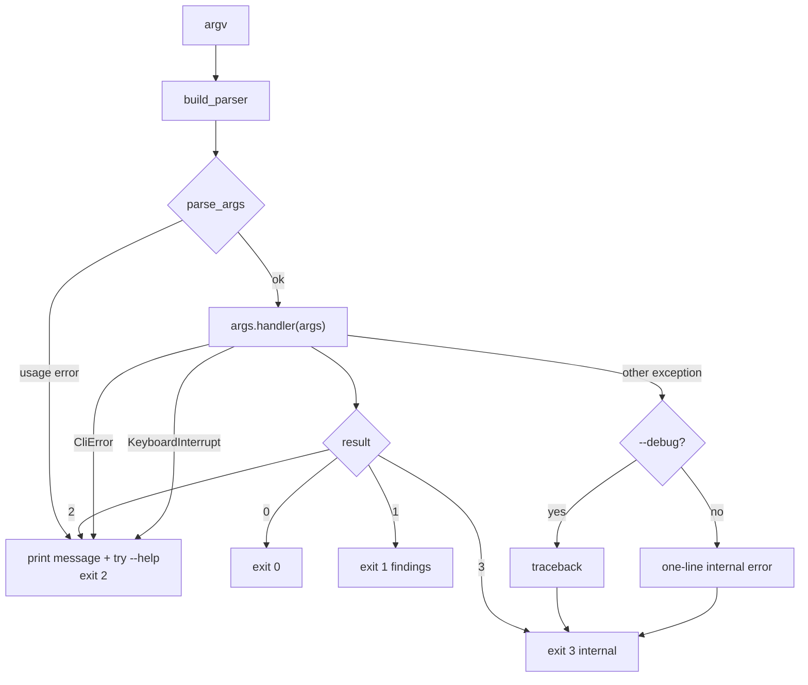

# Command line

The `sattline` command is a JSON-first wrapper over the library. It never
modifies a source tree and has no `--fix`, no network access and no watch mode,
but `project` caches parsed ASTs under the user's cache directory unless
`--no-cache` is given. Every command maps onto a documented library call, and
the source commands report problems in one finding shape. It is designed for
agents, scripts, and CI, not for interactive editing.

```bash
sattline <command> [options]
sattline --debug <command> [options]
python -m sattline_parser <command> [options]
```

There is no `--fix`, no network access, and no watch mode.

## Dispatch and exit codes



| Exit code | Meaning |
| --- | --- |
| `0` | Clean |
| `1` | Findings (or a diff that changed, or a query with no rows) |
| `2` | Usage or input problem |
| `3` | Internal error (a bug) |

Agents branch on exit codes, not on prose. A traceback is printed only under
`--debug`. `--debug` is a top-level flag, so it comes before the command:
`sattline --debug check program.s`. After the command name it is an unknown
option and exits `2`.

## Commands

| Command | Maps to | What it answers |
| --- | --- | --- |
| `check` | `parse_and_validate` | Does this source decode, parse, and validate? |
| `parse` | `parse_source_text` | What is the structure of this unit? |
| `query` | `parse_source_text` + AST walk | One structural question: symbols, references, writers, callers, graph objects, interact objects, sequences |
| `rules` | validation rule registry | Which rules exist, what they mean, and whether they are active? |
| `project` | `SattLineProject.load` | What does this tree contain, and how does it depend? |
| `graphics` | `parse_graphics_text` | What bindings and scan messages does this companion have? |
| `decode` | `preprocess_source` | What is this compact/coded source as plain text? |
| `diff` | `analyse` on two units | Which findings and counts moved? |
| `corpus` | `analyse` over a tree | What is the rule histogram for a whole source tree? |
| `version` | package metadata | What tool and schema versions am I talking to? |

### `check`

```bash
sattline check SR/*.s --jsonl
sattline check program.s --rule CONSECUTIVE_SEQUENCE_STEPS --fail-on error
sattline check - --stdin-name editor-buffer.s
```

Reads each source exactly like `parse_source_file` and reports parse-or-decode
failures and validator diagnostics in one shape.

`--rule` accepts a rule id (`SL-V016`), enum name
(`CONSECUTIVE_SEQUENCE_STEPS`), or one of the two synthetic finding ids this
command emits itself: `PARSE_ERROR` and `DECODE_ERROR`. It is repeatable, so
output can be narrowed to one rule. An unknown rule, an inactive rule, or
another command's synthetic id (such as `READ_ERROR`, which only `corpus`
reports) is a usage error (exit `2`), never a silently empty report. See
[`rules`](#rules) for the registry.

### `parse`

```bash
sattline parse M.s
sattline parse M.s --tree --depth 3
sattline parse M.s --json
sattline parse M.s --json --compact
```

The default output is a structural summary: program name, encoding, and counts
of module types, submodules, local variables, sequences, equation blocks, graph
objects, and interact objects. The counts cover the whole module tree, so a
nested submodule's declarations and code blocks are included, and the summary
agrees with a `walk` over the picture. `diff` compares the same counts. `--tree` emits the AST as JSON, bounded by
`--depth` (default 5). At the limit a composite value is replaced by a
placeholder such as `<ModuleDef>` or `<12 items>`, so nothing silently
disappears. `--compact` prints JSON on one line instead of indented.

### `query`

```bash
sattline query M.s --what writers --name Counter
sattline query M.s --what symbols --module StartMaster/Changelog
sattline query M.s --what sequences --json --limit 5
```

`--what` accepts `symbols`, `references`, `writers`, `callers`,
`graph-objects`, `interact-objects`, and `sequences`. Filters are
case-insensitive: `--name` matches a row name, `--module` matches a
slash-separated module path, and `--limit N` stops after `N` rows. A query with
no rows exits `1`, because "nothing found" is a finding for a caller that
expected a hit.

`references` includes variable uses in header, graphics, interact, and
module-layout annotation tails. A bare bound `InVar_`/`OutVar_` name is reported
with detail `unresolved` because the parser does not evidence how the name
resolves. The row carries the tail's source span. A `LitString` tail is a quoted
symbol, not a variable path, and is not reported. Text-object `VarName`
references and `IntObjPickButton` references are ordinary `VarRef` rows, so
filtering the rows on `VarRef` gives every reference in the unit. These rows are
AST introspection, not a graphics-companion binding, and the validator does not
diagnose them. The `GroupConn=` name is not a variable use and is not listed.

### `rules`

```bash
sattline rules
sattline rules SL-V016
sattline rules CONSECUTIVE_SEQUENCE_STEPS --json
```

Lists every rule with its id, enum name, status, and summary. Retired rules are
hidden from the listing unless `--include-retired` is given; a single lookup by
id or name always finds one. `--json` emits one document and `--jsonl` emits one
object per line followed by a summary. An unknown rule exits `2`.

The status is `active` (the validator emits it), `retired` (the form was proved
to load and the check was withdrawn, or another rule already covers it), or
`unimplemented` (a reserved code with no check). The same registry renders the rule table in
[validation.md](validation.md).

### `project`

```bash
sattline project programs/ libs/ --targets MyProgram --json
sattline project programs/ libs/ --graph
sattline project programs/ libs/ --of MyProgram --reverse --depth 2
sattline project programs/ libs/ --validate full --fail-on error
```

A root is a library directory: the loader indexes artifacts directly inside it.
Roots are searched in the order written, and an earlier root wins: when two
roots hold a unit with the same name, only the earlier body is loaded. When
`--targets` is omitted, every source directly under each root is a target.
A missing or unparseable artifact is a load failure: the command reports
`cannot load project` with the underlying error and exits `1`, whatever
`--fail-on` says. A recursive `.l`/`.z` dependency
(`DependencyCycleError`) and a module type that instantiates itself
(`ModuleTypeCycleError`) are load failures too, reported the same way. There is
no partial project: `--fail-on` governs validation findings only.

Each program row reports `distribution` (the resolved companion extension or
`null`), `has_executing_system` (`true`, `false`, or `null` when no companion was
found), and `executing_systems` (one `kind` / `name` / `download` object per
target). A companion that exists but does not parse is a load failure, never an
empty list. See [project.md](project.md#distribution-companion).

| Flag | Meaning |
| --- | --- |
| `--search-path PATH` | Comma-separated roots in lookup order, as an alternative to positional `ROOT...`; backslashes are accepted |
| `--search-path-base DIR` | Resolve relative `--search-path` entries under `DIR` |
| `--mode draft\|official` | Which artifacts to resolve. Default `draft` |
| `--targets A,B` | Only load these program names. Default: every source under the roots |
| `--workers N` | Parse bodies in `N` processes. Default `min(8, cpu_count)`; `1` parses in this process |
| `--cache-dir DIR` | Parser cache directory |
| `--no-cache` | Bypass the project caches |
| `--validate invoked\|full\|none` | What to validate. Default `invoked` |
| `--fail-on none\|error` | Whether a validation finding fails the run. Default `error` |

The project caches live under `$XDG_CACHE_HOME/sattline-parser/project` (or
`~/.cache/sattline-parser/project`) unless `--cache-dir` names another private
directory; a relative `XDG_CACHE_HOME` is ignored, and an unknown home directory
disables the cache. `--no-cache` makes the load hermetic: the project caches
neither read nor write. The compiled grammar cache under the temporary directory
is independent of this flag. A first load in an empty directory writes the
cache; every later load of an unchanged tree skips parsing. The directory holds
parsed ASTs of the loaded sources, so keep it private.

`--cycles` is gone, and the JSON payload no longer carries a `cycles` key: a
recursive dependency chain or a self-instantiating module type is a structural
load error, so the command reports `cannot load project` and exits `1` instead
of listing cycles.

### `graphics`

```bash
sattline graphics drawing.y
sattline graphics drawing.y --json
```

Refuses a `.s`/`.x` source. Conversely, `check`, `parse`, `query`, `decode`, and
`diff` refuse a `.g`/`.y` graphics companion and a `.p`/`.q` distribution
companion, so a companion is never reported as broken source. The refusal uses
the name that identifies the input: the path itself, or `--stdin-name` when the
input is `-`, so `sattline check --stdin-name x.g -` is refused exactly like a
`.g` path.

### `decode`

```bash
sattline decode coded.x
sattline decode coded.x --report
sattline decode coded.x --json
```

Prints the decoded text by default, a JSON report with `--report`, or the text
inside a JSON document with `--json`.

### `diff`

```bash
sattline diff Program.x Program.s
sattline diff Program.x Program.s --json
```

A SattLine program or library is one unit made of four files: the code body,
the dependency sidecar, the graphics companion, and the distribution companion.
`diff` compares the
official `.x` code body of a unit with its draft `.s` code body. In a unit the
two versions are the official `.x` and the draft `.s`, never two `.s` files;
the command itself accepts any two code sources. It compares findings by
`(rule, message)` and compares structural counts. It is a regression aid, not a
semantic diff. Exit `1` when anything changed.

### `corpus`

```bash
sattline corpus tests/fixtures/corpus --summary
sattline corpus src --jobs 8 --json
```

Scans for `.s`/`.x` recursively. `--jobs` uses a thread pool. The output is a
rule histogram plus the failing files, or a full JSON result unless `--summary`
is given.

### `version`

```bash
sattline version
sattline version --json
```

The JSON payload lists every command and its schema id, so a client can verify
compatibility before parsing output.

## Output modes

| Flag | Effect |
| --- | --- |
| (none) | Human-readable text |
| `--json` | One JSON document |
| `--jsonl` | Command-specific stream, described below |

`--json` and `--jsonl` are mutually exclusive. Findings are never printed as a
second document alongside a JSON payload: they ride inside the same object.

`--jsonl` does not mean the same thing in every command, because a command that
reports one unit has nothing to stream:

| Command | `--jsonl` output |
| --- | --- |
| `check` | One finding object per line, then a summary object |
| `rules` | One rule object per line, then a summary object |
| `query` | One row object per line, with no summary object |
| `parse` | One compact summary document |
| `project` | One compact document |
| `graphics` | One compact document |
| `diff` | One compact document |
| `corpus` | One compact document |
| `decode` | Not accepted; use `--report` or `--json` |
| `version` | Not accepted; use `--json` |

## The finding shape

`check`, `parse`, `query`, and `graphics` report a problem as one `Finding`:

```json
{
  "severity": "error",
  "message": "Reference to undefined variable 'Counter'",
  "rule": "UNDEFINED_VARIABLE",
  "file": "program.s",
  "line": 12,
  "column": 20,
  "start": 345,
  "end": 354,
  "hint": null,
  "source_line": "   Total = Counter + 1;"
}
```

| Field | Meaning |
| --- | --- |
| `severity` | `error` for parse, decode, project-load, and validation findings; `warning` for graphics scan messages |
| `message` | A sentence about the source |
| `rule` | Machine-only id: `PARSE_ERROR`, `DECODE_ERROR`, `PROJECT_LOAD_ERROR`, `GRAPHICS_SCAN`, a `DiagnosticCode` enum name such as `UNDEFINED_VARIABLE` (`SL-V019` is its id), or a corpus read error |
| `file` | Display path |
| `line`, `column` | One-based location in the original source, or `null` when the failure has no position, as with a decode error |
| `start`, `end` | Zero-based character range in the original source, or `null` when no range is known, as with a parse error or a decode error |
| `hint` | Actionable sentence, when one is known |
| `source_line` | The original source line at `line`, or `null` |

A rule id is never printed as prose. It exists for baselines, filters, and
diffs.

`sattline project --json` does not use `Finding`. Its payload carries:

| Key | Shape |
| --- | --- |
| `programs` | One row per loaded artifact: `name`, `code`, `graphics`, `deps`, `distribution`, `sidecar`, `dependencies`, `source`, `library`, `resolved_base`, `has_executing_system`, `executing_systems` |
| `edges` | `{"from": dependent, "to": dependency}` over casefolded names |
| `diagnostics` | One row per non-fatal load condition: `kind` (`sidecar-missing`, `sidecar-elsewhere`, `sidecar-empty`, or `sidecar-family-mismatch`), `program`, `detail`, `path` |
| `validation` | One row per diagnostic: `program`, `code` (`SL-V###`), `message`, `line`, `column` |
| `findings` | Present only when the tree could not be loaded at all: one `Finding` with rule `PROJECT_LOAD_ERROR` |

A validation row has no `severity`, because every row it carries is an error.
`line` and `column` are `null` when the diagnostic has no span.

`sattline diff` reports `FindingDelta` rows instead: `rule`, `message`, and
`count`, split into `findings.added` and `findings.removed`, plus
`counts.changed`.

## Shared flags

| Flag | Applies to | Meaning |
| --- | --- | --- |
| `--debug` | top level | Print a traceback for internal errors. It comes before the command |
| `--stdin-name PATH` | source commands | Required when reading `-`, so findings are attributable; a companion suffix here is refused like a companion path |
| `--paths given\|absolute` | source commands | How to render paths, in findings and in the document-level `file` key. Default `given` |
| `--rule RULE` | `check` | Filter by rule id or enum name, repeatable; only this command's own synthetic ids (`PARSE_ERROR`, `DECODE_ERROR`) are accepted |
| `--max-findings N` | `check` | Limit printed findings; the exit code still reflects all of them |
| `--limit N` | `query` | Stop after `N` rows |
| `--fail-on none\|error` | `check`, `project`, `corpus` | Which findings make the exit code `1` |
| `--compact` | `parse` | Emit JSON on one line |
| `--depth N` | `parse --tree`, `project --of` | Bound output or traversal |

"Source commands" means `check`, `parse`, `query`, `graphics`, `decode`, and
`diff`: the commands that read a source unit or a companion through the same
input layer.

## JSON schemas

Every payload is tagged with `sattline.v1.<command>`:

| Command | Schema |
| --- | --- |
| `check` | `sattline.v1.check` |
| `parse` | `sattline.v1.parse` |
| `query` | `sattline.v1.query` |
| `project` | `sattline.v1.project` |
| `graphics` | `sattline.v1.graphics` |
| `decode` | `sattline.v1.decode` |
| `diff` | `sattline.v1.diff` |
| `corpus` | `sattline.v1.corpus` |
| `rules` | `sattline.v1.rules` |
| `version` | `sattline.v1.version` |

`sattline version --json` is the authoritative list. A schema change is a
public change and must be called out in the changelog.

## Input handling

`read_source` mirrors `parse_source_file`:

- a file is read as bytes, decoded as cp1252, and coded streams are decoded
  first;
- stdin is read as bytes and requires `--stdin-name`;
- a decode failure becomes `CliError` and exit `2`;
- marker-compressed text is left as written so provenance stays anchored to the
  original source;
- `--paths absolute` resolves the display path, in findings and in the
  document-level `file` key.

## Tests that pin the CLI

| Test | What it protects |
| --- | --- |
| `tests/cli/test_cli_core.py` | Dispatch, exit codes, shared flags |
| `tests/cli/test_cli_check.py` | Finding shape and filters |
| `tests/cli/test_cli_parse.py` | Summary and tree output |
| `tests/cli/test_cli_query.py` | Query kinds and filters |
| `tests/cli/test_cli_rules.py` | Rule registry listing and lookup |
| `tests/cli/test_cli_project.py` | Project output and graph |
| `tests/cli/test_cli_project_validation.py` | Validation scope output and `--fail-on` |
| `tests/cli/test_cli_graphics.py` | Companion output and refusal |
| `tests/cli/test_cli_decode_diff_corpus.py` | Decode, diff, and corpus |
| `tests/cli/test_cli_coded.py` | Coded input through the CLI |
