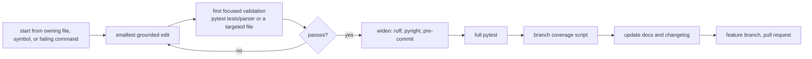

# Development

## Setup

Requires Python 3.12 or newer.

```bash
git clone https://github.com/SorenHJohansen/sattline-parser.git
cd sattline-parser
python -m venv .venv
source .venv/bin/activate
pip install -e ".[dev]"
```

`uv` is the CI standard and the lockfile source:

```bash
uv sync --frozen --all-extras
```

The `fuzz` extra is separate because Atheris is Linux and FreeBSD only:

```bash
pip install -e ".[dev,fuzz]"
```

## Repository map

| Path | Role |
| --- | --- |
| `src/sattline_parser/` | The package |
| `docs/` | This documentation |
| `tests/` | Parser, project, CLI, builtins, packaging suites |
| `scripts/` | Coverage gate, catalogue generator, docs checks, probes, profiling |
| `.github/workflows/` | CI, fuzz, docs, publish |
| `.clusterfuzzlite/` | Continuous fuzzing configuration |
| `.opencode/skills/` | Repo-local skill with map, recipes, and verification ladder |
| `.opencode/commands/` | Repo-local commands: `verify`, `release`, `review` |
| `.opencode/agents/` | Repo-local subagents, including the read-only reviewer |
| `AGENTS.md` | AI control-plane entry point |
| `README.md` | Public entry point |
| `CHANGELOG.md` | Release history |

## Workflow



Rules:

1. Never commit directly to `main`. Work on a feature branch and land through a
   pull request.
2. Never commit, push, tag, merge, open a pull request, or delete a branch
   without explicit permission for that specific action. Propose the command,
   then wait.
3. Start from the owning file. A parser bug belongs in `grammar/`,
   `source_io.py`, or `transformer/`; a rule bug belongs in `validation/`; a
   discovery bug belongs in `project/`.
4. Make the smallest edit that tests the hypothesis, then run the first focused
   check immediately. Widen only after it passes.
5. Prefer a cohesive module that exceeds 500 lines over a mechanical
   `_part1`/`_part2` split. Split when the split is a real responsibility
   boundary.
6. Keep touched Python files Pyright strict-clean.
7. Do not add imports from consumer tooling. This package ships standalone on
   PyPI and must stay self-contained.
8. Back every new rule or data table with something reproducible: a fixture, a
   public manual, or a black-box check. Never add data extracted from
   third-party binaries.

## Writing style

The repository follows the global rules in `AGENTS.md`:

- No dashes used as punctuation. Use a comma, a colon, a full stop,
  parentheses, or a new sentence. Hyphens inside compound words and
  identifiers are normal text and stay.
- Describe behaviour, not origin. Say "the syntax accepts `X`", never where the
  rule was learned. Keep out code addresses, third-party build numbers, and the
  names of customer libraries, projects, or people.
- This project is unofficial. Use "SattLine" only to name the file format; do
  not imply affiliation with ABB.

## AI-first documentation

This repository is maintained by AI agents. These conventions keep the
documentation usable as context:

- `AGENTS.md` is the short control plane: purpose, boundary, map, invariants,
  and workflow. It links to `docs/` for detail.
- `docs/README.md` is the index and the responsibility statement.
- Each document owns one subject and cross-links the others.
- Tables are preferred over prose for anything a future agent will look up:
  modules, flags, exit codes, rules, fields.
- Mermaid diagrams describe the graph that actually exists. If an import edge
  changes, update the diagram in the same change.
- Public behaviour changes update the matching document and `CHANGELOG.md`.
- Do not duplicate a fact in three places. Link to the owner.

## AI workspace tooling

The repository ships its own OpenCode workspace:

| Path | Purpose |
| --- | --- |
| `.opencode/skills/sattline-parser/SKILL.md` | Repo map, invariants, recipes, verification ladder |
| `.opencode/commands/verify.md` | Full check ladder |
| `.opencode/commands/release.md` | Release checklist |
| `.opencode/commands/review.md` | Read-only review, run by the reviewer subagent |
| `.opencode/agents/parser-reviewer.md` | Read-only review subagent |
| `.github/pull_request_template.md` | PR checklist for boundary, tests, docs, and generated files |
| `scripts/check_docs.py` | Relative links, dash punctuation, Mermaid extraction |
| `.github/workflows/docs.yml` | Docs CI: links, prose, and Mermaid rendering |

`opencode.json` pins the Pyright LSP to Python files, formats Python with the
project Ruff, blocks direct edits to generated files, and asks before release
actions. The rules are guardrails, not a substitute for the instructions in
`AGENTS.md`.

## Public tree rule

This repository is public. Everything committed is visible to users and to
other agents.

- Describe what the syntax or tool does, not where the knowledge came from.
- Keep out customer names, internal paths, build numbers, and third-party
  binary details.
- A new data table needs a reproducible source: a fixture, a public manual, or
  a black-box check against the real tool.
- The `builtins/README.md` source list is the model to follow.

## Versioning and release

- Releases use calendar versioning: `YYYY.M.N`.
- The version orders releases; it is not a semantic-version compatibility
  contract.
- The public surface is `sattline_parser.__all__`,
  `sattline_parser.api.__all__`, `sattline_parser.project.__all__`,
  `sattline_parser.builtins.__all__`, the documented `sattline` command, and its
  JSON schemas.
- Submodule paths not listed there are internal and may change.
- A patch release preserves existing names and behaviour.
- A breaking change is called out in the changelog and removed in that release.
  There is no deprecation window and no compatibility shim.
- Adding a dataclass field is not breaking. Removing or renaming one is.

## Changelog

`CHANGELOG.md` follows Keep a Changelog. Add a bullet under `Unreleased` for
every user-visible change. A documentation change is user-visible when it
changes the public contract; a pure clarification can be one bullet under
`Changed` or `Documentation`.

## Dependency policy

Runtime dependencies are only:

- `lark[interegular]>=1.3.1,<1.4`
- `regex>=2023.12.25`

The parser does not call `regex` directly; Lark's regex engine does. The floor
is the first release with the Python 3.12 wheels used by CI, not a feature
requirement. CI tests both the locked minimum and the newest version that
satisfies the range.

Adding a runtime dependency is a design decision, not a convenience. Prefer the
standard library, then an existing dependency, then a new one.

## Checklist before a pull request

- [ ] The focused test passes.
- [ ] `pytest -q` passes.
- [ ] `python scripts/check_branch_coverage.py` passes.
- [ ] `ruff check src tests scripts benchmarks` passes.
- [ ] `ruff format --check src tests scripts benchmarks` passes.
- [ ] `pyright src tests benchmarks` passes.
- [ ] `bandit -q -r src -x tests -c pyproject.toml` passes.
- [ ] `python scripts/check_docs.py` passes when Markdown changed.
- [ ] New syntax or rules have fixtures.
- [ ] New rules have golden expectations.
- [ ] New builtins update the catalogue source, not the generated file.
- [ ] `docs/` is updated.
- [ ] `CHANGELOG.md` has an entry.
- [ ] No consumer imports were added.
- [ ] No dash punctuation was added.
- [ ] No third-party identifiers were added.
