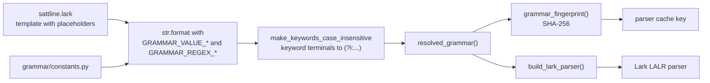
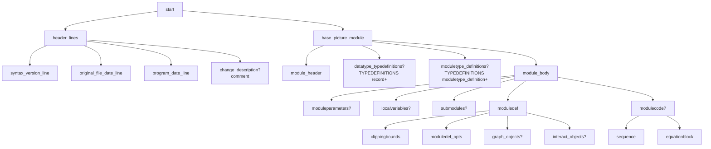
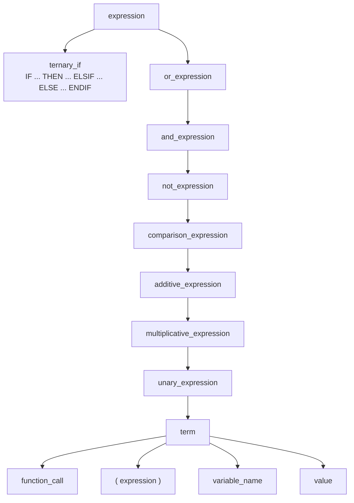
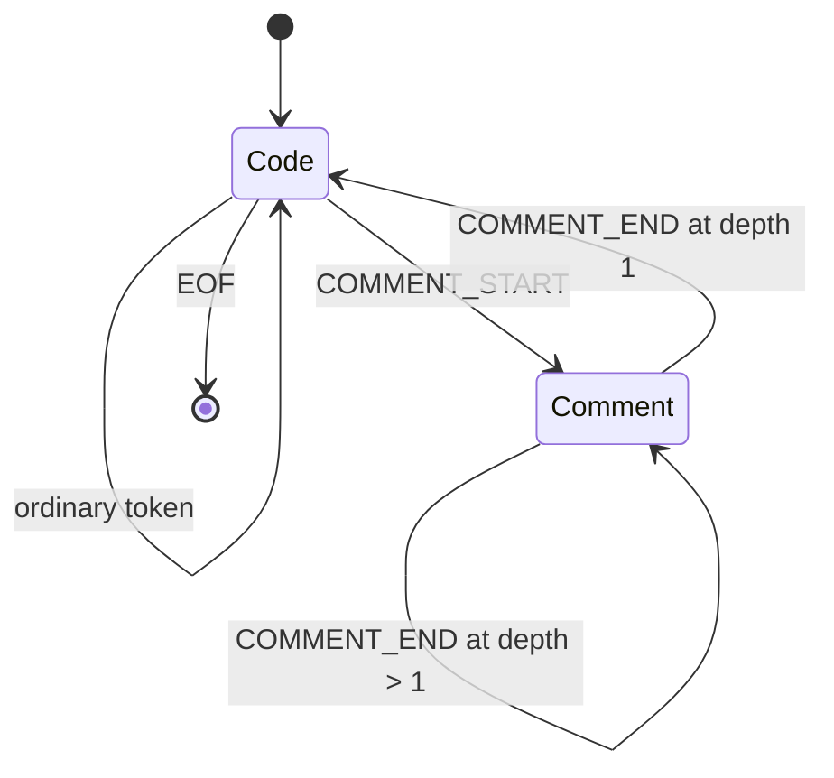
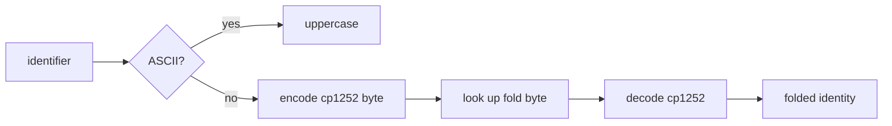

# Grammar and tokenization

The canonical grammar is `src/sattline_parser/grammar/sattline.lark`. Everything
else in this document describes how that file is resolved, lexed, and mapped
onto the AST.

## From template to executable grammar



Why a template rather than a literal grammar:

- Keywords and operators are spelled once in `constants.py`, so the grammar,
  the transformer, and the error renderer agree.
- The scanner token table and the grammar can be checked against each other.
- `grammar_fingerprint()` gives the parser cache a stable identity. A grammar
  edit changes the fingerprint, so a warm cache cannot serve the old language.

`make_keywords_case_insensitive` rewrites named terminals:

- `NAME: "Text"` becomes `NAME: /(?i:Text)\b/`.
- `NAME: /pattern/` becomes `NAME: /(?i:pattern)/`.
- Punctuation-only terminals stay string literals.

It uses `(?i:...)` rather than a bare `(?i)` because Lark concatenates terminal
patterns into one alternation, where a leading flag would be illegal.

The `\b` is deliberate. A keyword is a whole word, so it must end at a
non-word character. A source therefore separates a keyword from following text
with whitespace, punctuation, or a line break, and `PRIVATE_MODULEDEFINITION`
is one name rather than the `PRIVATE_` and `MODULEDEFINITION` keywords.

`DateCode_` is the one exception: its rule is `DATECODE_PREFIX SL_DATECODE`, so
a digit after it is the datecode and not part of a longer word. The rewriter
uses `(?![^\W\d])` after that literal: a letter or underscore still blocks the
keyword, a digit does not. `DateCode_1` is therefore the keyword and `1` in the
datecode slot, while `DateCode_x` stays one name there. In an identifier
position the contextual lexer does not accept `DATECODE_PREFIX`, so
`DateCode_1` is one identifier again.

## Grammar shape



The top level is deliberately small: three quoted header lines, then one
`BasePicture` module. A syntactically incomplete top-level unit fails here
before any nested construct is considered.

### Header lines

`syntax_version_line`, `original_file_date_line`, and `program_date_line` are
all `STRING` tokens. The transformer keeps all three inside `HeaderInfo` on the
root `BasePicture`, together with the optional `change_description` comment, and
derives `program_name` from the `name:` field of the program date line.
`HeaderInfo` also exposes the written syntax version, original file date, and
program date. A line the package does not recognise keeps its text and yields
`None` for the field it lacks, so a shadow header from an invalid-input fixture
is preserved rather than rejected.

### Module structure

| Rule | What it represents |
| --- | --- |
| `module_header` | `Name Invocation (x,y,x,y,x) arguments` |
| `base_picture_module` | The root module; the trailing `ENDDEF` and its `;` may be omitted together, but a written `ENDDEF` requires its `;` |
| `invocation_new_module` | A nested module body with its own `MODULEDEFINITION ... ENDDEF` |
| `invocation_module_type` | A reference to a named module type, with optional parameter transfers |
| `frame_module` | `( Frame_Module )`, a pure container |
| `scan_group` | `( GroupConn = [GLOBAL] name )` |
| `moduletype_definition` | `Name = [PRIVATE_] MODULEDEFINITION ... ENDDEF ;` |

`module_body` is `moduleparameters? localvariables? submodules? moduledef
modulecode?`. The `moduledef` is required. The root body's closing `ENDDEF` and
its `;` may be omitted together; a written `ENDDEF` requires the `;`. A nested
body still ends at its own `ENDDEF`. A `ModuleCode` without a `ModuleDef` is not accepted, and the
corpus fixture
`ModuleCodeWithoutModuleDef.s` pins that. A module body has at most one
`moduledef`: a second `ModuleDef` before the closing `ENDDEF` is a syntax error,
and `RepeatedModuleDefBlocks.s` pins that.

### Data types

```
datatype_typedefinitions: TYPEDEFINITIONS record+
record:                   NAME STRING? "=" RECORD_KW sl_datecode? variable_list? ENDDEF_KW module_end_comment? ";"?
variable_group:           variable_item ("," variable_item)* ":" GLOBAL_KW? NAME
                          (CONST_KW | STATE_KW | OPSAVE_KW | SECURE_KW)* opt_var_init? ";"
variable_item:            NAME (STRING | STRING_CRLF)?
```

A record is a name, an optional description, `= RECORD`, an optional datecode,
a field list, and `ENDDEF ;`. A variable group shares a datatype and a set of
attributes among one or more names. The `variable_item` description accepts
`STRING_CRLF` because real sources occasionally contain an unterminated string
in that position.

### Expressions



Precedence, lowest to highest: ternary, `OR`, `AND`, `NOT`, comparison,
additive, multiplicative, unary, term. The transformer folds binary operators
left-associatively into `BinOp` and flattens `OR`/`AND` chains into `BoolOp`
with an operand tuple.

`variable_name` is `NAME (DOT NAME)* STATE_SUFFIX?`, so `Pump.State`,
`Record.Field`, and `Counter:Old` are all one reference shape.

### Sequences and SFC

```
sequence:       (SEQUENCE _sequence_tail ENDSEQUENCE
                | OPENSEQUENCE _sequence_tail ENDOPENSEQUENCE)
_sequence_tail: NAME? seq_control_opt? codeblock_coord objsizedef layer_info? sequence_body
sequence_body:  (code_comment | seq_element)+
seq_element:    seqinitstep | seqstep | seqtransition | seqtransitionsub
                | seqsubstep | seqsub | seqalternative | seqparallel
```

The opener and the closer must match: `SEQUENCE` ends with `ENDSEQUENCE` and
`OPENSEQUENCE` ends with `ENDOPENSEQUENCE`. The shared tail is an inlined rule
(a leading underscore), so the transformer sees the same item order as a single
rule would give it. `Sequence.type` keeps the opener spelling.

Every position-bearing element goes through `seq_element`, so one transformer
hook can attach the element's source span. `SEQFORK` is a suffix of its host
step or transition, not an element of its own.

The accepted body shapes are documented in
`validation/sequences.py` and enforced after parsing, so comments may appear
anywhere. See [validation.md](validation.md).

### Equation blocks

The `equationblock` rule accepts the `EQUATIONBLOCK` and `EQUATIONS` keywords:

```
equationblock: (EQUATIONBLOCK | EQUATIONS) NAME? codeblock_coord? objsizedef?
               layer_info? ":" (code_comment | statement)*
```

Both keywords are accepted and kept distinct in the AST (`Equation.kind`). The
name, coordinates, size, and layer are optional; only the statement list is
required.

### Module definition and graphics objects

`moduledef` carries `ClippingBounds`, layout options, and optional
`GraphObjects` / `InteractObjects` sections. Coordinates can carry tails:
`:InVar_`, `:OutVar_`, or a full expression. The distinction between
`REAL` and `REAL_NOTAIL` (and the matching `SIGNED_INT`, `BOOL`, and `STRING`
variants) exists because a value followed by `:` at the end of a line is a
tail, not a plain value. The `NOTAIL` terminals use a negative lookahead and
have priority 1. `BOOL` accepts `True`, `False`, `On`, and `Off`; `On` and
`Off` have the same meaning as `True` and `False`.

### Numeric literals and signs

A numeric literal may carry a leading `+` or `-` only where a literal may
start. The terminals use a negative lookbehind: after an identifier character,
a digit, `)`, `"`, or `]` the sign is the binary operator, not part of the
next literal. So `1+2`, `1-2`, and `A-1` parse as expressions, while `= -5`,
`( -1.0`, and `* -2` keep a signed literal. A sign inside an exponent
(`1e-3`, `1.0E+10`) belongs to the same literal. Signed coordinates and layout
values are the reason the sign is still accepted at the start of a literal: a
value list separates two literals with nothing but whitespace, so `-1.0 -1.0`
is two values and the second sign cannot be a binary operator. That keeps the
sign in the literal, and `unary_expression` covers the positions where no
literal may start. A consequence is that `1 +2` in an expression reads as two
values, so a source spells a binary operator with no space after it (`1+2`) or
with a space on both sides (`1 + 2`).

## Tokenization

### Line terminators

A line break is CRLF, LF, or a lone CR. The definition is the same in the
grammar's string terminals, the compressed-source scanner, the coded decoder,
and `render_ide_text`, so a CR is never ordinary text for one of them and a line
break for another.

Line and column numbers are a separate rule: the position index and the reported
source line both split on LF. A plain document written with lone CR terminators
therefore parses with CR as a break while its reported positions all stay on the
first line. The coded decoder and `render_ide_text` emit CRLF, so a document that
goes through either of them is unaffected.

- `STRING` and `STRING_NOTAIL` contain no line break, so a lone CR ends the
  literal exactly as LF does, and an unclosed literal is a syntax error.
- `STRING_CRLF` is the unterminated description: it ends at the first line break
  and consumes that terminator, whichever of the three it is.

### Lexer selection

The parser is built with `lexer="contextual"`, but the `ContextualLexer` plugin
is replaced by `SattLineLexer`.



`SattLineLexer` keeps a comment-depth counter **per lexer run**, not on
`self`. The parser and its lexer are cached and shared, so instance state would
leak between concurrent parses. At depth 0 it delegates to the ordinary
per-state lexer. At depth greater than 0 it delegates to a dedicated comment
lexer that only recognizes `COMMENT_START`, `COMMENT_END`, and `COMMENT_TEXT`
and is oblivious to parser state.

`COMMENT_TEXT` is removed from every per-state accepted-terminal set, so comment
text is only ever produced by the dedicated comment lexer. Both delimiters are
kept for the error path: `COMMENT_START` is accepted in every state, so a
comment opener in a position the grammar does not allow reaches the parser as
`(*` and the diagnostic names it, and the fallback lexer keeps `COMMENT_END`, so
a rejected `*)` is reported as the comment end rather than as the `*` that
`MULTIPLY` matches on its own.

### Comment roles

Comments are not stripped. The grammar gives them roles:

| Rule | Role |
| --- | --- |
| `code_comment` | A comment inside a `ModuleCode`, equation block, or SFC body |
| `comment_stmt` | A comment followed by `;` in statement position |
| `module_typedescription` | A description comment in a module header or definition |
| `module_end_comment` | The comment after `ENDDEF` |
| `comments` | A generic comment run in a structural position |

The transformer turns the role-tagged nodes into `CodeComment` values on the
matching AST field. A comment that is syntactically legal but has no AST home is
not attached and is not retained by the returned AST; it is never silently
attached somewhere else. In particular, a `comments` run in a `ComButProc_` body
or inside a colour assignment has no AST field; only `interact_body` comments
become `CodeComment` values.

Comment positions are structural. A comment is accepted in code, in an SFC
body, in the header's change-description slot, after a module header or
definition, after `ENDDEF`, and in a `SUBMODULES` run, including a comment
between the last submodule and the following `ModuleDef`. It is not accepted
between two variable declarations, between `MODULECODE` and its first equation
block or sequence, or at a bare position with no comment production. Those
positions have no production for a comment, so the parser reports the comment
rather than silently dropping it.

### Identifiers and name folding

The `NAME` terminal:

- does not match any keyword (`IF`, `THEN`, `ELSE`, `ELSIF`, `ENDIF`, `AND`,
  `OR`, `NOT`, `True`, `False`, `On`, `Off`, `SUBSEQSTEP`);
- may not begin with a decimal digit. A leading digit would be read as a numeric
  literal wherever a literal may start, so `1E5` is the number `100000.0` in an
  expression and a declaration named `1E5` is rejected with `expected a name`
  rather than becoming a name no expression can reference. The quoted form
  spells such a name: `'1E5'`;
- accepts letters, marks, `_`, `'`, digits after the first character, and every
  printable CP1252 byte;
- accepts a quoted identifier `'...'`, whose body holds no apostrophe and never
  spans a line break. The lexer and the compressed-source scanner share this
  boundary (see [source-provenance.md](source-provenance.md));
- accepts an identifier of any length.

The language limits a declared identifier to 20 characters, so a longer spelling
is a validation finding (`SL-V038`) with the declaration's span, not a lexer
error. Keeping the lexer permissive means the source parses and the finding says
what is wrong, instead of pointing at the twenty-first character as an
unexpected one. A sidecar dependency name is not length-capped either: it is
validated against the identifier character set so it cannot carry a path, and a
body whose declaration exceeds 20 characters is reported by `SL-V038` like any
other declaration.

Identifier comparison is not Unicode case folding. `names.fold_identifier`
implements the CP1252 byte table used by the language:



The table folds `a-z` to `A-Z`, `0x9A` to `0x8A`, `0x9C` to `0x8C`, `0xE0-0xF6`
to `0xC0-0xD6`, `0xF8-0xFE` to `0xD8-0xDE`, and `0xFF` to `0x9F`. Everything
else is identity, so `ß` does not fold and `Straße` never equals `STRASSE`.
Quoted identifiers compare including their quotes, with folding applied inside.

The project layer compares filesystem paths with the platform's own rule
(`os.path.normcase` through `ArtifactIdentity`), which is a different question
from language identity.

### Keywords are case-insensitive

`moduledefinition` and `EndDef` parse exactly like `MODULEDEFINITION` and
`ENDDEF`. The rewriting happens in `keywords.py` after the constants are
substituted. String literals, comment text, and quoted identifiers are
unaffected because only terminals defined in the template are rewritten. A
keyword is a whole word, so a source separates it from the following token:
`PRIVATE_MODULEDEFINITION` is one name, not adjacent keywords. The datecode
prefix is the exception, because the rule after it is a number: `DateCode_1`
is the keyword and `1`.

### Raw words in coded files

A coded source stores keywords as fixed-width `#NN` codes but may contain raw
words that spell a keyword. In coded mode, the lexer retypes a raw keyword-like
word to `NAME` unless the decoder produced its characters. The raw literal
spellings `True`, `False`, `On`, `Off`, and `Default` are exempt because the
compressor always writes them unencoded.

A raw `DateCode_` is the other exception: the rule that follows it is a number,
so a raw prefix with a digit after it stays the keyword half of the
`DATECODE_PREFIX SL_DATECODE` pair instead of becoming an identifier. The
decision reads the text after the token rather than lexing ahead, so the parser
stays in charge of the lexer state.

Three keywords have no scanner code: `EQUATIONS`, `IntObjPickButton`, and
`NewWindow`. A compact document cannot spell them, and the failure is clean; see
[source-provenance.md](source-provenance.md).

This is a lexical decision, not a grammar one.

## Tests that pin the grammar

| Test | What it protects |
| --- | --- |
| `tests/parser/test_parser_core_grammar.py` | Grammar resolution, keyword casing, terminal spellings |
| `tests/parser/test_parser_core_comments.py` | Nested comments, role tagging, comment preservation |
| `tests/parser/test_parser_core_syntax_forms.py` | Accepted and rejected syntax forms |
| `tests/parser/test_parser_core_corpus.py` | Every corpus fixture behaves as declared |
| `tests/parser/test_parser_core_provenance.py` | Positions after decoding |
| `tests/parser/test_parser_core_fuzz.py` | No crash or timeout on hostile input |
