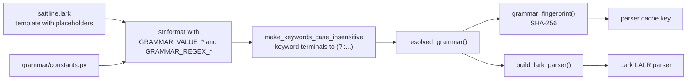
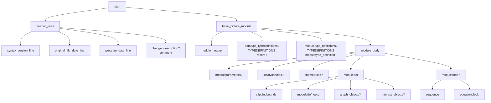
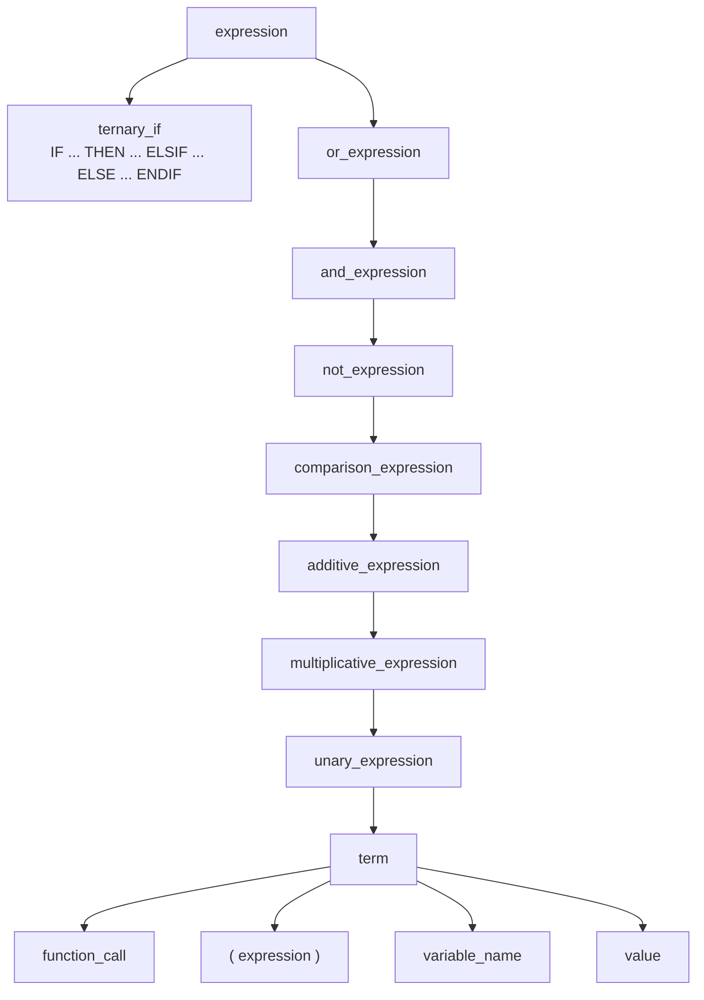
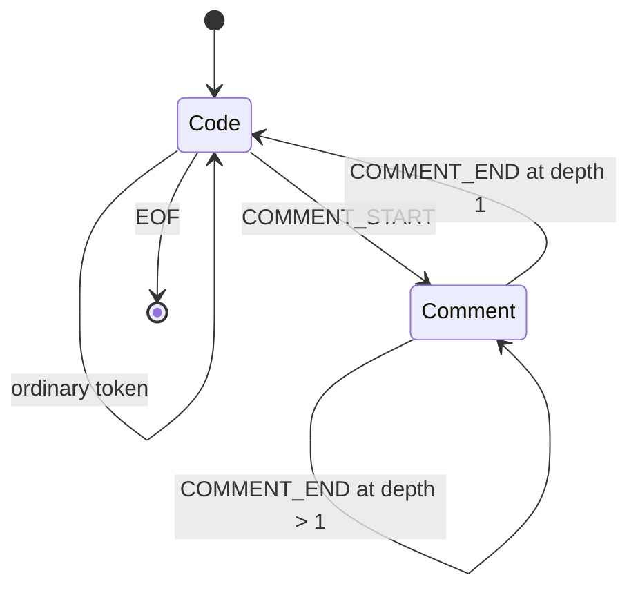
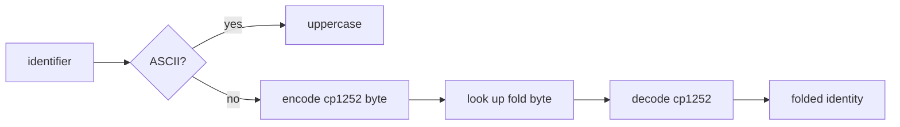

# Grammar and tokenization

The canonical grammar is `src/sattline_parser/grammar/sattline.lark`. Everything
else in this document describes how that file is resolved, lexed, and mapped
onto the AST.

## From template to executable grammar



Why a template rather than a literal grammar:

- Keywords and operators are spelled once in `constants.py`, so the grammar,
  the transformer, and the error renderer agree.
- The scanner token table and the grammar can be checked against each other.
- `grammar_fingerprint()` gives the parser cache a stable identity. A grammar
  edit changes the fingerprint, so a warm cache cannot serve the old language.

`make_keywords_case_insensitive` rewrites named terminals:

- `NAME: "Text"` becomes `NAME: /(?i:Text)\b/`.
- `NAME: /pattern/` becomes `NAME: /(?i:pattern)/`.
- Punctuation-only terminals stay string literals.

It uses `(?i:...)` rather than a bare `(?i)` because Lark concatenates terminal
patterns into one alternation, where a leading flag would be illegal.

## Grammar shape



The top level is deliberately small: three quoted header lines, then one
`BasePicture` module. A syntactically incomplete top-level unit fails here
before any nested construct is considered.

### Header lines

`syntax_version_line`, `original_file_date_line`, and `program_date_line` are
all `STRING` tokens. `program_date_line` is where the transformer finds
`program_name` when the header carries a `name:` field.

### Module structure

| Rule | What it represents |
| --- | --- |
| `module_header` | `Name Invocation (x,y,x,y,x) arguments` |
| `base_picture_module` | The root module, ending in `ENDDEF` and an optional `;` |
| `invocation_new_module` | A nested module body with its own `MODULEDEFINITION ... ENDDEF` |
| `invocation_module_type` | A reference to a named module type, with optional parameter transfers |
| `frame_module` | `( Frame_Module )`, a pure container |
| `scan_group` | `( GroupConn = [GLOBAL] name )` |
| `moduletype_definition` | `Name = [PRIVATE_] MODULEDEFINITION ... ENDDEF ;` |

`module_body` is `moduleparameters? localvariables? submodules? moduledef
modulecode?`. The `moduledef` is required. A `ModuleCode` without a
`ModuleDef` is not accepted, and the corpus fixture
`ModuleCodeWithoutModuleDef.s` pins that.

### Data types

```
datatype_typedefinitions: TYPEDEFINITIONS record+
record:                   NAME STRING? "=" RECORD_KW sl_datecode? variable_list? ENDDEF_KW module_end_comment? ";"?
variable_group:           variable_item ("," variable_item)* ":" GLOBAL_KW? NAME
                          (CONST_KW | STATE_KW | OPSAVE_KW | SECURE_KW)* opt_var_init? ";"
variable_item:            NAME (STRING | STRING_CRLF)?
```

A record is a name, an optional description, `= RECORD`, an optional datecode,
a field list, and `ENDDEF ;`. A variable group shares a datatype and a set of
attributes among one or more names. The `variable_item` description accepts
`STRING_CRLF` because real sources occasionally contain an unterminated string
in that position.

### Expressions



Precedence, lowest to highest: ternary, `OR`, `AND`, `NOT`, comparison,
additive, multiplicative, unary, term. The transformer folds binary operators
left-associatively into `BinOp` and flattens `OR`/`AND` chains into `BoolOp`
with an operand tuple.

`variable_name` is `NAME (DOT NAME)* STATE_SUFFIX?`, so `Pump.State`,
`Record.Field`, and `Counter:Old` are all one reference shape.

### Sequences and SFC

```
sequence:       (SEQUENCE | OPENSEQUENCE) NAME? seq_control_opt? codeblock_coord objsizedef layer_info?
                sequence_body (ENDSEQUENCE | ENDOPENSEQUENCE)
sequence_body:  (code_comment | seq_element)+
seq_element:    seqinitstep | seqstep | seqtransition | seqtransitionsub
                | seqsubstep | seqsub | seqalternative | seqparallel
```

Every position-bearing element goes through `seq_element`, so one transformer
hook can attach the element's source span. `SEQFORK` is a suffix of its host
step or transition, not an element of its own.

The accepted body shapes are documented in
`validation/sequences.py` and enforced after parsing, so comments may appear
anywhere. See [validation.md](validation.md).

### Equations

```
equationblock: (EQUATIONBLOCK | EQUATIONS) NAME? codeblock_coord? objsizedef?
               layer_info? ":" (code_comment | statement)*
```

Both keywords are accepted and kept distinct in the AST (`kind`). The name,
coordinates, size, and layer are optional; only the statement list is
required.

### Module definition and graphics objects

`moduledef` carries `ClippingBounds`, layout options, and optional
`GraphObjects` / `InteractObjects` sections. Coordinates can carry tails:
`:InVar_`, `:OutVar_`, or a full expression. The distinction between
`REAL` and `REAL_NOTAIL` (and the matching `SIGNED_INT`, `BOOL`, and `STRING`
variants) exists because a value followed by `:` at the end of a line is a
tail, not a plain value. The `NOTAIL` terminals use a negative lookahead and
have priority 1.

## Tokenization

### Lexer selection

The parser is built with `lexer="contextual"`, but the `ContextualLexer` plugin
is replaced by `SattLineLexer`.



`SattLineLexer` keeps a comment-depth counter **per lexer run**, not on
`self`. The parser and its lexer are cached and shared, so instance state would
leak between concurrent parses. At depth 0 it delegates to the ordinary
per-state lexer. At depth greater than 0 it delegates to a dedicated comment
lexer that only recognizes `COMMENT_START`, `COMMENT_END`, and `COMMENT_TEXT`
and is oblivious to parser state.

`COMMENT_END` and `COMMENT_TEXT` are stripped from every per-state accepted
terminal set. `COMMENT_START` stays, because that is how a comment begins in
code context.

### Comment roles

Comments are not stripped. The grammar gives them roles:

| Rule | Role |
| --- | --- |
| `code_comment` | A comment inside a `ModuleCode`, equation, or SFC body |
| `comment_stmt` | A comment followed by `;` in statement position |
| `module_typedescription` | A description comment in a module header or definition |
| `module_end_comment` | The comment after `ENDDEF` |
| `comments` | A generic comment run in a structural position |

The transformer turns the role-tagged nodes into `CodeComment` values on the
matching AST field. A comment that is syntactically legal but has no AST home
stays in the parse tree and is not silently attached somewhere else.

### Identifiers and name folding

The `NAME` terminal:

- does not match any keyword (`IF`, `THEN`, `ELSE`, `ELSIF`, `ENDIF`, `AND`,
  `OR`, `NOT`, `True`, `False`, `SUBSEQSTEP`);
- accepts a quoted identifier `'...'` of 1 to 20 characters;
- accepts letters, marks, digits, `_`, `'`, and every printable CP1252 byte;
- is limited to 20 characters.

Identifier comparison is not Unicode case folding. `names.fold_identifier`
implements the CP1252 byte table used by the language:



The table folds `a-z` to `A-Z`, `0x9A` to `0x8A`, `0x9C` to `0x8C`, `0xE0-0xF6`
to `0xC0-0xD6`, `0xF8-0xFE` to `0xD8-0xDE`, and `0xFF` to `0x9F`. Everything
else is identity, so `ß` does not fold and `Straße` never equals `STRASSE`.
Quoted identifiers compare including their quotes, with folding applied inside.

The project layer uses `str.casefold` for filesystem identity. That is a
different question from language identity, which always uses
`fold_identifier`.

### Keywords are case-insensitive

`moduledefinition` and `EndDef` parse exactly like `MODULEDEFINITION` and
`ENDDEF`. The rewriting happens in `keywords.py` after the constants are
substituted. String literals, comment text, and quoted identifiers are
unaffected because only terminals defined in the template are rewritten.

### Raw words in coded files

A coded source stores keywords as fixed-width `#NN` codes but may contain raw
words that spell a keyword. In coded mode, the lexer retypes a raw keyword-like
word to `NAME` unless the decoder produced its characters. The raw literal
spellings `True`, `False`, `On`, `Off`, and `Default` are exempt because the
compressor always writes them unencoded. This is a lexical decision, not a
grammar one.

## Tests that pin the grammar

| Test | What it protects |
| --- | --- |
| `tests/parser/test_parser_core_grammar.py` | Grammar resolution, keyword casing, terminal spellings |
| `tests/parser/test_parser_core_comments.py` | Nested comments, role tagging, comment preservation |
| `tests/parser/test_parser_core_syntax_forms.py` | Accepted and rejected syntax forms |
| `tests/parser/test_parser_core_corpus.py` | Every corpus fixture behaves as declared |
| `tests/parser/test_parser_core_provenance.py` | Positions after decoding |
| `tests/parser/test_parser_core_fuzz.py` | No crash or timeout on hostile input |
