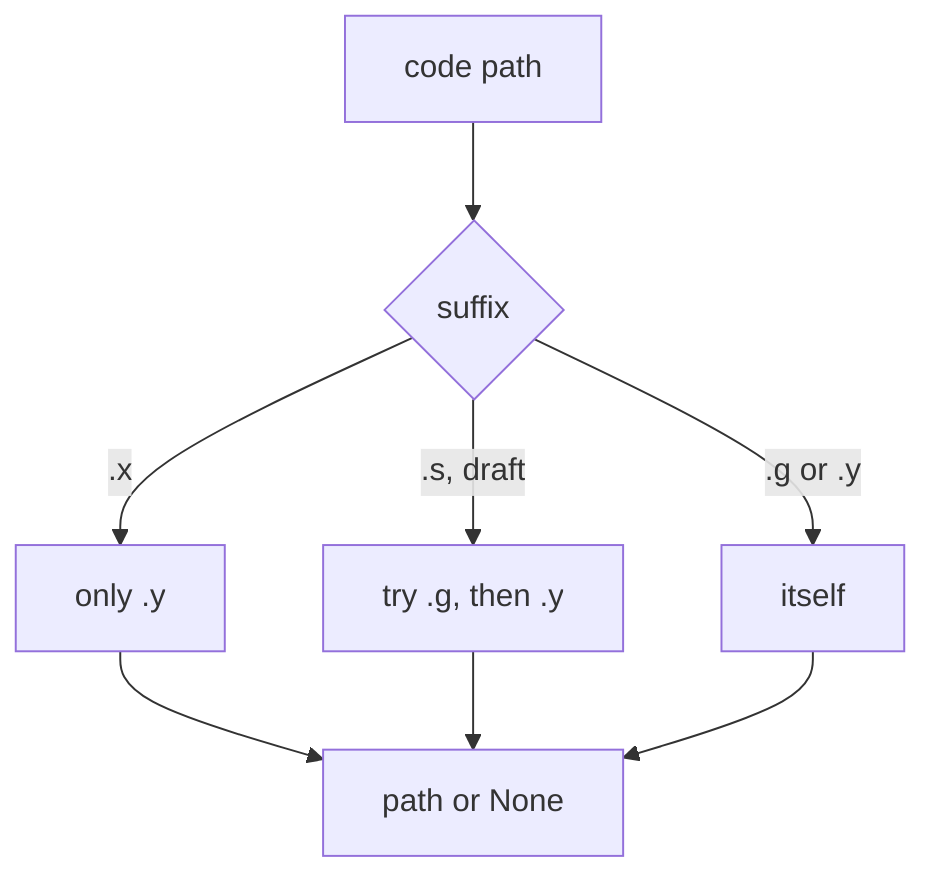
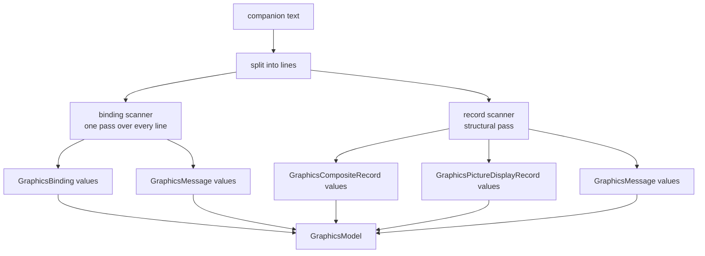
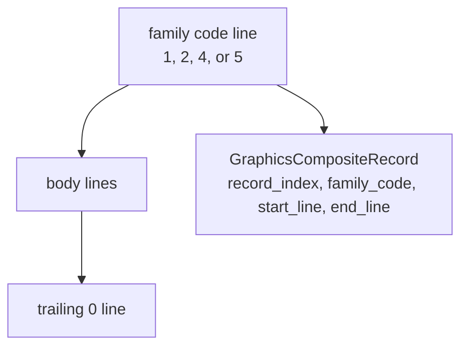
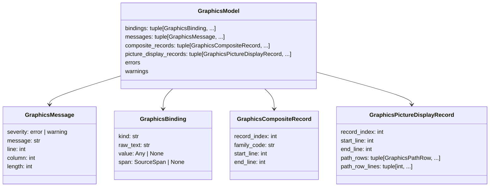

# Graphics companions

A SattLine program can have a graphics companion file, `.g` in draft mode and
`.y` in official mode. The package parses that file into a `GraphicsModel`: the
bindings, the structural records, and the scanner messages. It does not verify
bindings against the code, resolve assets, or render anything.

## Companion resolution



The companion always sits in the code file's own directory, as a `with_suffix`
substitution. It is never resolved through the ordered root list. A `.x` body
is official, so it only pairs with an official `.y`; a draft body keeps the
`.g` to `.y` fallback.

## Parsing



`parse_graphics_text` scans every line for bindings, then runs the structural
record scanner. `parse_graphics_file` reads the file as cp1252 and delegates.

Structural problems become `GraphicsMessage` values, never exceptions. That is
the opposite of the source parser, where invalid syntax raises. A companion is
a serialized configuration blob, and a malformed record should not stop a
project load that is otherwise readable.

## Bindings

A binding line carries one of three forms:

```text
Var  <name> <id> <value> ...
Expr <name> <id> <expression> ...
Lit  <name> <id> <literal> ...
```

The binding scanner is `BINDING_LINE_RE` in `project/graphics_bindings.py`:

```python
r"(?<!\S)(Var|Expr|Lit)\s+(\S+)\s+(-?\d+)\s+"
```

For each match it produces a `GraphicsBinding`:

```python
@dataclass
class GraphicsBinding:
    kind: str          # "var", "expr", or "lit"
    raw_text: str      # the source text of the binding
    value: Any | None  # the coerced value when it could be produced
    span: SourceSpan | None
```

`Expr` bindings are parsed with the package's own expression grammar, a small
Lark grammar over the same `SLTransformer`, and then rebased into the
companion file's coordinates. A failure to parse an expression becomes a
`GraphicsMessage`, not an exception.

## Records

The companion file can contain serialized records. A record starts with a
family-code line and ends with a trailing `0` line.



Families `1`, `2`, `4`, and `5` are composite records. Family `5` can also be a
picture display record when:

- its fourth non-empty body line is `2` (the picture display subtype);
- its last non-empty body line is `t` or `f` (the trailing
  `KeepPictureShape` flag).

A family 5 record that meets the subtype but lacks the trailing flag produces
an error message and is not turned into a picture display record. An
unterminated record produces one error message and stops the structural scan.

### Picture display path rows

A picture display record carries a path-row section. Each row is classified as:

| `kind` | Meaning |
| --- | --- |
| `variable` | A variable reference with a valid marker |
| `variable_invalid` | A variable reference the file marked `Invalid` |
| `literal` | A literal asset path |

```python
@dataclass
class GraphicsPathRow:
    record_index: int
    index_token: str
    index_value: int | None
    kind: Literal["variable", "variable_invalid", "literal"]
    raw_text: str
    span: SourceSpan
```

`GraphicsPictureDisplayRecord.path_row_lines` lists every line in the row
section, including rows that did not parse into a `GraphicsPathRow`. That lets
a consumer tell "this line was not a path row" apart from "this line was a path
row I could not understand".

## Model



`GraphicsModel.errors` and `GraphicsModel.warnings` filter `messages` by
severity while preserving parse order.

## What the package does not do

- It does not verify that a binding's variable exists in the code picture.
- It does not check that a literal asset path exists on disk.
- It does not correlate a graphics object with a code module.
- It does not validate the UI meaning of an interactor.
- It does not render or export graphics.

Those are consumer concerns. The graphics model is parsed data with source
positions, nothing more.

## CLI

```bash
sattline graphics drawing.y
sattline graphics drawing.y --json
```

The command refuses a source file (`.s`/`.x`) and `check`/`parse` refuse a
companion, so a companion is never mis-reported as broken source. See
[cli.md](cli.md).

## Tests that pin graphics

| Test | What it protects |
| --- | --- |
| `tests/project/test_graphics_parsing.py` | Binding scan, messages, companion resolution |
| `tests/project/test_graphics_records.py` | Composite and picture display records |
| `tests/parser/test_parser_core_graphics.py` | AST graph and interactor objects |
| `tests/cli/test_cli_graphics.py` | CLI output and refusal rules |
