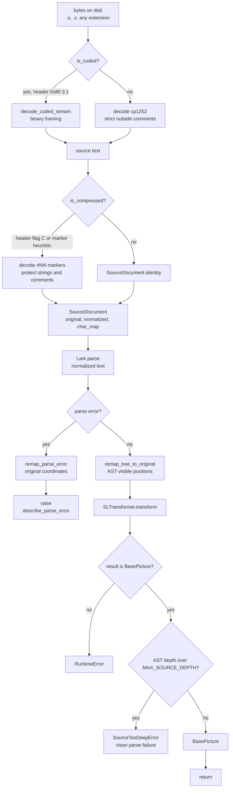
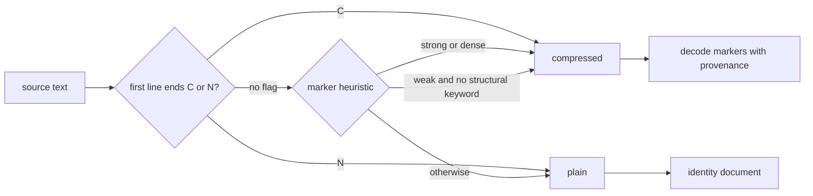

# Parse pipeline

The pipeline turns bytes into a `BasePicture` without ever losing the link to
the original source.

## Stages

## Encoding: bytes to text

`parse_source_file(path)` calls `source_text_for_parse(path)`, which reads the
file in binary and hands the bytes to `decode_source_bytes`.

- A byte-coded stream starts with `\x80 3.1`. It is decoded by
  `decode_coded_stream` before anything else. See [glossary](glossary.md) and
  [source-provenance.md](source-provenance.md) for the framing details.
- Everything else is decoded as **Windows-1252** (`cp1252`). This is a strict
  decode with no fallback to UTF-8 or Latin-1. A byte that is undefined in
  cp1252 (`0x81 0x8D 0x8F 0x90 0x9D`) is tolerated **only inside a
  `(* ... *)` comment body**, where it becomes `U+FFFD`. Everywhere else the
  `UnicodeDecodeError` survives.
- Files are read in binary mode on purpose. `Path.read_text()` performs
  universal newline translation and would silently turn CRLF into LF, changing
  offsets.

`decode_source_bytes` is also the CLI's decoder, so `sattline check` and
`parse_source_file` agree on what a file means.

`load_source_text(path)` is the read-then-decode helper for callers that want
the final plain text and no parse result. It decodes marker-compressed text as
well. `source_text_for_parse` deliberately does **not**, so provenance stays
anchored to the original markers.

## Preprocessing: text to `SourceDocument`

`preprocess_source(text)` classifies the text and returns a `SourceDocument`.

The header flag is authoritative. The marker heuristic only applies to files
that were not produced by a standard export:

- 50 or more markers outside strings and comments, or
- marker characters at least 2 percent of the non-whitespace text, or
- at least 10 markers and no structural keyword (`MODULEDEFINITION`,
  `TYPEDEFINITIONS`, `MODULEPARAMETERS`, `EQUATIONBLOCK`) outside opaque
  regions.

The decoder is lexically aware. `scan_opaque_regions` finds every string
literal and `(* ... *)` comment, including nested comments and doubled `""`
quotes. Those regions are replaced by placeholders, the `#NN` markers in the
remaining text are substituted from `scanner_tokens.json`, and the placeholders
are restored. Unknown markers raise `PreprocessError`. A replacement that does
not survive from the source is marked `GENERATED` rather than being given a
fake original offset.

## Parsing: normalized text to Lark tree

`parse_source_text` gets the default parser from `_default_parser()`, an
`lru_cache(maxsize=1)` around `create_parser()`, unless the caller supplies
one. `build_lark_parser` compiles the resolved grammar with:

- `parser="lalr"`
- `lexer="contextual"`
- `propagate_positions=True`
- `regex=True`
- the custom `SattLineLexer` registered through `_plugins`
- an optional private Lark cache keyed by grammar fingerprint, start rule,
  `propagate_positions`, Lark version, and Python major/minor version

Before parsing, `compact_provenance(predicate)` sets a context-local predicate
that tells the lexer whether the input is a coded source. In coded mode a raw
word that spells a keyword is still an identifier; only characters produced by
the decoder become keywords. This is what makes a partially hand-coded file
behave correctly.

## Positions: normalized to original

`remap_tree_to_original(tree, doc)` walks every `Tree.meta` and every `Token`
and rewrites `start_pos`, `end_pos`, `line`, `column`, `end_line`, and
`end_column` into original coordinates. The operation is skipped entirely for
an identity document, so plain sources pay no cost.

On a parse failure, `remap_parse_error(exc, doc)` rewrites the exception's
`pos_in_stream`, `line`, and `column` (and the offending token, when present)
so `describe_parse_error` and every caller see original coordinates. A runtime
tag prevents double remapping.

See [source-provenance.md](source-provenance.md) for the mapping model.

## Transformation: Lark tree to AST

`SLTransformer` is assembled from responsibility mixins and extends Lark's
`Transformer_NonRecursive`. It consumes the tree after remapping, so every
`SourceSpan` it builds already points at the original source. The transformer
reduces the tree with an explicit post-order stack, so a deeply parenthesized
parse tree cannot exhaust the Python call stack. `start()` requires exactly one
`BasePicture` child, attaches the program name found in the header's
`program_date_line`, and raises `ValueError` with the observed child types if
the shape is wrong.

`parse_source_text` verifies that the transformer result is a `BasePicture`.
A transformer that returns anything else is a bug, not invalid input, and
raises `RuntimeError`.

See [transformer.md](transformer.md) for the mixin map.

## Nesting limit

`parse_source_text` accepts at most `MAX_SOURCE_DEPTH` (256) structural levels.
The check uses an iterative traversal, so the check itself cannot overflow.
It follows dataclass fields and containers, so interactor property payloads and
comment values are measured too, not only the nodes that `walk` visits. A
grammar tree left in place by a custom transformer is measured through its
children as well. A deeper result raises `SourceTooDeepError`, a clean parse
failure with the same sentence and hint shape as any other invalid input.

The limit exists because several consumers still recurse over the parsed
structure: validation type inference, `format_expr`, dataclass `repr`/`eq`, and
the pickle-based AST cache. A 256-level cap keeps all of them inside CPython's
default recursion limit with margin. The parse tree is separate: the
non-recursive transformer, the iterative comment flattening, and the iterative
`remap_tree_to_original` mean a source may be deeply parenthesized or carry
deeply nested comments even though its AST stays shallow.

`SourceTooDeepError` subclasses Lark's `UnexpectedInput`, so the CLI findings,
the project loader, the fuzz harness, and the Atheris targets classify it as
invalid input rather than a parser crash. If a custom parser, custom
transformer, or unusually low interpreter recursion limit still raises
`RecursionError`, `parse_source_text` converts it to the same clean error.

## Entry points

| Function | Input | Decodes | Preprocesses | Parses | Validates |
| --- | --- | --- | --- | --- | --- |
| `parse_source_file` | path | yes, including coded and comment-tolerant cp1252 | yes | yes | no |
| `parse_source_text` | `str` | no | yes | yes | no |
| `parse_and_validate` | `str` | no | yes | yes | yes, single source |
| `load_source_text` | path | yes, including compressed | no, returns decoded text | no | no |
| `decode_source_bytes` | `bytes` | yes, coded and cp1252 | no | no | no |
| `preprocess_source` | `str` | no | yes | no | no |

## Failure taxonomy

| Failure | Exception | Meaning |
| --- | --- | --- |
| Malformed coded stream | `PreprocessError` | The binary framing is wrong |
| Unknown compressed marker | `PreprocessError` | The text claims a marker the table does not define |
| Undecodable byte outside a comment | `UnicodeDecodeError` | The file is not cp1252 |
| Syntax error | Lark `UnexpectedInput` family | The decoded text does not match the grammar |
| Structure too deep | `SourceTooDeepError` | The parsed structure exceeds the 256-level nesting limit |
| Transformer defect | `ValueError`, `RuntimeError` | The parse succeeded but the AST could not be built |
| Unreadable file | `OSError` | The path could not be read |

`PARSE_FAILURES` in `errors.py` is the shared tuple
`(UnexpectedInput, ValueError, UnicodeError, OSError)`. Every layer that turns
a failed parse into a finding uses it, so a broken file is classified the same
way by `sattline check` and by the project loader.

## Performance notes

- The default parser is cached for the process.
- Plain text short-circuits both the source map and the tree walk.
- Parse-tree transformation and position remapping use explicit stacks, so
  their cost follows the tree size rather than the Python call stack.
- The Lark cache is opt-in only through the private cache directory. It is
  never written into the source tree.
- `parse_source_text` reuses a caller-supplied parser and transformer, which is
  how the project loader avoids recompiling the grammar per file.
