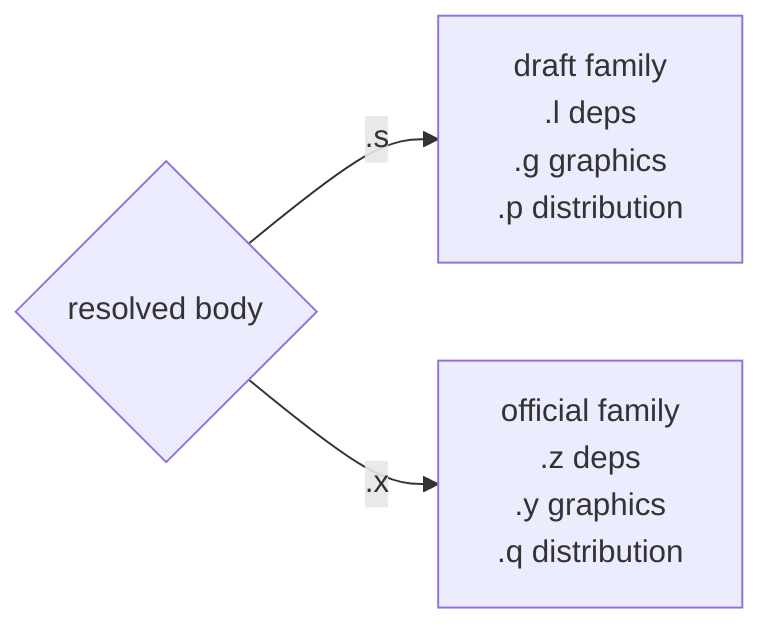
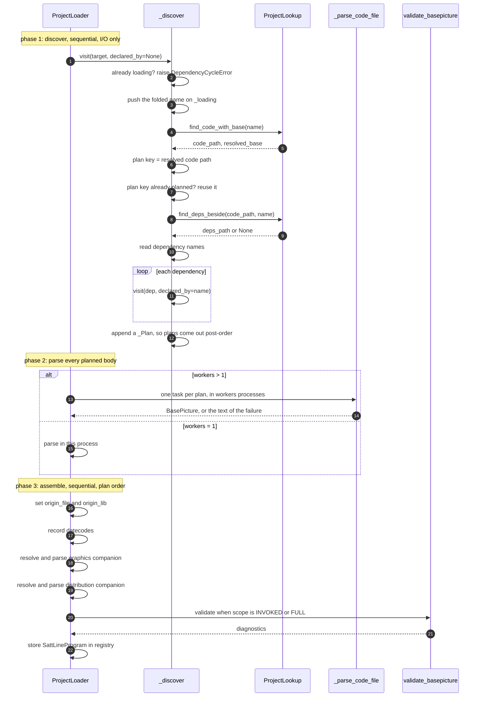
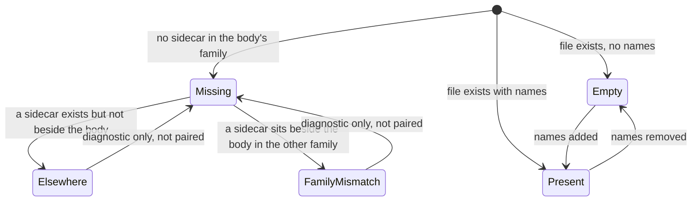
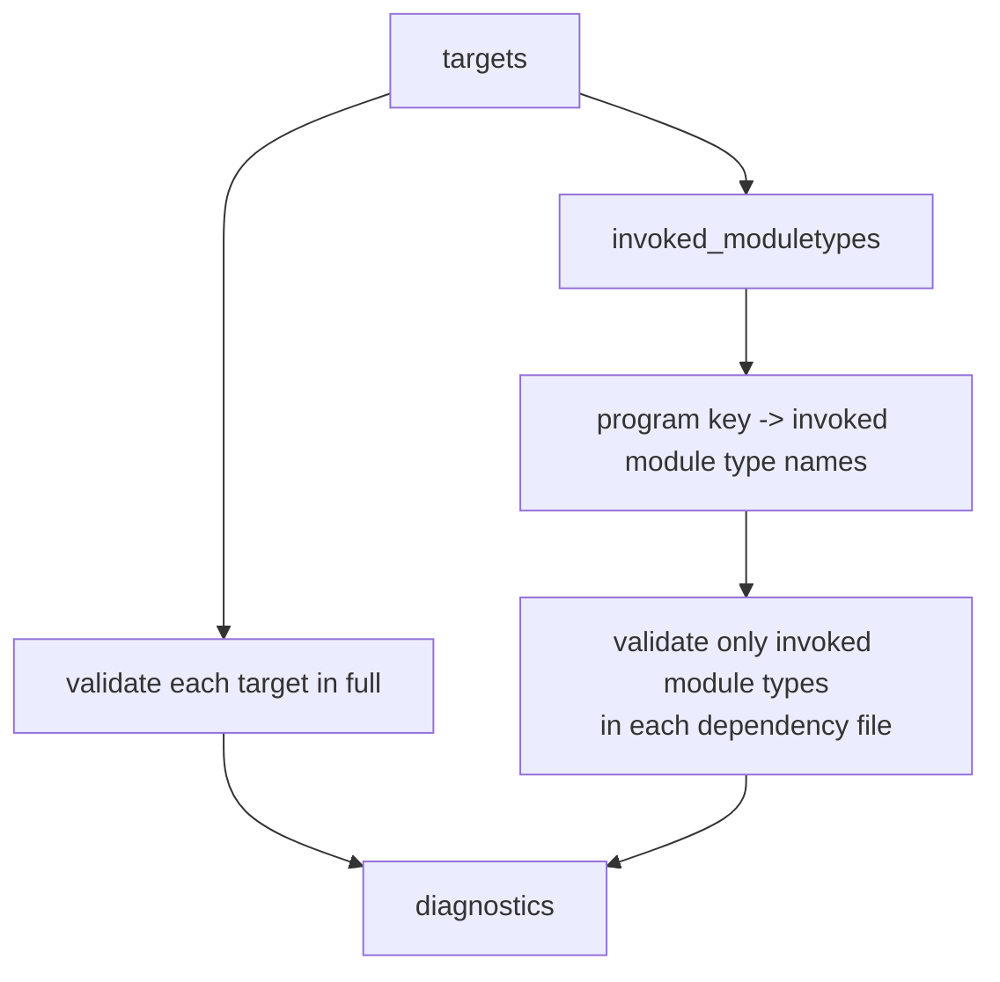
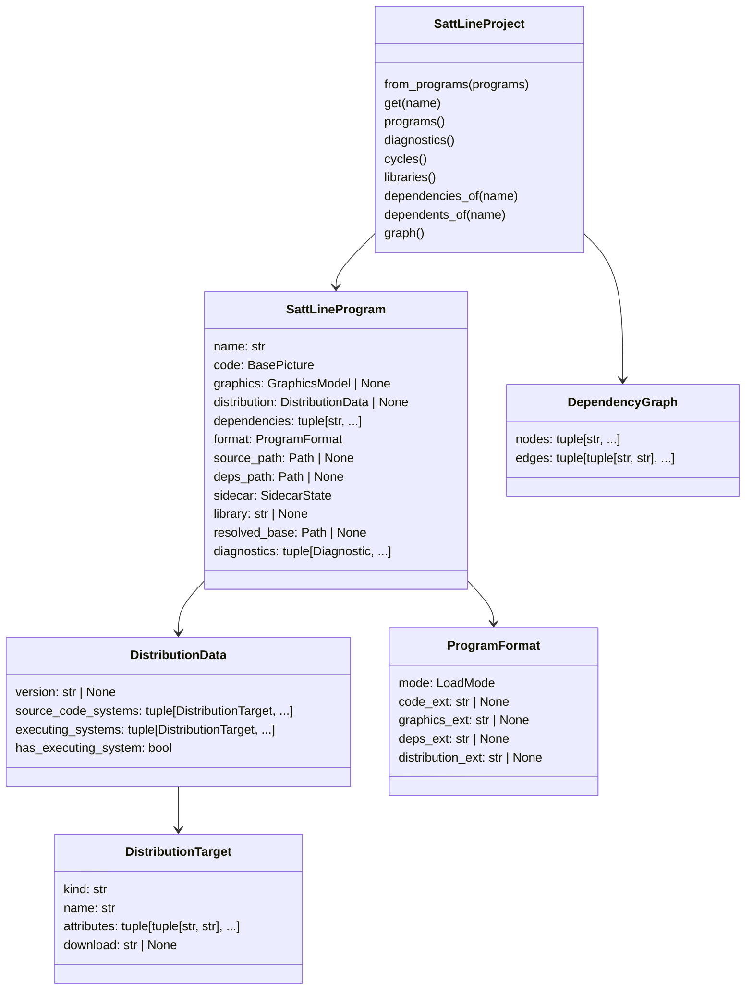
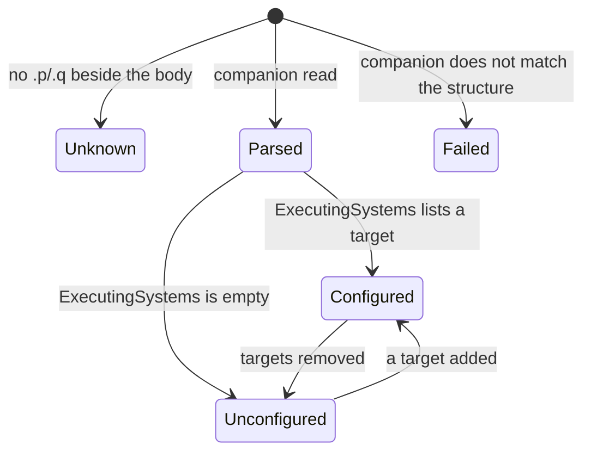

# Project layer

The project layer turns a set of SattLine artifact files into a resolved graph
of `SattLineProgram` instances. It owns discovery, draft/official selection,
dependency resolution, graphics and distribution companion loading,
parser-owned caches, and project-scope validation.

A **program** here is one loaded source artifact (one `.x` or `.s` file), not
one executable top-level program. Loading one target can produce many
`SattLineProgram` entries through its dependency closure.

A SattLine program or library is one unit made of four files: the code body,
the dependency sidecar, the graphics companion, and the distribution companion.
Draft is `.s`, `.l`, `.g`, `.p`; official is `.x`, `.z`, `.y`, `.q`. The loader
resolves each role by mode; a missing sidecar is reported as a diagnostic and a
missing companion is recorded as absent, never invented.

## Artifact formats



| Artifact | Draft | Official |
| --- | --- | --- |
| Code body | `.s` | `.x` |
| Dependency sidecar | `.l` | `.z` |
| Graphics companion | `.g` | `.y` |
| Distribution companion | `.p` | `.q` |

The **resolved body's suffix decides the artifact family for the whole unit**.
A `.s` body pairs only with `.l`, `.g`, and `.p`; an `.x` body pairs only with
`.z`, `.y`, and `.q`. Artifacts never fall back across families, so a draft body
is never paired with an official sidecar or companion, and the reverse never
happens either.

Only the code body falls back, and only within one mode: draft mode prefers
`.s` and falls back to `.x`, while official mode accepts `.x` only. Once the
body is resolved, every other role has exactly one candidate extension, chosen
by the body suffix. See `body_mode`, `deps_extensions_for_code`,
`companion_extensions_for_code`, and `distribution_extensions_for_code` in
`project/formats.py`.

There is no "guess the extension" step. A companion has exactly one candidate
extension and a sidecar has exactly one too, both chosen by the body suffix. A
companion whose stem differs only in case from its body still pairs, so a tree
copied from a case-insensitive filesystem keeps working. Only a regular file
pairs: a directory named like a companion is not one.

`ProgramFormat.mode` is the artifact family of the **resolved body**, not the
mode the caller requested. A draft load that fell back to an `.x` body reports
`OFFICIAL`, because the body's suffix is what decides which sidecars and
companions can pair with it.

## Discovery

`ProjectLookup` resolves a name across the caller's roots, in the caller's order.


`ordered_lookup_bases` is that order: it resolves each entry, keeps the first
position of a repeated root, and does nothing else. There is no requester
precedence, no cluster sorting, and no special last root. `SattLineProject.load`
and the CLI both pass an ordered sequence, so the rule is one rule: earlier
entries win.

`parse_search_path` turns the path-list notation into that sequence:
`parse_search_path(r"GC\UnitLib,HA\UnitLib", base=Path("/sattline"))` yields the
two roots in the written order, relative entries resolved under the base,
backslashes accepted, empty entries and duplicates dropped.

Each root is indexed once by `SourceIndex`:

```
stem.casefold() -> {extension -> Path}
```

Only code and dependency extensions are indexed. Graphics and distribution
companions are resolved from their code path and never appear in the index. A
miss in the index falls back to a `stat` check for each candidate extension, and
a hit updates the index. An index hit is re-statted before it is returned, so a
body deleted after the index was built reports a miss instead of a later
"failed to parse".

A dependency name is a bare unit name, never a path. It is validated against
the SattLine identifier charset and the 20-character limit, so separators,
drive or alternate-stream colons, UNC prefixes, parent references, control
characters, and the Windows-invalid filename characters are refused on every
platform; Windows device names are refused on Windows. The `stat` fallback
additionally requires the candidate to resolve inside the lookup base. A `.l`
line of `../outside/Secret`, or an absolute path, therefore resolves to nothing
and is reported as a missing dependency instead of loading a body outside every
root.

`ProjectLookup.find` resolves only a code body or a dependency sidecar. It
raises `ValueError` for `ArtifactKind.GRAPHICS` and
`ArtifactKind.DISTRIBUTION`, because a companion has no root-ordered meaning: a
search across the roots could return another unit's companion. Companions reach
a program only through `resolve_graphics_companion_path` and
`resolve_distribution_companion_path`, which anchor to the selected body.

`find_deps_beside(code_path, name)` is deliberately different from
`find_deps(name)`. A SattLine library is a body plus a sidecar at **one**
prefix. Resolving the sidecar through the whole root list could pair a body with
an unrelated library's sidecar, so the body's own directory decides. The body's
suffix also decides which sidecar extension may pair, through
`deps_extensions_for_code`.

## Loading



Discovery resolves paths and reads sidecars; it never parses a body. That split
is what makes the parse phase parallel: the whole closure is known before any
parse starts, so a worker needs nothing but a path, and the assembled registry
does not depend on which worker finished first.

A plan is identified by its **resolved code path**. Because every name resolves
through the same ordered path, one folded name reaches one body per load. When
two roots hold `Util.s`, the body in the earlier root is planned, parsed, and
validated; the later body is never read. There is no ambiguity to report and no
second body to expose, so the registry holds one program per name by
construction.

Post-order is an invariant: the registry is built dependencies-first, so a
program's diagnostics are computed against a complete prefix of its closure.
`_assert_registry_post_order` checks this and raises `RuntimeError` if a
dependency appears after its consumer. A cycle never reaches that check because
the loader rejects it first.

Discovery runs to completion before any body is parsed, which changes two
observable orders:

- **Errors.** A discovery failure (a missing body, an unreadable sidecar, a
  cycle) is raised before any body-parse failure, because the whole closure is
  resolved first. With two targets, `B`'s unreadable sidecar therefore wins over
  `A`'s broken body even when `A` was requested first. Structural errors win
  over everything.
- **Diagnostics.** `SattLineProject.diagnostics()` reports only the non-fatal
  load conditions: a missing or empty sidecar, a sidecar elsewhere, and a
  sidecar from the other artifact family. A failure to resolve or parse raises
  instead. Discovery rows come first, in discovery order, then assembly rows in
  plan order.

`validate=INVOKED` runs **after** the graph is complete, because it needs the
whole invocation graph. The loader first builds the registry, then walks
`invoked_moduletypes` and replaces each program with a copy that carries the
invoked-scope diagnostics.

## Cycles

A recursive dependency has no finite load order, so the loader rejects it. When
`_visit` sees a key already in `_loading`, it raises `DependencyCycleError`
with the canonical cycle path, for example `("alpha", "beta", "alpha")`. The
error is structural: a cycle inside an unparseable dependency still fails the
load.

A cycle is identified by its directed node sequence, not by its member set.
Rotations of the same sequence describe the same cycle, so every path is
rotated to start at its smallest node name before it is reported.

`SattLineProject.cycles()` stays available for a project built directly with
`from_programs`: it enumerates the cycles in the declared graph edges.
`SattLineProject.load` never returns one because the loader has already raised.
Enumeration is linear on a DAG because the search is confined to strongly
connected components. It is exponential in the worst case for a dense component
because every elementary cycle is reported.

## Module-type recursion

A module type that instantiates itself, directly or through other module types,
has no finite expansion. After the registry is complete, for each program the
loader builds the instantiation graph over the module types that program can
see and rejects the first cycle with `ModuleTypeCycleError`. A graph node is one
*definition*, identified by its owning program and folded type name, so two
libraries that reuse a name are not merged. A reference resolves to the
referencing file's own definition first, then to any definition in the checked
program's closure, so a library that shadows a dependency's type name loads.

The check runs before validation and is not governed by `LoadValidation`, so
`validate=NONE` cannot let a recursive type through. Unused module types in a
loaded dependency are checked
too, because the type itself is structurally invalid. The search stops at the
first cycle it finds, so a dense instantiation graph cannot make rejection
enumerate an exponential number of elementary cycles.

## Sidecars



`SidecarState` distinguishes absent, empty, and present. Conflating absent with
empty would silently drop a dependency chain: a library with an empty sidecar
is still a library whose body was found, while a missing sidecar may indicate a
layout mistake. `SIDECAR_ELSEWHERE` reports a stray file in another directory
without pairing it. `SIDECAR_FAMILY_MISMATCH` reports a sidecar that sits beside
the body but belongs to the other artifact family, for example a `.z` beside a
`.s` body. Neither stray is ever paired.

## Validation scopes



`invoked_moduletypes` walks the target's module tree, follows every
`ModuleTypeInstance` reference into loaded definitions, and continues through
their submodules. Only reached module types are validated. The target itself is
always validated in full.

Every finding the loader produces is final. A load is all or nothing, so a
definition can never be missing from a closure that a finding was computed
against: a missing or unparseable artifact raises instead of leaving a program
out. `DATECODE_CONFLICT` compares declarations that did load, and the mapping
and transfer rules see every definition their program's closure reaches.

## Load failures

A missing or unparseable artifact raises `ProjectLoadError` and its subclasses.
There is no partial project: `SattLineProject.load` either returns a complete
registry or raises. That applies to a missing body, an unreadable dependency
sidecar, a malformed companion, and a parse failure in any body the closure
reaches. Validation findings never raise, because they are findings and not load
failures.

The two structural errors are fatal in the same way: a recursive sidecar chain
and a module type that instantiates itself.

## Datecodes

The loader records the datecode of every module type and datatype it sees,
keyed by folded name and scoped to the program's visible closure. A conflict is
reported when the same name is declared with two different datecodes in one
closure. A program compares its own declaration against the visible versions,
so a closure holding versions 1 and 2 reports the conflict on a program that
declares either one, naming only the version that differs. Datecode findings
belong to an explicitly selected program, not to a library import: a library is
not the place to report its own version drift. Ownership comes from the target
set, not from discovery order, so a target that was first reached as a
dependency still reports its own conflict in either target order.

## Models



`SattLineProject` keys programs by `str.casefold()` identity internally while
preserving the caller's original spelling on `SattLineProgram.name`. `get`,
`__contains__`, `dependencies_of`, and `dependents_of` are case-insensitive.
`dependencies_of` returns the declared spelling in declaration order, and
`dependents_of` returns each dependent's declared spelling in load order, so a
name either method returns can be passed back to `get`. Graph nodes and edge
endpoints are canonical casefolded identities.

`graph()` returns every declared edge. In a loaded project every declared
dependency is also loaded, because a missing one fails the load. A project
assembled directly with `from_programs` may declare an edge to a program it does
not hold; the graph keeps that edge, because it describes the declared structure,
not just the resolved closure.

## Caches

Both project caches are opt-in through `cache_dir=`. When it is `None`, the
project layer reads and writes neither cache and shares no state. The compiled
Lark grammar cache is separate: it lives under the temporary directory and may
still be written on the first parse, as `sattline --no-cache` documents.
`sattline project` passes a private directory under the user's cache root
unless `--no-cache` is given, so a repeated load of the same tree skips
parsing.

### Lookup cache

`FileLookupCache` persists `(kind, name, mode) -> (base_dir, ext)` resolutions
as JSON. It is versioned (`LOOKUP_CACHE_VERSION`) and flushed periodically
(`DEFAULT_LOOKUP_CACHE_FLUSH_INTERVAL`). A cached resolution is trusted only
when:

- the base is still a configured root;
- the base is still present in the current ordered bases;
- the artifact still exists;
- no higher-precedence base holds the artifact.

On any failure the entry is forgotten and the full ordered scan runs. Extension
preference wins over the extension recorded in the cache, so an artifact that
appeared after the cache was written is not shadowed. The cached base is
resolved through the same case-insensitive index a cold scan uses, so a
dependency spelling whose case differs from the file name resolves identically
warm and cold. A warm lookup and a cold lookup always agree.

Startup pruning drops an entry whose recorded base directory no longer exists,
removes abandoned `*.tmp` siblings older than an hour, and caps the entry count
(`MAX_LOOKUP_CACHE_ENTRIES`); the surplus is dropped in key order. Writes stay
atomic: a temporary sibling, `fsync`, then `os.replace`.

### AST cache

`FileASTCache` stores each parsed `BasePicture` in an HMAC-signed pickle
envelope. The key includes:

- the code path;
- the load mode;
- the package version;
- the resolved grammar fingerprint;
- a fingerprint of the sources that shape an AST: `models/`, `transformer/`,
  `source_io.py`, `source_document.py`, and `names.py`;
- the digest of the source bytes the AST was parsed from.

A `mtime_ns` and `size` stat snapshot is the cheap first filter; on a match the
cached digest is confirmed against the bytes on disk, so the bytes decide. An
edit that keeps the file size and lands inside the filesystem's mtime
granularity, or a restore that puts an old mtime back, is a miss and the body is
reparsed.

Decoding, span remapping, and identifier folding all change the parsed AST, so
they are part of the fingerprint: a fix there invalidates a cached body through
the key rather than through a version bump. `FILE_AST_CACHE_VERSION` tracks the
envelope shape only.

The snapshot is taken from the exact bytes that are parsed, and the entry
records those bytes' digest, so an entry can never claim a source revision it
was not parsed from. A body whose source changed while a worker was reading it
is left uncached: the next load reparses it instead of trusting a stale AST.

The namespace and file-format magic belong to `sattline-parser`
(`FILE_AST_CACHE_VERSION`), so another tool's cache never cross-reads. The HMAC
key lives beside the entries. It proves the entry was written by whoever could
write that directory; it is not a defence against that user. The real boundary
is a private `0700` directory owned by the current user. Both the cache root
and its `file_ast` subdirectory are checked; a root or subdirectory that is a
symlink, or a directory owned by someone else, disables the caches instead of
being followed or tightened in place. An entry file that is a symlink is
ignored, never followed. Never point `cache_dir` at a shared location.

Only a writer creates the HMAC key. A read with no key is a miss, so a reader
never writes into the cache directory and the single-writer invariant holds.

On Windows there is no POSIX owner or mode check: `os.getuid` does not exist,
and the cache validates only that the root and `file_ast` are real directories.
The default per-user cache location is still private to the profile, but an
explicit `--cache-dir` on a shared path is not protected against a planted
pickle. Keep a Windows cache under the user profile or disable it with
`--no-cache`.

Pruning drops an entry whose envelope, identity, grammar, or code fingerprint no
longer matches, an entry whose recorded source path no longer exists (a rename,
a branch switch, a deleted temporary checkout), and the least recently used
entries past `MAX_AST_CACHE_ENTRIES` (1024 by default; the library constructor
accepts `max_entries=`). A successful load touches the entry, so eviction
follows last use rather than the time the entry was written. The count cap runs
on every startup because it only stats files; the full fingerprint and path
check runs when the cache identity changes. Abandoned `*.tmp` siblings older
than an hour are removed too.

A cache write failure is swallowed and logged; it must not turn a successful
parse into a load failure.

## Graphics companions

`resolve_graphics_companion_path(code_path, mode)` uses `with_suffix` in the
code file's directory. It never does a root-ordered lookup:

- `.x` resolves only to `.y`;
- `.s` resolves only to `.g`;
- a `.g` or `.y` input resolves to itself.

The stem is compared ignoring case, so `Pump.S` pairs with `pump.g`. Only a
regular file pairs: a directory named `Pump.g` is not a companion.

The loader parses the companion into `program.graphics`. Structural problems
become `GraphicsMessage` values, never exceptions. A companion larger than
`MAX_GRAPHICS_COMPANION_BYTES` (4 MiB) is a file-level refusal instead: it
raises `GraphicsParseError`, which the loader maps onto `ArtifactLoadError` or
`DependencyParseError`, because a partially scanned model would misreport what
the file says. See [graphics.md](graphics.md).

## Distribution companion

A distribution companion (`.p` draft, `.q` official) records which systems a
unit is sent to. It is configuration, not proof that the unit is running
anywhere, and it is not a module type: a program and a library both may carry
one.



`resolve_distribution_companion_path(code_path, mode)` uses `with_suffix` in the
code file's directory, never a root-ordered lookup:

- an `.x` body resolves only to `.q`;
- a `.s` body resolves only to `.p`;
- a `.p` or `.q` input resolves to itself.

The stem is compared ignoring case, so `Pump.S` pairs with `pump.p`.

The file is a small nested structure of named groups:

```
DistributionData
 ( Version "Distributiondata version 1.0" )
SourceCodeSystems
 (  )
ExecutingSystems
 ( Controller
    ( Name "172.18.0.1"
      Download ShortStopReconfig ) )
```

`parse_distribution_file` reads it into `DistributionData`:

| Field | Meaning |
| --- | --- |
| `version` | The `Version` string of `DistributionData` |
| `source_code_systems` | Targets of `SourceCodeSystems` |
| `executing_systems` | Targets of `ExecutingSystems` |
| `has_executing_system` | `True` when `executing_systems` is non-empty |

A target is a `DistributionTarget` with `kind` (the section keyword as written,
for example `Controller` or `OpStation`), `name` (the `Name` string), and
`attributes` (the trailing `Keyword Value` pairs in file order).

`SourceCodeSystems` entries never count as executing systems. The parse is
structural: a group is read as an executing system only when it sits inside
`ExecutingSystems`.

`SattLineProgram.has_executing_system` is the three-state answer a consumer
needs:

| Value | Meaning |
| --- | --- |
| `True` | A parsed companion lists at least one executing system |
| `False` | A parsed companion lists none |
| `None` | No companion was found, so the question is unanswerable |

A companion that exists but does not match the structure raises
`DistributionParseError`, which the loader turns into `ArtifactLoadError` (for a
target) or `DependencyParseError` (for a dependency). It is never reported as an
empty list, because "none" and "could not tell" are different answers. A missing
companion is not a diagnostic: distribution data is optional. A companion larger
than `MAX_DISTRIBUTION_COMPANION_BYTES` (1 MiB) is a parse error too, refused
before it is read, because a companion is a small configuration blob.

This is deliberately stricter than the graphics companion, where structural
problems become `GraphicsMessage` values on a companion that still loads. A
graphics message still describes the file it came from; an unusable distribution
companion cannot answer the one question it exists to answer, so the load fails
instead of reporting the program as unconfigured. The three-state field therefore
describes only what the parser could establish, and a rejected companion is
never mistaken for "no companion".

The companion is read during assembly on every load, including a load served
from a warm AST cache, so editing only the `.q` changes the answer without
re-parsing the body.

## Loading performance

- Each resolved body is parsed once, by resolved code path.
- The parser is shared across files.
- The lookup cache skips repeated ordered scans for a stable layout.
- The AST cache skips re-parsing an unchanged file.
- `INVOKED` scope avoids validating a library's unused module types.

Measured with `sattline project` over a 268-program library tree (315 MB of
`.x` bodies, `validate=invoked`) on a 6-core machine:

| Load | Time |
| --- | --- |
| `--workers 1 --no-cache` | 255 s |
| defaults, second load (warm AST cache) | 68 s |

Parsing is 99% of a load. Lookup, sidecar reads, graphics and distribution
companions, and graph assembly together are under a second on that tree, which
is why `workers` is the only lever with a large factor.

A `ProjectLoader` resolves one load. Discovery plans, parse outcomes, and the
registry are per-load state, so a second `resolve()` call raises rather than
doubling the plans over an existing registry; construct another loader.

### Parallel parsing

`workers` parses bodies in that many processes and defaults to `1`; the CLI
defaults to `min(8, cpu_count)` and accepts at most 32. Results do not depend
on the worker count: discovery fixes the plan order before any parse runs.

- A single-threaded caller on Linux before Python 3.14 uses `fork`, which needs
  no `__main__` guard. A caller with other threads gets `forkserver`, because
  forking a threaded process is deprecated in CPython and can inherit a lock
  another thread held at fork time. macOS and Python 3.14 and later keep the
  platform default, which no longer prefers `fork`. Discovery parses nothing,
  so the parser is not built before the pool starts: every worker builds it
  from the on-disk Lark cache, about 50 ms and 50 MB each.
- A daemonic process may not start children, so a load called from inside an
  outer pool parses in that process instead of raising.
- A worker reads the AST cache but never writes it: the parent owns every
  write, so the per-user key and the entry signatures stay single-process, and
  the parent stores a worker's body only under the source snapshot the worker
  read. A cached body still crosses the pipe to the parent, which is why a warm
  cache and `workers` do not multiply.
- If a pool cannot be created (a restricted sandbox, a bootstrap failure), the
  load logs and parses in this process rather than failing.
- `workers > 1` and a warm cache do not add up: the parent must still receive
  every AST from a child. Use the cache for repeated loads and `workers` for a
  cold one.

## Tests that pin the project layer

| Test | What it protects |
| --- | --- |
| `tests/project/test_discovery.py` | Ordered lookup and path-list notation |
| `tests/project/test_formats.py` | Extension selection and companion pairing |
| `tests/project/test_loader.py` | Recursive loading and post-order |
| `tests/project/test_project_layer.py` | `SattLineProject` views and graph |
| `tests/project/test_project_validation.py` | Scopes and datecodes |
| `tests/project/test_reachability.py` | Invoked module-type walk |
| `tests/project/test_lookup_cache.py` | Cache trust and invalidation |
| `tests/project/test_ast_cache.py` | Cache key, signature, pruning |
| `tests/project/test_graphics_parsing.py` | Companion parsing |
| `tests/project/test_distribution.py` | Distribution companion parsing and pairing |
| `tests/project/test_graphics_records.py` | Composite and picture display records |
| `tests/project/test_companion_fixtures.py` | Committed `.l`/`.z`/`.g`/`.y`/`.p`/`.q` fixtures written from synthetic examples, and CP1252 sidecars |
