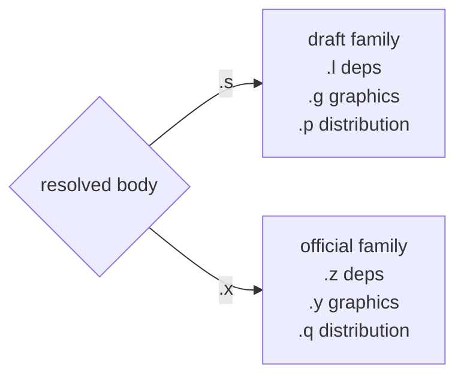
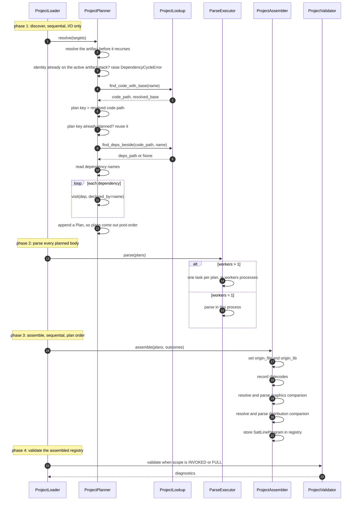
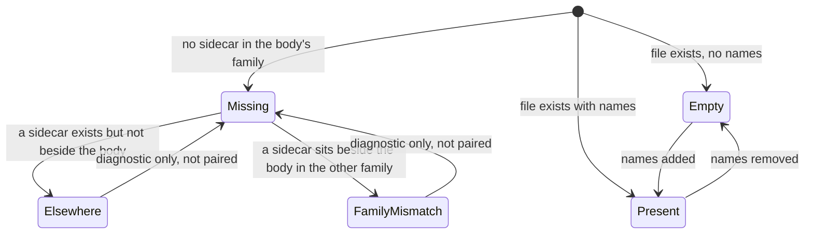
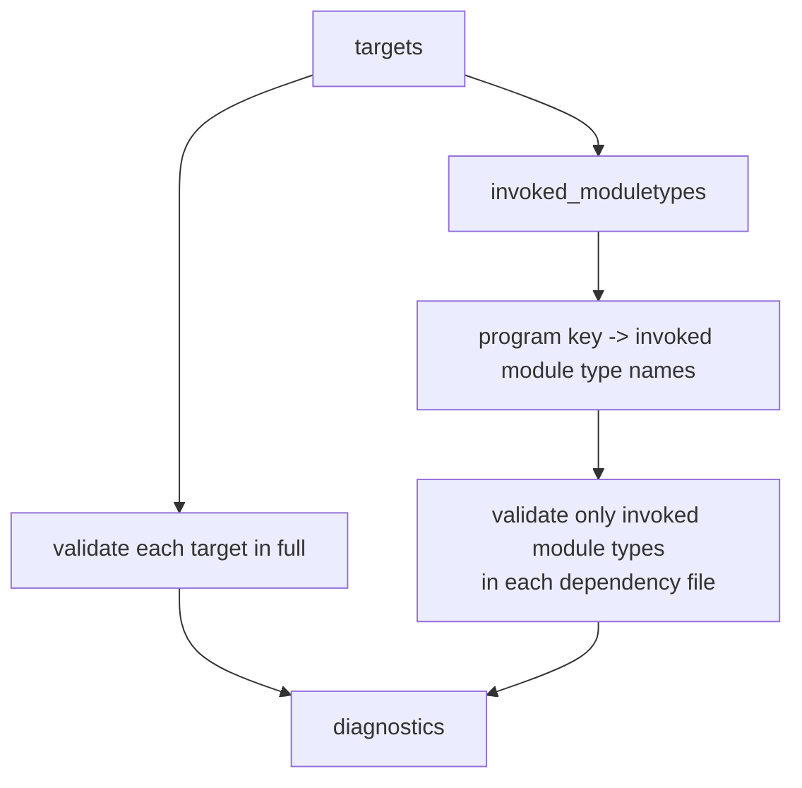
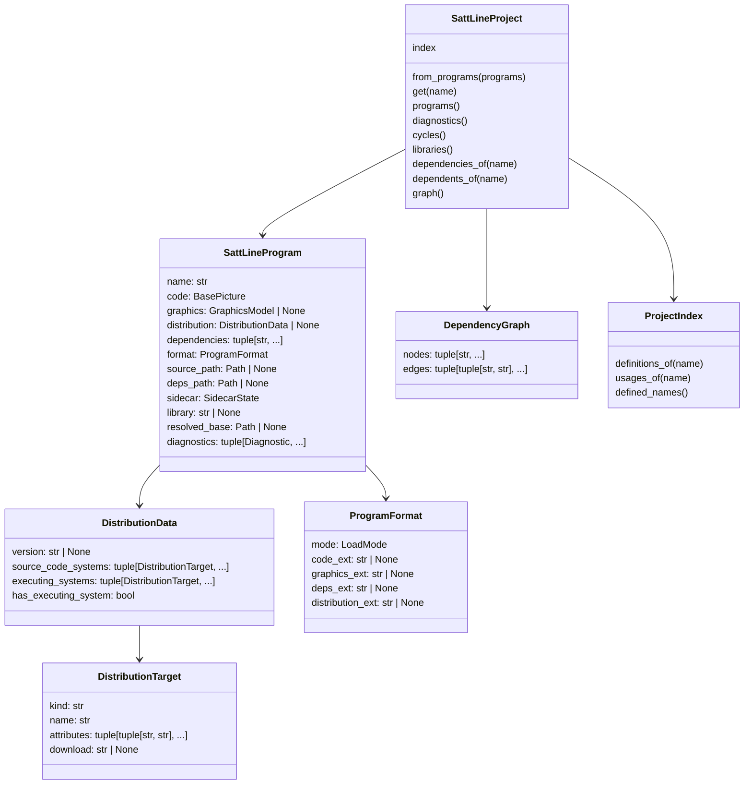
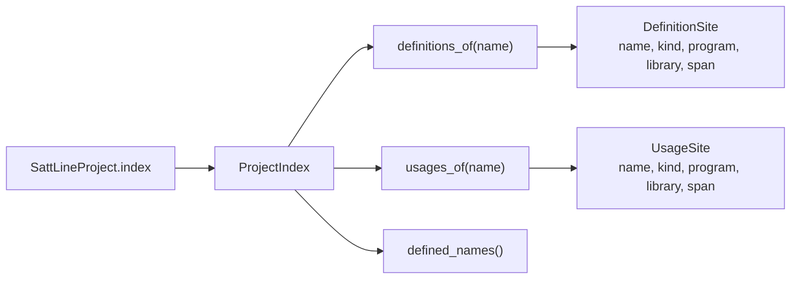
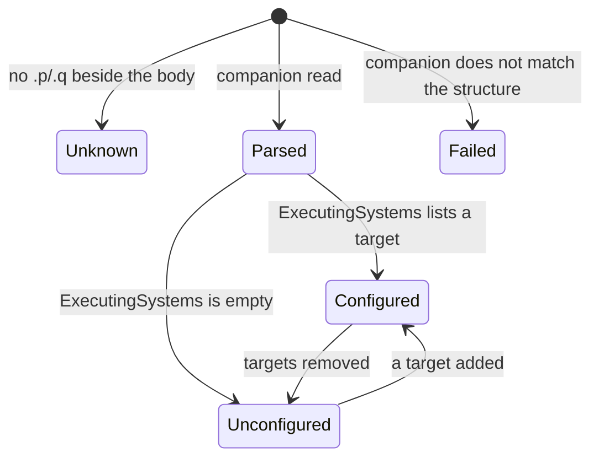

# Project layer

The project layer turns a set of SattLine artifact files into a resolved graph
of `SattLineProgram` instances. It owns discovery, draft/official selection,
dependency resolution, graphics and distribution companion loading,
parser-owned caches, and project-scope validation.

A **program** here is one loaded source artifact (one `.x` or `.s` file), not
one executable top-level program. Loading one target can produce many
`SattLineProgram` entries through its dependency closure.

A SattLine program or library is one unit made of four files: the code body,
the dependency sidecar, the graphics companion, and the distribution companion.
Draft is `.s`, `.l`, `.g`, `.p`; official is `.x`, `.z`, `.y`, `.q`. The loader
resolves each role by mode; a missing sidecar is reported as a diagnostic and a
missing companion is recorded as absent, never invented.

## Artifact formats



| Artifact | Draft | Official |
| --- | --- | --- |
| Code body | `.s` | `.x` |
| Dependency sidecar | `.l` | `.z` |
| Graphics companion | `.g` | `.y` |
| Distribution companion | `.p` | `.q` |

The **resolved body's suffix decides the artifact family for the whole unit**.
A `.s` body pairs only with `.l`, `.g`, and `.p`; an `.x` body pairs only with
`.z`, `.y`, and `.q`. Artifacts never fall back across families, so a draft body
is never paired with an official sidecar or companion, and the reverse never
happens either.

Only the code body falls back, and only within one mode: draft mode prefers
`.s` and falls back to `.x`, while official mode accepts `.x` only. Once the
body is resolved, every other role has exactly one candidate extension, chosen
by the body suffix. See `body_mode`, `deps_extensions_for_code`,
`companion_extensions_for_code`, and `distribution_extensions_for_code` in
`project/formats.py`.

There is no "guess the extension" step. A companion has exactly one candidate
extension and a sidecar has exactly one too, both chosen by the body suffix. A
companion whose stem matches its body under the language name table still pairs,
so a tree copied from a case-insensitive filesystem keeps working. The exact
stem is tried first; a case variant is found through the directory index. Only a
regular file pairs: a directory named like a companion is not one.

`ProgramFormat.mode` is the artifact family of the **resolved body**, not the
mode the caller requested. A draft load that fell back to an `.x` body reports
`OFFICIAL`, because the body's suffix is what decides which sidecars and
companions can pair with it.

## Discovery

`ProjectLookup` resolves a name across the caller's roots, in the caller's order.


`ordered_lookup_bases` is that order. It resolves each entry, keeps the first
position of a repeated root, and drops a root whose directory name an earlier
root already holds under the language name table. That is the loading path of
the real session: one library per name, and the first library found is the only
one opened. A shadowed root contributes nothing, including a unit the earlier
library does not define. There is no requester precedence, no cluster sorting,
and no special last root. `SattLineProject.load` and the CLI both pass an
ordered sequence, so the rule is one rule: earlier entries win.

A root with no directory name, such as a filesystem root or a Windows drive
root, is compared by path only, so `C:\` and `D:\` stay two roots.

`parse_search_path` turns the path-list notation into that sequence:
`parse_search_path(r"LibA\UnitLib,LibB\OtherLib", base=Path("/sattline"))` yields
the two roots in the written order, relative entries resolved under the base,
backslashes accepted, empty entries and duplicates dropped. Duplicate detection
has two rules: a repeated resolved path is the same root, and a repeated
directory name is the same library. Path comparison uses the platform's rule,
so a case-only difference is two roots on a case-sensitive filesystem and one
root on Windows; library names fold with `fold_identifier`, so `Lib` and `LIB`
are one library everywhere.

Each effective root is indexed once by `SourceIndex`:

```
fold_identifier(stem) -> {extension -> Path}
```

Only code and dependency extensions are indexed. Graphics and distribution
companions are resolved from their code path and never appear in the index. A
miss in the index falls back to a `stat` check for each candidate extension, and
a hit updates the index. Only a regular file resolves: a directory or a FIFO
named like a body is not one, so it neither shadows a real body in a later root
nor gets opened. An index hit is re-statted before it is returned, so a body
deleted after the index was built reports a miss instead of a later "failed to
parse".

A dependency name is a bare unit name, never a path. It is validated against
the SattLine identifier charset, so separators, drive or alternate-stream
colons, UNC prefixes, parent references, control characters, and the
Windows-invalid filename characters are refused on every platform; Windows
device names are refused on Windows. The name is not limited to 20 characters
here: that length is the declaration rule `SL-V038`, not a resolution rule. The
`stat` fallback additionally requires the candidate to resolve inside the lookup
base. A `.l` line of `../outside/Secret`, or an absolute path, therefore resolves
to nothing and is reported as a missing dependency instead of loading a body
outside every root.

Default target discovery uses the same name rule, so `sattline project <dir>`
never offers a name the resolver would refuse. A code file directly under a
root whose stem cannot be a unit name, such as `Pump.v2.s`, is left out of the
target set and reported once as `SKIPPED_FILE`: a whole-tree load carries on
instead of failing on an unresolvable target.

A configured root that is not a readable directory (a regular file, a missing
path, or a directory under a denied ancestor) is a load failure naming that
root, not an empty root. The check runs before any target is resolved, so
`SattLineProject.load` never reports a missing body for a root it could not
search.

`ProjectLookup.find` resolves only a code body or a dependency sidecar. It
raises `ValueError` for `ArtifactKind.GRAPHICS` and
`ArtifactKind.DISTRIBUTION`, because a companion has no root-ordered meaning: a
search across the roots could return another unit's companion. Companions reach
a program only through `resolve_graphics_companion_path` and
`resolve_distribution_companion_path`, which anchor to the selected body.

`find_deps_beside(code_path, name)` is deliberately different from
`find_deps(name)`. A SattLine library is a body plus a sidecar at **one**
prefix. Resolving the sidecar through the whole root list could pair a body with
an unrelated library's sidecar, so the body's own directory decides. The body's
suffix also decides which sidecar extension may pair, through
`deps_extensions_for_code`.

## Loading



Discovery resolves paths and reads sidecars; it never parses a body. That split
is what makes the parse phase parallel: the whole closure is known before any
parse starts, so a worker needs nothing but a path, and the assembled registry
does not depend on which worker finished first.

A plan is identified by its **resolved artifact identity**
(`ArtifactIdentity`), which is the resolved code path compared by the platform's
own rule. Because every name resolves through the same ordered path, one name
reaches one body per load. When two roots hold `Util.s`, the body in the earlier
root is planned, parsed, and validated; the later body is never read. When two
roots carry the same library name, the later root is not in the path at all, so
a unit that only it holds is not found. There is no ambiguity to report and no
second body to expose, so the registry holds one unit per name by construction
and every loaded unit has a distinct `library` label.

Planning is iterative. Each unit is a frame on an explicit stack, so a dependency
chain of any legal length is planned without growing the Python call stack. A
400-unit chain loads; a 400-unit loop raises `DependencyCycleError` with its
canonical path instead of a `RecursionError`.

One body reached under two names, for example directly and through a symlink, is
one plan with two spellings. Every spelling is kept as an alias, so a dependency
name returned by `dependencies_of` is always a name `get` resolves, and every
`graph()` endpoint is a node. See [aliases](#aliases).

Post-order is an invariant: the registry is built dependencies-first, so a
program's diagnostics are computed against a complete prefix of its closure.
`_assert_registry_post_order` checks this and raises `RuntimeError` if a
dependency appears after its consumer. A cycle never reaches that check because
the loader rejects it first.

Discovery runs to completion before any body is parsed, which changes two
observable orders:

- **Errors.** A discovery failure (a missing body, an unreadable sidecar, a
  cycle) is raised before any body-parse failure, because the whole closure is
  resolved first. With two targets, `B`'s unreadable sidecar therefore wins over
  `A`'s broken body even when `A` was requested first. Structural errors win
  over everything.
- **Diagnostics.** `SattLineProject.diagnostics()` reports only the non-fatal
  load conditions: a missing or empty sidecar, a sidecar elsewhere, a sidecar
  from the other artifact family, a companion from the other artifact family, a
  code file whose stem cannot be a unit name, and a folded-name collision. A
  failure to resolve or parse raises instead. Discovery rows come first, in
  discovery order, then assembly rows in plan order.

`validate=INVOKED` runs **after** the graph is complete, because it needs the
whole invocation graph. The loader first builds the registry, then walks
`invoked_moduletypes` and replaces each program with a copy that carries the
invoked-scope diagnostics.

## Identity

The project layer keeps several comparisons apart, and conflating them has caused
real bugs. They now have names.

| Identity | Type or rule | Used for |
| --- | --- | --- |
| Unit name in the project view | `str.casefold()`, or `fold_identifier` for every unit of a shared casefold key | `programs()` keys, graph node names |
| Language identity of a unit | `UnitIdentity`, `fold_identifier` (CP1252 table) | artifact resolution, `get`, `__contains__`, the symbol index, the lookup cache key |
| Language identity inside a unit | `fold_identifier` | record, module-type, field, and variable lookup |
| Artifact identity | `ArtifactIdentity`, resolved path compared with `os.path.normcase` | roots, plan keys, the cycle stack |
| Logical spelling | `SattLineProgram.name`, `UnitIdentity.spelling` | what a diagnostic quotes |

Artifact resolution uses the language identity, not Unicode case folding. A
dependency named `STRASSE` never resolves to `Straße.s`, even though
`str.casefold` equates the two: the candidate's stem must match the requested
name under `fold_identifier`. `SourceIndex` is keyed by that identity, the
lookup cache uses the same key (`LOOKUP_CACHE_VERSION` covers the rule), and the
`stat` fallback requires a regular file inside the root. A `str.casefold` match
the language rejects is a missing dependency, never a successful resolution.

`programs()` keys stay `str.casefold`, which keeps every ordinary ASCII name at
the key it has always had. That key is a view key, not the language name table:
two language names that differ outside the CP1252 fold, such as `Straße` and
`STRASSE`, share one. When that happens the shared key names no single unit, so
every unit in the group is keyed by its language identity instead. Every loaded
unit then has one key, none is dropped, and each keeps its own identity in
`get`, the graph, and the symbol index. `get` and `__contains__` accept a view
key as written, and any other spelling must match a loaded unit's name under
`fold_identifier`, so a casefold-only name designates the unit whose language
identity it is and never the unit that happens to share its Unicode fold.
Module-type, record, field, and variable lookup inside a unit use
`fold_identifier` and keep them apart. A filesystem path is never case-folded
unconditionally: `ArtifactIdentity`
resolves it and lets the platform decide, so `/lib` and `/Lib` are two roots on
a case-sensitive filesystem and one directory on Windows.

`UnitIdentity.of(name)` and `ArtifactIdentity.of(path)` are exported for a
consumer that needs the same comparisons. Equality and hashing use the key, so
two spellings of one identity are equal.

### Aliases

One body can be reached under more than one name, for example directly and
through a symlink. The body is planned once, and every spelling that reached it
is kept as an alias, so `dependencies_of` only returns names `get` resolves and
every `graph()` endpoint is also a node. An alias is a name for a unit, not a
second unit: `programs()` still holds one entry per body, and
`get(alias).name` is the spelling that planned the body first. The alias table
is keyed by language identity, so `AliasBase` resolves to the body that
`Base` planned while a casefold-only spelling of either name does not.
`dependencies_of` and `dependents_of` resolve their argument the same way, so a
`programs()` view key, an alias, and a source spelling all designate the unit
they name.

### Folded-name collisions

Two files in one root whose stems fold to one language identity, such as
`Util.s` and `UTIL.s`, are an ambiguity: the language considers them one unit and
the filesystem holds two. The index keeps the first in sorted name order and
records a `NameCollision`; the loader reports
`LoadDiagnosticKind.FOLDED_NAME_COLLISION` naming every file and the winner. Two
loaded units whose names share a project view key are reported the same way.
That shared key names no single unit, so both are keyed by their language
identity: `get`, `programs()`, the index, and the graph see one unit per name,
and a dependent's declared spelling round-trips through `get`. The load still
succeeds: the layout is reported as ambiguous instead of one unit disappearing
without a finding or an edge retargeting at the other unit.

## Cycles

A recursive dependency has no finite load order, so the loader rejects it. The
planner resolves an artifact before it recurses, so the cycle check follows
physical files: when the resolved artifact is already on the active stack, it
raises `DependencyCycleError` with the canonical cycle path, for example
`("alpha", "beta", "alpha")`. The names in the path are the logical names that
formed the loop, folded, because that is what a reader can act on. The error is
structural: a cycle inside an unparseable dependency still fails the load.

Following artifacts rather than names matters because two different names for
one body, such as a symlink alias, still form a cycle even though no name
repeats. The diagnostics section of [identity](#identity) names the comparison
each layer uses.

A cycle is identified by its directed node sequence, not by its member set.
Rotations of the same sequence describe the same cycle, so every path is
rotated to start at its smallest node name before it is reported.

`SattLineProject.cycles()` stays available for a project built directly with
`from_programs`: it enumerates the cycles in the declared graph edges.
`SattLineProject.load` never returns one because the loader has already raised.
Enumeration is linear on a DAG because the search is confined to strongly
connected components. It is exponential in the worst case for a dense component
because every elementary cycle is reported.

## Module-type recursion

A module type that instantiates itself, directly or through other module types,
has no finite expansion. After the registry is complete, for each program the
loader builds the instantiation graph over the module types that program can
see and rejects the first cycle with `ModuleTypeCycleError`. A graph node is one
*definition*, identified by its owning program and folded type name, so two
libraries that reuse a name are not merged.

A reference binds to what its own file can see. It resolves to the referencing
file's own definition first, then to any definition in the referencing unit's
own closure, never to a definition the referencing unit cannot resolve. A
wrapper that defines `Motor` around a dependency's `Valve` therefore cannot
capture the dependency's `Valve -> Motor` reference, even though the wrapper is
the unit being checked. Only a cycle whose definitions all lie in the checked
unit's closure is reported, so an unrelated closure's layout cannot fail this
one.

The check runs before validation and is not governed by `LoadValidation`, so
`validate=NONE` cannot let a recursive type through. Unused module types in a
loaded dependency are checked
too, because the type itself is structurally invalid. The search stops at the
first cycle it finds, so a dense instantiation graph cannot make rejection
enumerate an exponential number of elementary cycles.

## Sidecars



`SidecarState` distinguishes absent, empty, and present. Conflating absent with
empty would silently drop a dependency chain: a library with an empty sidecar
is still a library whose body was found, while a missing sidecar may indicate a
layout mistake. `SIDECAR_ELSEWHERE` reports a stray file in another directory
without pairing it. `SIDECAR_FAMILY_MISMATCH` reports a sidecar that sits beside
the body but belongs to the other artifact family, for example a `.z` beside a
`.s` body. The stray is found by the body's stem under the language name table,
so `STRASSE.z` is not a stray sidecar for `Straße.s` and the report is
`SIDECAR_MISSING` instead. Neither stray is ever paired.

## Validation scopes



`invoked_moduletypes` walks the target's module tree, follows every
`ModuleTypeInstance` reference into loaded definitions, and continues through
their submodules. Only reached module types are validated. The target itself is
always validated in full.

Every finding the loader produces is final. A load is all or nothing, so a
definition can never be missing from a closure that a finding was computed
against: a missing or unparseable artifact raises instead of leaving a program
out. `DATECODE_CONFLICT` compares declarations that did load, and the mapping
and transfer rules see every definition their program's closure reaches.

## Load failures

A missing or unparseable artifact raises `ProjectLoadError` and its subclasses.
There is no partial project: `SattLineProject.load` either returns a complete
registry or raises. That applies to a configured root that is not a readable
directory, a missing body, an unreadable dependency sidecar, a malformed
companion, and a parse failure in any body the closure reaches. Validation
findings never raise, because they are findings and not load failures.

The two structural errors are fatal in the same way: a recursive sidecar chain
and a module type that instantiates itself.

## Datecodes

The loader records the datecode of every module type and datatype it sees,
keyed by folded name and scoped to the program's visible closure. A conflict is
reported when the same name is declared with two different datecodes in one
closure. A program compares its own declaration against the visible versions,
so a closure holding versions 1 and 2 reports the conflict on a program that
declares either one, naming only the version that differs. Datecode findings
belong to an explicitly selected program, not to a library import: a library is
not the place to report its own version drift. Ownership comes from the target
set, not from discovery order, so a target that was first reached as a
dependency still reports its own conflict in either target order.

## Models



`SattLineProject` keys programs by view key internally while preserving the
caller's original spelling on `SattLineProgram.name`. The view key is
`str.casefold()`, except for the units of a shared casefold key, which use their
language identity instead. `get`, `__contains__`, `dependencies_of`, and
`dependents_of` are case-insensitive under the language name table.
`dependencies_of` returns the declared spelling in declaration order, and
`dependents_of` returns each dependent's declared spelling in load order, so a
name either method returns can be passed back to `get`.

A `DependencyGraph` resolves a name by its exact node key first, then by the
casefolded spelling, then by the language identity, so a unit keyed by its
identity is reachable under any of its spellings.

`graph()` returns every declared edge. In a loaded project every declared
dependency is also loaded, because a missing one fails the load. A project
assembled directly with `from_programs` may declare an edge to a program it does
not hold; the graph keeps that edge, because it describes the declared structure,
not just the resolved closure.

### Snapshot

A project owns an immutable snapshot. `load` freezes the trees the loader
produced in place; `from_programs` deep-copies first, so the caller keeps
ownership of the tree it passed in. Freezing replaces every reachable list with
a tuple, every mapping with a read-only mapping, and locks every mutable model
node. Assigning a field or appending to a container on an attached tree raises.

The snapshot is what makes the lazy index safe: `project.index` cannot go stale
because the tree it was built from cannot change. Build a new project if the
source changed.

## Symbol index

`SattLineProject.index` answers "who defines X" and "who uses Y" across every
loaded unit. It is built on first access from the parsed trees and cached for the
lifetime of the project.



| Definition kind | Node |
| --- | --- |
| `PROGRAM` | the unit's `BasePicture` header |
| `DATATYPE` | a record declaration |
| `MODULETYPE` | a module-type declaration |
| `VARIABLE` | a module parameter, local, or record field declaration |

| Usage kind | Node |
| --- | --- |
| `VARIABLE` | every `VarRef`, including a mapping source or target and a header argument |
| `MODULETYPE` | every `ModuleTypeInstance` |

Names compare with `fold_identifier`, so a lookup is case-insensitive. Results
are sorted by unit name and then source offset, and deduplicated, so two runs
over the same project return the same tuples. The index records where a name
appears, not what it resolves to: a reference to a name defined nowhere still
has a usage site, and validation is what reports it.

`invoked_moduletypes(programs, targets, *, closure_of=None)` is exported from
`sattline_parser.project`. It returns the module types each unit actually
reaches, which is why a dependency file is validated only for the parts a target
invokes. Its keys are the mapping keys the caller supplied (the loader passes
plan keys), its values are module-type names folded with `fold_identifier`, and
`closure_of` must answer in the same key space as `programs`. See
[validation scopes](#validation-scopes).

## Caches

Both project caches are opt-in through `cache_dir=`. When it is `None`, the
project layer reads and writes neither cache and shares no state. A supplied
`cache_dir` must be a directory this user owns privately: the level itself and
every directory above it, so no other user can rename the tree and replace it.
A root-owned sticky directory such as the system temporary directory is an
acceptable ancestor, because another user cannot rename an entry they do not
own there. Never point `cache_dir` at a shared location; a location that cannot
be proven private disables both caches instead of being tightened or followed.

The compiled Lark grammar cache is separate: it lives under the temporary
directory and may still be written on the first parse, as `sattline --no-cache`
documents. `sattline project` passes a private directory under the user's cache
root unless `--no-cache` is given, so a repeated load of the same tree skips
parsing.

The companion directory index is not one of those caches. It lives only for one
load, so a second load lists its directories again and sees a file that changed
in between; nothing about a companion scan outlives the load that made it.

### Lookup cache

`FileLookupCache` persists `(kind, name, mode) -> (base_dir, ext)` resolutions
as JSON. It is versioned (`LOOKUP_CACHE_VERSION`) and flushed periodically
(`DEFAULT_LOOKUP_CACHE_FLUSH_INTERVAL`). A cached resolution is trusted only
when:

- the base is still a configured root;
- the base is still present in the current ordered bases;
- the artifact still exists;
- no higher-precedence base holds the artifact.

On any failure the entry is forgotten and the full ordered scan runs. Extension
preference wins over the extension recorded in the cache, so an artifact that
appeared after the cache was written is not shadowed. The cached base is
resolved through the same case-insensitive index a cold scan uses, so a
dependency spelling whose case differs from the file name resolves identically
warm and cold. A warm lookup and a cold lookup always agree.

Startup pruning drops a file it cannot use (wrong version, or an entry whose
shape is not `(base_dir, ext)` strings), removes abandoned `*.tmp` siblings older
than an hour, and caps the entry count (`MAX_LOOKUP_CACHE_ENTRIES`); the surplus
is dropped in key order. Pruning never stats a recorded base directory: that
string is untrusted data, and on Windows a planted UNC path would otherwise turn
a startup prune into an outbound SMB connection. The same cap also runs on every
insert, so one long run cannot grow the file past it. Writes stay atomic: a
temporary sibling, `fsync`, then `os.replace`.

### AST cache

`FileASTCache` stores each parsed `BasePicture` in an HMAC-signed envelope: a
small signed JSON metadata header followed by the pickled AST. The key includes:

- the code path;
- the load mode;
- the package version;
- the resolved grammar fingerprint;
- the installed `lark` and `regex` versions and the interpreter version, so an
  upgrade inside a pin cannot serve an AST parsed by a different parser stack;
- a fingerprint of every regular file shipped in the package, including
  `grammar/`, `models/`, `transformer/`, `preprocessing/`, and non-Python
  resources such as `preprocessing/scanner_tokens.json`; bytecode caches are
  excluded;
- the digest of the source bytes the AST was parsed from.

A `mtime_ns` and `size` stat snapshot is the cheap first filter; on a match the
cached digest is confirmed against the bytes on disk, so the bytes decide. An
edit that keeps the file size and lands inside the filesystem's mtime
granularity, or a restore that puts an old mtime back, is a miss and the body is
reparsed. A cache hit still reads the source to verify the digest, so a warm
load avoids parsing but not the source read.

Decoding, span remapping, and identifier folding all change the parsed AST, so
they are part of the fingerprint: a fix there invalidates a cached body through
the key rather than through a version bump. `FILE_AST_CACHE_VERSION` tracks the
envelope shape only.

The snapshot is taken from the exact bytes that are parsed, and the entry
records those bytes' digest, so an entry can never claim a source revision it
was not parsed from. A body whose source changed while a worker was reading it
is left uncached: the next load reparses it instead of trusting a stale AST.

The namespace and file-format magic belong to `sattline-parser`
(`FILE_AST_CACHE_VERSION`), so another tool's cache never cross-reads.

#### Privacy boundary

The HMAC key lives beside the entries. It proves the entry was written by
whoever could write that directory; it is not a defence against that user. The
real boundary is a directory proven private to this user:

- On POSIX the cache root and every directory above it must be owned by this
  user or by root with no group or world write bit, and the root must have mode
  `0700`. A root-owned sticky ancestor is accepted. On Windows the root must be
  a real directory, not a reparse point, whose owner is this user and whose DACL
  grants write access to nobody else; a failed security-descriptor read disables
  the cache.
- On POSIX the cache root is opened once with `O_DIRECTORY | O_NOFOLLOW` and
  its `(st_dev, st_ino)` is recorded; the `file_ast` subdirectory is opened
  relative to that descriptor, and every entry and key operation is relative to
  it with `O_NOFOLLOW`, so a link is never followed. Windows has no portable
  directory descriptor: each entry is opened by path after the revalidation, and
  the privacy check refuses a reparse point.
- Every load and every save revalidates the directory against the recorded
  identity, the name that still resolves to it, and the owner and mode (through
  the held descriptor on POSIX, and through the security descriptor on
  Windows). A cache root or `file_ast` directory that is renamed, replaced,
  symlinked, or widened after construction disables the handle instead of being
  written into. A removed cache directory is not recreated during that run; the
  next process opens a fresh one.
- Only a writer creates the HMAC key, and it reads and installs the key through
  the validated descriptor. A read with no key is a miss, so a reader never
  creates a key. Entry files and the key are created `0600`.

A read-only worker handle performs the same revalidation but never prunes,
rewrites the identity marker, touches an entry, or writes one.

#### Pruning and bounds

Pruning drops an entry whose file name carries another identity, an entry whose
signed header records a source path that no longer exists (a rename, a branch
switch, a deleted temporary checkout), and abandoned `*.tmp` siblings older than
an hour. The vanished-source check reads only the signed header, so it never
unpickles a payload it cannot verify and never stats a path from an unverified
header. Entry-level validity (envelope, version, source revision) is decided by
the load path, which is the only place that unpickles a payload.

The least recently used entries past `MAX_AST_CACHE_ENTRIES` (1024 by default;
the library constructor accepts `max_entries=`) are dropped as well. A
successful load touches the entry, so eviction follows last use rather than the
time the entry was written. The cap runs at startup and again during a run after
`max_entries // 8` writes (capped at 64, at least 1), so a single process can
overshoot the cap by at most that many entries; the next load starts at the cap.
The full identity and vanished-source pass runs when the cache identity changes,
because the count check only stats files.

A cache read or write failure is a miss; it must not turn a successful parse
into a load failure. The fingerprint is captured when the cache is constructed,
so an install whose package files disappear mid-run disables caching for that
process instead of failing each lookup.

#### Lark parser cache

The compiled-grammar cache is an unsigned pickle shared by every worker. Its
security boundary is the directory, not the file: the per-user directory has a
predictable name under the shared temporary directory, so the directory and its
parent chain are proven private before it is used, and an unusable directory
disables the cache. Inside that directory, the file carries a header naming the
grammar fingerprint, start rule, position mode, Lark version, and interpreter
version; a file with a different header, a partial body from an interrupted
writer, or a file in an older format is discarded and rebuilt.

The file is written to a unique staging sibling, flushed, and published with
`os.replace`, so another process reads either the previous complete file or the
new complete file, never a partial pickle. It is not signed: adding a second key
store for a parser that is already in a private directory would add a secret to
protect without adding a boundary.

## Graphics companions

`resolve_graphics_companion_path(code_path, mode)` uses `with_suffix` in the
code file's directory. It never does a root-ordered lookup:

- `.x` resolves only to `.y`;
- `.s` resolves only to `.g`;
- a `.g` or `.y` input resolves to itself.

The stem is compared with the language name table, so `Pump.S` pairs with
`pump.g` while `Straße` never pairs with `STRASSE`. The exact stem and extension
are tried first; a case variant is found through the load's directory index.
Only a regular file pairs: a directory named `Pump.g` is not a companion. When a
directory holds two case variants of one companion name, `Main.g` and `MAIN.G`,
the alphabetically first file wins whatever order the directory lists them in,
and the load reports `FOLDED_NAME_COLLISION` naming both and the winner.

A companion from the other artifact family beside the body, for example a `.y`
beside a `.s` body, is never paired and is reported as
`COMPANION_FAMILY_MISMATCH`, so a missing graphics model is explained instead of
silently absent. The report is produced only when no same-family companion
exists, matching the sidecar rule.

The loader parses the companion into `program.graphics`. Structural problems
become `GraphicsMessage` values, never exceptions. A companion larger than
`MAX_GRAPHICS_COMPANION_BYTES` (4 MiB) is a file-level refusal instead: it
raises `GraphicsParseError`, which the loader maps onto `ArtifactLoadError` or
`DependencyParseError`, because a partially scanned model would misreport what
the file says. Both `GraphicsParseError` and `MAX_GRAPHICS_COMPANION_BYTES` are
exported from `sattline_parser.project`. See [graphics.md](graphics.md).

## Distribution companion

A distribution companion (`.p` draft, `.q` official) records which systems a
unit is sent to. It is configuration, not proof that the unit is running
anywhere, and it is not a module type: a program and a library both may carry
one.



`resolve_distribution_companion_path(code_path, mode)` uses `with_suffix` in the
code file's directory, never a root-ordered lookup:

- an `.x` body resolves only to `.q`;
- a `.s` body resolves only to `.p`;
- a `.p` or `.q` input resolves to itself.

The stem is compared with the language name table, so `Pump.S` pairs with
`pump.p` while `Straße` never pairs with `STRASSE`. As with graphics, the exact
stem wins, a case variant is found through the load's directory index, and a
collision between case variants is reported with its winner. A `.q` beside a
`.s` body is not paired and is reported as `COMPANION_FAMILY_MISMATCH`, which is
why `has_executing_system` is `None` rather than a silent unknown.

The file is a small nested structure of named groups:

```
DistributionData
 ( Version "Distributiondata version 1.0" )
SourceCodeSystems
 (  )
ExecutingSystems
 ( Controller
    ( Name "172.18.0.1"
      Download ShortStopReconfig ) )
```

`parse_distribution_file` reads it into `DistributionData`:

| Field | Meaning |
| --- | --- |
| `version` | The `Version` string of `DistributionData` |
| `source_code_systems` | Targets of `SourceCodeSystems` |
| `executing_systems` | Targets of `ExecutingSystems` |
| `has_executing_system` | `True` when `executing_systems` is non-empty |

A target is a `DistributionTarget` with `kind` (the section keyword as written,
for example `Controller` or `OpStation`), `name` (the `Name` string), and
`attributes` (the trailing `Keyword Value` pairs in file order).

`SourceCodeSystems` entries never count as executing systems. The parse is
structural: a group is read as an executing system only when it sits inside
`ExecutingSystems`.

`SattLineProgram.has_executing_system` is the three-state answer a consumer
needs:

| Value | Meaning |
| --- | --- |
| `True` | A parsed companion lists at least one executing system |
| `False` | A parsed companion lists none |
| `None` | No companion was found, so the question is unanswerable |

A companion that exists but does not match the structure raises
`DistributionParseError`, which the loader turns into `ArtifactLoadError` (for a
target) or `DependencyParseError` (for a dependency). It is never reported as an
empty list, because "none" and "could not tell" are different answers. A missing
companion is not a diagnostic: distribution data is optional. A companion larger
than `MAX_DISTRIBUTION_COMPANION_BYTES` (1 MiB) is a parse error too, refused
before it is read, because a companion is a small configuration blob.

This is deliberately stricter than the graphics companion, where structural
problems become `GraphicsMessage` values on a companion that still loads. A
graphics message still describes the file it came from; an unusable distribution
companion cannot answer the one question it exists to answer, so the load fails
instead of reporting the program as unconfigured. The three-state field therefore
describes only what the parser could establish, and a rejected companion is
never mistaken for "no companion".

The companion is read during assembly on every load, including a load served
from a warm AST cache, so editing only the `.q` changes the answer without
re-parsing the body.

## Loading performance

- Each resolved body is parsed once, by resolved code path.
- The parser is shared across files.
- The lookup cache skips repeated ordered scans for a stable layout.
- The AST cache skips re-parsing an unchanged file.
- `INVOKED` scope avoids validating a library's unused module types.
- Companion resolution lists each directory once per load and indexes it by
  language identity and extension. Graphics, distribution, and the sidecar
  family probe share that one scan, so the non-parse phase stays flat as a
  directory fills with units instead of growing with unit count times roles.

Measured with `sattline project` over a 268-program library tree (315 MB of
`.x` bodies, `validate=invoked`) on a 6-core machine:

| Load | Time |
| --- | --- |
| `--workers 1 --no-cache` | 255 s |
| defaults, second load (warm AST cache) | 68 s |

Parsing is 99% of a load. Lookup, sidecar reads, graphics and distribution
companions, and graph assembly together are under a second on that tree, which
is why `workers` is the only lever with a large factor.
A `ProjectLoader` resolves one load. Discovery plans, parse outcomes, and the
registry are per-load state, so a second `resolve()` call raises rather than
doubling the plans over an existing registry; construct another loader.

### Parallel parsing

`workers` parses bodies in that many processes and defaults to `1`; the CLI
defaults to `min(8, cpu_count)` and accepts at most 32. Results do not depend
on the worker count: discovery fixes the plan order before any parse runs.

- A single-threaded caller on Linux before Python 3.14 uses `fork`, which needs
  no `__main__` guard. A caller with other threads gets `forkserver`, because
  forking a threaded process is deprecated in CPython and can inherit a lock
  another thread held at fork time. macOS and Python 3.14 and later keep the
  platform default, which no longer prefers `fork`. Discovery parses nothing,
  so the parser is not built before the pool starts: every worker builds it
  from the on-disk Lark cache, about 50 ms and 50 MB each.
- A daemonic process may not start children, a process that is itself a pool
  worker must not start a second pool, and a load constructed while another
  load is resolving is nested. Each of those parses in that process instead of
  raising. The fallback logs one warning per load, not one per body, so a run
  that silently lost its parallelism does not look like a clean parallel load.
- A worker reads the AST cache but never writes it: the parent owns every
  write, so the per-user key and the entry signatures stay single-process, and
  the parent stores a worker's body only under the source snapshot the worker
  read. A cached body still crosses the pipe to the parent, which is why a warm
  cache and `workers` do not multiply.
- If a pool cannot be created (a restricted sandbox, a bootstrap failure), the
  load logs and parses in this process rather than failing.
- A worker that dies mid-load, for example under memory pressure, breaks the
  pool. The load logs that at warning level and reparses the closure in the
  parent instead of failing, because parsing is the load rather than an
  optimisation. The warning names the pool failure, so a run that silently lost
  its parallelism does not look like a clean parallel load.
- `workers > 1` and a warm cache do not add up: the parent must still receive
  every AST from a child. Use the cache for repeated loads and `workers` for a
  cold one.

## Tests that pin the project layer

| Test | What it protects |
| --- | --- |
| `tests/project/test_discovery.py` | Ordered lookup and path-list notation |
| `tests/project/test_formats.py` | Extension selection and companion pairing |
| `tests/project/test_loader.py` | Recursive loading and post-order |
| `tests/project/test_project_layer.py` | `SattLineProject` views and graph |
| `tests/project/test_project_validation.py` | Scopes and datecodes |
| `tests/project/test_reachability.py` | Invoked module-type walk |
| `tests/project/test_lookup_cache.py` | Cache trust, invalidation, and a prune that never stats a recorded base |
| `tests/project/test_ast_cache.py` | Cache key, signature, envelope header, pruning |
| `tests/project/test_ast_cache_privacy.py` | Directory identity, key and entry links, cap during a run, foreign owner |
| `tests/project/test_private_directory.py` | Descriptor and path forms of the private directory handle |
| `tests/project/test_graphics_parsing.py` | Companion parsing |
| `tests/project/test_distribution.py` | Distribution companion parsing and pairing |
| `tests/project/test_graphics_records.py` | Composite and picture display records |
| `tests/project/test_companion_fixtures.py` | Committed `.l`/`.z`/`.g`/`.y`/`.p`/`.q` fixtures written from synthetic examples, and CP1252 sidecars |
