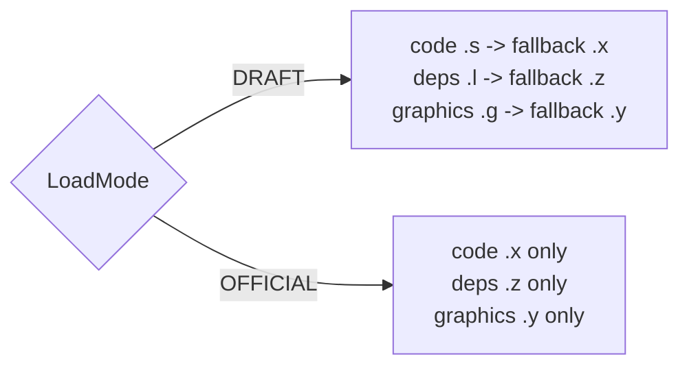
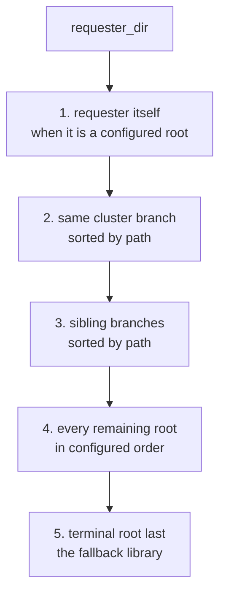
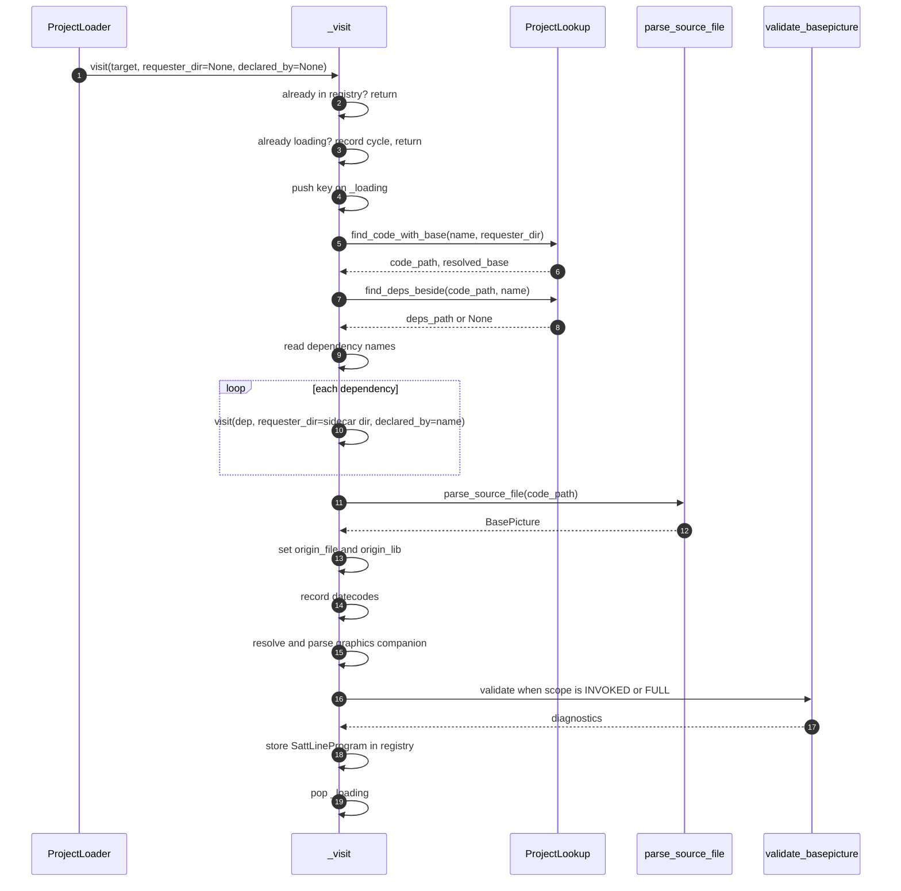
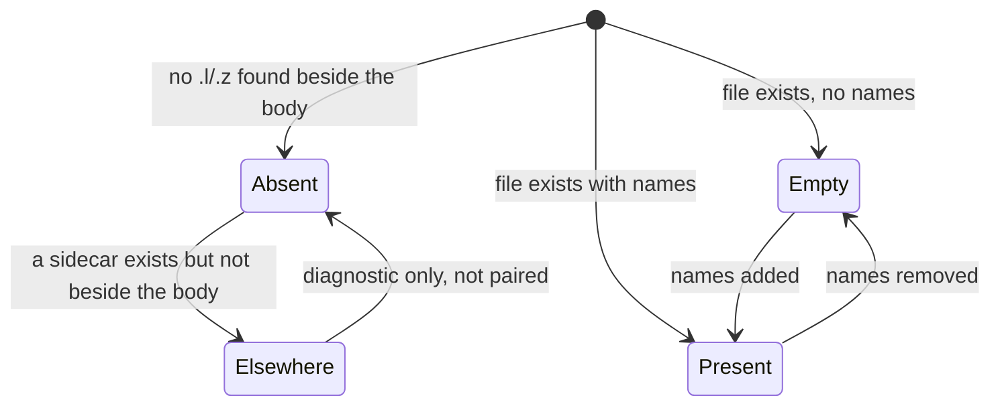
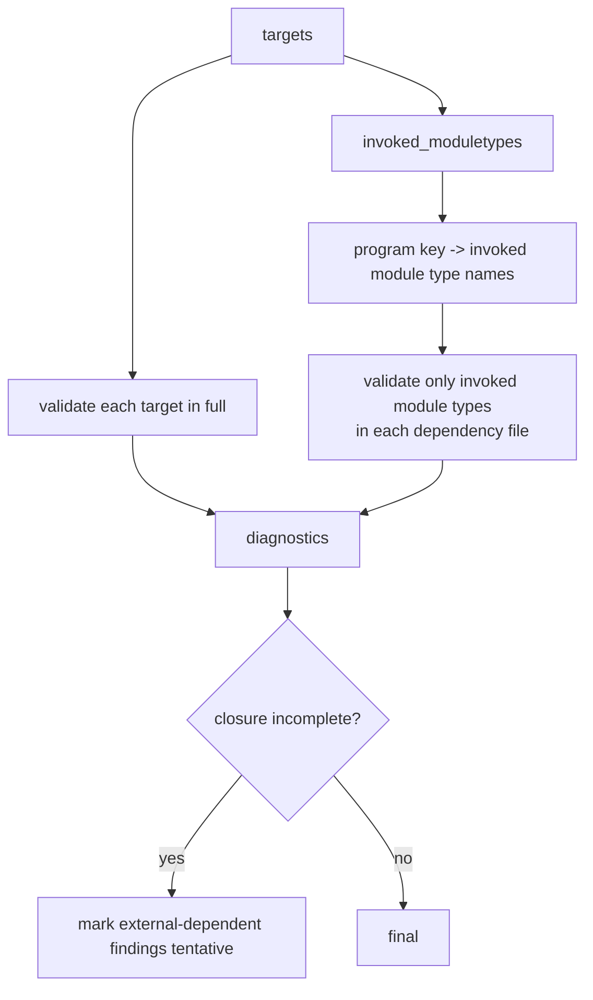
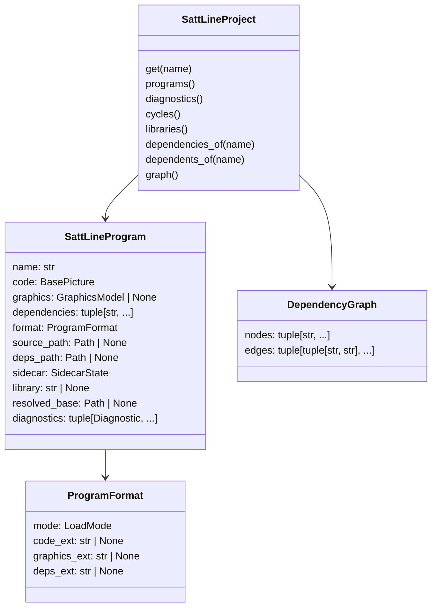

# Project layer

The project layer turns a set of SattLine artifact files into a resolved graph
of `SattLineProgram` instances. It owns discovery, draft/official selection,
dependency resolution, graphics companion loading, parser-owned caches, and
project-scope validation.

A **program** here is one loaded source artifact (one `.x` or `.s` file), not
one executable top-level program. Loading one target can produce many
`SattLineProgram` entries through its dependency closure.

A SattLine program or library is one unit made of three files: the code body,
the dependency sidecar, and the graphics companion. Draft is `.s`, `.l`, `.g`;
official is `.x`, `.z`, `.y`. The loader resolves each role by mode; a missing
sidecar is reported as a diagnostic and a missing companion is recorded as
absent, never invented.

## Artifact formats



| Artifact | Draft | Official | Fallback |
| --- | --- | --- | --- |
| Code body | `.s` | `.x` | Draft falls back to `.x`; official does not |
| Dependency sidecar | `.l` | `.z` | Draft falls back to `.z`; official does not |
| Graphics companion | `.g` | `.y` | Draft falls back to `.y`; official does not |

A `.x` body always pairs only with a `.y` companion, regardless of mode,
because `.x` is the official body format. See
`companion_extensions_for_code` in `project/formats.py`.

There is no "guess the extension" step. The mode decides the candidate list,
and the first candidate that exists wins.

## Discovery

`ProjectLookup` resolves a name across ordered roots.



`ordered_lookup_bases` implements that order. The shared cluster root is the
nearest ancestor of the requester under which at least two other roots land in
distinct first-level branches. When no such cluster exists, only rules 1 and 4
apply.

Each root is indexed once by `SourceIndex`:

```
stem.casefold() -> {extension -> Path}
```

Only code and dependency extensions are indexed. Graphics companions are
resolved from their code path and never appear in the index. A miss in the
index falls back to a `stat` check for each candidate extension, and a hit
updates the index.

`find_deps_beside(code_path, name)` is deliberately different from
`find_deps(name, requester_dir)`. A SattLine library is a body plus a sidecar
at **one** prefix. Resolving the sidecar through the whole root list could pair
a body with an unrelated library's sidecar, so the body's own directory decides
and the requester is ignored.

## Loading



Post-order is an invariant: the registry is built dependencies-first, so a
program's diagnostics are computed against a complete prefix of its closure.
`_assert_registry_post_order` checks this for acyclic loads and raises
`RuntimeError` if a dependency appears after its consumer. The check is skipped
when a cycle was recorded, because a cycle has no valid post-order.

`validate=INVOKED` runs **after** the graph is complete, because it needs the
whole invocation graph. The loader first builds the registry, then walks
`invoked_moduletypes` and replaces each program with a copy that carries the
invoked-scope diagnostics.

## Cycles

A cycle is an edge in the graph, not an infinite recursion. When `_visit`
sees a key already in `_loading`, it records the path
`("alpha", "beta", "alpha")` in `_cycles`, adds a `DEPENDENCY_CYCLE` load
diagnostic, and returns. The graph keeps the edge. Consumers can render the
path or compare it.

A cycle is identified by its directed node sequence, not by its member set.
`alpha -> beta -> gamma -> alpha` and `alpha -> gamma -> beta -> alpha` are
different cycles and are both reported. Rotations of the same sequence describe
the same cycle, so every path is rotated to start at its smallest node name and
recorded once.

`SattLineProject.cycles()` merges the paths recorded during the load with the
cycles computed from the graph edges. The merge keeps a cycle visible even when
a skipped program produced the load diagnostic. The CLI renders that same view.
Enumeration is linear on a DAG because the search is confined to strongly
connected components. It is exponential in the worst case for a dense component
because every elementary cycle is reported.

## Sidecars



`SidecarState` distinguishes absent, empty, and present. Conflating absent with
empty would silently drop a dependency chain: a library with an empty sidecar
is still a library whose body was found, while a missing sidecar may indicate a
layout mistake. `SIDECAR_ELSEWHERE` reports the stray file without pairing it.

## Validation scopes



`invoked_moduletypes` walks the target's module tree, follows every
`ModuleTypeInstance` reference into loaded definitions, and continues through
their submodules. Only reached module types are validated. The target itself is
always validated in full.

The loader marks these findings tentative when a non-strict load skipped part
of the closure:

- `UNKNOWN_DATATYPE_NAME`
- `UNKNOWN_MODULETYPE_NAME`
- `PARAM_TRANSFER_TYPE_MISMATCH`
- `PARAMETER_MAPPING_TYPE_MISMATCH`
- `PARAMETER_MAPPING_TARGET_UNKNOWN`
- `DATECODE_CONFLICT`

Purely local findings stay final. A skipped program is never silent: it is
recorded as a `LOAD_SKIPPED` diagnostic.

## Strict versus lenient

| `strict` | Missing or unparseable artifact |
| --- | --- |
| `True` (default) | Raise `ProjectLoadError` and its subclasses |
| `False` | Record `LOAD_SKIPPED`, mark dependents incomplete, continue |

Validation findings never raise. `strict` governs load failures only.

## Datecodes

The loader records the datecode of every module type and datatype it sees,
keyed by folded name and scoped to the program's visible closure. A conflict is
reported when the same name is declared with two different datecodes in one
closure. Datecode findings belong to an explicitly selected program, not to a
library import: a library is not the place to report its own version drift.

## Models



`SattLineProject` keys programs by `str.casefold()` identity internally while
preserving the caller's original spelling on `SattLineProgram.name`. `get`,
`__contains__`, `dependencies_of`, and `dependents_of` are case-insensitive.
Graph nodes and edge endpoints are canonical casefolded identities.

`graph()` returns every declared edge, including edges to dependencies that
were not loaded. That is deliberate: the graph is the declared structure, not
just the resolved closure.

## Caches

Both caches are opt-in through `cache_dir=`. When it is `None`, the load is
fully in-memory and hermetic: no disk writes, no shared state.

### Lookup cache

`FileLookupCache` persists `(kind, name, mode) -> (base_dir, ext)` resolutions
as JSON. It is versioned (`LOOKUP_CACHE_VERSION`) and flushed periodically
(`DEFAULT_LOOKUP_CACHE_FLUSH_INTERVAL`). A cached resolution is trusted only
when:

- the base is still a configured root;
- the base is still present in the current ordered bases;
- the artifact still exists;
- no higher-precedence base holds the artifact.

On any failure the entry is forgotten and the full ordered scan runs. Extension
preference wins over the extension recorded in the cache, so an artifact that
appeared after the cache was written is not shadowed. A warm lookup and a cold
lookup always agree.

### AST cache

`FileASTCache` stores each parsed `BasePicture` in an HMAC-signed pickle
envelope. The key includes:

- the code path;
- the load mode;
- the package version;
- the resolved grammar fingerprint;
- a `mtime_ns` and `size` stat snapshot.

The namespace and file-format magic belong to `sattline-parser`
(`FILE_AST_CACHE_VERSION`), so another tool's cache never cross-reads. The HMAC
key lives beside the entries. It proves the entry was written by whoever could
write that directory; it is not a defence against that user. The real boundary
is the private `0700` directory. Never point `cache_dir` at a shared location.

A cache write failure is swallowed and logged; it must not turn a successful
parse into a load failure.

## Graphics companions

`resolve_graphics_companion_path(code_path, mode)` uses `with_suffix` in the
code file's directory. It never does a root-ordered lookup:

- `.x` resolves only to `.y`;
- draft code resolves `.g`, then `.y`;
- a `.g` or `.y` input resolves to itself.

The loader parses the companion into `program.graphics`. Structural problems
become `GraphicsMessage` values, never exceptions. See [graphics.md](graphics.md).

## Loading performance

- Dependencies are parsed once, by casefolded identity.
- The parser is shared across files.
- The lookup cache skips repeated ordered scans for a stable layout.
- The AST cache skips re-parsing an unchanged file.
- `INVOKED` scope avoids validating a library's unused module types.

## Tests that pin the project layer

| Test | What it protects |
| --- | --- |
| `tests/project/test_discovery.py` | Ordered lookup and cluster precedence |
| `tests/project/test_formats.py` | Extension selection and companion pairing |
| `tests/project/test_loader.py` | Recursive loading, post-order, strictness |
| `tests/project/test_project_layer.py` | `SattLineProject` views and graph |
| `tests/project/test_project_validation.py` | Scopes, tentative findings, datecodes |
| `tests/project/test_reachability.py` | Invoked module-type walk |
| `tests/project/test_lookup_cache.py` | Cache trust and invalidation |
| `tests/project/test_ast_cache.py` | Cache key, signature, pruning |
| `tests/project/test_graphics_parsing.py` | Companion parsing |
| `tests/project/test_graphics_records.py` | Composite and picture display records |
