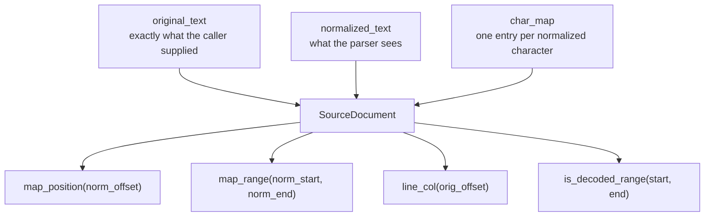
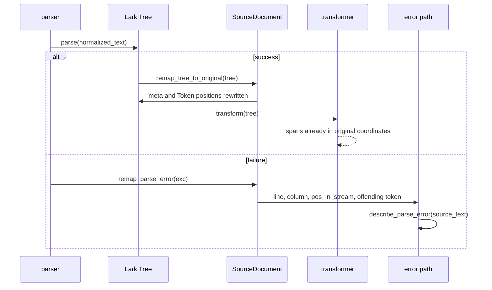
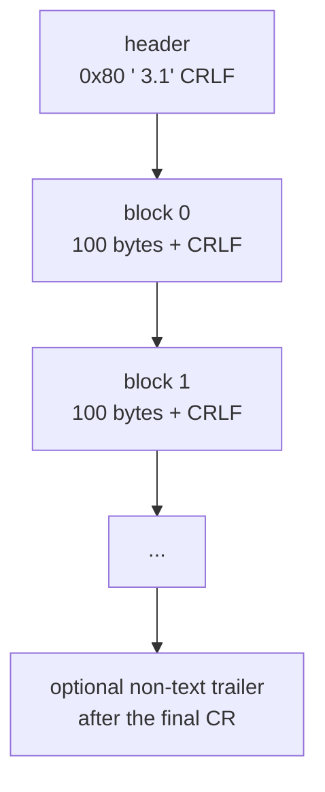
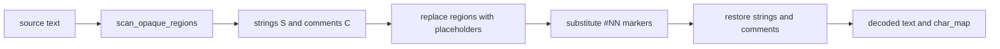

# Source provenance

Every position the package reports refers to the **original source**: the bytes
the caller supplied, not the decoded text the Lark parser saw. This document
explains the model that makes that true.

## The problem

Decoding can change the text in three ways:

1. A binary coded stream is expanded into text with different bytes and
   different offsets.
2. A marker-compressed source replaces compact `#NN` codes with full keywords,
   which makes the decoded text longer than the original.
3. A decoder may need to insert text that has no source spelling at all, for
   example a line terminator at the end of a stream.

A plain offset from the decoded text would then point at the wrong place. The
package therefore carries a `SourceDocument` through the whole pipeline and
translates positions on the way out.

## `SourceDocument`



`char_map` is a `tuple[int, ...]` whose length equals `len(normalized_text)`.
Each entry is either:

- a real original offset (`>= 0`), or
- `GENERATED`, the first-class sentinel `Generated(-1)`.

`GENERATED` is a subclass of `int` with value `-1`. The type is distinct on
purpose: code that builds or rewrites a map can tell "this character was
inserted by the preprocessor" apart from a real offset, and a generated
character can never silently become a real position.

### Identity documents

`SourceDocument.identity(text)` sets `char_map=None`. It does not materialize
`tuple(range(len(text)))`, which for a large plain source would be a large
disposable allocation. For an identity document:

- `map_position(i)` returns `min(i, len(original_text))`;
- `map_range(start, end)` returns the range unchanged;
- `remap_tree_to_original` is a no-op;
- `is_decoded_range` is always `False`.

Most sources are identity documents. The expensive path only runs for coded or
compressed input.

### Mapping rules

| Situation | `map_position` | `map_range` |
| --- | --- | --- |
| Exact character | Its original offset | Tightest covering range |
| Generated character | Anchor: nearest preceding real character | Anchored at the preceding real character |
| Deleted original region | No normalized counterpart | Included when the range spans the surviving text around it |
| Offset at or past the end | End boundary after the last real character | End boundary |
| Negative offset | `None` | Zero-width range at 0 |

Anchoring is the key rule: a generated character never claims an exact
original position of its own. It borrows the nearest preceding real position
so a diagnostic can still point somewhere meaningful. A range that spans a
deleted region includes that region in its original result, because the range
is the smallest contiguous original range that covers the real characters of
the normalized range.

All spans are half-open `[start, end)` in both coordinate systems. An end
offset equal to the text length is a valid boundary.

### `is_decoded_range`

`is_decoded_range(start, end)` answers "was every character in this normalized
range produced by the decoder?". The keyword expander emits its output as
`GENERATED` characters, so a span made only of them came from a compact
`#NN` code. A raw word in a partially hand-coded file maps to exact offsets and
therefore reports `False`. The lexer uses this to decide whether a word token
may act as a keyword. See [grammar.md](grammar.md).

## Applying the map



`remap_tree_to_original` walks `Tree.meta` and every `Token` in place. It
rewrites `start_pos`, `end_pos`, `line`, `column`, `end_line`, and
`end_column`, using `map_range` and `line_col`. A node whose ends do not lie in
the normalized text keeps its recorded span rather than being nudged to 0.

`remap_parse_error` mutates the exception so downstream code, logging, and
callers reading exception attributes all see original positions. It sets
`_sattline_remapped` only when something was actually rewritten, so a second
pass cannot shift the position twice.

## Coded streams

A coded file is a binary stream, not text with a different encoding.



Within a block, each stored byte `b` decodes as:

```
p = (b & 0x7F) ^ key[n]
key[n] = (7 * n + 8) % 128
```

A stored `0x01` is a sync byte. It is skipped and does not advance `n`. The
decoded payload is the original SattLine text with CRLF line endings. A lone
`\r` is normalized to `\r\n`; a genuine `\r\n` pair passes through untouched.
The last `\r` is treated as the end of the text and any short trailer after it
is dropped.

The `b & 0x7F` mask destroys bit 7, so cp1252 characters above `0x7F` collide
with their ASCII counterparts. Only `0x93` and `0x94` (curly quotes) can be
repaired unambiguously, because they surface as the control characters `DC3`
and `DC4`, which never occur in legitimate source. Every other non-ASCII
character decodes lossily by construction of the format. This is a property of
the on-disk format, not a parser gap.

`decode_coded_stream` raises `PreprocessError` for a missing header, a header
without its CRLF terminator, a payload that is not a whole number of
`102`-byte frames, or a block without its CRLF terminator.

## Markers and opaque regions

Compressed source is text with `#NN` codes. Decoding is lexically aware:



`scan_opaque_regions` understands:

- nested `(* ... *)` comments;
- doubled `""` inside a string literal;
- `(*` or `*)` inside a string as text, not a delimiter;
- a `"` inside a comment as text, not a string start.

The scanner never rewrites text inside an opaque region. An unknown marker
raises `PreprocessError` with its character offset instead of being replaced by
whitespace.

Replacement text is aligned to the matched source region by longest common
subsequence. A replacement character gets a real source mapping only when it
genuinely survives from the region. Inserted, renamed, or rewritten characters
are `GENERATED`. This is what keeps a keyword expansion from claiming the
position of the `#NN` code as if it were the keyword's own spelling.

## IDE text rendering

`render_ide_text(text)` lays out decoded text the way the SattLine IDE expects
when it re-reads a saved file:

- CRLF line terminators everywhere;
- no line longer than `MAX_IDE_LINE_LENGTH` (135 characters).

Long lines break at the last space within the limit. The scan never splits a
double-quoted string literal, and a line without a usable break space is
emitted unchanged rather than cut mid-token. The function is safe on text that
is already formatted, and it is not part of the parse path.

## Tests that pin provenance

| Test | What it protects |
| --- | --- |
| `tests/parser/test_parser_core_provenance.py` | Position mapping, generated characters, deleted regions |
| `tests/parser/test_parser_core_preprocessing.py` | Marker decoding, opaque regions, unknown markers |
| `tests/parser/test_coded_stream.py` | Coded framing, XOR key, sync bytes, CRLF repair |
| `tests/parser/test_ide_text.py` | CRLF and line-length layout |
| `tests/parser/test_parser_decode.py` | CLI and library decode agreement |
