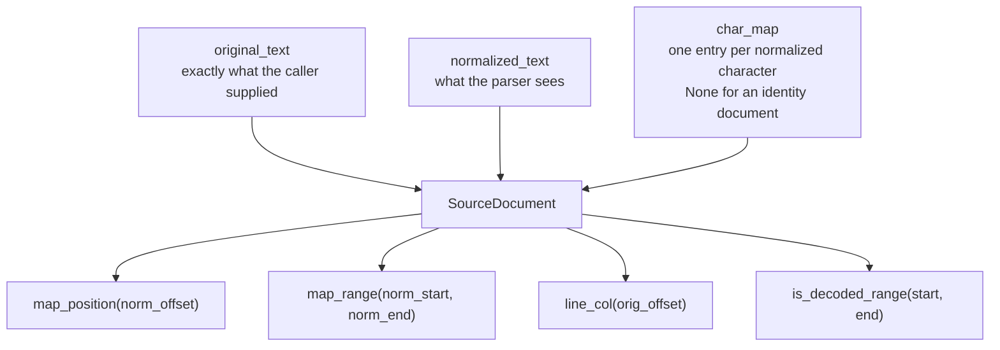
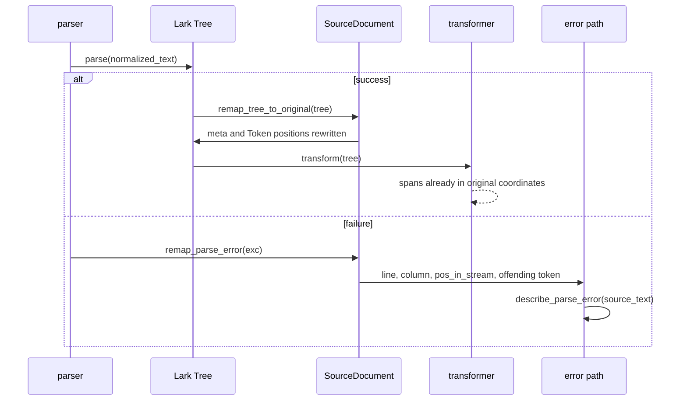
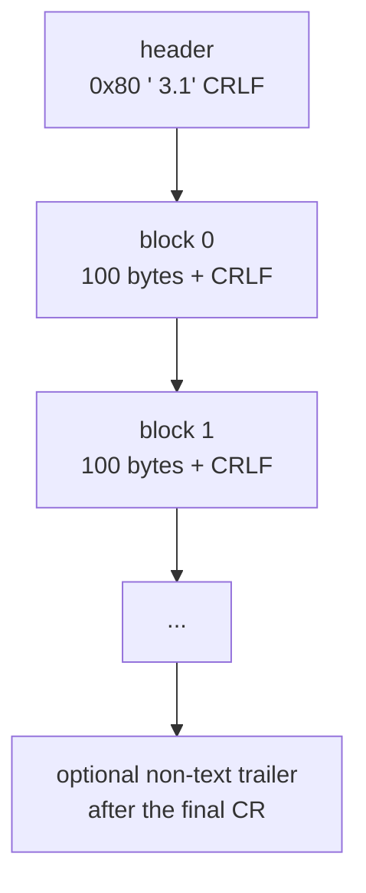
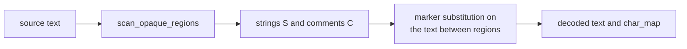

# Source provenance

Every position the package reports refers to the **original source**: the bytes
the caller supplied, not the decoded text the Lark parser saw. This document
explains the model that makes that true.

## The problem

Decoding can change the text in three ways:

1. A binary coded stream is expanded into text with different bytes and
   different offsets.
2. A marker-compressed source replaces compact `#NN` codes with full keywords,
   which makes the decoded text longer than the original.
3. A decoder may need to insert text that has no source spelling at all, for
   example a line terminator at the end of a stream.

A plain offset from the decoded text would then point at the wrong place. The
package therefore carries a `SourceDocument` through the whole pipeline and
translates positions on the way out.

## `SourceDocument`



`SourceDocument` is importable from `sattline_parser.preprocessing`, which is
where `preprocess_source` hands one out.

`char_map` is a read-only property of type `tuple[int, ...] | None`. Its length
equals `len(normalized_text)`, and it is `None` for an identity document, where
there is nothing to map. Each entry is either:

- a real original offset (`>= 0`), or
- `GENERATED`, the first-class sentinel `Generated(-1)`.

The constructor validates the map: every real entry must be an offset inside
`original_text`, and the real entries must strictly increase, because that is
the order a forward decoding walk produces. A map that breaks either rule would
make a span inverted or zero-width, so it raises `ValueError` rather than
letting a diagnostic point at the wrong text.

`GENERATED` is a subclass of `int` with value `-1`. The type is distinct on
purpose: code that builds or rewrites a map can tell "this character was
inserted by the preprocessor" apart from a real offset, and a generated
character can never silently become a real position.

### Identity documents

`SourceDocument.identity(text)` sets `char_map=None`. It does not materialize
`tuple(range(len(text)))`, which for a large plain source would be a large
disposable allocation. `is_identity()` reports whether the map is absent, not
whether the two texts happen to be equal, so a caller-supplied map is never
skipped. For an identity document:

- `map_position(i)` returns `min(i, len(original_text))`;
- `map_range(start, end)` returns the range clamped to the original text, and a
  zero-width range at the mapped boundary when `start >= end`;
- `remap_tree_to_original` is a no-op unless the text contains a lone CR. A
  CR-only text rewrites each span's line and column through `line_col`, because
  the language treats a lone CR as a line break while the Lark position index
  counts LF, so its token lines would otherwise all stay on line 1;
- `is_decoded_range` is always `False`.

Most sources are identity documents. The expensive path only runs for coded or
compressed input. A compressed file that decodes to the text it started from
(for example a header-flagged file with no markers) is also an identity
document.

### Mapping rules

| Situation | `map_position` | `map_range` |
| --- | --- | --- |
| Exact character | Its original offset | Tightest covering range |
| Generated character | Anchor: nearest preceding real character | Anchored at the preceding real character |
| Deleted original region | No normalized counterpart | Included when the range spans the surviving text around it |
| Offset at or past the end | End boundary after the last real character | End boundary |
| Negative offset | `None` | Clamped to 0 |
| Range with `start >= end` | Boundary position | Zero-width range at that boundary |

Anchoring is the key rule: a generated character never claims an exact
original position of its own. It borrows the nearest preceding real position
so a diagnostic can still point somewhere meaningful. A range that spans a
deleted region includes that region in its original result, because the range
is the smallest contiguous original range that covers the real characters of
the normalized range.

The anchors are indexed once per document: the real characters of the map, in
normalized order, are also in original order, so a bisect finds the nearest one
for any offset. Remapping a marker-dense compressed source is therefore linear
in its length rather than quadratic in the length of a generated run.

All spans are half-open `[start, end)` in both coordinate systems. An end
offset equal to the text length is a valid boundary.

A line ends at CRLF, LF, or a lone CR, the same definition the grammar's string
terminals and the compressed scanner use. `line_col` and the source excerpt a
diagnostic renders therefore agree on a CR-only document: a position on its
third physical line reports line 3 and quotes that line. A form feed, a
vertical tab, and the other `str.splitlines` separators are ordinary content.

### `is_decoded_range`

`is_decoded_range(start, end)` answers "was every character in this normalized
range produced by the decoder?". The keyword expander emits its output as
`GENERATED` characters, so a span made only of them came from a compact
`#NN` code. A raw word in a partially hand-coded file maps to exact offsets and
therefore reports `False`. The lexer uses this to decide whether a word token
may act as a keyword. See [grammar.md](grammar.md).

## Applying the map



`remap_tree_to_original` walks `Tree.meta` and every `Token` in place. It
rewrites `start_pos`, `end_pos`, `line`, `column`, `end_line`, and
`end_column`, using `map_range` and `line_col`. A node whose ends do not lie in
the normalized text keeps its recorded span rather than being nudged to 0.

`remap_parse_error` mutates the exception so downstream code, logging, and
callers reading exception attributes all see original positions. It records the
exception with `mark_remapped` only when something was actually rewritten, so
`is_remapped` lets a second pass avoid shifting the position twice.

## Coded streams

A coded file is a binary stream, not text with a different encoding.



Within a block, each stored byte `b` decodes as:

```
p = (b & 0x7F) ^ key[n]
key[n] = (7 * n + 8) % 128
```

A stored `0x01` is a sync byte. It is skipped and does not advance `n`. The
decoded payload is the original SattLine text with CRLF line endings. A lone
`\r` is normalized to `\r\n`; a genuine `\r\n` pair passes through untouched.
The last `\r` is treated as the end of the text and any short trailer after it
is dropped.

The `b & 0x7F` mask destroys bit 7, so cp1252 characters above `0x7F` collide
with their ASCII counterparts. Only `0x93` and `0x94` (curly quotes) can be
repaired unambiguously, because they surface as the control characters `DC3`
and `DC4`, which never occur in legitimate source. Every other non-ASCII
character decodes lossily by construction of the format. This is a property of
the on-disk format, not a parser gap: a coded stream is an ASCII format, and the
decoder never guesses which character the lost bit belonged to.

`decode_coded_stream` raises `PreprocessError` for a missing header, a header
without its CRLF terminator, a payload that is not a whole number of
`102`-byte frames, or a block without its CRLF terminator.

## Markers and opaque regions

Compressed source is text with `#NN` codes. Decoding is lexically aware:



The region boundaries never leave the decoder. Marker substitution runs only on
the runs of text between them, and the pieces are joined with their original
offsets already attached, so no placeholder character is ever spliced into the
text being decoded. A source that contains a sequence resembling an internal
marker is therefore ordinary text: it is neither restored nor rejected, and the
decoded text stays linear in the size of the input.

`scan_opaque_regions` understands:

- nested `(* ... *)` comments;
- doubled `""` inside a string literal;
- `(*` or `*)` inside a string as text, not a delimiter;
- a `"` inside a comment as text, not a string start;
- a description that ends at a line break, because the grammar accepts an
  unterminated description (`STRING_CRLF`) and no string spans a line. A line
  break here is CRLF, LF, or a lone CR, the one definition the grammar, the
  compressed scanner, the coded decoder, and `render_ide_text` use;
- a single-quoted identifier such as `'#84'`, whose body is literal text rather
  than a marker.

The scanner shares the lexer's name boundary rule rather than approximating it.
It consumes a whole unquoted name run, so an apostrophe inside a name such as
`Pump'A` is name text, and it recognises a quoted identifier only where the
`NAME` terminal does: at a name start character, with at least one body
character, no apostrophe inside, and no line break. Two quoted names written
back to back are therefore two regions, a quoted name may follow a number
(`1'A'`), and a multi-line quoted spelling is not a quoted name for either
component. `grammar/constants.py` holds the pattern and the character classes
both use.

The scanner never rewrites text inside an opaque region. An unknown marker
raises `PreprocessError` with its character offset in the **original** source,
not in any rewritten intermediate text.

`preprocessing/scanner_tokens.json` is the scanner enum: the ordinal `n` is
encoded as `'#' + chr(48 + n // 16) + chr(48 + n % 16)` and the row `id` is
`n + 8`. The table covers keywords and operators; literal source text is
emitted unencoded. A code is added only with a fixture that decodes it, because
the ordinal alone does not prove which word an export used.

Two grammar keywords have no row: `EQUATIONS` and `IntObjPickButton`. No encoded
form of them has been observed, and the ordinal alone would not prove the word,
so none is invented. A compressed document therefore cannot spell them, and both
failure paths are clean: a raw spelling is an identifier in coded mode and the
parse rejects it, while the unknown marker raises `PreprocessError`. The set is
pinned by a test, so adding a row or a keyword terminal keeps this paragraph and
the table in step.

`NewWindow` is not on that list and has no keyword terminal. It is a procedure
name that an interactor calls, so a compressed document writes it literally: the
compressed corpus fixture carries it unencoded inside a `ComButProc_` body.

Replacement text is aligned to the matched source region by longest common
subsequence. A replacement character gets a real source mapping only when it
genuinely survives from the region. Inserted, renamed, or rewritten characters
are `GENERATED`. This is what keeps a keyword expansion from claiming the
position of the `#NN` code as if it were the keyword's own spelling. A
replacement that shares no character with its region (the common case for a
`#NN` code) is marked `GENERATED` without building the alignment table; the
result is identical.

## IDE text rendering

`render_ide_text(text)` lays out decoded text for a saved file:

- CRLF line terminators everywhere;
- no line longer than `MAX_IDE_LINE_LENGTH` (135 characters).

Those two numbers are this package's own canonical layout, not a reproduction of
the native writer: the width the IDE uses is state and configuration dependent,
and it handles strings as their own case. Matching it byte for byte is therefore
not something this function claims, and `MAX_IDE_LINE_LENGTH` is a local choice
rather than a measured limit.

Long lines break at the last space within the limit. The scan never splits a
string literal or a quoted identifier, so a break point inside `'a name'` is
not used, and it reuses the scanner's own region rule rather than a second
approximation. A line without a usable break space is emitted unchanged rather
than cut mid-token. The function is safe on text that is already formatted, and
it is not part of the parse path.

## Tests that pin provenance

| Test | What it protects |
| --- | --- |
| `tests/parser/test_parser_core_provenance.py` | Position mapping, generated characters, deleted regions |
| `tests/parser/test_parser_core_preprocessing.py` | Marker decoding, opaque regions, unknown markers, forged placeholder-shaped text |
| `tests/parser/test_coded_stream.py` | Coded framing, XOR key, sync bytes, CRLF repair |
| `tests/parser/test_ide_text.py` | CRLF and line-length layout |
| `tests/parser/test_parser_decode.py` | CLI and library decode agreement |
