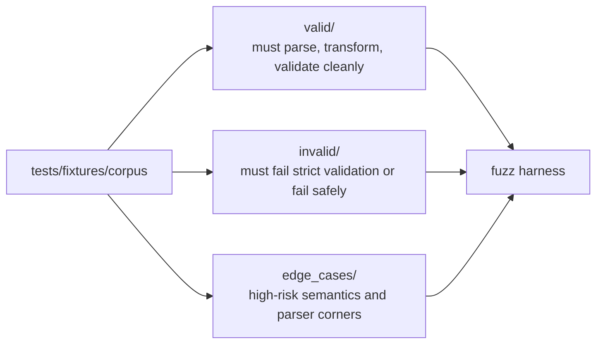
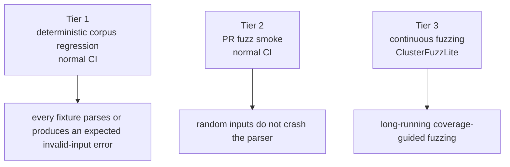
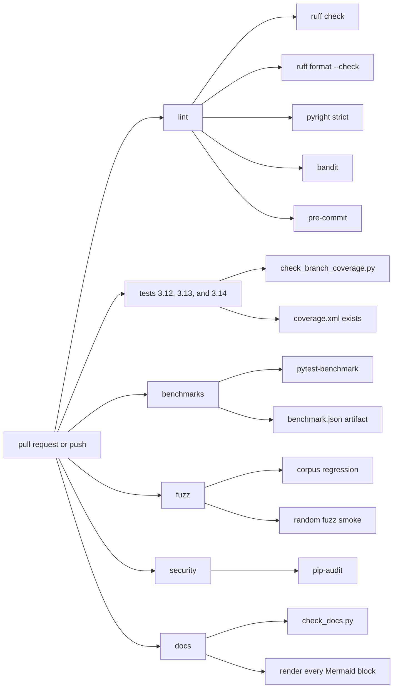

# Testing and CI

The repository treats tests as executable evidence. A change is not done until
the focused test passes, then the wider gates pass.

## Test layout

| Path | Scope |
| --- | --- |
| `tests/parser/` | Grammar, decoding, provenance, AST, transformer, validation, formatter |
| `tests/project/` | Discovery, formats, loader, caches, reachability, graphics, project validation |
| `tests/cli/` | Every subcommand, exit codes, JSON output, refusal rules |
| `tests/builtins/` | Catalogue freshness and signature shape |
| `tests/test_packaging.py` | Installed-package smoke tests outside the parser tree |
| `benchmarks/` | pytest-benchmark parse, validation, and traversal timings, outside the coverage suite |
| `tests/fixtures/corpus/` | Every fixture is a `.s` source, grouped by expected behaviour |
| `tests/fixtures/validation/expectations.json` | Golden expectations for validation findings |
| `tests/conftest.py` | Shared pytest configuration |

`tests/test_packaging.py` lives outside `tests/parser` on purpose. It proves
that `pytest` (whose `testpaths` is `tests`) runs tests beyond the parser
directory, that grammar and JSON resources ship in the wheel, and that the
public API and console script survive installation.

## Corpus categories



The fuzz harness consumes the whole directory through `collect_corpus_inputs`
and re-parses every file on each regression run. A new syntax form needs a
fixture in one of the three directories; a new rule needs an invalid or edge
case fixture plus a golden expectation.

Deep-structure seeds are part of the corpus: `invalid/DeepExpressionChain.s`
holds a 5,000-term left-associative sum and must produce `SourceTooDeepError`,
while `edge_cases/DeepNestedParentheses.s` holds 1,000 nested parentheses and
`edge_cases/DeeplyNestedComments1000.s` holds 1,000 nested comment pairs, both
of which must parse. `tests/parser/test_parser_core_deep_structures.py` pins
them, the iterative walker, the iterative remap, the comment flattening, and
the `RecursionError` backstop.

## Running tests

```bash
pytest -q                                   # full configured suite
pytest tests/parser -q                      # parser only
pytest tests/parser/test_parser_core_grammar.py -q
pytest -q -m "not slow"                     # skip slow tests
python scripts/check_branch_coverage.py     # full suite plus both coverage gates
pytest benchmarks --no-cov -q               # parse, validation, and traversal benchmarks
pytest benchmarks --no-cov -q --benchmark-json=benchmark.json
```

`benchmarks/` is outside `testpaths`, so the coverage gate never depends on it.
The benchmark job uploads `benchmark.json` as a CI artifact. It is observational
and does not fail on a regression because the repository has no committed
baseline.

`pyproject.toml` configures:

- `testpaths = ["tests"]`
- `timeout = 60`, `timeout_method = "thread"`
- `--strict-markers`, `--strict-config`
- coverage on `src` with terminal, XML, and HTML reports
- markers `slow`, `parser`, `quarantine`

The coverage gates:

| Gate | Minimum | Owner |
| --- | --- | --- |
| Line coverage | 100 percent after `pragma: no cover` and configured exclusions | `pyproject.toml` |
| Branch coverage | 93 percent | `scripts/check_branch_coverage.py` |

`check_branch_coverage.py` is the authoritative branch gate because coverage's
config cannot express separate line and branch fail thresholds. It also prints
how many executable lines the exclusion rules keep outside the line gate, so
100 percent is not mistaken for full-source coverage.

## Fuzzing



Tier 1 and tier 2 run in `.github/workflows/ci.yml`. Tier 3 runs from
`.github/workflows/fuzz.yml` and `.clusterfuzzlite/`.

The harness in `src/sattline_parser/fuzz_harness.py` enforces timeouts with a
dedicated worker subprocess:

- the worker parses one input at a time;
- the worker is reused across inputs, so there is no process spawn per input;
- on timeout the worker is killed and replaced;
- Python threads cannot be killed safely, so a hard timeout requires a
  separate process.

The worker protocol is length-prefixed UTF-8 on stdin and length-prefixed JSON
on stdout.

Expected invalid-input errors (`UnexpectedInput`, `PreprocessError`) are
classified separately from internal bugs. A `ValueError` or `TypeError` from
the transformer is a crash, not ordinary invalid input.

```bash
python -c "from sattline_parser.fuzz_harness import run_corpus_regression, assert_no_crashes, assert_no_timeouts; r = run_corpus_regression(); assert_no_crashes(r); assert_no_timeouts(r)"
python -c "from sattline_parser.fuzz_harness import run_random_fuzz, assert_no_crashes; r = run_random_fuzz(rounds=50); assert_no_crashes(r)"
```

`parser_fuzzer.py` and `decode_fuzzer.py` are the Atheris entry points used by
ClusterFuzzLite. The `fuzz` extra installs Atheris, and `dev` never pulls it,
because Atheris is Linux and FreeBSD only:

```bash
pip install -e ".[dev,fuzz]"   # Linux / FreeBSD only
```

## CI jobs



`.github/workflows/publish.yml` handles release publication. `.github/workflows/ci.yml`
runs on pull requests, pushes to `main`, version tags, and manual dispatch.
`.github/workflows/docs.yml` runs when documentation changes and checks relative
links, prose punctuation, and every Mermaid block.

### Docs CI

`scripts/check_docs.py` is the local half of the Docs workflow:

- every relative Markdown link resolves;
- no em dash or en dash is used as punctuation outside a code fence;
- Mermaid blocks can be extracted to a directory for rendering.

```bash
python scripts/check_docs.py
python scripts/check_docs.py --mermaid-dir /tmp/sattline-mermaid
```

The workflow also validates `opencode.json` and the Mermaid puppeteer config as
JSON, then renders each extracted `.mmd` with `@mermaid-js/mermaid-cli` 11.17.1.
A diagram that does not parse fails the job.

## Quality commands

```bash
ruff check src tests scripts benchmarks
ruff format --check src tests scripts benchmarks
pyright src tests benchmarks
bandit -q -r src -x tests -c pyproject.toml
pip-audit
pre-commit run --all-files
```

`pyproject.toml` sets Pyright to `strict` for `src` and `tests`. Ruff enables
`E`, `F`, `W`, `I`, `N`, `UP`, `B`, `BLE`, `C4`, `PLC0415`, `PLR0915`, `S101`,
`SIM`, and `RUF`, with a 120-character line length. `S101` is disabled for
tests because `assert` is the test mechanism.

## Helper scripts

| Script | Purpose |
| --- | --- |
| `scripts/check_branch_coverage.py` | Run the full suite and enforce both coverage gates |
| `scripts/check_docs.py` | Check docs links and prose, extract Mermaid blocks |
| `scripts/gen_builtin_catalogue.py` | Generate or check `builtins/catalogue.json` |
| `scripts/export_parity_expectations.py` | Export validation expectations |
| `scripts/profile_parse.py` | Profile the parse path |
| `scripts/smoke_installed.py` | Smoke-test an installed artifact |
| `scripts/probe/` | Ad-hoc probes, not part of the suite |

## Adding a test

1. Pick the owning suite: parser, project, CLI, or builtins.
2. Add a fixture when the behaviour is syntax or validation related.
3. Assert the shape or the finding, not merely that no exception was raised.
4. Assert the message and the code for a diagnostic, so a rule cannot drift.
5. Run the focused file first, then `pytest -q`, then the coverage script.
6. Add the test to the matching table in the relevant document.
