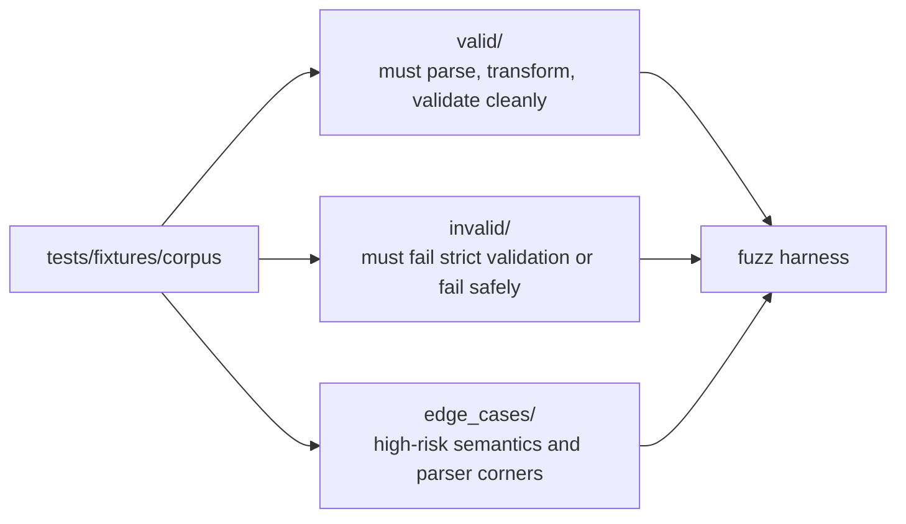
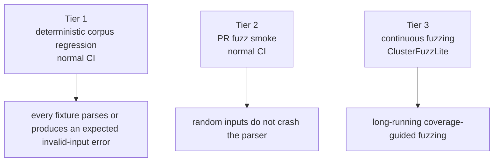
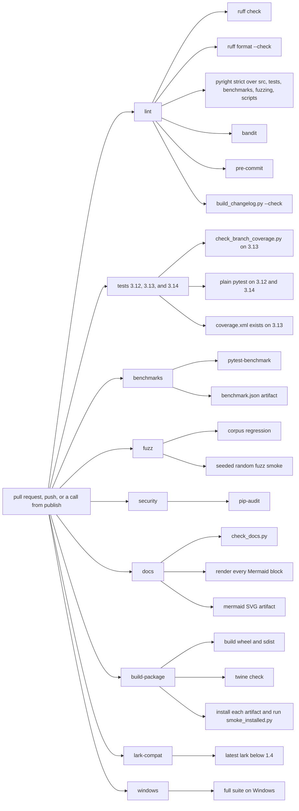

# Testing and CI

The repository treats tests as executable evidence. A change is not done until
the focused test passes, then the wider gates pass.

## Test layout

| Path | Scope |
| --- | --- |
| `tests/__init__.py` | Makes `tests` a package, so every module has one stable name (`tests.parser.test_parser`) |
| `tests/parser/` | Grammar, decoding, provenance, AST, transformer, validation, formatter |
| `tests/project/` | Discovery, formats, loader, caches, reachability, graphics, distribution, project validation |
| `tests/cli/` | Every subcommand, exit codes, JSON output, refusal rules |
| `tests/builtins/` | Catalogue freshness and signature shape |
| `tests/test_packaging.py` | Installed-package smoke tests outside the parser tree |
| `benchmarks/` | pytest-benchmark parse, validation, and traversal timings, outside the coverage suite |
| `tests/fixtures/corpus/` | Every fixture is a `.s` source, grouped by expected behaviour |
| `tests/fixtures/validation/expectations.json` | Golden expectations for validation findings |
| `tests/fixtures/project/companions/` | One committed companion file per artifact kind, written from a synthetic example, plus a CP1252 sidecar |
| `tests/conftest.py` | Shared pytest configuration |
| `tests/*/_support.py` | Helpers shared inside one test directory |

`tests` and every test subdirectory are packages. That keeps module names
unique, so two files with the same basename in different directories cannot
collide in `sys.modules`. Helpers shared by several modules in one directory
live in that directory's `_support.py` (for example
`tests/project/_support.py`), never in a star-import hub.

`tests/test_packaging.py` lives outside `tests/parser` on purpose. It proves
that `pytest` (whose `testpaths` is `tests`) runs tests beyond the parser
directory, that grammar and JSON resources ship in the wheel, and that the
public API and console script survive installation. It imports the checkout
through `conftest.py` and pins `PYTHONPATH=src` for any subprocess, so it passes
whether or not `sattline-parser` is installed in the interpreter. Installed
artifact evidence belongs to `scripts/smoke_installed.py`.

## Corpus categories



The fuzz harness consumes the whole directory through `collect_corpus_inputs`
and re-parses every file on each regression run. A new syntax form needs a
fixture in one of the three directories; a new rule needs an invalid or edge
case fixture plus a golden expectation.

Deep-structure seeds are part of the corpus: `invalid/DeepExpressionChain.s`
holds a 5,000-term left-associative sum and must produce `SourceTooDeepError`,
while `edge_cases/DeepNestedParentheses.s` holds 1,000 nested parentheses and
`edge_cases/DeeplyNestedComments1000.s` holds 1,000 nested comment pairs, both
of which must parse. `tests/parser/test_parser_core_deep_structures.py` pins
them, the iterative walker, the iterative remap, the comment flattening, and
the `RecursionError` backstop.

## Running tests

```bash
pytest -q                                   # full configured suite
pytest tests/parser -q                      # parser only
pytest tests/parser/test_parser_core_grammar.py -q
python scripts/check_branch_coverage.py     # full suite plus both coverage gates
pytest benchmarks --no-cov -q               # parse, validation, and traversal benchmarks
pytest benchmarks --no-cov -q --benchmark-json=benchmark.json
```

`benchmarks/` is outside `testpaths`, so the coverage gate never depends on it.
The benchmark job uploads `benchmark.json` as a CI artifact. It is observational
and does not fail on a regression because the repository has no committed
baseline.

`pyproject.toml` configures:

- `testpaths = ["tests"]`
- `timeout = 60`, `timeout_method = "thread"`
- `--strict-markers`, `--strict-config`

No custom marker is declared. A marker that no test uses and no workflow
deselects is a documented behaviour that does not exist, so the former `slow`,
`parser`, and `quarantine` markers were removed rather than left unenforced.

A plain `pytest` run does not collect coverage. `scripts/check_branch_coverage.py`
runs the suite with branch coverage and writes the JSON report used by the CI
gates. The script scrubs `PYTEST_ADDOPTS` and `PYTEST_PLUGINS` from the child
environment, so an exported `-k` or plugin cannot narrow the run and still pass
the gate.

The coverage gates:

| Gate | Minimum | Owner |
| --- | --- | --- |
| Line coverage | 100 percent after `pragma: no cover` and configured exclusions | `scripts/check_branch_coverage.py` |
| Branch coverage | 93 percent | `scripts/check_branch_coverage.py` |

`check_branch_coverage.py` is the authoritative branch gate because coverage's
config cannot express separate line and branch fail thresholds. It also prints
how many executable lines the exclusion rules keep outside the line gate, so
100 percent is not mistaken for full-source coverage.

The gate runs on one matrix leg only (Python 3.13). Coverage totals depend on
interpreter bytecode, so gating every leg triples the most expensive job and can
make the same source pass on one version and fail on another. The 3.12 and 3.14
legs run a plain `pytest`, which still exercises the whole suite.

## Fuzzing



Tier 1 and tier 2 run in `.github/workflows/ci.yml`. Tier 3 runs from
`.github/workflows/fuzz.yml` and `.clusterfuzzlite/`.

The harness in `fuzzing/fuzz_harness.py` enforces timeouts with a
dedicated worker subprocess:

- the worker parses one input at a time;
- the worker is reused across inputs, so there is no process spawn per input;
- on timeout the worker is killed and replaced;
- Python threads cannot be killed safely, so a hard timeout requires a
  separate process.

The worker protocol is length-prefixed UTF-8 on stdin and length-prefixed JSON
on stdout.

Expected invalid-input errors (`UnexpectedInput`, `PreprocessError`) are
classified separately from internal bugs. A `ValueError` or `TypeError` from
the transformer is a crash, not ordinary invalid input.

```bash
python -c "from fuzzing.fuzz_harness import run_corpus_regression, assert_no_crashes, assert_no_timeouts; r = run_corpus_regression(); assert_no_crashes(r); assert_no_timeouts(r)"
python -c "from fuzzing.fuzz_harness import run_random_fuzz, assert_no_crashes; r = run_random_fuzz(rounds=50); assert_no_crashes(r)"
python -c "from fuzzing.fuzz_harness import run_random_fuzz, assert_no_crashes; r = run_random_fuzz(rounds=50, seed=20261114); assert_no_crashes(r)"
```

The first random command is seedless, which is fine for local exploration. CI
passes a fixed seed, so a red PR is replayable: each `FuzzResult.input_desc`
carries its per-round seed (`random:seed=<n>`), and
`generate_random_text(length, seed=<n>)` reproduces the exact input. A
successful parse also reports a small `FuzzSummary` (`root_name`, `node_count`)
instead of a picture the subprocess cannot hand back.

`fuzzing/parser_fuzzer.py` and `fuzzing/decode_fuzzer.py` are the Atheris entry points used by
ClusterFuzzLite. The `fuzz` extra installs Atheris, and `dev` never pulls it,
because Atheris is Linux and FreeBSD only:

```bash
pip install -e ".[dev,fuzz]"   # Linux / FreeBSD only
```

## CI jobs



`.github/workflows/ci.yml` runs on pull requests, pushes to `main`, version
tags, manual dispatch, and as a reusable workflow. `.github/workflows/publish.yml`
handles release publication and calls that workflow as one job, so a tag cannot
reach PyPI unless every CI job passed for the same commit, the Windows job and
the Lark compatibility job included. The release job then re-checks the tag
version and the built metadata before the upload step. `.github/workflows/docs.yml`
runs when documentation changes and checks relative links, anchors, prose
punctuation, and every Mermaid block.

Every action is pinned to a commit SHA with a `# vX.Y.Z` comment, so the pinned
version is readable and a bump is a reviewable one-line change.

### Docs CI

`scripts/check_docs.py` is the local half of the Docs workflow:

- every relative Markdown link resolves, including its `#anchor`;
- no em dash or en dash is used as punctuation outside a code fence;
- Mermaid blocks can be extracted to a directory for rendering.

It owns `docs/**/*.md` (recursively), `.opencode/**/*.md`,
`changelog.d/*.md`, `README.md`, `AGENTS.md`, `CHANGELOG.md`, `SECURITY.md`, and
`.github/pull_request_template.md`.

```bash
python scripts/check_docs.py
python scripts/check_docs.py --mermaid-dir /tmp/sattline-mermaid
```

The workflow also validates `opencode.json` and the Mermaid puppeteer config as
JSON. The Mermaid CLI is pinned by `.github/mermaid/package.json` and
`package-lock.json`, installed with `npm ci`, and the npm download directory is
cached. Extracting zero diagrams is an explicit failure, not an `mmdc` error,
and the rendered SVGs are uploaded as an artifact. A diagram that does not parse
fails the job.

## Quality commands

```bash
ruff check src tests scripts benchmarks fuzzing
ruff format --check src tests scripts benchmarks fuzzing
pyright src tests benchmarks fuzzing scripts
bandit -q -r src fuzzing -x tests -c pyproject.toml
pip-audit
pre-commit run --all-files
```

`pyproject.toml` sets Pyright to `strict` for `src`, `tests`, `benchmarks`,
`fuzzing`, and `scripts`. `src` carries two narrow file-scope suppressions
(`reportUnusedClass` on the SFC and token mixins) and no blanket one. A test file
may open with a `# pyright: reportX=false` header, but the header must list only
the rules that file actually needs; the set is recomputed by deleting the header
and reading the rules Pyright reports. Eight test files that carried a header no
longer need one. Where a blanket header is still the practical choice (deeply
dynamic AST assertions), the header is the documented policy rather than a
hidden exception. Ruff enables `E`, `F`, `W`, `I`, `N`, `UP`, `B`, `BLE`, `C4`,
`PLC0415`, `PLR0915`, `S101`, `SIM`, and `RUF`, with a 120-character line length.
`S101` is disabled for tests because `assert` is the test mechanism.

## Helper scripts

| Script | Purpose |
| --- | --- |
| `scripts/build_changelog.py` | Validate fragments, preview `[Unreleased]`, or cut a dated release |
| `scripts/check_branch_coverage.py` | Run the full suite and enforce both coverage gates |
| `scripts/check_docs.py` | Check docs links, anchors, and prose, extract Mermaid blocks |
| `scripts/gen_builtin_catalogue.py` | Generate or check `builtins/catalogue.json` |
| `scripts/gen_rule_table.py` | Generate or check the validation rule table |
| `scripts/export_validation_expectations.py` | Export validation expectations |
| `scripts/profile_parse.py` | Profile the parse path |
| `scripts/smoke_installed.py` | Smoke-test an installed artifact |

## Packaging

The wheel ships the package, its grammar and JSON resources, and the `py.typed`
marker. The sdist is the input downstream packagers use, so `MANIFEST.in` adds
`CHANGELOG.md`, `SECURITY.md`, `docs/`, `changelog.d/`, `tests/`, and the
`scripts/`, `benchmarks/`, and `fuzzing/` trees the suite imports. The
`build-package` job builds both artifacts, runs `twine check`, installs each into
a clean virtualenv, and runs `scripts/smoke_installed.py` against it.

## Adding a test

1. Pick the owning suite: parser, project, CLI, or builtins.
2. Add a fixture when the behaviour is syntax or validation related.
3. Assert the shape or the finding, not merely that no exception was raised.
4. Assert the message and the code for a diagnostic, so a rule cannot drift.
5. Run the focused file first, then `pytest -q`, then the coverage script.
6. Add the test to the matching table in the relevant document.
