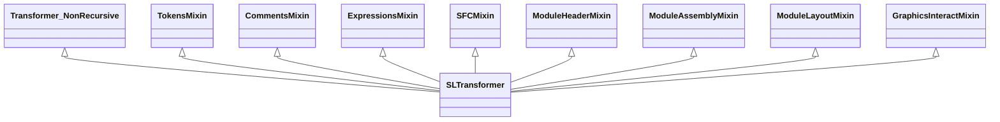
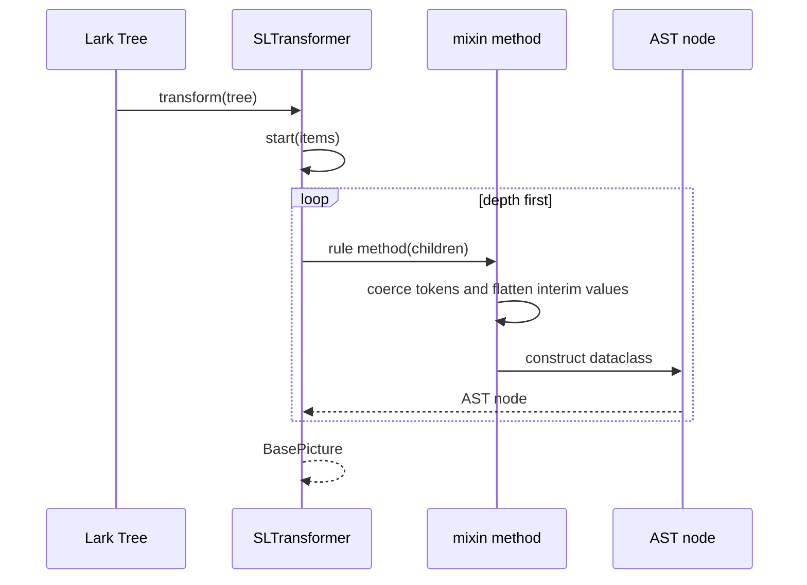
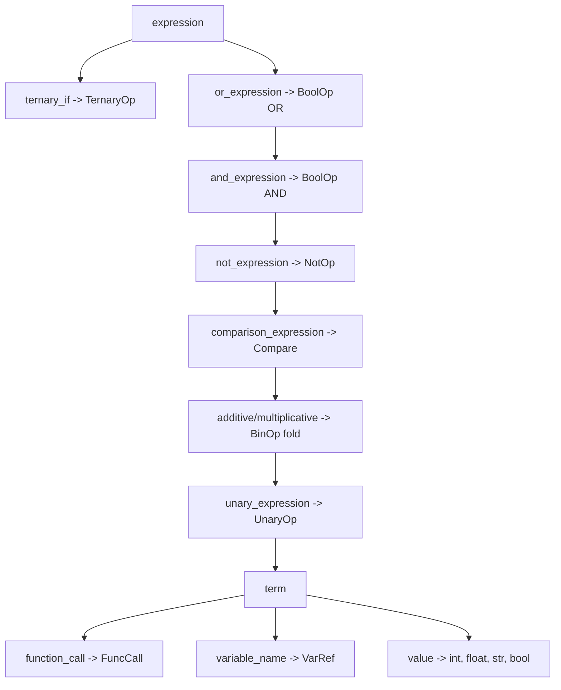
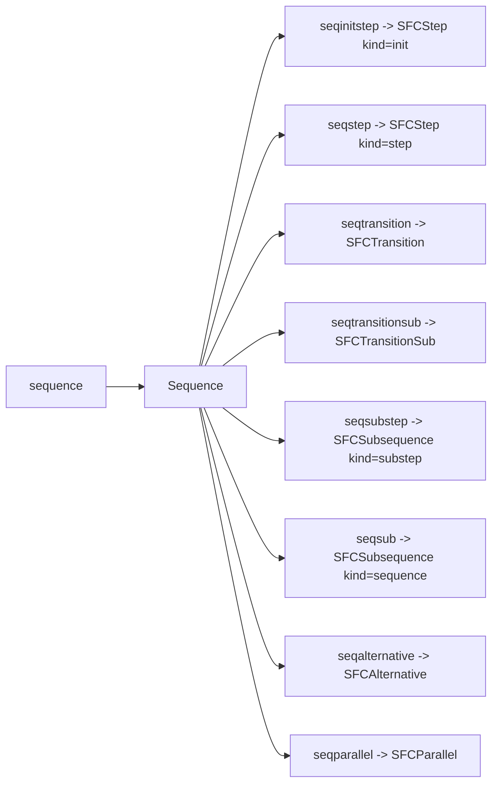

# Transformer

`SLTransformer` is Lark's `Transformer_NonRecursive` that turns the parse tree
into the AST documented in [ast.md](ast.md). It is assembled from mixins so
each file owns one responsibility. The non-recursive base reduces the tree with
an explicit post-order stack, so deeply parenthesized input does not grow the
Python call stack. Comment token flattening also uses an explicit stack,
because structural comment nesting is not capped by the lexer.

## Composition



The method resolution order is the order shown in
`transformer/sl_transformer.py`:

```python
class SLTransformer(
    TokensMixin,
    CommentsMixin,
    ExpressionsMixin,
    SFCMixin,
    ModuleHeaderMixin,
    ModuleAssemblyMixin,
    ModuleLayoutMixin,
    GraphicsInteractMixin,
    Transformer_NonRecursive,
):
```

| Mixin | File | Responsibility |
| --- | --- | --- |
| `TokensMixin` | `_tokens_mixin.py` | Token coercion, literal conversion, `meta_span` |
| `CommentsMixin` | `_comments_mixin.py` | Role-tagged `CodeComment` construction |
| `ExpressionsMixin` | `_expressions_mixin.py` | Expressions, values, statements |
| `SFCMixin` | `_sfc_mixin.py` | Sequence function chart nodes |
| `ModuleHeaderMixin` | `_module_header_mixin.py` | Module headers, invocation arguments, tails |
| `ModuleAssemblyMixin` | `_module_assembly_mixin.py` | Module-body normalization and AST assembly |
| `ModuleLayoutMixin` | `_module_layout_mixin.py` | Layout, coordinates, `ModuleDef` |
| `GraphicsInteractMixin` | `_graphics_interact_mixin.py` | Graph objects and interactor objects |

`_payloads.py` holds the interim payloads a rule builds and a later rule folds
into an owner: `CommonProperties`, `ModuleOptions`, `TwoLayers`, `Grid`,
`Zoomable`, `ClipValue`, and `CoordinateClipping`. They are not AST nodes and
are not part of `sattline_parser.ast`; a parsed tree never contains one.

`_module_shared.py` holds helpers and types shared by several mixins:
`flatten_items`, `meta_span`, `tree_children`, `InterimCoords`,
`TransformerItem`, and `TransformerTree`. It also holds the token-type
constants the mixins inspect (`OUTVAR_TOKEN`, `INVAR_TOKEN`,
`PREFIX_TOKENS`) and the typed `v_args` passthrough. The `STATE_SUFFIX` and
`ENDDEF_KW` token names live in `grammar/constants.py` as `KEY_STATE_SUFFIX`
and `KEY_ENDDEF_KW`.
The passthrough keeps each decorated rule method's declared `(meta, items)`
signature, because Lark's own annotation erases it to `Callable[[object],
object]` and would hide a wrong argument order or return type from the type
checker.

## Dispatch

Lark calls a transformer method named after each grammar rule. The mixins
provide those methods; the class body only adds the root method and a few
shared helpers.



The transformer contract is bottom-up: children are transformed before their
parent. `Transformer_NonRecursive` preserves that order with an explicit
post-order stack instead of recursion. Several grammar rules are prefixed with
`?`, so Lark inlines them and
the mixin never sees a rule node for them. The mixins are written against the
actual tree shapes, not against the grammar text alone.

## Root: `start`

```python
def header_lines(self, items: list[TransformerItem]) -> HeaderInfo: ...
def start(self, items: list[TransformerItem]) -> BasePicture: ...
```

`header_lines` turns the three quoted header lines and the optional change
description into one `HeaderInfo`. The lines are stored as written; the derived
fields (`syntax_version`, `original_file_date`, `program_date`, `program_name`)
read the editor's spelling and return `None` for a line that does not carry
them. `change_description` becomes a `CodeComment` with its span.

`start` does two things:

1. Finds the `HeaderInfo` produced by `header_lines`.
2. Finds the `BasePicture` produced by `base_picture_module`, attaches the
   header info and its derived program name, and returns it.

If no `BasePicture` is present, it raises `ValueError` naming the observed child
types. That is a grammar or transformer bug, not invalid input.

## Value coercion

`TokensMixin` converts grammar tokens into Python values before the AST is
built:

| Grammar | Python |
| --- | --- |
| `SIGNED_INT` | `IntLiteral` (an `int` subclass with a span) |
| `REAL` | `FloatLiteral` (a `float` subclass with a span) |
| `STRING` | `str` with doubled quotes unescaped |
| `BOOL` (`True`, `False`, `On`, `Off`) | `bool` |
| `STATE_SUFFIX` | `"old"`, `"new"`, or `None` on a `VarRef` |

`meta_span(meta)` converts a Lark `Meta` into a `SourceSpan`. It runs after
`remap_tree_to_original`, so the values are already original coordinates.

## Comments

`CommentsMixin` turns the role-tagged grammar nodes into `CodeComment` values:

| Grammar node | AST home |
| --- | --- |
| `code_comment` | `CodeItem` position in a code list |
| `comment_stmt` | A code comment followed by `;` |
| `module_typedescription` | `ModuleHeader.description_comments` or `ModuleTypeDef.description_comments` |
| `module_end_comment` | `trailing_comments` or the matching end field |
| `comments` | The structural field for that context, when one exists; an interactor body turns each comment into a `CodeComment` |

A legal comment with no AST home is not attached to the AST; the returned
`BasePicture` does not retain it. It is never attached to the nearest field just
to avoid losing it.

## Expressions

`ExpressionsMixin` builds the expression hierarchy:



`OR` and `AND` are n-ary: a chain becomes one `BoolOp` with an operand tuple.
Arithmetic and comparison are binary: a chain folds left-associatively into
`BinOp` or produces a `Compare`.

`if_statement` produces an `IfStmt` with a tuple of `(condition, body)` pairs
and an optional `else_block`. `assignment_statement` produces an `Assignment`.
A bare `function_call` statement produces a `FuncCallStmt`. The `statement`
funnel returns the concrete `CodeItem` union (`Assignment | FuncCallStmt |
IfStmt | CodeComment`) and raises on anything else, so a new statement shape
cannot silently pass through as `Any`.

The additive and multiplicative rules share one left-associative fold, and the
`OR` and `AND` rules share one n-ary chain builder. Only the operator differs,
so the two rules in each pair delegate to a single helper.

## SFC

`SFCMixin` maps the sequence grammar:



`code_blocks` become `SFCCodeBlocks(enter, active, exit)`. An absent block is
an empty list, not `None`, because the grammar treats the three blocks as
independently optional. `seqfork` becomes `SFCFork`, attached to its host step
or transition. A `Layer_ = <int>` after the `OBJSIZE` pair is stored on
`Sequence.layer_info`, matching `Equation.layer_info`.

## Module headers and assembly

`ModuleHeaderMixin` builds `ModuleHeader` values:

- name and invocation coordinates;
- `arguments` for arguments such as `Zoomable`, `LayerModule`,
  `SymbolModule`, `Enable_`, `Module_In_View`, layer info, zoom limits, and
  `Name = value` assignments;
- `groupconn` and `groupconn_global` from `GroupConn=`;
- `invoke_coord_tails` for the tails attached to the five invocation
  coordinates only, plus `coordinate_tails` with the same tails grouped by
  coordinate. Argument tails stay on their clause under `arguments`;
- description comments in source order. The grammar has one position before
  `Invocation` and one after it, so `description_comments` holds at most two
  entries and their order is that of the two positions;
- `arguments` span, which is `None` when the argument list is empty because an
  empty match reports no position.

The singular header names (`layer_info`, `enable`, `enable_tail`,
`module_in_view`, `zoom_limits`, `zoomable`, `invocation_arguments`) are
read-only views over `arguments`, so they can never diverge from the payload.

`ModuleAssemblyMixin` is the largest mixin. It normalizes module bodies and
assembles the AST:

- splits a `module_body` into parameters, locals, submodules, `moduledef`, and
  `modulecode`;
- builds `SingleModule`, `FrameModule`, and `ModuleTypeInstance`;
- marks a `(Frame_Module)` invocation with a marker and excludes booleans from
  the datecode collectors, so the marker can never be read as a datecode;
- accepts a record description only when it is a real string, never the
  `RECORD` keyword token;
- gives every variable in a group its own copy of a mutable init payload;
- builds `ModuleTypeDef` for `TYPEDEFINITIONS ... MODULEDEFINITION` blocks;
- builds `BasePicture` for the root, including the root `(Frame_Module)` marker;
- builds `FrameModule` with the parameter mappings written after its `ENDDEF`;
- rejects a second `moduledef` or `modulecode` in one body instead of silently
  overwriting the first;
- attaches trailing and description comments to the right field;
- collects parameter mappings for module-type instances;
- keeps the `Duration_Value` keyword as an identity sentinel, so a quoted
  `"Duration_Value"` literal is never read as the keyword;
- keeps a bare `:= Duration_Value` marker (`init_is_duration` stays `True` while
  `init_value` is `None`) and skips the `Time_Value` keyword token, so the
  keyword never becomes the payload text.

The assembly mixin deliberately preserves absence: an optional block that the
source omitted is `None` or an empty list, never a synthesized default object.

### Repeated singular clauses

The grammar repeats several rules whose properties are singular: the invocation
`arguments`, a graph object's `common_properties`, a colour block, and a text
object's clause run. A second `Layer_`, `Enable_`, `Module_In_View`,
`ZoomLimits`, `Width_`, `ColourStyle`, `ValueFraction`, `Format_String_`, or
`ConnectionNode` in one of those positions is ambiguous, so the transformer
raises `ValueError` naming the clause instead of keeping the last one. That
matches `_only_one_block` for a second `ModuleDef`. Clause keys are compared
through `fold_identifier`, so `Width_` and `WIDTH_` are one clause. Only the
interactor body keeps repeats, because its entries are an ordered list. A
consumer sees the failure as Lark's `VisitError` around the transformer error.

## Layout and graphics

`ModuleLayoutMixin` handles:

- `ClippingBounds` coordinates, including tail expressions;
- `ZoomLimits`, `Two_Layers_`, `LayerLimit_`, `Grid`, `Zoomable`;
- `ModuleDef` assembly.

`ClippingBounds` becomes one `ClippingClause` on `ModuleDef.clipping`, keeping
the resolved corners and the corner tails together. Validation type-checks the
tails through that clause.

`GraphicsInteractMixin` handles:

- graph objects (`TextObject`, `RectangleObject`, `LineObject`, `OvalObject`,
  `PolygonObject`, `SegmentObject`, `CompositeObject`, connection nodes);
- interactor objects (`ComBut_`, `OptBut_`, `CheckBox_`, `TextBox_`,
  `MenuInteract`, `SimpleInteract`, `ProcedureInteract`, and free-form names);
- property clauses: layer, enable, colours, width, format strings, value
  fractions, alignment, pick buttons, scale selectors;
- `InVar_` / `OutVar_` tails.

Colour clause keys and a text object's `Width_`, `ValueFraction`, and
`Format_String_` keys are compared through `fold_identifier`, so `Width_` and
`WIDTH_` are the same clause and the written spelling is kept on the clause. A
second one of those clauses, or a second `ConnectionNode`, is rejected rather
than overwriting the earlier payload and its tail.

`InteractObject.type` is the interactor keyword as written, for the procedure
interactor too: `ComButProc_` and `ProcedureInteract` no longer collapse into one
spelling. `InteractObject.kind` is the folded spelling for case-insensitive
comparison.

A text object's `VarName` marker binds the `text_content` written immediately
before it, including an empty one. A marker with no text before it is kept as an
empty label, so the grammar-legal shape neither raises nor borrows an earlier
caption.

`graph_objects` takes no section-level layer: the grammar has no such
production, and each object's `Layer_` comes from its own `common_properties`.

A graph object keeps the enable tail in `properties["enable_tail"]` as well as
the resolved boolean in `properties["enable"]`. Interact objects keep their
`EnableClause` payloads in `enables` or `body`. The flat
`properties["tails"]` list is a derived view over the same tail objects; the
walker emits a clause-owned tail through its clause and only the remaining
coordinate tails from the flat list.

A polygon keeps every coordinate pair in `properties["points"]` as a
`PolygonPoint`, with `x_tails` and `y_tails` holding the tails written after
each value. `coordinates` records that split alongside the flat tail list, so a
`ClippingBounds` annotation on one corner is attributed to that value. A text
object keeps `Width_`, `ValueFraction`, and `Format_String_` as `TailedClause`
payloads, the alignments as `Alignment` values, and its `ConnectionNode` anchor
as a `GraphObject`. Each clause is one payload: the value and its binding tail
are read together, and the tail is the same object the flat list holds.

Free-form interactor names are accepted on purpose. The transformer preserves
them as `InteractObject.type` strings; the package does not decide which
free-form names are valid UI widgets.

## Extending the transformer

When you add a grammar rule:

1. Add the rule to `sattline.lark`.
2. Add constants to `grammar/constants.py` if the rule needs a spelling.
3. Add the AST field to the matching dataclass in `models/`.
4. Add the method to the mixin that owns that responsibility.
5. Add a fixture to `tests/fixtures/corpus/` (valid, invalid, or edge case).
6. Add a focused test that asserts the constructed shape, not just that parsing
   succeeded.
7. Update [grammar.md](grammar.md) and [ast.md](ast.md).

The transformer never validates. If a rule is syntactically accepted but
semantically wrong, the finding belongs in `validation/`, not here.

## Tests that pin the transformer

| Test | What it protects |
| --- | --- |
| `tests/parser/test_parser_core_transformer.py` | Root assembly and helper behaviour |
| `tests/parser/test_transformer.py` | General transformer coverage |
| `tests/parser/test_parser_core_expressions.py` | Expression building |
| `tests/parser/test_parser_core_comments.py` | Comment roles |
| `tests/parser/test_parser_core_sfc.py` | SFC building |
| `tests/parser/test_parser_core_module_definitions.py` | Layout and graphics |
