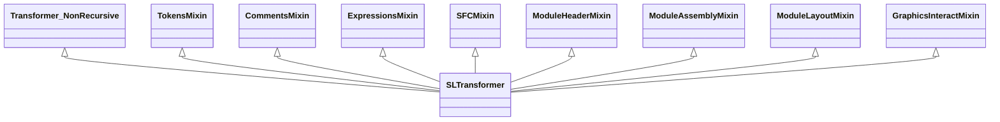
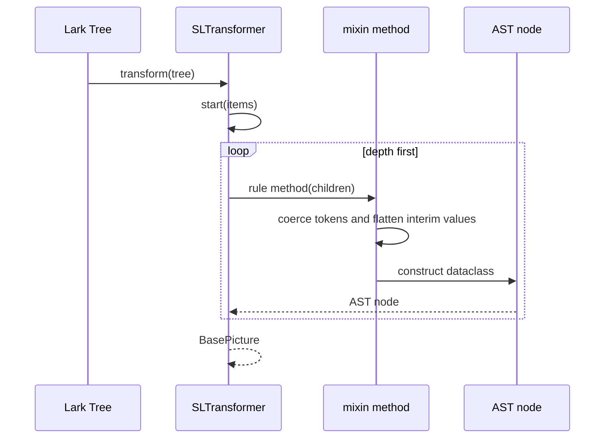
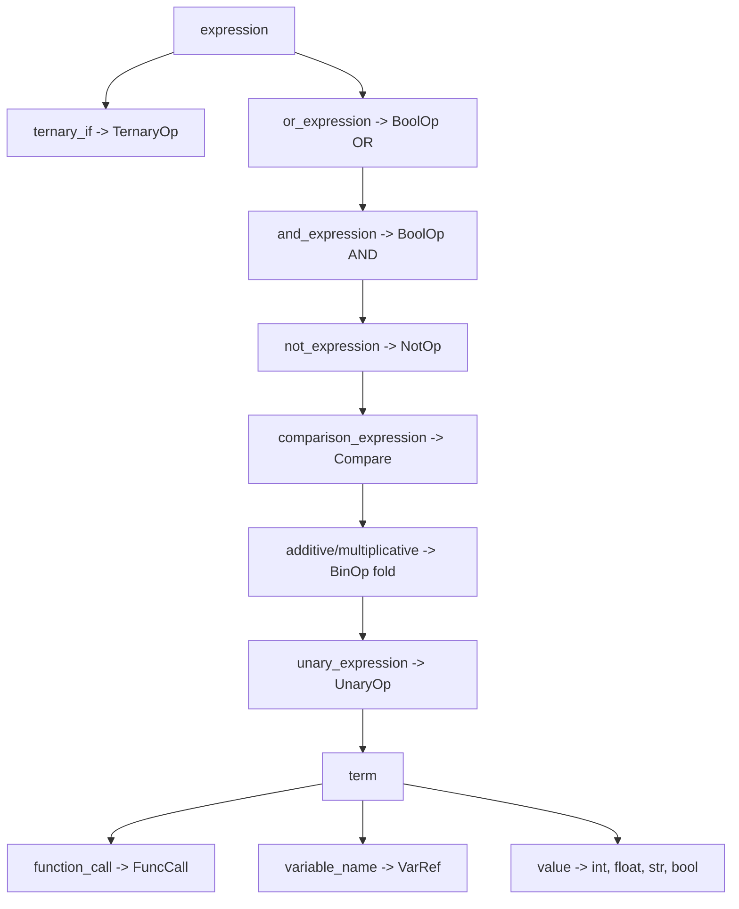
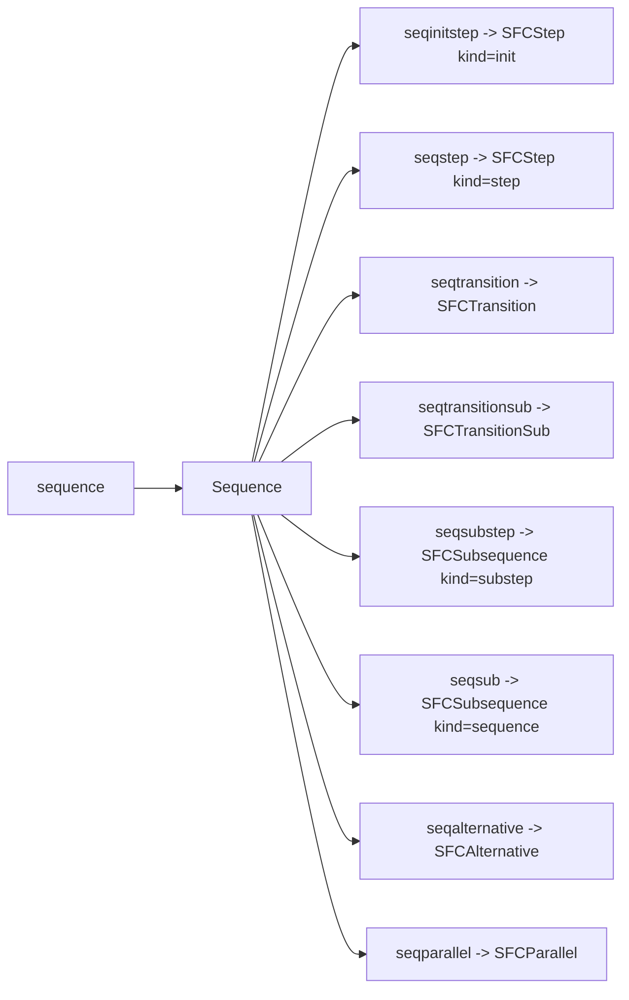

# Transformer

`SLTransformer` is Lark's `Transformer_NonRecursive` that turns the parse tree
into the AST documented in [ast.md](ast.md). It is assembled from mixins so
each file owns one responsibility. The non-recursive base reduces the tree with
an explicit post-order stack, so deeply parenthesized input does not grow the
Python call stack. Comment token flattening also uses an explicit stack,
because structural comment nesting is not capped by the lexer.

## Composition



The method resolution order is the order shown in
`transformer/sl_transformer.py`:

```python
class SLTransformer(
    TokensMixin,
    CommentsMixin,
    ExpressionsMixin,
    SFCMixin,
    ModuleHeaderMixin,
    ModuleAssemblyMixin,
    ModuleLayoutMixin,
    GraphicsInteractMixin,
    Transformer_NonRecursive,
):
```

| Mixin | File | Responsibility |
| --- | --- | --- |
| `TokensMixin` | `_tokens_mixin.py` | Token coercion, literal conversion, `meta_span` |
| `CommentsMixin` | `_comments_mixin.py` | Role-tagged `CodeComment` construction |
| `ExpressionsMixin` | `_expressions_mixin.py` | Expressions, values, statements |
| `SFCMixin` | `_sfc_mixin.py` | Sequence function chart nodes |
| `ModuleHeaderMixin` | `_module_header_mixin.py` | Module headers, invocation arguments, tails |
| `ModuleAssemblyMixin` | `_module_assembly_mixin.py` | Module-body normalization and AST assembly |
| `ModuleLayoutMixin` | `_module_layout_mixin.py` | Layout, coordinates, `ModuleDef` |
| `GraphicsInteractMixin` | `_graphics_interact_mixin.py` | Graph objects and interactor objects |

`_module_shared.py` holds helpers and types shared by several mixins:
`flatten_items`, `meta_span`, `tree_children`, `InterimCoords`,
`TransformerItem`, and `TransformerTree`.

## Dispatch

Lark calls a transformer method named after each grammar rule. The mixins
provide those methods; the class body only adds the root method and a few
shared helpers.



The transformer contract is bottom-up: children are transformed before their
parent. `Transformer_NonRecursive` preserves that order with an explicit
post-order stack instead of recursion. Several grammar rules are prefixed with
`?`, so Lark inlines them and
the mixin never sees a rule node for them. The mixins are written against the
actual tree shapes, not against the grammar text alone.

## Root: `start`

```python
def start(self, items: list[TransformerItem]) -> BasePicture:
    ...
```

`start` does two things:

1. Finds the `header_lines` tree and extracts the program name from
   `program_date_line`. The header is a quoted string with comma-separated
   `name: value` fields; the extractor splits on `,` and matches `name`
   case-insensitively.
2. Finds the `BasePicture` produced by `base_picture_module`, attaches the
   program name, and returns it.

If no `BasePicture` is present, it raises `ValueError` naming the observed child
types. That is a grammar or transformer bug, not invalid input.

## Value coercion

`TokensMixin` converts grammar tokens into Python values before the AST is
built:

| Grammar | Python |
| --- | --- |
| `SIGNED_INT` | `IntLiteral` (an `int` subclass with a span) |
| `REAL` | `FloatLiteral` (a `float` subclass with a span) |
| `STRING` | `str` with doubled quotes unescaped |
| `BOOL`, `ON_KW`, `OFF_KW` | `bool` |
| `STATE_SUFFIX` | `"old"`, `"new"`, or `None` on a `VarRef` |

`meta_span(meta)` converts a Lark `Meta` into a `SourceSpan`. It runs after
`remap_tree_to_original`, so the values are already original coordinates.

## Comments

`CommentsMixin` turns the role-tagged grammar nodes into `CodeComment` values:

| Grammar node | AST home |
| --- | --- |
| `code_comment` | `CodeItem` position in a code list |
| `comment_stmt` | A code comment followed by `;` |
| `module_typedescription` | `ModuleHeader.description_comments` or `ModuleTypeDef.description_comments` |
| `module_end_comment` | `trailing_comments` or the matching end field |
| `comments` | The structural field for that context, when one exists |

A legal comment with no AST home stays in the parse tree only. It is never
attached to the nearest field just to avoid losing it.

## Expressions

`ExpressionsMixin` builds the expression hierarchy:



`OR` and `AND` are n-ary: a chain becomes one `BoolOp` with an operand tuple.
Arithmetic and comparison are binary: a chain folds left-associatively into
`BinOp` or produces a `Compare`.

`if_statement` produces an `IfStmt` with a tuple of `(condition, body)` pairs
and an optional `else_block`. `assignment_statement` produces an `Assignment`.
A bare `function_call` statement produces a `FuncCallStmt`.

## SFC

`SFCMixin` maps the sequence grammar:



`code_blocks` become `SFCCodeBlocks(enter, active, exit)`. An absent block is
an empty list, not `None`, because the grammar treats the three blocks as
independently optional. `seqfork` becomes `SFCFork`, attached to its host step
or transition.

## Module headers and assembly

`ModuleHeaderMixin` builds `ModuleHeader` values:

- name and invocation coordinates;
- `invocation_arguments` for arguments such as `Zoomable`, `LayerModule`,
  `SymbolModule`, `Enable_`, `Module_In_View`, and layer info;
- `groupconn` and `groupconn_global` from `GroupConn=`;
- `enable`, `enable_tail`, and `module_in_view` when present;
- coordinate tails (`_extract_coord_tails`) and invocation tails
  (`_extract_tailed_rule_payload`).

`ModuleAssemblyMixin` is the largest mixin. It normalizes module bodies and
assembles the AST:

- splits a `module_body` into parameters, locals, submodules, `moduledefs`, and
  `modulecodes`;
- builds `SingleModule`, `FrameModule`, and `ModuleTypeInstance`;
- builds `ModuleTypeDef` for `TYPEDEFINITIONS ... MODULEDEFINITION` blocks;
- builds `BasePicture` for the root;
- keeps every legacy repeated `moduledef` block in `moduledefs` and
  `modulecodes`;
- attaches trailing and description comments to the right field;
- collects parameter mappings for module-type instances.

The assembly mixin deliberately preserves absence: an optional block that the
source omitted is `None` or an empty list, never a synthesized default object.

## Layout and graphics

`ModuleLayoutMixin` handles:

- `ClippingBounds` coordinates, including tail expressions;
- `ZoomLimits`, `Two_Layers_`, `LayerLimit_`, `Grid`, `Zoomable`;
- `SeqLayers`;
- `ModuleDef` assembly.

Coordinate tails are retained on `ModuleDef.clipping_tails` so validation can
type-check them. `clipping_bounds` keeps only the resolved float values.

`GraphicsInteractMixin` handles:

- graph objects (`TextObject`, `RectangleObject`, `LineObject`, `OvalObject`,
  `PolygonObject`, `SegmentObject`, `CompositeObject`, connection nodes);
- interactor objects (`ComBut_`, `OptBut_`, `CheckBox_`, `TextBox_`,
  `MenuInteract`, `SimpleInteract`, `ProcedureInteract`, and free-form names);
- property clauses: layer, enable, colours, width, format strings, value
  fractions, alignment, pick buttons, scale selectors;
- `InVar_` / `OutVar_` tails.

Free-form interactor names are accepted on purpose. The transformer preserves
them as `InteractObject.type` strings; the package does not decide which
free-form names are valid UI widgets.

## Extending the transformer

When you add a grammar rule:

1. Add the rule to `sattline.lark`.
2. Add constants to `grammar/constants.py` if the rule needs a spelling.
3. Add the AST field to the matching dataclass in `models/`.
4. Add the method to the mixin that owns that responsibility.
5. Add a fixture to `tests/fixtures/corpus/` (valid, invalid, or edge case).
6. Add a focused test that asserts the constructed shape, not just that parsing
   succeeded.
7. Update [grammar.md](grammar.md) and [ast.md](ast.md).

The transformer never validates. If a rule is syntactically accepted but
semantically wrong, the finding belongs in `validation/`, not here.

## Tests that pin the transformer

| Test | What it protects |
| --- | --- |
| `tests/parser/test_parser_core_transformer.py` | Root assembly and helper behaviour |
| `tests/parser/test_transformer.py` | General transformer coverage |
| `tests/parser/test_parser_core_expressions.py` | Expression building |
| `tests/parser/test_parser_core_comments.py` | Comment roles |
| `tests/parser/test_parser_core_sfc.py` | SFC building |
| `tests/parser/test_parser_core_module_definitions.py` | Layout and graphics |
