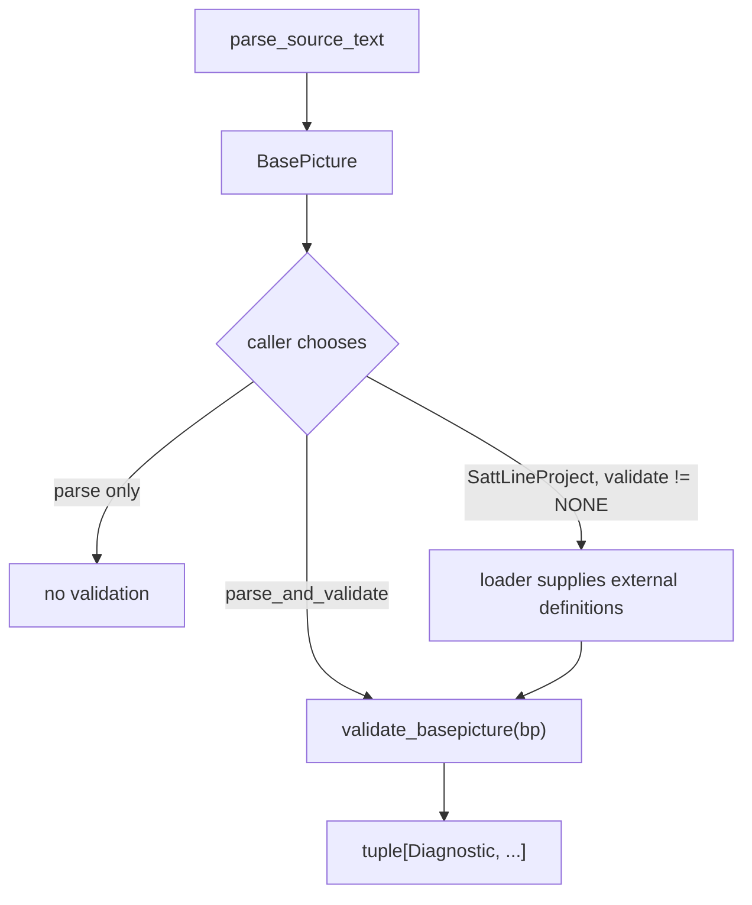
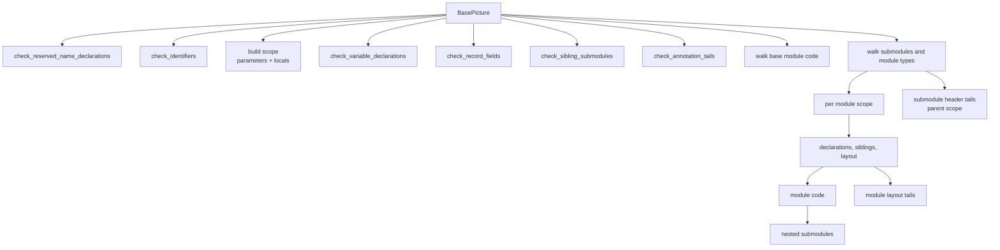

# Validation

Validation answers "is this source well formed as a SattLine unit?" at the
language level. It is **not** a lint policy, a style checker, a data-flow
analysis, or a whole-program audit. It runs on one parsed `BasePicture`, with
optional definitions already loaded from dependencies.

## When validation runs



`parse_source_text` is a pure parse/transform pipeline. `parse_and_validate` is
the explicit opt-in for single-source validation. `SattLineProject.load`
chooses a validation scope: `INVOKED` (default), `FULL`, or `NONE`.

| Scope | What is validated |
| --- | --- |
| `INVOKED` | Each target in full. A dependency file contributes only the module types the target invokes, transitively |
| `FULL` | Every loaded program |
| `NONE` | Nothing; parse only |

`INVOKED` exists because a library file usually defines far more than any one
consumer uses. Blaming the consumer for an unused library module type is not a
useful finding. See [project.md](project.md) for the reachability walk.

## Entry point

```python
validate_basepicture(
    bp,
    *,
    external_datatypes=(),
    external_moduletype_defs=(),
    allow_unresolved_external_datatypes=False,
) -> tuple[Diagnostic, ...]
```

The validator builds one `_ValidationContext`:

- `records`: the file's `DATATYPE` definitions, the external definitions, and
  the builtin record specs, keyed by `fold_identifier`;
- `moduletypes`: the file's module types plus external ones;
- `type_graph`: a case-insensitive `TypeGraph` over the same records;
- `sfc_names`: every SFC step, transition, subsequence, and sequence name in
  the program, collected once;
- `allow_unresolved_external_datatypes`: a single-file escape hatch.

The single-file caller may legitimately reference a datatype that lives in
another file it has not loaded. `allow_unresolved_external_datatypes=True`
suppresses only unknown-name findings. It does not suppress typo suggestions or
local rules. The project loader never sets it; it marks external-dependent
findings tentative instead.

## Walk



Scopes nest: a module sees its own parameters and locals, then its enclosing
module's, up to the `BasePicture` scope. Record field access resolves through
the top-level `DATATYPE` definitions and the builtin record specifications.

Annotation tails are checked in the scope that encloses their container: the
base scope for the unit header and base `ModuleDef`, the parent scope for a
submodule header, and the module scope for that module's `ModuleDef`. The
walker emits each tail once, so a tail shared between a typed clause and the
flat `properties["tails"]` view is not reported twice.

Expression tails are walked like any other expression: an unresolved name is
`SL-V019`, and ordinary operator diagnostics apply. An `Enable_` expression tail
must be boolean (`SL-V030`). A `ModuleDef` coordinate tail must be real
(`SL-V032`). Bound `InVar_`/`OutVar_` names produce no diagnostic because the
parser does not evidence how the name resolves. The query command reports those
names as unresolved uses instead.

`ModuleHeader.invoke_coord_tails` folds coordinate tails, `Module_In_View`
tails, and invocation-assignment tails into one field. Only the undefined-name
walk applies there: the field cannot distinguish a coordinate position from a
boolean condition, so `SL-V032` and the `Module_In_View` boolean rule are not
applied to header tails. Splitting the header field is a separate change.

These rules keep the `code` rule scope because annotation tails are code
expressions. The rule-group table names `annotations.py` as the file that emits
them, not a separate scope.

## Rule groups

| Module | Rules |
| --- | --- |
| `declarations.py` | Reserved names, identifier length and keywords, sibling submodule uniqueness, declaration modifiers, datatype references, record fields |
| `annotations.py` | Header, graphics, interact, and module-layout tails: undefined names, boolean `Enable_` conditions, real coordinate positions |
| `code.py` | Module code and SFC: expressions, assignments, calls, conditions, `:Old`/`:New`, const writes, sequence structure, fork targets |
| `sequences.py` | SFC position grammar: S/T/M body shapes for closed, transition, step, and open bodies |
| `transfers.py` | Parameter-transfer type compatibility when the module type is declared in the same file |
| `parameter_mappings.py` | Module-type instance mappings: duplicate targets, field access, literal and variable types |
| `typing.py` | Scalar families, literal inference, assignment and operand compatibility, datatype typo suggestions |
| `type_graph.py` | Record field resolution and leaf-path expansion |
| `symbols.py` | Scope chain and reference resolution |
| `builtins.py` | Builtin arity, output-argument positions, datatype typo helper |

## What is checked

### Declarations

- Reserved runtime names (`On`, `Off`) may be read but not declared.
- Identifiers must be at most 20 characters and must not be a reserved keyword.
- Sibling submodules must have unique names.
- Declaration modifiers are checked in source order. `State OpSave` is valid;
  `OpSave State` and `OpSave Const` are invalid.
- A declared datatype name must resolve to a file datatype, a builtin record,
  or a loaded external datatype, unless the single-file escape hatch applies.
- Record fields must resolve.

### Module code and expressions

- `:Old` and `:New` require a `State` variable, or a field whose declaration is
  state.
- A write to a `Const` variable is rejected, including a write through a
  builtin output argument.
- References to undefined variables are rejected, except SFC runtime
  accessors and the `On`/`Off` runtime constants.
- Builtin calls are checked for arity and for output arguments that must be
  writable variable references. Calls to unknown names are left alone.
- String literals are not accepted where a variable reference is required.
- Numeric operands are required for arithmetic; boolean operands for `AND`,
  `OR`, and `NOT`; a boolean condition for `IF`, `ELSIF`, and `WAIT_FOR`.
- Assignment types must be compatible.
- Comparison operands must be compatible.
- Ternary branches must have compatible types.
- A string may not be assigned where the language does not allow it.

### Sequences

The SFC position rules are worth reading directly in
`validation/sequences.py`. In summary:

| Position | Constructs |
| --- | --- |
| `S` (step) | `SEQINITSTEP`, `SEQSTEP`, `SUBSEQSTEP`, `PARALLELSEQ` |
| `T` (transition) | `SEQTRANSITION`, `SUBSEQTRANSITION`, `ALTERNATIVESEQ` |
| `M` (structural) | `SUBSEQUENCE` |

Accepted body shapes:

```
closed_body     = (S T | M)+          SEQUENCE, SUBSEQUENCE
transition_body = T (S T | M)*        each ALTERNATIVEBRANCH, SUBSEQTRANSITION
step_body       = M* S (T M* S)*      each PARALLELBRANCH, SUBSEQSTEP
open_body       = S after_step
                | T after_boundary
                | M after_boundary    OPENSEQUENCE
after_step      = empty | T after_boundary
after_boundary  = empty | M after_boundary | S after_step
```

These are parse-time rules in the real language, but they are enforced after
parsing here so comments may appear anywhere. `SEQFORK` occupies no position;
it is a suffix of its host step or transition.

### Parameter transfers and mappings

- A module-type instance whose module type is declared in the same file is
  checked for parameter-transfer type compatibility.
- A module-type instance mapping is checked for a duplicate target, field
  access, unknown target, and literal or variable type mismatch.
- When the module type is external, the mapping rule resolves against the
  loaded definition through the project layer.

## Diagnostics

```python
@dataclass(frozen=True, slots=True)
class Diagnostic:
    code: DiagnosticCode
    message: str
    span: SourceSpan | None = None
    tentative: bool = False
```

Every validation diagnostic is an error. The finding shape in the CLI keeps a
severity field because graphics scan messages can be warnings, but validation
never produces one.

`code` is a stable machine identifier (`SL-V###`). `message` is a sentence
about the source. `span` points into the original source. `tentative` is set by
the project loader, never by the validator: it means the finding depends on
definitions from a part of the closure that failed to load, so it is not final.

The full code table lives in the rule registry, not in the enum. Every
`DiagnosticCode` has exactly one `Rule` in `validation/rules.py` with an id, an
enum name, a scope, a status, a summary, and optional details. The status is
`active` when the validator emits the rule, `retired` when the form was proved
to load and the check was withdrawn, and `unimplemented` when a code was
reserved but no check exists yet.

`RULES`, `RULES_BY_ID`, and `RULES_BY_NAME` are the lookup tables. `find_rule`
accepts either `SL-V019` or `UNDEFINED_VARIABLE`, case-insensitively.
`render_markdown_table` produces the table below, and a test asserts that the
document and the registry agree, so a code cannot be added without appearing
here. `sattline rules` exposes the same data on the command line.

<!-- RULE-TABLE:START -->
| Id | Name | Status | Scope | Summary |
| --- | --- | --- | --- | --- |
| `SL-V001` | `DUPLICATE_DATATYPE_NAME` | retired | declarations | A datatype name may be declared twice. |
| `SL-V002` | `DUPLICATE_MODULETYPE_NAME` | retired | declarations | A module-type name may be declared twice. |
| `SL-V003` | `DUPLICATE_VARIABLE_NAME` | retired | declarations | A variable name may be declared twice. |
| `SL-V004` | `DUPLICATE_SIBLING_SUBMODULE` | active | declarations | Two sibling submodule instances may not share a name. |
| `SL-V005` | `OLD_NEW_ON_NON_STATE_VARIABLE` | active | code | `:Old` and `:New` require a State variable. |
| `SL-V006` | `OLD_NEW_ON_NON_STATE_FIELD` | active | code | `:Old` and `:New` require a State record field. |
| `SL-V007` | `WRITE_TO_CONST_VARIABLE` | active | code | A Const variable may not be assigned or written through an output argument. |
| `SL-V008` | `INIT_VALUE_TYPE_MISMATCH` | retired | declarations | An initial value must match its variable's datatype. |
| `SL-V009` | `BARE_DURATION_INIT` | retired | declarations | A duration variable needs a duration literal, not a bare string. |
| `SL-V010` | `BARE_TIME_INIT` | retired | declarations | A time variable needs a time literal, not a bare string. |
| `SL-V011` | `MALFORMED_DURATION_LITERAL` | retired | declarations | A duration literal must be well formed. |
| `SL-V012` | `MALFORMED_TIME_LITERAL` | retired | declarations | A time literal must be well formed. |
| `SL-V013` | `BUILTIN_WRONG_ARITY` | active | code | A builtin call must supply between its minimum and maximum argument count. |
| `SL-V014` | `BUILTIN_OUT_ARG_NOT_VARIABLE` | active | code | A builtin output argument must be a plain variable reference. |
| `SL-V015` | `STRING_LITERAL_CALL_ARGUMENT` | active | code | A string literal may not stand in a call argument position that requires a reference. |
| `SL-V016` | `CONSECUTIVE_SEQUENCE_STEPS` | active | sfc | SFC steps must be separated by a transition. |
| `SL-V017` | `SEQUENCE_FORK_UNKNOWN_TARGET` | active | sfc | A SEQFORK target must name an SFC element in the module. |
| `SL-V018` | `BUILTIN_DATATYPE_TYPO` | active | declarations | A near miss of a builtin datatype name is reported as a typo. |
| `SL-V019` | `UNDEFINED_VARIABLE` | active | code | A reference or assignment target must resolve to a declared variable or parameter. |
| `SL-V020` | `UNKNOWN_DATATYPE_NAME` | active | declarations | A datatype reference must resolve to a builtin or a declared DATATYPE. |
| `SL-V021` | `DUPLICATE_SFC_ELEMENT_NAME` | active | sfc | SFC step and transition names must be unique within a module. |
| `SL-V022` | `SFC_INIT_STEP_PLACEMENT` | retired | sfc | A sequence must contain exactly one init step in a valid position. |
| `SL-V023` | `SFC_ALTERNATIVE_BRANCH_START` | active | sfc | An ALTERNATIVESEQ branch must start with a SEQTRANSITION. |
| `SL-V024` | `SFC_PARALLEL_BRANCH_START` | active | sfc | A PARALLELSEQ branch must start and end with a SEQSTEP. |
| `SL-V025` | `DUPLICATE_RECORD_FIELD_NAME` | retired | declarations | A record may not declare the same field name twice. |
| `SL-V026` | `BUILTIN_DATATYPE_SHADOWED` | retired | declarations | A declaration may not reuse a builtin datatype name. |
| `SL-V027` | `PARAM_TRANSFER_TYPE_MISMATCH` | active | mappings | A submodule argument must be type compatible with the declared module-type parameter. |
| `SL-V028` | `OPERAND_NOT_NUMERIC` | active | code | Arithmetic and unary operators require integer or real operands. |
| `SL-V029` | `ASSIGNMENT_TYPE_MISMATCH` | active | code | An assigned value must have a datatype compatible with the target. |
| `SL-V030` | `CONDITION_NOT_BOOLEAN` | active | code | IF, ELSIF, WAIT_FOR, and Enable_ tail conditions must be boolean. |
| `SL-V031` | `ATTRIBUTE_COMBINATION_INVALID` | active | declarations | Declaration attributes must appear in an accepted order and combination. |
| `SL-V032` | `COORDINATE_NOT_REAL` | active | code | A coordinate value must be real. |
| `SL-V033` | `SEQUENCE_ENDS_WITH_STEP` | active | sfc | A closed sequence must end with a transition, not a step. |
| `SL-V034` | `RESERVED_NAME_DECLARED` | active | declarations | `On` and `Off` are SFC runtime names and may not be declared. |
| `SL-V035` | `OLD_STATE_NOT_WRITABLE` | active | code | The `:Old` state of a State variable is read-only. |
| `SL-V036` | `SEQUENCE_POSITION_INVALID` | active | sfc | SFC steps, transitions, and structural constructs must occupy valid positions. |
| `SL-V037` | `SEQUENCE_FORK_TARGET_KIND` | active | sfc | A SEQFORK on a step must target a transition, and the reverse. |
| `SL-V038` | `IDENTIFIER_TOO_LONG` | active | declarations | A declared identifier may be at most 20 characters. |
| `SL-V039` | `RESERVED_KEYWORD_NAME` | active | declarations | A declaration may not use a reserved SattLine keyword as its name. |
| `SL-V040` | `DATATYPE_TOO_FEW_FIELDS` | unimplemented | declarations | A DATATYPE declaration must declare at least one field. |
| `SL-V041` | `COMPARE_INCOMPATIBLE_OPERANDS` | active | code | Comparison operators require compatible operand datatypes. |
| `SL-V042` | `DIVISION_BY_ZERO` | unimplemented | code | Division by a literal zero is rejected. |
| `SL-V043` | `LOGICAL_OPERAND_NOT_BOOLEAN` | active | code | Logical operators require boolean operands. |
| `SL-V044` | `TERNARY_BRANCH_TYPES_INCOMPATIBLE` | active | code | IF-expression branches must have compatible datatypes. |
| `SL-V045` | `STRING_ASSIGNMENT_NOT_ALLOWED` | active | code | A string variable is copied with CopyString or CopyVar, not assigned directly. |
| `SL-V046` | `BUILTIN_ARG_NOT_VARIABLE` | active | code | An `in var` builtin parameter requires a variable reference argument. |
| `SL-V047` | `BUILTIN_ARG_TYPE_MISMATCH` | active | code | A builtin argument must match its declared parameter datatype. |
| `SL-V048` | `PARAMETER_MAPPING_TARGET_UNKNOWN` | active | mappings | A module-type instance mapping must target a declared parameter. |
| `SL-V049` | `PARAMETER_MAPPING_DUPLICATE_TARGET` | active | mappings | A module-type instance may map each parameter target only once. |
| `SL-V050` | `PARAMETER_MAPPING_TYPE_MISMATCH` | active | mappings | A module-type instance mapping value must match the parameter datatype. |
| `SL-V051` | `STEP_AUTO_VARIABLE_UNAVAILABLE` | active | code | A step or sequence accessor requires the matching SeqControl or SeqTimer flag. |
| `SL-V052` | `SEQUENCE_TRANSITION_AFTER_TRANSITION` | unimplemented | sfc | A transition may not directly follow another transition. |
| `SL-V053` | `PARALLEL_BRANCH_INCOMPLETE` | unimplemented | sfc | A parallel branch must contain a complete step sequence. |
| `SL-V054` | `SUBSEQTRANSITION_STARTS_WITH_STEP` | unimplemented | sfc | A SUBSEQTRANSITION body must not start with a step. |
| `SL-V055` | `SEQUENCE_REQUIRES_INIT_STEP` | unimplemented | sfc | A closed sequence must contain an init step. |
| `SL-V056` | `SEQUENCE_AMBIGUOUS_FORK_TARGET` | active | sfc | A SEQFORK target may not be declared more than once in a module. |
| `SL-V057` | `DATECODE_CONFLICT` | active | project | The same module type or datatype may not be declared with different datecodes in a visible closure. |
| `SL-V058` | `UNKNOWN_MODULETYPE_NAME` | active | project | A module-type instance must name a declared type or one visible from a loaded dependency. |
<!-- RULE-TABLE:END -->

### Retired and unimplemented codes

`RETIRED_CODES` in `validation/rules.py` records the retired rules and why they
are not enforced. Each was implemented, then disproved by loading the same
source directly. The editor's UI refused to *create* such a declaration, but the
file loaded and parsed from disk. A UI guard is not a parser rule. The enum
members stay so existing imports and stored diagnostics remain valid, but
nothing emits them:

- duplicate datatype, module-type, variable, and record-field names;
- shadowing a builtin datatype;
- init value of a different datatype;
- bare duration or time init;
- malformed duration or time literal;
- misplaced or missing init step.

Do not reintroduce one of these without new, reproducible evidence.

A rule marked `unimplemented` is a reserved code with no check at all. It is not
a statement about the language; it is a gap in the validator. The registry
records the gap so it cannot be mistaken for an enforced rule. In particular,
`DIVISION_BY_ZERO` is reserved but not enforced, so a literal zero divisor is
not reported today.

## Relation to the project loader

The loader adds findings the single-file validator cannot know:

| Finding | Why it needs the project |
| --- | --- |
| `DATECODE_CONFLICT` | The same module type or datatype is declared with different datecodes in the visible closure |
| `UNKNOWN_MODULETYPE_NAME` | The module type may be declared in another loaded file |
| `PARAM_TRANSFER_TYPE_MISMATCH` | The formal parameter is in another file |
| `PARAMETER_MAPPING_TARGET_UNKNOWN` | The formal parameter is in another file |
| `PARAMETER_MAPPING_TYPE_MISMATCH` | The formal parameter is in another file |

The loader scopes datecode conflicts to a program's visible closure. Unrelated
programs that happen to declare the same name never conflict with each other.

## What validation deliberately does not do

- It does not verify graphics bindings against variables or assets.
- It does not compute metrics, dead code, or data flow.
- It does not enforce style or naming conventions beyond the language limit.
- It does not compare two files semantically. `sattline diff` compares finding
  and structural counts, not meanings.
- It does not decide whether the program is correct for its machine.

Those are consumer concerns. The package supplies the facts; the consumer
applies its policy.

## Adding a rule

1. Prove the rule is real: a fixture, a public manual, or a black-box check.
   The `RETIRED_CODES` list exists because a plausible rule without proof is a
   bug.
2. Add a `DiagnosticCode` member. Do not reuse a code for a different rule.
3. Add the matching `Rule` to `validation/rules.py`: summary, scope, and
   status. The registry test fails until every code has exactly one entry.
4. Put the rule in the owning module: declarations in `declarations.py`, code
   and SFC in `code.py`, type facts in `typing.py`, and so on.
5. Emit a `Diagnostic` with a sentence and a `span` when one is available.
6. Add the fixture to `tests/fixtures/corpus/invalid/` or
   `tests/fixtures/corpus/edge_cases/`, and the golden expectation to
   `tests/fixtures/validation/expectations.json`.
7. Add a focused test.
8. Update this document, then run `python scripts/gen_rule_table.py` to refresh
   the rule table.

## Tests that pin validation

| Test | What it protects |
| --- | --- |
| `tests/parser/test_validation_rules.py` | Rule behaviour |
| `tests/parser/test_validation_types.py` | Type rules and literal inference |
| `tests/parser/test_validation_expectations.py` | Golden manifest agreement |
| `tests/parser/test_parser_sequence_positions.py` | SFC body shapes |
| `tests/parser/test_moduletype_declarations.py` | Declarations and transfers |
| `tests/project/test_project_validation.py` | Project-scope validation and tentative marking |
