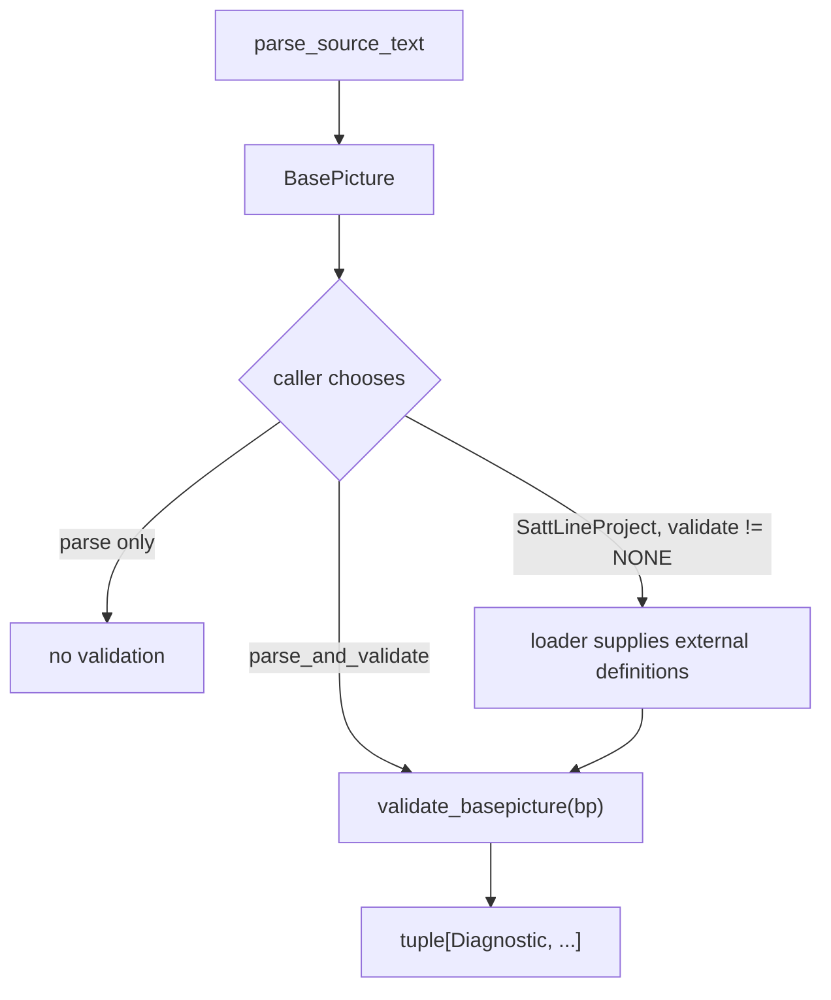
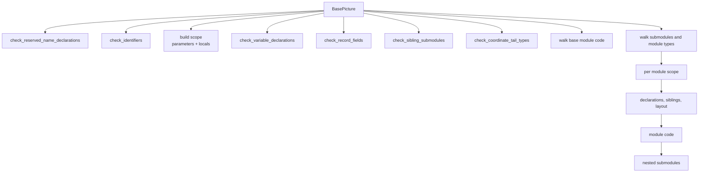

# Validation

Validation answers "is this source well formed as a SattLine unit?" at the
language level. It is **not** a lint policy, a style checker, a data-flow
analysis, or a whole-program audit. It runs on one parsed `BasePicture`, with
optional definitions already loaded from dependencies.

## When validation runs



`parse_source_text` is a pure parse/transform pipeline. `parse_and_validate` is
the explicit opt-in for single-source validation. `SattLineProject.load`
chooses a validation scope: `INVOKED` (default), `FULL`, or `NONE`.

| Scope | What is validated |
| --- | --- |
| `INVOKED` | Each target in full. A dependency file contributes only the module types the target invokes, transitively |
| `FULL` | Every loaded program |
| `NONE` | Nothing; parse only |

`INVOKED` exists because a library file usually defines far more than any one
consumer uses. Blaming the consumer for an unused library module type is not a
useful finding. See [project.md](project.md) for the reachability walk.

## Entry point

```python
validate_basepicture(
    bp,
    *,
    external_datatypes=(),
    external_moduletype_defs=(),
    allow_unresolved_external_datatypes=False,
) -> tuple[Diagnostic, ...]
```

The validator builds one `_ValidationContext`:

- `records`: the file's `DATATYPE` definitions, the external definitions, and
  the builtin record specs, keyed by `fold_identifier`;
- `moduletypes`: the file's module types plus external ones;
- `type_graph`: a case-insensitive `TypeGraph` over the same records;
- `sfc_names`: every SFC step, transition, subsequence, and sequence name in
  the program, collected once;
- `allow_unresolved_external_datatypes`: a single-file escape hatch.

The single-file caller may legitimately reference a datatype that lives in
another file it has not loaded. `allow_unresolved_external_datatypes=True`
suppresses only unknown-name findings. It does not suppress typo suggestions or
local rules. The project loader never sets it; it marks external-dependent
findings tentative instead.

## Walk



Scopes nest: a module sees its own parameters and locals, then its enclosing
module's, up to the `BasePicture` scope. Record field access resolves through
the top-level `DATATYPE` definitions and the builtin record specifications.

## Rule groups

| Module | Rules |
| --- | --- |
| `declarations.py` | Reserved names, identifier length and keywords, sibling submodule uniqueness, declaration modifiers, datatype references, record fields |
| `code.py` | Module code and SFC: expressions, assignments, calls, conditions, `:Old`/`:New`, const writes, sequence structure, fork targets |
| `sequences.py` | SFC position grammar: S/T/M body shapes for closed, transition, step, and open bodies |
| `transfers.py` | Parameter-transfer type compatibility when the module type is declared in the same file |
| `parameter_mappings.py` | Module-type instance mappings: duplicate targets, field access, literal and variable types |
| `typing.py` | Scalar families, literal inference, assignment and operand compatibility, datatype typo suggestions |
| `type_graph.py` | Record field resolution and leaf-path expansion |
| `symbols.py` | Scope chain and reference resolution |
| `builtins.py` | Builtin arity, output-argument positions, datatype typo helper |

## What is checked

### Declarations

- Reserved runtime names (`On`, `Off`) may be read but not declared.
- Identifiers must be at most 20 characters and must not be a reserved keyword.
- Sibling submodules must have unique names.
- Declaration modifiers are checked in source order. `State OpSave` is valid;
  `OpSave State` and `OpSave Const` are invalid.
- A declared datatype name must resolve to a file datatype, a builtin record,
  or a loaded external datatype, unless the single-file escape hatch applies.
- Record fields must resolve.

### Module code and expressions

- `:Old` and `:New` require a `State` variable, or a field whose declaration is
  state.
- A write to a `Const` variable is rejected, including a write through a
  builtin output argument.
- References to undefined variables are rejected, except SFC runtime
  accessors and the `On`/`Off` runtime constants.
- Builtin calls are checked for arity and for output arguments that must be
  writable variable references. Calls to unknown names are left alone.
- String literals are not accepted where a variable reference is required.
- Numeric operands are required for arithmetic; boolean operands for `AND`,
  `OR`, and `NOT`; a boolean condition for `IF`, `ELSIF`, and `WAIT_FOR`.
- Assignment types must be compatible.
- Comparison operands must be compatible.
- Division by a literal zero is rejected.
- Ternary branches must have compatible types.
- A string may not be assigned where the language does not allow it.

### Sequences

The SFC position rules are worth reading directly in
`validation/sequences.py`. In summary:

| Position | Constructs |
| --- | --- |
| `S` (step) | `SEQINITSTEP`, `SEQSTEP`, `SUBSEQSTEP`, `PARALLELSEQ` |
| `T` (transition) | `SEQTRANSITION`, `SUBSEQTRANSITION`, `ALTERNATIVESEQ` |
| `M` (structural) | `SUBSEQUENCE` |

Accepted body shapes:

```
closed_body     = (S T | M)+          SEQUENCE, SUBSEQUENCE
transition_body = T (S T | M)*        each ALTERNATIVEBRANCH, SUBSEQTRANSITION
step_body       = M* S (T M* S)*      each PARALLELBRANCH, SUBSEQSTEP
open_body       = S after_step
                | T after_boundary
                | M after_boundary    OPENSEQUENCE
after_step      = empty | T after_boundary
after_boundary  = empty | M after_boundary | S after_step
```

These are parse-time rules in the real language, but they are enforced after
parsing here so comments may appear anywhere. `SEQFORK` occupies no position;
it is a suffix of its host step or transition.

### Parameter transfers and mappings

- A module-type instance whose module type is declared in the same file is
  checked for parameter-transfer type compatibility.
- A module-type instance mapping is checked for a duplicate target, field
  access, unknown target, and literal or variable type mismatch.
- When the module type is external, the mapping rule resolves against the
  loaded definition through the project layer.

## Diagnostics

```python
@dataclass(frozen=True, slots=True)
class Diagnostic:
    code: DiagnosticCode
    message: str
    severity: DiagnosticSeverity = DiagnosticSeverity.ERROR
    span: SourceSpan | None = None
    tentative: bool = False
```

`code` is a stable machine identifier (`SL-V###`). `message` is a sentence
about the source. `span` points into the original source. `tentative` is set by
the project loader, never by the validator: it means the finding depends on
definitions from a part of the closure that failed to load, so it is not final.

The full code table is the `DiagnosticCode` enum in
`validation/diagnostics.py`. The codes group by area:

| Codes | Area |
| --- | --- |
| `SL-V001` to `SL-V004` | Duplicate names and sibling submodules |
| `SL-V005` to `SL-V007` | `:Old` / `:New` state rules and const writes |
| `SL-V008` to `SL-V012` | Initial values and temporal literals |
| `SL-V013` to `SL-V015` | Builtin call arity, output arguments, string arguments |
| `SL-V016` to `SL-V017` | Sequence step order and fork targets |
| `SL-V018` | Builtin datatype typo |
| `SL-V019` to `SL-V020` | Undefined variable and unknown datatype |
| `SL-V021` to `SL-V024` | SFC names and SFC structure |
| `SL-V025` to `SL-V027` | Record fields, shadowing, parameter transfers |
| `SL-V028` to `SL-V033` | Operand types, assignment, conditions, attributes, coordinates, sequence end |
| `SL-V034` to `SL-V039` | Reserved names, writable state, sequence position, identifier length |
| `SL-V040` to `SL-V051` | Datatype size, comparisons, division, logical and ternary types, mappings |
| `SL-V052` to `SL-V058` | Sequence transitions, parallel branches, forks, datecodes, unknown module types |

### Retired codes

`RETIRED_CODES` records rules that were implemented, then disproved by loading
the same source directly. The editor's UI refused to *create* such a
declaration, but the file loaded and parsed from disk. A UI guard is not a
parser rule. The enum members stay so existing imports and stored diagnostics
remain valid, but nothing emits them:

- duplicate datatype, module-type, variable, and record-field names;
- shadowing a builtin datatype;
- init value of a different datatype;
- bare duration or time init;
- malformed duration or time literal;
- misplaced or missing init step.

Do not reintroduce one of these without new, reproducible evidence.

## Relation to the project loader

The loader adds findings the single-file validator cannot know:

| Finding | Why it needs the project |
| --- | --- |
| `DATECODE_CONFLICT` | The same module type or datatype is declared with different datecodes in the visible closure |
| `UNKNOWN_MODULETYPE_NAME` | The module type may be declared in another loaded file |
| `PARAM_TRANSFER_TYPE_MISMATCH` | The formal parameter is in another file |
| `PARAMETER_MAPPING_TARGET_UNKNOWN` | The formal parameter is in another file |
| `PARAMETER_MAPPING_TYPE_MISMATCH` | The formal parameter is in another file |

The loader scopes datecode conflicts to a program's visible closure. Unrelated
programs that happen to declare the same name never conflict with each other.

## What validation deliberately does not do

- It does not verify graphics bindings against variables or assets.
- It does not compute metrics, dead code, or data flow.
- It does not enforce style or naming conventions beyond the language limit.
- It does not compare two files semantically. `sattline diff` compares finding
  and structural counts, not meanings.
- It does not decide whether the program is correct for its machine.

Those are consumer concerns. The package supplies the facts; the consumer
applies its policy.

## Adding a rule

1. Prove the rule is real: a fixture, a public manual, or a black-box check.
   The `RETIRED_CODES` list exists because a plausible rule without proof is a
   bug.
2. Put the rule in the owning module: declarations in `declarations.py`, code
   and SFC in `code.py`, type facts in `typing.py`, and so on.
3. Add a `DiagnosticCode` member. Do not reuse a code for a different rule.
4. Emit a `Diagnostic` with a sentence and a `span` when one is available.
5. Add the fixture to `tests/fixtures/corpus/invalid/` or
   `tests/fixtures/corpus/edge_cases/`, and the golden expectation to
   `tests/fixtures/validation/expectations.json`.
6. Add a focused test.
7. Update this document and the code table.

## Tests that pin validation

| Test | What it protects |
| --- | --- |
| `tests/parser/test_validation_rules.py` | Rule behaviour |
| `tests/parser/test_validation_types.py` | Type rules and literal inference |
| `tests/parser/test_validation_expectations.py` | Golden manifest agreement |
| `tests/parser/test_parser_sequence_positions.py` | SFC body shapes |
| `tests/parser/test_moduletype_declarations.py` | Declarations and transfers |
| `tests/project/test_project_validation.py` | Project-scope validation and tentative marking |
